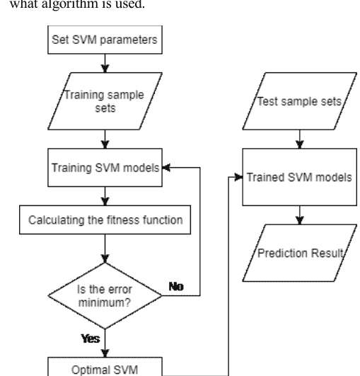
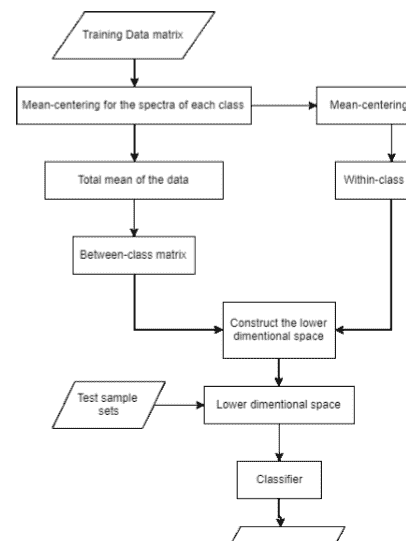
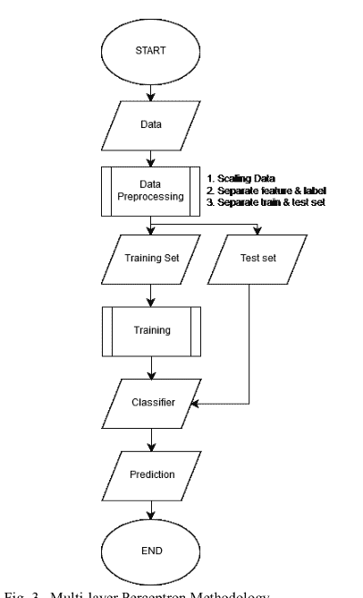

# 2019年亚太工业与系统工程研究会议 (APCoRISE) (印尼西亚德波克 2019.4.18-2019.4.19)

Ahmad Habbie Thies, Isca Amanda, Jessica, Nikita Akhsan Fitri, Rai Rona Althof, Sukmandhari Harimuti, Widyaawardana Adiprawita, Ita Ansari*

生物医学工程系，电气与信息技术学院
万隆理工大学，万隆，印度尼西亚
`is_ansari@stei.itb.ac.id`

## 摘要

通过研究患者的语音特征可以验证帕金森病（PD）的早期检测。利用机器学习，通过研究包含 PD 特片段和本研究使用的语音方法的帕金森病数据集，可以很好地检测帕金森病。研究使用支持向量机、K最近邻、逻辑回归、梯度提升、多层感知器和决策树对所研究特征进行了测试。对所有这些方法的性能在准确率、精确率和 F1 分上进行了评估。根据结果，最适用于帕金森病的算法是机器学习，其在不进行数据缩放的情况下准确率达到 95.92%。

**关键词**——帕金森病，语音分析，机器学习

数据集由来自 31 个人的发声测量组成，其中 22 人患有帕金森病（PD）。本研究收集的数据集包含每个受试者的多个样本，如元音、数字、单词和短句。表格中的每行都有一个特定的测量值，每行对应从每个受试者录制的 15 种声音之一。该方法被用于区分帕金森病患者。根据文献，本研究使用的数据集具有许多优势，例如每个受试者都有多种声音，且数据集中收集了许多特征。数据量不足，受试者仅有 31 人。本研究使用的所有 23 个特征并不一定对帕金森病的诊断有显著贡献。然而，数据集尚未完全满足。在受试者中，只有 8 人不是帕金森病患者。数据集的缺陷可能会影响最终模型的准确性，无论使用什么算法。

## I. 引言

帕金森病是一种神经退行性疾病，其特征是中枢神经系统中产生多巴胺的神经元受损；基底节功能障碍会导致语言流利障碍等症状；帕金森患者可能会有不同的语音强度，以及预期的语音退化或无法产生持续的发声。

目前还没有用于诊断帕金森病的特定检测。目前，已经在进行开发使用算法区分健康个体与帕金森患者的决策支持工具的研究 [1]。在本研究中，调查了使用机器学习方法，利用牛津大学的语音特征数据集（一种非侵入性方法）诊断帕金森病。本工作使用的一些机器学习算法包括支持向量机、线性判别、K最近邻、决策树、朴素贝叶斯、梯度提升和多层感知器。本工作旨在了解在给定特征或病例的情况下，哪种学习模型可以提供至少 90% 的准确率和至少 0.9 的马修斯相关系数，以预测帕金森病。

## II. 方法

### A. 数据集

本研究使用的语音数据集来自牛津帕金森病（OPD）数据集。该数据集是由来自牛津的 Max Little 与科罗拉州国家语音与语音中心创建，录制了语音信号。本研究发布了针对普通语音疾病的特征提取方法。

### B. 特征提取

机器学习中的重要过程之一是从数据中提取特征。这些特征将作为算法的输入，以产生特定的分类模型。在其他情况下，新的测试（数据）将根据预训练的数据分类到某些类别中。在这种情况下，语音样本被提取为 22 个特征。语音特征提取使用多维语音程序（MDVP）。该程序提供了多个菜单，可以提取出特征。

### C. 支持向量机 (SVM)

使用 `sklearn-learn` 实现 SVM 时，必须调整几个参数。为了执行分类，需要调整 `'kernel'`（内核）。测试的内核参数包括 RBF、poly 和 sigmoid。SVM 图如图 1 所示。

### D. K最近邻 (KNN)

使用 Python `scikit-learn` 包，可以调整一些参数，例如用于预测的 `n_neighbors`、`weight`（权重）、计算最近邻居的 `leaf_size`（叶大小）、`BallTree` 或 `KDTree`、用于树的 `metric`（指标）、`metric_params` 以及并行任务的 `n_jobs`。在这里，`n_neighbors` 有变化。

### E. 线性判别分析 (LDA)

LDA 在 `sklearn-learn` 包中有类别、`components`、`priors`、`shrinkage`（收缩）和 `tol`。对于这种分类情况，`'svd'` 为 `'False'`，且 `'tol'` 阈值设置为默认值 0.001。使用 `'svd'` 表示不计算方差矩阵，因为数据有大量特征。LDA 流程图如图 2 所示。

### F. 梯度提升 (Gradient Boosting)

使用 `Scikit-learn` 库实现梯度提升。通过结合多个弱学习器提高性能。在前向构建的模型显示了任意的可微函数。在每种情况下，回归树最小化二项或多项损失。二分类是一个使用回归树的示例。

### G. 多层感知器 (MLP)

MLP 使用 Python `Scikit-learn` 实现，如图 3 所示。从上传帕金森数据到系统开始。然后对数据进行预处理以提高质量。数据预处理阶段有几个步骤：数据缩放、特征提取以及分离训练和测试数据。MLP 工作流如下：

1. 信号从输入层传播到输出层。
2. 在输出网络上计算误差。
3. 反向传播误差，找到每个权重的导数并最小化误差。

## III. 结果与分析

接下来，将改变 MLP 中的某些参数以分析其影响。

### A. 分类 (SVM)

| 验证大小 | 准确率 (%) | 精确率 | F-score |
|---|---|---|---|
| 0.20 | 82.05% | 0.67 | 0.82 |
| 0.25 | 79.59% | 0.63 | 0.80 |
| 0.30 | 79.66% | 0.63 | 0.80 |
| 0.35 | 76.81% | 0.59 | 0.77 |

### B. 分类 (KNN)

| 验证大小 | 准确率 (%) | 精确率 | F-score |
|---|---|---|---|
| 0.20 | 88.17% | 0.87 | 0.84 |
| 0.25 | 89.79% | 0.89 | 0.90 |
| 0.30 | 86.44% | 0.86 | 0.86 |
| 0.35 | 85.51% | 0.81 | 0.83 |

### C. 分类 (LDA)

| 验证大小 | 准准确率 (%) | 精确率 | F-score |
|---|---|---|---|
| 0.20 | 82.05% | 0.72 | 0.74 |
| 0.25 | 81.63% | 0.80 | 0.81 |
| 0.30 | 81.36% | 0.81 | 0.81 |
| 0.35 | 78.26% | 0.77 | 0.78 |

### D. 分类 (Gradient Boosting)

| 验证大小 | 准确率 (%) | 精确率 | F-score |
|---|---|---|---|
| 0.20 | 84.61% | 0.83 | 0.82 |
| 0.25 | 85.71% | 0.85 | 0.85 |
| 0.30 | 86.44% | 0.86 | 0.85 |
| 0.35 | 84.06% | 0.83 | 0.83 |

### E. 分类 (MLP)

| 验证大小 | 准确率 (%) | 精确率 | F-score |
|---|---|---|---|
| 0.20 | 84.61% | 0.82 | 0.82 |
| 0.25 | 85.71% | 0.84 | 0.85 |
| 0.30 | 86.44% | 0.85 | 0.85 |
| 0.35 | 84.06% | 0.83 | 0.83 |

### F. 决策树

在本工作中，使用 `Scikit-Learn` 构建决策树。它将数据集划分为子集，并在每个子集上递归地构建决策树。

此外，欧几里距离对幅度非常敏感。幅度较大的特征具有需要进行数据缩放的负担。因此，在下表中，我们尝试根据数据对分类器进行分类。如表 VI 所示，获得了更好的准确率。

| 验证大小 | 数据 | 准确率 (%) | 精确率 | 召回率 | F值 |
|---|---|---|---|---|---|
| 0.20 | | 94.87 | 0.95 | 0.95 | 0.95 |
| | SD | 94.87 | 0.95 | 0.95 | 0.95 |
| 0.25 | | 95.92 | 0.96 | 0.96 | 0.96 |
| | SD | 93.88 | 0.94 | 0.94 | 0.94 |
| 0.30 | | 94.92 | 0.95 | 0.95 | 0.95 |
| | SD | 94.92 | 0.95 | 0.95 | 0.95 |
| 0.35 | | 94.20 | 0.94 | 0.94 | 0.94 |
| | SD | 94.20 | 0.94 | 0.94 | 0.94 |

| 准确率 (%) | 精确率 | 召回率 | F值 |
|---|---|---|---|
| 未进行数据缩放 | 84.06 | 0.84 | 0.84 | 0.82 |
| 使用数据缩放 | 96.61 | 0.97 | 0.96 | |

KNN 算法可能不太适用于此数据集，因为 KNN 对应的特征数量较少。在此之前需要构建更多特征，而维度的增加可能会导致过拟合。这一点可以通过在减少特征之前实现 PCA（主成分分析）来解决。因此，KNN算法的实现需要对应的方法。

### 3) 判别分析 (LDA)

LDA 在验证大小下的性能如表 VI 所示。该分类器在将数据分为 25 的验证中具有最佳准确率 (87.76%)。

#### 表 VII. 验证大小变化的 LDA 结果

| 验证大小 | 准确率 (%) | 精确率 | 召回率 | F值 |
|---|---|---|---|---|
| SD | SD | SD | SD | SD |
| 0.20 | 87.18 | 87.16 | 0.86 | 0.87 |
| 0.25 | 87.76 | 87.76 | 0.88 | 0.88 |
| 0.30 | 86.44 | 86.44 | 0.86 | 0.86 |
| 0.35 | 81.16 | 81.16 | 0.81 | 0.81 |

从表 VII 可以看出，LDA 对于 PD 点的性能缺乏准确性。LDA 的缺点是样本量小且密度不足。在我们的案例中由于许多特征的实例较少，仅进行缩放是不够的。然而，LDA 在线性可分的情况下最好，由于我们使用的数据线性度较小，它无法进行数据缩放。

### 4) 梯度提升 (Gradient Boosting)

通过改变数据划分组合（验证大小）比较分类模型的性能，结果如表 VIII 所示。表 VIII 显示，在测试和训练结果为 25:77 的情况下获得了最佳结果，准确率为 95.92%。上述结果还显示在该实现情况下，数据集不会产生显著差异。

| 验证大小 | 准确率 (%) | 精确率 | 召回率 | F值 |
|---|---|---|---|---|
| 0.20 | 94.87 | 0.95 | 0.95 | 0.95 |
| 0.25 | 95.92 | 0.96 | 0.96 | 0.96 |
| 0.30 | 94.23 | 0.93 | 0.93 | 0.93 |
| 0.35 | 92.75 | 0.93 | 0.93 | 0.93 |

### 5) 多层感知器 (MLP)

#### 表 IX. 未缩放变化下的 MLP 性能

| 准确率 (%) | 精确率 | 召回率 | F值 |
|---|---|---|---|
| 未进行数据缩放 | 79.59 | 0.63 | 0.8 | 0.71 |
| 使用数据缩放 | 97.96 | 0.98 | 0.98 | 0.98 |

与其他模型相比，结果非常令人满意，它是准确的模型之一。这是通过梯度提升算法减少偏差和方差实现的，在实际数据和预测值之间产生了意义差异。

此外，欧几里距离对幅度非常敏感。幅度较大的特征具有需要进行数据缩放的负担。因此，在下表中，我们尝试根据数据对分类器进行分类。如表 VI 所示，获得了更好的准确率。

## 参考文献

[2] N.C. Brabo, T.S.C. Minett, and K.Z. Ortiz, “帕金森病的流利度：病程、认知状态与年龄，” *Arquivos de Neuro-Psiquiatry*, vol. 72 no. 5, pp. 349-355. 2014年5月。

[3] G.J. Canter, “帕金森病患者的言语特征。I. 亲密度、音高和时长，” *Journal of Speech and Hearing Disorders*, vol. 28, no. 6, pp. 221. 1963年8月。

[4] O. Kramer, “K近邻，” 基于无监督最近邻的降维方法。第1版. 德国柏林：Springer-Verlag Berlin Heidelberg, 2013, pp. 13-23.
