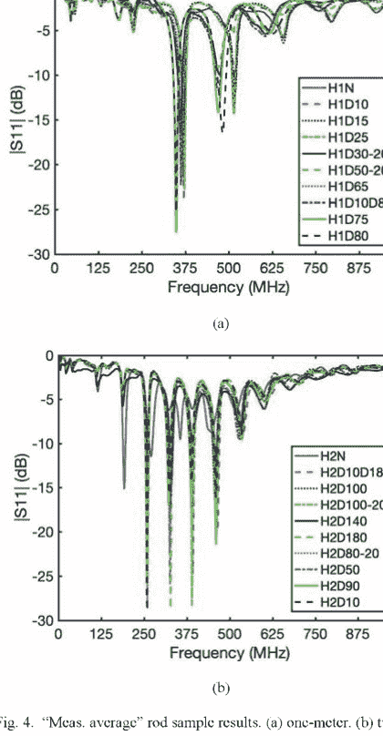

# 2019 SBMO/IEEE MTT-S 国际微波与光电学会议 (IMOC)

**Marcelo Sa Coutinho**  
伯南约科联邦大学  
巴西，里约约  
https://orcid.org/0000-7609-1127

**Lauro Rodrigo G. S. Lourenço Novo**  
伯南约科联邦大学  
巴西，里约约  
https://orcid.org/0000-2372-9051

**Henrique Batista Duffles T. Lott Neto**  
东北部传输系统公司  
巴西，里约约  
https://orcid.org/0000-2883-2163

**Paulo Henrique Ramireza Pereira Gama**  
能源与创新技术学院  
巴西，里约约  
https://orcid.org/0000-0062-2459-1533

**Luiz Henrique Almeida dos Santos**  
伯南约科联邦大学  
巴西，里约约  
https://orcid.org/0000-0001-6339-536X

**M. T. de Melo**  
伯南约科联邦大学  
巴西，里约约  
https://orcid.org/0000-0063-0616-1123

**Douglas Batista Barbosa Pimentel**  
伯南约科联邦大学  
巴西，里约约  
https://orcid.org/0000-0003-4462-3106

**Marcelo Machado Alves**  
伯南约科联邦大学  
巴西，里约约  
https://orcid.org/0000-0002-6582-8333

**Vinicius Le Tarraz**  
伯南约科联邦大学  
巴西，里约约  
https://orcid.org/0000-0003-1233-5046

**Renan Guilherme Matias dos Santos**  
伯南约科联邦大学  
巴西，里约约  
https://orcid.org/0000-0072-6896-0919

*摘要——本文提出了一种基于频域反射（FDR）技术和机器学习的新型方法，用于检测输电线路运行中锚杆的故障。故障由于锚杆材料的流失引起，这可能导致断裂并引发完全失效。所提出的无损（NDT）方法使用了频域反射技术（FDR）。在检测方面，将高频脉冲插入锚杆并在仿真结果中进行分析。模拟了有和无故障锚杆的数据集，并通过机器学习结构进行制造和分类，以确定故障是否存在。*

开发了一种检测固定在输电线路污染土壤中的锚杆故障的新方法。锚杆故障的检测使用了 FDR 方法 [5-9] 以及基于机器学习结构的 `S11` 参数分析。实验装置由一个矢量网络分析仪（VNA）、配合一个自定义高频分析滤波器（CHAAF，葡萄牙语）以及反射装置组成。VNA 通过 CHAAF 连接到锚杆上。基于机器学习的分类器对锚杆是否存在故障进行了分类。使用基于逻辑回归的机器学习结构来实现了一个锚杆状态的分类器。性能在高达 1 GHz 的频率范围内进行了仿真，具有 1001 个数据点，输入由分类器处理。

*关键词——锚杆、输电线路、频域反射、机器学习、无损*

# I. 引言

支撑电缆的输电电力结构。V 型电缆和锚杆是此类结构在土壤中组和固定的主要元件。发生故障时，锚杆可能会落地，导致电源中断。

评估锚杆状态的最常用方法是目视检查，然而土壤会发生腐蚀，锚杆也会腐蚀。这种技术有效但具有破坏性。因此，无损技术被应用于此类问题中，例如在 [1] 中，矩形波导使用微波反射技术（30-300 GHz 范围）来检测表面裂缝，[2] 也是研究对象。在 [3] 中展示了一项将声波插入 15 mm 圆柱形锚杆并根据信噪比（SNR）检测故障或腐蚀的研究。

# II. 方法论

所提出的故障检测系统基于对长度和状态（有或无故障）的分类，使用了机器学习算法。实验装置由一个矢量网络分析仪（VNA）、配合一个自定义高频分析滤波器（CHAAF，葡萄牙语）以及反射装置组成。VNA 通过 CHAAF 连接到锚杆上。基于机器学习的分类器对锚杆是否存在故障进行了分类。使用基于逻辑回归的机器学习结构来实现了一个锚杆状态的分类器。性能在高达 1 GHz 的频率范围内进行了仿真，具有 1001 个数据点，输入由分类器处理。

# III. 仿真

所提出的故障检测系统基于对长度和状态（有或无故障）的分类，使用了机器学习算法。实验装置由一个矢量网络分析仪（VNA）、配合一个自定义高频分析滤波器（CHAAF，葡萄牙语）以及反射装置组成。VNA 通过 CHAAF 连接到锚杆上。基于机器学习的分类器对锚杆是否存在故障进行了分类。使用基于逻辑回归的机器学习结构来实现了一个锚杆状态的分类器。性能在高达 1 GHz 的频率范围内进行了仿真，具有 1001 个数据点，输入由分类器处理。

# IV. 测量与验证

所提出的故障检测系统基于对长度和状态（有或无故障）的分类，使用了机器学习算法。实验装置由一个矢量网络分析仪（VNA）、配合一个自定义高频分析滤波器（CHAAF，葡萄牙语）以及反射装置组成。VNA 通过 CHAAF 连接到锚杆上。基于机器学习的分类器对锚杆是否存在故障进行了分类。使用基于逻辑回归的机器学习结构来实现了一个锚杆状态的分类器。性能在高达 1 GHz 的频率范围内进行了仿真，具有 1001 个数据点，输入由分类器处理。

# V. 机器学习结构

为了检测一米和两米锚杆的故障，使用实现的逻辑回归算法构建了三个二分类器。逻辑回归是一种分类模型，其输出可以表示为作用于输入特征的逻辑 sigmoid 函数。所提出的逻辑回归分类器易于实现且使用快速。

第一个分类器被训练用于区分一米机器人和两米机器人的信号。另外两个分类器分别训练用于检测一米和两米机器人是否存在故障。使用向量 `x` 对分类器进行训练和测试，并通过使用每个测得机器人信号的 101 个点进行优化。

# VI. 结果与讨论

对一米和两米机器人进行了测量和仿真，并确定了它们的信号强度（SI）行为模式以表征。

“平均值”结果如图 4 (a) 和 (b) 所示。然而，二分类器利用数据库中的 130 次测量数据以及用于减少精密测量固有误差的子集进行了分析。图 4 的视觉分析显示故障与无故障结果之间存在微小差异。这表明判断状态准确性的机器学习结构是有效的。

二分类器被用于分析测量数据，平均准确率超过 98.33%。然而，使用具有不同锚杆故障模式的输入数据库可以改进结果，减少过拟问题。

三个二分类器在机器人识别测试中获得了 99.28% 的准确率，在一米机器人故障检测中获得 98.33%，在两米机器人故障检测中获得 100.00%。通过图 5 的分析表明，逻辑回归二分类器能够准确检测锚杆的长度和是否存在故障。

分析针对两米机器人进行的。锚杆长度可用于此方法。为此，必须预先开发同类机器人。获得的结果表明，所提方法可以构建一个用于检测输电塔锚杆故障的系统。

# VII. 结论

本文介绍了一种前景良好的无破坏性检测方法，用于检测输电塔中锚杆的故障，这些元件具有电磁学能力且机械结构稳固。

# 致谢

本文是 UFPE 和 IATH 研究所为 STP 公司开发的一个研究项目，属于巴西国家能源局（Energia Nacional de Elétrica – ANEE）巴西电力部门研发计划的一部分。

# 参考文献

- [1] J. R. Goliath and G. Yan, "Steel cord characterization using open-rectangular waveguide probe," IEEE Sensors Journal, vol. 18, no. 3, pp. 1604–1662, February 2018.
- [2] J. R. Goliath and R. Smith, "Microwave-wave-based characterization of steel with wireless access," IEEE Transactions on Instrumentation and Measurement, vol. 66, pp. 2786–2791, October 2017.
- [3] M. Shao and Y. Li, "Ultrasonic wave-based detection of faults buried in soil," 2016 IEEE International Ultrasonics Symposium (IUS), pp. 1–4.
- [4] L. R. A. Silva, M. T. De Melo, M. R. T. De Oliveira, J. H. H. A. De Medros, and L. B. Aquino, "Characterization of connections in high-frequency environments," International Journal of Applied Electromagnetics and Mechanics, vol. 45, pp. 457–464, May 2014.
- [5] S. Cao and Y. Wang, "Waveguide-based fault detection in ground by impedance spectroscopy," IEEE Transactions on Instrumentation and Measurement, vol. 64, pp. 2179–2186, March 2017.
- [6] M. J. Lee, S. Kim, and J. Park, "Application of time-domain reflectometry base for multi-band detection and localization of cable," International Conference on Control, Automation and Systems (ICAS) 2013 IEEE, pp. 1–6.
- [7] Q. Shi, T. Ucheiro, and O. Nakau, "Detection and localization of cable faults by time and domain analysis," 2010 IEEE International Conference on Control, Signals, and Devices, pp. 1–6, September 2010.
- [8] II. Vanhuysse, "High frequency reflection-domain reflectometry," IEEE Transactions on Instrumentation, vol. 39, no. 2, pp. 369–375, March 1992.
- [9] J. M. B. Henriques, L. H. A. De Medros, R. R. B. Aquino, O. N. Silva, L. R. G. Oliveira, M. F. de Melo. Santos, M. A. B. Fonseca, and P. R. Brito, "Localization and detection of anchor rods applied by guy towers," 2014 IEEE International Conference on High Wave Technology and Applications, pp. 1–5, August 2014.
- [10] S. Dresti, and L. O-Machado, "Logistic regression and artificial neural network classification: a methodology review," J. Biometrosc. Inform., vol. 55, no. 3-6, pp. 325–339, 2002.

图. 4. “平均值”机器人样本结果。(a) 一米；(b) 两米。
