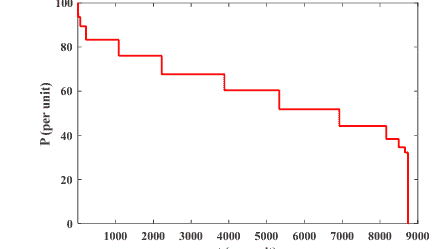

# 2020 第10届智能电网会议 (SGC) ｜｜ 考虑负荷需求不确定性的多目标发电扩容规划


邮箱: F_ghasemi@email.kntu.ac

近年来，随着人口增长和交通部门的电气化，对电力的需求日益增长，这增加了发电扩建规划（GP）的重要性。大多数文献研究了考虑单一目标函数（成本最小化）的 GP，而另一些研究则有其他高优先级。在本文中，提出了一种多目标方法，目标是成本最小化、可靠性最大化和灵活性最大化。该研究基于年度峰值需求基础，展示了在 GP 中考虑负荷不确定性的优越性。我们使用了基于短短期记忆（LSTM）网络的深度学习方法，该网络在时间序列预测方面具有很高的能力，用于模拟负荷不确定性。优化问题也被视为混合整数线性规划（MILP），以保证全局最优解。以 2020 年作为测试日的可行方案显示了深层 LSTM 在年度负荷预测方面的稳健性（数据真实误差为 52.33%）。

索引词——发电扩建规划；神经网络；多目标模型；可靠性；灵活性

# 符号说明


| | |
|---|---|
| B | 负荷块数量 |
| i | 机组索引 |
| l | 隐藏层索引 |
| z | 时间索引 |
| | | 灵活性索引 |
| Δt_b | 负荷块 b 的持续时间 |
| Δn_{max} | t 年机组 i 的最大可建设数量 |
| C_i | 机组 i 的容量 |
| Cap_i | 机组容量 (MW) |
| HR_i | 机组 (i) 的热耗 ($q_{ww}$) |

| | |
|---|---|
| N^{new} | 年度机组总成本 |
| L_zi | 索引 z 和机组 i 的归一化值 |
| Load_b | 每个块 b 的负荷量（每单位） |
| N_gt | 现有机组总数 |
| N^{open-cycle} | 开循环机组总数 |
| N^{RES} | 可再生能源（RES）机组总数 |
| OM_{uit} | t 年机组 i 的运维成本 |
| P_t | t 年负荷预测中观测到的峰值 |
| P^{max} | 机组最大容量 (MW) |
| P^{min} | 机组最小容量 (MW) |
| PPC_i | 机组 i 的峰值性能系数 (%) |
| ramp_i | 机组爬坡率 (MW) |
| RES_i | t 年的备用容量 |
| W_i | 每个指标的权重 |
| flex_i | 灵活性索引参数 |
| fuel_{uit} | t 年机组 i 的燃料成本 |
| x_it | 机组 i 的灵活性准则值 |
| nh | 隐藏单元总数 |
| r | 每个数据序列的维度 |
| Ir | 利率 (%) |
| N | 发电机组总数 |

# 变量

bc_bf, bf_i, bo 单元块、遗忘门、输入门和 bo 输出门的偏置因子

t 时单元块、遗忘门和输入门的数据

隐藏层中 t 时单元块、遗忘门和输入门的数据

t 时输出门的数据

隐藏层中 t 时输出门的数据

t 时机组 i 负荷块的发电量 (MW)

t 状态下当前层的状态

t 状态下隐藏层的状态

t 年的新机组数量

状态点、单元门和输出门的输出门值

状态点、单元门和输出门的输出门值

# 引言

人口的快速增长、经济的飞速发展和工业化是电力需求上升的因素。此外，许多电厂由于电力效率降低而显示出陈旧老化状态。因此，对化石燃料的高度关注将因选择错误的电厂类型和安装时间付出高昂的经济成本和社会损害。电网扩建规划（GEP）是一个优化容量以满足特定目标的长期视角。GEP 的主要目标是成本最小化。由于化石燃料的排放对全球变暖有显著影响，我们必须放弃化石燃料，转而采用可再生能源（RES）。

一些人将 GEP 视为具有碳排放最小化 [1]、可靠性 [2]、成本 [3] 和可再生能源（RES）影响 [4], [5] 目标以及成本中单一目标可行性约束的单一问题。因此，GEP 从一个维度解决，这导致忽略了其他重要因素。例如，GEP 是一个多目标问题。Palacios 等人 [7] 实施了 GEP 以最小化成本、CO2 和 NOx 污染。[8] 中的作者研究了 GEP 以最小化电厂的可靠性和成本。在 [9] 中，使用了一种方法但未考虑最大化可靠性。在 [10] 中，将未供电量（EENS）添加到目标函数中。然而，最大化电网灵活性的目标已添加到 GEP 多目标问题中。

GEP 问题中的主要挑战是峰值负荷的不确定性，由于 GEP 的长期性，这对优化问题的结果有显著影响。在 [11]-[12] 中，使用回归分析考虑了负荷不确定性，但没有考虑可靠性。在 [13] 中，使用点估计法（PEM）优化了年度的负荷不确定性，并使用混合整数线性规划（MINLP）制定了 GEP 问题。MINLP 的优势是灵活性，但其结果并不适用 [15]。具有高特征提取能力的深度学习方法已用于电力系统研究中，例如短期负荷预测 [16]。在之前的研究 [17] 中，尚未将在时间序列中具有高性能的深度学习方法用于 GEP。在本文中，考虑了综合多目标 GEP，通过最小化约束、最小化排放和通过最大化灵活性来实现可靠性。通过考虑不同的目标，我们使用了基于短期记忆（LSTM）的学习方法，这是一种稳健的预测工具。LSTM 网络预测峰值负荷误差较低，导致 GEP 结果准确，使其具有经济性。优化问题建模为混合整数规划（MIP），可以提供全局解。对于多目标问题，我们使用了加权法。综之，本文的主要贡献是：

- 用于峰值负荷预测的 LSTM 网络。
- 将 GEP 视为多目标问题，以最小化成本、最小化排放并最大化灵活性。

论文的结构如下：第二节介绍了负荷不确定性的建模、目标和约束。第三节描述了结果。最后在第四节给出结论。

# 公式

## II. 公式化

### A 峰负荷预测

对于峰值负荷预测，我们在本节使用了 LSTM 网络。与循环神经网络相比，LSTM 的优势是对梯度消失和爆炸的抗性。在 LSTM 中，有三个门：输入门、输出门和遗忘门，有助于处理时间依赖关系。公式所示所示：

$i_t = \sigma(W_i \cdot h_{t-1} + U_i \cdot x_t + b_i)$
$f_t = \sigma(W_f \cdot h_{t-1} + U_f \cdot x_t + b_f)$
$o_t = \sigma(W_o \cdot h_{t-1} + U_o \cdot x_t + b_o)$
$c_t = f_t \odot c_{t-1} + i_t \odot \tanh(W_c \cdot h_{t-1} + U_c \cdot x_t + b_c)$
$h_t = o_t \odot \tanh(c_t)$


### B NEP 问题 公式化

####1 目标函数

NEP 的第一个目标是最小化成本，包括投资成本、燃料成本。

$C_{total} = \sum_{t=1}^{T} (C_{inv} + C_{fuel} + C_{om})$

第二个目标是最小化排放（公式 22）:

$E = \sum_{t=1}^{T} w_{it}^{em} \cdot Cap_{it}$

第三个目标是最大化系统可靠性，如公式 13 所示

$\sum_{t=1}^{T} w_{it}^{res} \cdot Cap_{it} \geq (1 + Res_{lt}) \cdot P_{lt}$

在本文中解决多目标问题，我们使用了加权法：

$Min[w_G \frac{G}{G_{total}} - w_R \frac{r^{xh}}{r_{total}} - w_R \frac{r^{rr}}{r_{total}} - w_F \frac{f^{fr}}{f_{total}}]$

####2 约束

- 备用容量。每年发电机组（现有和新建）的容量应等于年度峰值负荷（公式 15）。

$\sum_{t=1}^{T} w_{it}^{res} \cdot Cap_{it} \geq (1 + Res_{lt}) \cdot P_{lt}$

每年现有和新建电厂的发电量应等于它们能够处理的负荷量。

$\sum_{t=1}^{T} P_{it} = Load_{lt} \times P_{lt}$

- 3. 最小最大容量限制。由于涡轮侧的限制（如低温度），功率单元具有最小容量限制。此外，每个机组都有容量限制。这强制要求在最小和最大范围内工作。公式 17 针对现有机组，18 用于新建机组。

$P_{min}^{it} \leq P_{it} \leq P_{max}^{it}$
$u_{min}^{it} \leq u_{it} \leq u_{max}^{it}$

- 4. 隧道约束。由于经济和技术原因，每年新增机组的数量受到限制。

$0 \leq \Delta u_{it} \leq \Delta u_{max}$

- e. 可再生能源发电，包括风电和太阳能发电，取决于天气条件和它们提供的容量。

$P_{gl,it} = Cap_{it} \times C_{it} \times u_{it}$


对燃料的依赖。因此，我们定义了一个限制，即可再生能源（RES）的建设每年应占发电厂总容量的2%，且该比例每年应按此增加。这意味着第二年为4%，第三年为6%，并以此类推。

```
$\sum_{i=1}^{n} \Delta U_i \times Cap_i \ge 0.02 \times \sum_{i=1}^{n} U_i \times Cap_i$
```

求解器，以及用于峰值负载预测的 LSTM 网络使用 Python 和 Keras 库实现。系统使用了 24 GHz 双核处理器和 8 GB 内存。

由于可再生能源的不确定性，开敞循环电厂对这些电厂未提供的功率进行了补偿。开敞循环电厂具有高爬坡速率和更宽范围内提供电力的能力可以涵盖可再生能源的多样性。如果可再生能源因波动提供电力，气电厂无法补偿其缺失。



图 2. 负载曲线

因此，我们在 GEP 程序中定义了一个限制。通过建设一个等于规划期间新装电厂容量 5% 的开敞循环电厂。

```
$\sum_{i=1}^{n} U_i \times Cap_i \ge 0.05 \times \sum_{i=1}^{n} U_i \times Cap_i$
```

## C. 负载持续曲线

在本文中，我们对 GEP 问题采用多阶段方法。使用 IEEE-RTS 96 标准负载信息作为负载曲线，曲线分为 12 个负载块，如图 2 所示。

优化问题在通用代数建模系统 (GAMS) 中通过 CPLEX 完成。


| 燃料 | 技术 | 容量 (MW) | 热率 (BTU/kWh) | 最小输出 (MW) | 机组数量 | 运维成本 (S$/MWh) | 峰值参与系数 (%)%) | 灵活性指数 |
|---|---|---|---|---|---|---|---|---|
| 核能 | 汽机 | 1020 | 10450 | 1 | 0 | 85 | 17 | 0.2273 |
| 天然气 | 联合循环 | 480 | 7660 | 7 | 3 | 65 | 40.5 | 0.6334 |
| 天然气 | 联合循环 | 160 | 10935 | 8 | 6 | 85 | 18.1 | 0.6254 |
| 天然气 | 汽机 | 440 | 9247 | 9 | 0 | 75 | 22.9 | 0.6103 |
| 天然气 | 汽机 | 320 | 9247 | 6 | 3 | 61 | 22.9 | 0.6030 |

## III 案例研究与数值结果

为了实施 GEP 问题，我们测试了六种待建设的机组，包括核能和煤燃料汽机机组；天然燃料开敞循环机组以及可再生能源机组。机组信息包括最大输出、机组数量、建设和运行成本（包括投资、燃料和运行维护成本）。污染物气体来自参考文献 [12], [20]。


| 燃料 | 技术 | 容量 (MW) | 热率 (BTU/kWh) | 最小输出 (MW) | 周期 | 投资成本 (S$) | 运维成本 (S$/MWh) | 峰值参与系数 (%) | 灵活性指数 |
|---|---|---|---|---|---|---|---|---|---|
| 核能 | 汽机 | 2200 | 1076 | 1 | (每5年一次) | 6500 | 08 | 115 | 37.1 | 0.4 |
| 煤炭 | 汽机 | 600 | 9221 | 3 | 5 | 5169 | 14 | 72.12 | 11.4 | 0.6112 |
| 天然气 | 联合循环 | 960 | 6350 | 28 | 5 | 999 | 5 | 39.7 | 0.6471 |
| 天然气 | 联合循环 | 480 | 6750 | 28 | 5 | 1200 | 3 | 39.7 | 0.6441 |
| 天然气 | 开敞循环 | 320 | 8550 | 8 | 5 | 800 | 3 | 85 | 17.8 | 0.6252 |
| 天然气 | 开敞循环 | 1600 | 9600 | 40 | 5 | 950 | 3 | 85 | 18.1 | 0.6084 |


| 技术 | 容量 (MW) | 容量因子 (%) | 投资成本 (S$) | 运维成本 (S$/MWh) | 峰值参与系数 (%) | 灵活性指数 |
|---|---|---|---|---|---|---|
| 风力 | 50 | 0.35 | 1300 | 30 | 10 | 0.6 |
| 光伏 | 10 | 0.25 | 1100 | 10 | 80 | 0.6 |

为了预测峰值负载，我们考虑了伊朗三个省（德黑兰、霍萨珊和马赞德兰）的负载案例 [21]。伊朗的峰值负载发生在7月，我们使用了2011-2020 年的数据。为了计算参与系数，我们考虑了每个机组的运行率并对其归一化。完整数据集包含 930 条数据，分别用于训练（80%）、验证（10%）和测试（10%）。为了预测每日负载，我们使用了之前的30天峰值负载。在每日负载任务中，我们展示了LSTM 网络对2020年的预测情况，隐藏层数设为100。此外，为了避免过拟合问题，使用了丢弃层（dropout layers），最大层数设为100。2020年的预测负载和实际负载分别为17141 MW和16244 MW，误差仅为5.23%。这显示了LSTM网络在未来2021-2030年峰值负载预测中的有效性。

```
$ppc_{ci} = \frac{ramp_{ci}}{\sum ramp}$
```

根据目标函数的重要性优化上述多目标函数。第一个目标为0.3，第二个0.25，第三个0.2，结果见表VI。总成本为 $3.88447\times10^6$，生产成本为 $2.65271\times10^6$。如表VI所示，使用了大部分可再生能源（RES）容量，因为它们不产生碳排放。然而，由于这些电厂无法全天候发电，我们需要其他电力来供应网络负载。


| 年份 | 峰值负载 | 峰值负载 |
|---|---|---|
| 2021 | 17279.27 | 20006 |
| 2022 | 17889.4 | 20445.1 |
| 2023 | 18461.7 | 20847.1 |
| 2024 | 19017.24 | 21213.7 |
| 2025 | 19529.71 | 21345.4 |


为了显示预测结果的误差，我们计算了绝对误差（平均绝对误差 MAE）、平均百分比误差（MAPE）和均方根误差（RMSE）[15]。这些误差是针对2020年测试年计算的，见表V。

| 方法 | MAE (%) | MAPE (%) | RMSE (%) |
|---|---|---|---|
| LSTM | 2.1 | 104.7 | 130.34 |

在进行GEP研究时，考虑了上述公式，利率和奖励分别为5%和10%。机组的灵活性通过表II的数据和公式(23), (24) 进行归一化。

```
$I_{iz} = \frac{x_i - min(x_i)}{max(x_i) - min(x_i)}$ 
flex = \frac{\sum_{i=1}^{n} I_{iz} \times w_z}{\sum w}$
```

每个归一化指标的权重根据每个指标的重要性选择。


| 年份 | 8 | 9 | 10 | 11 | 12 | 13 |
|---|---|---|---|---|---|
| 1 | 5 | 5 | 5 | 10 | 10 |
| 2 | 3 | 0 | 5 | 10 | 10 |
| 3 | 0 | 0 | 5 | 10 | 10 |
| 4 | 0 | 0 | 0 | 10 | 10 |
| 5 | 0 | 0 | 0 | 10 | 10 |
| 6 | 0 | 0 | 0 | 10 | 10 |
| 7 | 0 | 0 | 0 | 10 | 10 |
| 8 | 0 | 0 | 0 | 10 | 10 |
| 9 | 0 | 0 | 0 | 10 | 10 |
| 10 | 0 | 0 | 0 | 10 | 10 |

## IV. 结论

在本文中，发电规划（GEP）问题被建模为高比例区域的多目标优化问题。目标是


旨在最小化成本、排放发电，并最大化系统可靠性与灵活性。使用 LP 方法求解该多目标问题，函数权重是根据每个目标的重要性来确定的。此外，在这项工作中，为了对负载不确定性（这是 GFP 研究中的关键参数）进行建模，我们使用了深度长短期记忆网络（LSTM），这是时间序列预测任务中的一种稳健工具。本文试图通过考虑不同的目标和负载不确定性，为 GFP 问题提供一个完整的模型。我们的研究表明，当不同的目标函数起时，低排放电厂是最终选择，我们证明了 LSTM 方法能够很好地预测实际负载。可再生能源电厂的容量机制以及实施强化学习算法是我们未来的研究方向。

- [9] T. Al Shaghai, Ioannis, and G. French, "Multi-objective optimization of power system planning integrating sustainability," Energy, vol. 13, no. 9, 2020.
- [10] E. Noorollahi, D. Fatasi, S. Ghodipour, and M. A. Shiraz, "A developing framework for power generation expansion with the inclusion of renewable energy - A case study in Iran," IEEE Trans. Power Elect., Vol. 156, no. 2, 2011.
- [11] P. Parven, S. Ray, J. Das, and A. Bakhtiary, "Multi-Objective Power System Planning with Renewable Intermittency and Uncertainty," IEEE Conf. ICCPC 2018, pp. 424-429, 2018.
- [12] V. Perez, S. Hajkanen, and P. French, "A multi-objective generation expansion planning with renewable energy," Energy Policy, vol. 155, 119938, 2021.
- [13] P. Surya, S. Subramaniam, S. Ganesan, and M. Maharathi, "Multi-objective power system planning using gas chromatography algorithm," J. Aust. Elect. Con., vol. 16, no. 3, pp. 136-148, 2019.
- [14] S. Hajkanen and A. Amminen, "Generation Expansion Planning Considering the Uncertainty of Yearly Loads," IEEE Int. Conf. Elect. Energy 2019, pp. 1-5-1-6, 2019.
- [15] H. Hajkanen, T. Ariyani, S. S. Ghodipour, M. A. Golkar, and A. Ahmadiyan, "Deep Learning-Based Forecasting in Smart Grid: A Multi-Objective Approach with Clustering Features," IEEE Trans. Smart Grid, 2020.
- [16] M. A. Golkar, H. Vahabzadeh, S. Hajkanen, J. A. Mohar, "Power Location and Profit Profile with Windpower," IEEE Trans. Distribution Network with Uncertainty, pp. 11-12, 2019.
- [17] S. M. J. Mirzaafar, Al-Haskani, H. Maleki, and M. B. Aryanabad, "Multi-objective robust optimization for multi-objective power system planning with uncertainty," Int. J. Prod. Econ., vol. 134, no. 1, pp. 28-42, 2019.
- [18] S. S. Gougarth, J. Hajkanen, M. A. Golkar, and A. Mohari, "Unit Commitment with Price Demand Response Based on Generation Forecasting," 2019 IEEE International Power System Conference (IPPSC), pp. 239-240.

# 参考文献

- [19] H. Akhazadeh and T. Amminen, "A Model for Generation Planning of Power System Expansion Costs," Proc. Smart Grid Conf. (SGC), pp. 1-5, 2018.
- [20] R. F. Suriya, S. Bajaj, and H. Hadi, "The impact of a multi-objective reliability index on multi-objective load," IEEE Int. Conf. Elect. (ICE), 2017, pp. 1-6.
- [21] S. Raashid, T. Amminen, and M. El-Farsi, "A multi-objective generation expansion model considering load of flexibility," IEEE Trans. Power, vol. 33, no. 6, pp. 6922-6934, 2018.
- [22] C. Zhou, J. Ordegard, and G. Wu, "Generation planning considering large-scale wind generation," IEEE Industrial. Conf., pp. 205-221, 2005.
- [23] B. Kim, K. Lee, and J. Vaz, "Expansion planning with high share of renewable output," Energy, 190, pp. 1275-1288, 2017.
- [24] B. Kim and J. Lee, "Expansion planning through convex relaxation," IEEE Trans. Power, vol. 53, no. 2, pp. 2221-2228, 2008.
- [25] E. Zakarian and A. Shiraz, "Multi-objective power generation expansion planning-case study in Iran," In Smart Grid Green. Energy, vol. 7, no. 2, pp. 90-97, 2016.
- [26] H. Taghi and A. Shiraz, "Multi-objective power generation planning with high penetration of renewables," Renew. Energy. Rel., vol. 81, no. 1, 2663, 2018.
- [27] E. Sugawara and H. Hajkanen, "establishing best test assets (BTA) under European Directive 2019/944 of the European Parliament and the Council, for large competition participation," Off. J. Eur. Un., vol. 58, no. 2, pp. 212, 2017.

| 机组 | 最小功率 (MW) | 爬坡速率 (MW/h) | 目标功率 (MW) | 时间 (h) | 机组 | 最小功率 (MW) | 爬坡速率 (MW/h) | 目标功率 (MW) | 时间 (h) |
|---|---|---|---|---|---|---|---|---|---|
| 1 | 1000 | 65 | 108 | 8 | 28 | 20 | 5 | 3 | 3 |
| 2 | 240 | 17 | 5.5 | 3 | 29 | 20 | 5 | 3 | 3 |
| 4 | | 80 | 14 | 1.5 | 1 | 14 | 40 | 7 | 1 |
| 2 | | 8 | 6.5 | 3 | 11 | | | | |
| 5 | 160 | 6.4 | 5 | 3 | 12 | | | | |
| 6 | 1760 | 11.4 | 108 | 8 | | | | | |

