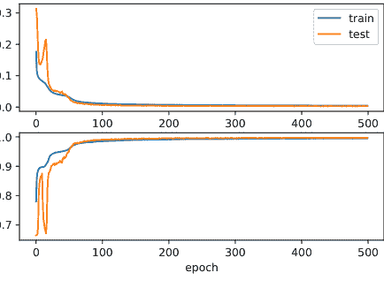
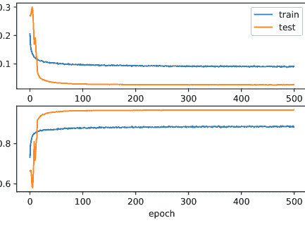
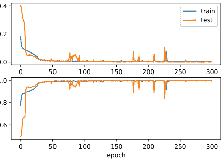
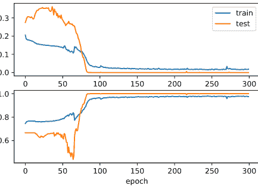
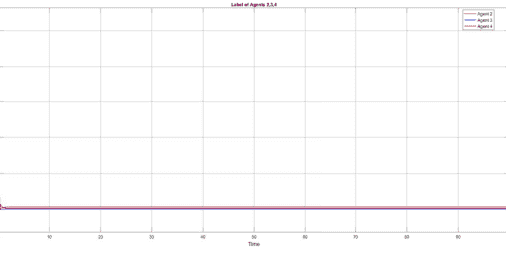
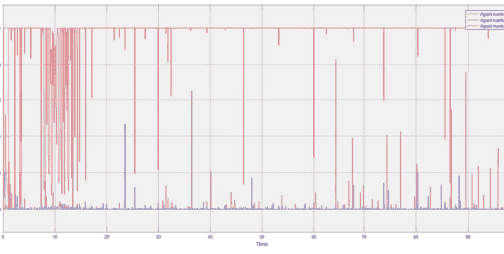
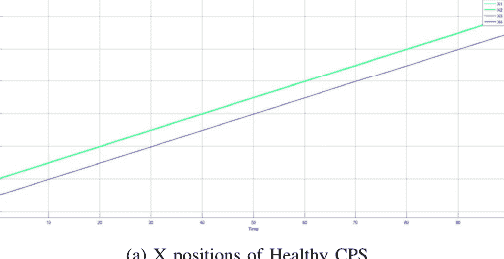
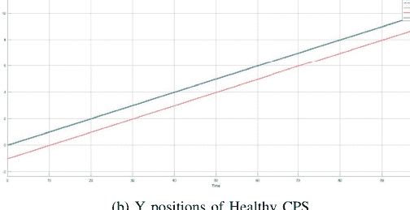
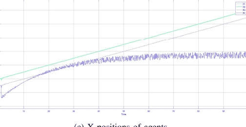
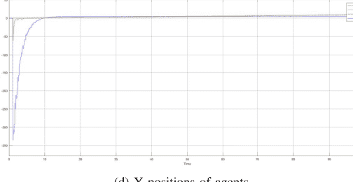

# 2020 第11届国际信息与知识技术会议 (IKT)


Zohre Zarandi, Iman Sharif
电气工程系
伊玛目·柯莱尼国际大学
伊朗，加兹温
邮箱：Nasari.zohre8888@gmail.com

摘要——尽管物理组件、计算资源和通信能力之间实现了集成，但信息物理系统（CPS）在许多应用中取得了显著进展。网络攻击是这些系统的主要威胁。发生信息物理系统中的攻击是出其意料且隐蔽的。这些攻击中，有些被称为数据注入攻击，其旨在通过破坏某些系统、腐改数据或向系统输入虚假信息来误导检测。如果系统没有察觉攻击，其性能可能会下降或被停用。因此，有必要调整算法来识别这些系统中的攻击类型。需要注意的是，CPS 生成的数据具有很多样性，使用机器学习算法来促进数据的评估和分析至关重要。在本文，CPS 被建模为相互移动的智能体网络，其中一个被视为领导者，攻击由领导者指挥。所提出的方法在检测阶段使用深度学习网络，应在攻击发生的初期通知系统攻击的存在。研究了如何在领导者-跟随机制中隔离异常行为。在所提出的控制方法中，利用深度神经网络攻击检测阶段控制异常行为。实验分析表明，使用学习算法可以更高的性能检测攻击，使安全更简单、更廉价且无需努力。

最近的进展导致了信息物理系统的引入，由于更好的计算能力以及物理与网络组件之间的集成，许多动态应用得到了显著提高。这种改进是以易受到网络攻击为代价的 [11], [13], [14]。信息物理系统由逻辑和嵌入式设备组成，通过物联网等通信通道进行通信。具体来说，这些系统包括数字或网络组件、逻辑组件、物理设备以及设计在物理和网络部分之间运行的人员。换之，信息物理系统是任何包含信息物理组件和人类并能够在物理与网络部分之间进行交换的系统 [1], [110]。在信息物理系统中，由于增加了接收物理环境数据的物理数据组件，这些数据可能会接收并向系统注入数据，因此这类系统的安全性变得非常重要。信息物理系统在物理部分面临的最大挑战之一是环境的存在，该环境收集了大量多样化且高速的数据。此外，物理部分与网络部分之间的连接使得获得的数据面临许多挑战。因此，信息物理系统最重要的特征之一是这些系统之间的通信、安全控制以及系统本身的安全性。

信息物理系统检测网络攻击的安全性是这些系统中的一个重要问题 [1]。需要注意的是以不规则的方式和常规的方式来描述这些攻击 [9]。通常，信息物理系统中的网络攻击主要有两种类型：拒绝服务 (DoS) 和检测攻击 [1]。在拒绝服务中，攻击者在网络节点和通信通道之间进行攻击。欺骗攻击向系统注入虚假数据，通过滥用作为传感器或控制器的系统组件实施，可能会腐改数据或向系统输入其他信息并导致异常行为 [12]。这些攻击可以通过系统内部监控来检测。但如果攻击者能够获得高水平攻击以保护自己不被识别，这些攻击被称为隐蔽欺骗攻击以及其他常见的通信攻击方法 [11], [12]。因此，意识到发生的攻击并及时对攻击者做出响应至关重要。其他情况下，安全系统应当意识到攻击，否则将无法感知。

# I. 引言


信息物理系统检测网络攻击的安全性是这些系统中的一个重要问题 [1]。需要注意的是以不规则的方式和常规的方式来描述这些攻击 [9]。通俗来说，信息物理系统中的网络攻击主要有两种类型：拒绝服务 (DoS) 和检测攻击 [1]。在拒绝服务中，攻击者在网络节点和通信通道之间进行攻击。欺骗攻击向系统注入虚假数据，通过滥用作为传感器或控制器的系统组件实施，可能会腐改数据或向系统输入其他信息并导致异常行为 [12]。这些攻击可以通过系统内部监控来检测。但如果攻击者能够获得高水平攻击以保护自己不被识别，这些攻击被称为隐蔽欺骗攻击以及其他常见的通信攻击方法 [11], [12]。因此，意识到发生的攻击并及时对攻击者做出响应至关重要。其他情况下，安全系统应当意识到攻击，否则将无法感知。

本研究的主要目的是调查向系统注入虚假数据的攻击。这些攻击可以通过系统内部监控来检测。但如果攻击者能够获得高水平攻击以保护自己不被识别，这些攻击被称为隐蔽欺骗攻击以及其他常见的通信攻击方法 [11], [12]。因此，意识到发生的攻击并及时对攻击者做出响应至关重要。其他情况下，安全系统应当意识到攻击，否则将无法感知。

（此处重复内容略）

本研究的主要目的是调查向系统注入虚假数据的攻击。这些攻击可以通过系统内部监控来检测。但如果攻击者能够获得高水平攻击以保护自己不被识别，这些攻击被称为隐蔽欺骗攻击以及其他常见的通信攻击方法 [11], [12]。因此，意识到发生的攻击并及时对攻击者做出响应至关重要。其他情况下，安全系统应当意识到攻击，否则将无法感知。

（此处重复内容略）

本研究的主要目的是调查向系统注入虚假数据的攻击。这些攻击可以通过系统内部监控来检测。但如果攻击者能够获得高水平攻击以保护自己不被识别，这些攻击被称为隐蔽欺骗攻击以及其他常见的通信攻击方法 [11], [12]。因此，意识到发生的攻击并及时对攻击者做出响应至关重要。其他情况下，安全系统应当意识到攻击，否则将无法感知。

本研究的主要目的是调查向系统注入虚假数据的攻击。这些攻击可以通过系统内部监控来检测。但如果攻击者能够获得高水平攻击以保护自己不被识别，这些攻击被称为隐蔽欺骗攻击以及其他常见的通信攻击方法 [11], [12]。因此，意识到发生的攻击并及时对攻击者做出响应至关重要。其他情况下，安全系统应当意识到攻击，否则将无法感知。

## II. 系统模型

CPS 被建模为相互移动的智能体网络，其中一个被视为领导者，攻击由领导者指挥。领导者能够获得高水平攻击以保护自己不被识别，这些攻击被称为隐蔽欺骗攻击以及其他常见的通信攻击方法 [11], [12]。因此，意识到发生的攻击并及时对攻击者做出响应至关重要。其他情况下，安全系统应当意识到攻击，否则将无法感知。

（此处重复内容略）

CPS 被建模为相互移动的智能体网络，其中一个被视为领导者，攻击由领导者指挥。领导者能够获得高水平攻击以保护自己不被识别，这些攻击被称为隐蔽欺骗攻击以及其他常见的通信攻击方法 [11], [12]。因此，意识到发生的攻击并及时对攻击者做出响应至关重要。其他情况下，安全系统应当意识到攻击，否则将无法感知。

（此处重复内容略）

CPS 被建模为相互移动的智能体网络，其中一个被视为领导者，攻击由领导者指挥。领导者能够获得高水平攻击以保护自己不被识别，这些攻击被称为隐蔽欺骗攻击以及其他常见的通信攻击方法 [11], [12]。因此，意识到发生的攻击并及时对攻击者做出响应至关重要。其他情况下，安全系统应当意识到攻击，否则将无法感知。

（此处重复内容略）

CPS 被建模为相互移动的智能体网络，其中一个被视为领导者，攻击由领导者指挥。领导者能够获得高水平攻击以保护自己不被识别，这些攻击被称为隐蔽欺骗攻击以及其他常见的通信攻击方法 [11], [12]。因此，意识到发生的攻击并及时对攻击者做出响应至关重要。其他情况下，安全系统应当意识到攻击，否则将无法感知。

### A. 异常智能体模型


并通过代理接收到的正确节点数与总节点数之比来表示，

```
$rep_{ij}[k] = \frac{\eta d_{ij}[k] + 1}{\eta k + 2} (7)
```

其中 $rep_{ij}$ 是代理 $i$ 中邻居代理 $j$ 直到时间步 $k$ 的信誉值，$\eta$ 是标量信誉因子，可以调整不同应用中信誉值的变化率。

- 3) 识别并隔离信誉值低于阈值的情况，此时该邻居节点将被视为无效并因此被隔离。在这种情况下，所有行为异常的代理都会被拒绝。然而，可以使用超时机制允许异常代理在它过去曾出现过异常或现在表现正常时得以恢复。

事实上，信誉管理作为一种验证机制，如果在一段时间内重复检测到某个具有异常值的代理，则被视为异常代理。在这种情况下，它被解释为该代理在邻居周围的信誉值。这本质上是错误拒绝率与错误接受率之间的差异。在这种方法中，设计偏好存在于阈值和信誉机制中。

- 4) 使用共识值对参考状态加权，确保良好代理的收敛。

在系统中，异常代理可以分为两类：

```
$u_{i,M}[k] = c_i - \sum_{j=1}^{n} d_{ij}[z] \to$ fault input
```

```
$u_{i,M}[k] = c_i[k] \to$ misbehaving input
```

图 2. 主跟随者结构中代理之间的连接

B. 主跟随网络中的分布式控制方法。领导引导网络的输入，而跟随者使用共识算法更新其状态并逐渐收敛到领导的最终状态。假设领导可能是一个异常代理，用于主跟随者共识的分布式控制算法在每个时间步执行四个步骤的功能，并提供参考 [4][5]。

- 1) 每个代理通过其局部观测和行为监控来检测异常邻居：

```
$G_{ij}[k] = \begin{cases} G_{ij}[k-1] + 1, & \text{if } |r_{ij}-z[k]| < (\gamma, \delta) \\ G_{ij}[k-1] - 1, & \text{if } |r_{ij}-z[k]| > (\gamma, \delta) \end{cases} (6)
```

$G(i,j)$ 是由代理 $i$ 控制的表示为 $j$ 的邻居直到 $k$ 时间步的正确状态总数。$(\gamma)$ 是一个取决于时间步 $k$ 和无序度 $\delta$ 的阈值函数。

- 2) 调整趋向邻居信誉值的共识权重。给于邻居的一组正确和错误行为，该代理参与特定正确和错误行为组合的概率分布满足检测。表示信誉的贝塔分布：

```
$d_{ij} = \frac{rep_{ij}[k]}{\sum_{j=1}^{n} rep_{ij}[k]} (8)
```

该方程用于归一化。如果使用上述关系，$d_{ij}$ 元素的行和将为一。如果检测到邻居代理，共识管理器会降低相应共识 $d_{ij}$ 的权重，以减少潜在异常代理的影响扩散率。如果一个代理被识别为异常节点，$d_{ij}$ 共识管理器将将其重置以断开该代理与其他代理的连接。

# III. 仿真

在检测阶段，使用深度网络检查数据仓库中的数据。为此，我们使用名为 keras 的强大机器学习工具。为了训练能够识别正确和错误数据的网络，需要一个数据集，使用 MATLAB 软件生成训练和测试所需的数据集，最后用于评估检测物理系统中的攻击。研究假设攻击遵循伯努利分布如下：

```
$$f(k) = \begin{cases} p, & \text{if } k=1 \\ 1-p, & \text{if } k=0 \end{cases} (1)
```

取决于 $p$ 的值，系统遭受攻击的概率 []。在本节中，假设 $p=0.8$，系统遭受攻击的概率。如果 $k=1$ 则系统遭受攻击，假设领导者是安全的且只有一个代理可以被攻击，注意到网络连接的程度为 $f=1$。在这些条件下，$f$ 具有达到总数据15%的能力。在完成训练后，展示了与不同网络配置相关的深度学习性能评估曲线。

# IV. 结论

在本研究中，我们提出了一种在复杂的物理系统网络中维持弹性共识的方法。通过应用该方法，观察到在攻击发生时，系统可以保持稳定且受攻击节点不会被削弱。简而言之，机器学习可以防止类似的攻击，且更有效。通过神经网络报告的系统状态做出决策并隔离其对代理行为的影响。未来，可以使用支持向量机（SVM）或其他类型的神经网络考虑更多的攻击。

# V. 参考文献

- [1] Kwon, Chaeyeuk, Weiyi Lee, and Inseok Hwang. "Security for cyber-physical systems against deception attack." In American Conference (2013): 3344-3349.
- [2] Pajolas, Miguel Jaime Wiener, Nicola Beza, Oleg Sogero, and Ian Lee. "Design and implementation of attack-resistant cyber-physical systems." IEEE Transactions on Systems Engineering 37 (2017): 664-673.
- [3] Sun, Hong, Chen-Yan Fan, and Jing Xiang. "Congestion forum for a class of networked botnet systems." Journal of Science and Engineering (2012): 217.
- [4] Zheng, W., and Mo Chow. "Resilient control in the presence of misleading agents in networked systems." IEEE transactions on communications 44, no. 11 (2016): 5751-5760.
- [5] Song, Haiyu, Chen-Yi Zhang, Wang Zhang, and Wang Li. "Resilient neural control for systems with semantic denial of service." IEEE International Conference (2017): 2790-2797.
- [6] Zhang, Haoran, and Shreya Sundaram. "Robustness of information distribution algorithms to locally bounded attacks." In American Conference (2012): IEEE (5852-5861).
- [7] Wu, Feijun, Jun Xiang, Shu Wei, and Yong Zhang. "Robust Consensus of Discrete-Time Cyber-Physical Networks under Deception." In International Conference on Industrial Informatics (2019).
- [8] Taufield, Langley. "Data mining based on cyber-attack." System simulation technology 13, no. 2 (2017): 901-9014.
- [9] Taquelli, Fabio, Florian Hill, and Franco Buccella. "Attack detection in cyber-physical systems." IEEE Transactions on Automatic Control 58, no. 11 (2013): 2725-2739.
- [10] Kwon, Chaeyeuk, Weiyi Lee, and Inseok Hwang. "Reliability analysis for safety of cyber-physical systems against deception attack." IEEE Transactions on Automatic Control 61, no. 7 (2016): 2272-2288.
- [11] Kwon, Chaeyeuk, and Inseok Hwang. "Recoverable control for on-line safety of Cyber-physical systems against sneaky attackers." IEEE International Conference, IEEE (2016): 1123-1228.
- [12] Kwon, Chaeyeuk, Weiyi Lee, and Inseok Hwang. "Analysis and stability of cyber systems under unknown attacks." Journal of Aerial Systems 11, no. 4 (2014): 529-5335.
- [13] Kwon, Chaeyeuk, Scott Yantice, and Inseok Hwang. "Real-time assessment of unmanned systems against cyber attack." Journal of Aerospace Information Systems 13, no. 1 (2015): 17-25.
- [14] Liu, Yuxiaos, Min Nguyen, Rong Deng, and Zhu Han. "Detecting false data injection using machine learning in smart grid." IEEE Systems 11, no. 3 (2014): 1644-1652.






(a) 使用 elu 函数的 MLP 结构中的两个隐藏层。

(b) 使用 elu 函数并进行 0.4 丢弃的 MLP 结构中的两个隐藏层。





(c) 使用 elu 函数的 RNN 结构中的三个隐藏层。

(d) 使用 elu 函数并进行 0.4 丢弃的 RNN 结构中的三个隐藏层。

# 图 3 智能体网络中的深度学习结果。





(a) 无攻击情况下的智能体标签。

(b) 存在异常行为智能体时的智能体标签。

# 图 4 控制系统中的检测与识别阶段。









图 5. 智能体的位置。

