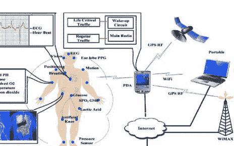
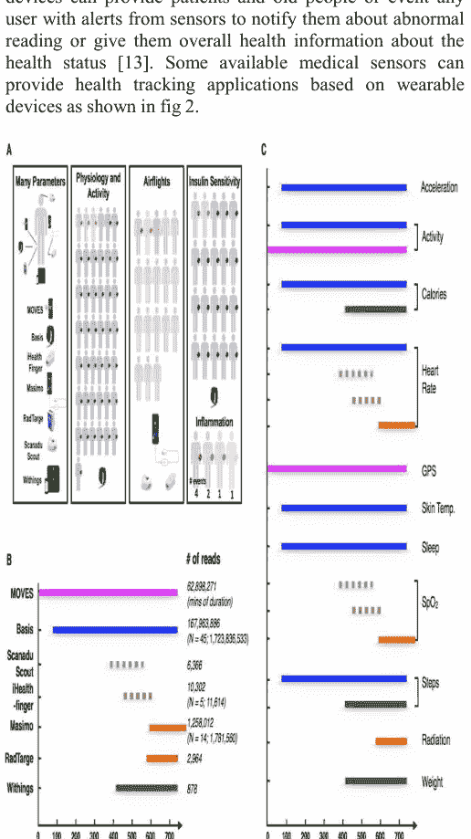
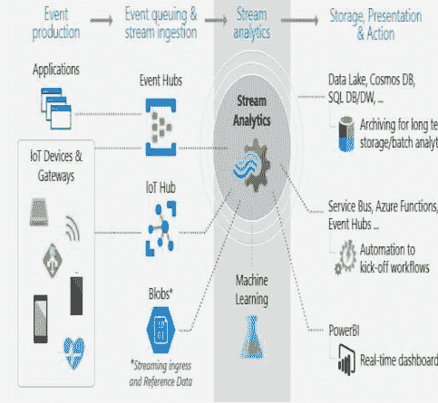
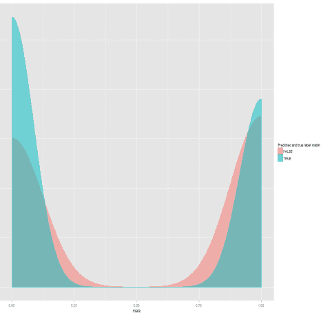
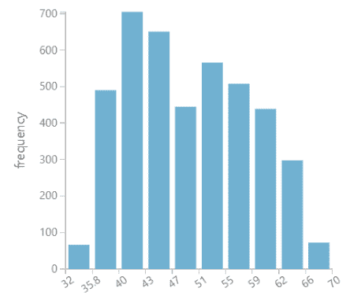
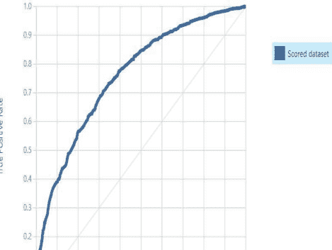

# 2020 第11届国际信息、智能、系统与应用会议 (IISA) (希腊比列埃斯 2020.7.15-2020.7.17)

Ahmed Ismail Ebaida，曼苏拉大学计算机与信息学院信息系统系，德国慕尼黑，`a.ebada@outlook.com`；Samir Abdelrafek，曼苏拉大学，埃及曼苏拉，`samir.abdelrafek@mansoura.edu`；Ibrahim Elhenawy，格加齐格大学计算机与信息学院计算机科学系，埃及格加齐格，`henawy2009@yahoo.com`

## 摘要

医疗健康大数据（包括医疗病史、医生报告、处方和家族史数据库、实验室数据以及扫描报告）可以帮助疾病的检测和预测。本文概述了医疗领域中当前的技术和方法，以获取云系统、数据科学和分析的优势。论文介绍了如何利用现有技术用于医疗应用的流式数据传输。医疗大数据分析是一个研究领域，文章展示了其对患者结果的一些影响。所提系统采用了经过调优的优化支持向量机（SVM）分类器，以实现高分类准确性和效率。该系统获取心率、糖尿病和血压数据，在云端医疗平台的帮助下分析并预测疾病。

**关键词**——移动设备；医疗健康；健康数据状态；预测。

## I. 引言

心血管疾病是全球数百万人死亡的最主要原因之一，仅次于癌症[1]。当血块阻塞流向心脏某部分的血液时，就会发生心脏发病，这种血块会导致心脏肌肉死亡。根据统计，对于饮食和生活方式选择不健康的人，心脏问题可能在40-50岁时逐渐开始[2]。因此，早期预后可以通过激励他们采取健康的生活方式和饮食为他们的生活带来巨大改变，从而降低这种风险。本研究旨在展示心脏病预测机器学习中最大的风险因素。机器学习模型通过在个体数据集上训练，预测患者患心脏病的概率。并根据当前的生活方式和饮食计算出患心脏病的概率。该模型使用弗雷明汉心脏研究数据集进行训练。

许多研究人员开发了机器学习方法来在早期诊断慢性疾病。可穿戴设备通过智能传感器为人体变化提供紧凑、准确、廉价且轻量的健康监测系统，为许多医疗事务提供了生活方式上的便利。大多数健康意识计划都要求对疾病进行预防和早期警示[1]。大数据分析对于使用 `Spark` 和机器学习算法利用数据生成医疗数据以预测结果非常有用且高效。这可以提供有关健康风险的信息，并获取健康问题的警报。这可以帮助医生通过可穿戴设备实时监测患者。它支持通过机器学习推荐系统对疾病进行诊断。

本文提供了关于医疗健康数据的一些信息。在第2节中，我们简述了分析健康数据所需的步骤。第5节讨论了所提系统及其未来工作。

许多研究人员开发了新方法和技术，将机器学习算法应用于大数据以便在疾病发生前进行预测。`Spark` 在处理海量数据方面非常快，可以在几分钟内完成计算。这对于运行时的数据处理和决策非常有用。`Spark` 提供了 `Lambda` 架构来执行实时处理和批处理[3]。

### A. 数据集成

所提系统基于使用 `Spark` 的流式数据。`Spark` 在处理来自物联网（IoT）的数据方面非常有用，因为它使用了边缘计算。它收集来自多个源的可穿戴设备、电子健康记录（EHR）数据、用户医疗数据[4]。`Spark` 可以与 `Hadoop` 集成，以处理来自不同来源的流式数据[5]，如图1所示。



支持 `Python`、`Java`、`Scala` 和 `R`。该平台的主要优势是它可以在运行时在内存中为 `MapReduce` 处理数据，不需要浪费时间在磁盘上读写数据。可以通过分析数据，从心理和生理数据中生成特征来预测疾病。

### B. 跨越IoT系统的流式数据

许多研究项目尝试利用物联网（IoT）中新技术的力量，使用医疗可穿戴设备来跟踪和预测疾病。带有某些物理传感器（如心率传感器和血压传感器）的医疗可穿戴设备为患者提供了紧凑、准确、廉价且轻量的人体健康监测系统，为许多医疗事务提供了生活方式上的便利。大多数健康意识计划都要求对疾病进行预防和早期警示[1]。大数据分析对于使用 `Spark` 和机器学习算法利用数据生成医疗数据以预测结果非常有用且高效。这可以提供有关健康风险的信息，并获取健康问题的警报。这可以帮助医生通过可穿戴设备实时监测患者。它支持通过机器学习推荐系统对疾病进行诊断。

本文提供了关于医疗健康数据的一些信息。在第2节中，我们简述了分析健康数据所需的步骤。第5节讨论了所提系统及其未来工作。

许多研究人员开发了新方法和技术，将机器学习算法应用于大数据以便在疾病发生前进行预测。`Spark` 在处理海量数据方面非常快，可以在几分钟内完成计算。这对于运行时的数据处理和决策非常有用。`Spark` 提供了 `Lambda` 架构来执行实时处理和批处理[3]。

所提系统基于使用 `Spark` 的流式数据。`Spark` 在处理来自物联网（IoT）的数据方面非常有用，因为它使用了边缘计算。它收集来自多个源的可穿戴设备、电子健康记录（EHR）数据、用户医疗数据[4]。`Spark` 可以与 `Hadoop` 集成，以处理来自不同来源的流式数据[5]，如图1所示。

支持 `Python`、`Java`、`Scala` 和 `R`。该平台的主要优势是它可以在运行时在内存中为 `MapReduce` 处理数据，不需要浪费时间在磁盘上读写数据。可以通过分析数据，从心理和生理数据中生成特征来预测疾病。

### C. 数据分析

医疗数据总是需要被分析。数据分析过程包含四类。第一类是描述发生了什么的描述性分析。然后诊断性分析试图找出事件的原因。第三类是针对未来的预测性分析。规范性分析是针对不同情况做出反应[10]。

医疗数据分析可以使用并行计算完成。`MapReduce`[11] 和 `Dryad`[12] 提供了可以管理复杂性的框架。`Spark` 是一个强大的框架，支持不同的编程语言，如



**图2**：来自传感器的流式数据。

## III. 相关工作

使用支持向量机（SVM）[15]在常见分类中应用广泛。`SVM` 也可以高率地分类数据集。当具有大量输入数据时，会增加分类的复杂性并导致过拟合问题[16]。移除冗余和无关特征可以提高分类准确性并增强机器学习模型的性能。

在[25]中，作者提出了一种基于遗传算法特征选择的疾病诊断系统。所提系统使用了三种分类方法 `SVM`、`KMN` 和反向传播进行测试。该工具的准确率为99.5%。

特征选择与提取的区别在于，前者是选择合适的特征，而后者是构造特征[17]。还有研究人员使用 `SVM` 开发系统[18]。

## IV. 所提健康预测系统

实时处理定义为对无界数据流的处理，例如 `JSON` 或半结构化数据，这些通常在毫秒级到达。实时处理解决方案的挑战之一是实时存储大量数据。处理必须以不阻塞摄取管道的方式进行。另一个挑战是快速对数据采取行动，例如在实时仪表板中生成和展示数据。

Ismail等人提出了一种基于 `SVM` 的系统，用于心脏病预测。他们通过特征减少了数据集。所提系统以90.5%的高成功率实现。

本文提出的解决方案提供了一种适用于基于医疗设备的物联网可穿戴设备的方法。如图3所示，该架构基于医疗设备、智能手表和其他智能可穿戴设备的流源。该系统还基于云结构来处理和存储来自不同来源的医疗数据。所提系统使用 `Apache Spark` 在内存中处理随时间流的流式数据。



**图3**：流式数据架构。

大数据是指大量的数据，需要大量的时间进行处理。`MapReduce` 模型可以处理大数据。所提系统使用 `MapReduce` 存储大数据并能及时恢复结果。所提系统提供了一个可以处理物联网（IoT）中异构和海量数据的框架。所提系统从可穿戴设备获取流数据，然后对存储的流式数据进行分析，最后使用 `Apache Spark` 对数据进行处理。所提系统的架构从数据的预处理开始，通过处理阶段基于特征减少方法来减少不需要处理的因素。

它使用测试数据进行训练并最终生成预测结果。

### 算法 1

```
BEGIN
- 加载数据集，将变量初始化为原始数据集
- 对数据进行预处理
- 应用缺失数据清洗
- 执行 R 脚本
- 根据权重设置阈值值
- 准备选定列表（List Selected）
- 计数器从 1 到权重长度(length(weights))
    - 如果 权重 >= threshold
        - 数据集应用 (lambda Val: Val > Threshold)
        - 在选定特征列表（List Feature Selected）中添加列
- 对数据集应用交叉验证
- 使用交叉验证创建训练数据和测试数据
- 创建 (cost, gamma, 和 epsilon) 的网格空间，cost、gamma 和 epsilon 用随机值初始化
- 对于搜索空间中的每组 (cost, gamma, epsilon)
    - 在训练数据集上进行验证以进行参数优化
- 结束循环
- 评估
- 预测
- 可视化
END
```

#### A. 基于机器学习算法的所提系统

所提系统使用带有参数调优的 `SVM` 分类器来生成准确的分类结果。所提模型根据因素过滤数据集中的第一部分数据，在下一步中根据阈值检测所有属于疾病的特征。采用 `SVM` 分类来分类并预测疾病发生的可能性。

所提系统适配了使用 `sklearn` 库中的 `GridSearch` 调整 `SVM` 参数调优以进行学习。`GridSearch` 从 `sklearn` 导入并带有参数网格，然后传递算法。

为了被视为最优值的参数调优是参数搜索。网格搜索通过所有组合高效地优化 `SVM` 参数（`cost`、`gamma` 和 `epsilon`），并将它们传输到 `SVM` 模型进行分类。在 `SVM` 分类之前进行参数优化可以提高数据集的预测性能，因为不需要遍历整个数据集。从数据集中移除所需的属性可以使得重点仅关注与疾病相关的重要参数。

所提系统如算法 1 所示。它从数据的预处理和清洗开始，我们使用阈值对值执行权重。目标是忽略小于阈值的值以进行处理。我们使用了 `Spark` 支持的 `lambda` 函数来应用阈值并仅选择需要的数据。然后应用特征选择，最后应用系统。

#### B. 医疗决策框架

所提系统基于医疗数据，需要对这些数据以做出正确的决策。

所提系统使用 `Microsoft Azure` 平台结合 `Spark` 处理流数据和 EHR（电子健康记录）数据。可穿戴设备每秒可向云端发送数据，每天服务数千名用户。`Microsoft Azure` 提供的 `SQL` 数据仓库支持 `Polybase`。`Polybase` 提供了通过 `T-SQL` 语言访问数据库外数据的技术。该系统的目标是连接大型数据集。`Azure` 提供了分布式数据库，实现了可扩展应用程序。它支持 `NoSQL`，并在一个系统中支持键值、图和文档数据。`Azure Data Lake` 是一种存储技术，无限制地存储不同结构（结构化和半结构化）的数据，用于大数据分析，并与云端的 `HDFS` 和 `Spark` 使用。`Azure Data Lake` 可以存储数万亿个文件，单个文件的大小可以超过一个拍字节（petabyte）。

关于患者的医疗数据。`Azure Functions` 服务允许开发者执行代码而无需准备接口。该函数的主要目标是它可以按计划运行或由另一个 `Azure` 服务的事件触发。每当有新的实验室测试结果上传到 `Azure Blob Storage` 时，`Azure function` 就会被触发。

## V. 实验结果与分析



**图 6**：所提系统的评估。

在图 7 中，使用曲线下面积（AUC）图来衡量机器学习模型的性能。AUC 显示了在所提系统中，基于训练模型对数据集进行评分的正性率的增加情况。



**图 7**：所提系统的 AUC。

**图 8**：心率与相关性。



所提系统证明了基于用户的个人数据、抑郁情况、传感器和用户特征参数，其准确率达到了 85.2%，非常有前景。

数据集中参与者的年龄如图 11 所示，它显示大多数参与者的年龄在 32 到 70 岁之间。图 8 中展示了最大心率频率的分布和参与者的年龄。

## VI. 结论与未来工作

所提系统提供了一个平台，能够处理实时医疗数据与历史电子健康记录（EHR）数据，供临床医生和医疗保健提供者预测心脏疾病，`Spark` 实现了对医疗数据的实时流分析。本文中“最大平台”的目标是获取和分析企业级的临床使用。所提系统提供了一个大数据系统，根据来自可穿戴设备和用户医疗档案的流数据处理 EHR 数据。所提系统依赖于数据集作为输入，并带有某些定义参数来过滤心脏数据集的特征。这是通过作为带有 `sql` 节点的 `Microsoft Azure` 云平台实现的。

本文提出了一种利用知识发现进行疾病预测的有效解决方案，该方案处理 EHR 数据库和用户社交档案信息。所提平台还提供了一种有效的解决方案，基于 `Spark` 和 `Microsoft Azure` 连接来自可穿戴设备的流数据进行预测。未来的工作是利用深度学习技术对该数据实施此所提系统。我们所提工作的下一步是提供一个云平台，支持任何种类的疾病数据集，并为疾病的分类过程提供一些预定义的因素。

## REFERENCES

[1] A. Gahane, G. Kokkula, I. Pandya, K. Devadkar, ”Prediction of heart disease using machine learning., In 2018 Second International Conference on Electronics, Communication, and Aerospace Technology (ICECA), IEEE, pp. 1275–1278, 2018.

[2] World Health Organization. Available: http://www.who.int/ (accessed 9 March 2020).

[3] H. Mirza, M. Rizvi, “Prediction of heart disease using machine learning algorithms: A survey”, International Journal on Research and Innovation Trends in Computing and Machine, v5(8), pp. 99–104, 2017.

[4] Ismail, A. Shehab, El-Enahy, “Healthcare Analytics in Smart Data Analytics: Reviews, Challenges, and Recommendations,” in Smart Cities: Models, Applications, and Challenges, Springer Cham, pp. 27–45, 2019.

[5] L. Nair, S. Shetty, “Applying spark-based machine learning on big data for heart health predictions,” Computers & Electrical Engineering, v65, pp. 393–399, 2019.

[6] M. Babar, F. Arif, M. Jan, Z. F. Khan, “Urban data analytics for Internet of Things based on smart environment management systems using customized Hadoop,” Generation Conference, vol.06, pp. 396–406, 2019.

[7] S. Sarow, M. Kamal, N. Dey, “Impact of Heart Disease and Its Impacts on Computing Intelligence: A Comprehensive Review-IoT Application for Big Data, In Big Data Analytics for Smart and Connected Systems, pp. 103–136, 2019.

[8] P. Abraham, K. Kanipriya, N. Raghavi, “Analysis of Disease from Multiple Healthcare Data using IIET Method of Hadoop,” International Journal of Computer & Mathematical Sciences (IJMS), pp. 2347–8527, 2018.


## References

[9] Z. Mariah, R. Xin, P. Wendelt, “Apache spark: a unified engine for big data processing,” *Communications of the ACM*, vol. 59, pp. 56–65, 2016.

[10] L. Benlima, “Data Management for Healthcare Systems: Architecture, Requirements, and Implementation,” in *bioinformatics*, 2018.

[11] Y. Shahbaz, C. Gao, L. Jahi, F. Shah, “Investigating the adoption of big data analytics in healthcare: the role of resistance to change,” *Journal of data science*, doi(1), 2019.

[12] D. Dunka, A. Sah, “Smart ambulance system using the concept of big data and intent of things,” in *Healthcare Data Analytics and Management*, pp. 165–176, 2019.

[13] J. Macadden, T. Durant, D. Bunch, A. Coppi, N. Price, K. Rodgerson, W. Schulz, “Health Care and Precision Medicine Analytics: Analysis of a Scalable Data Science Platform,” *Journal of medical research*, v21(4), 2019.

[14] A. Ismail, A. Shehab, El-Enahy, L. Osman, M. Elhosheny, “Quantified self-using IoT devices,” *International Conference on Advanced Systems and Informatics*, pp. 820–831, 2017.

[15] N. Mahdiz, M. Mayeen, M. Ahmed, M. Zaman, “Prediction of Heart Disease Using Multilayer Neural Network and Support Vector,” in *2019 International Conference on Electrical Information Communication Technology (EECT)*, IEEE, pp. 1–6, 2019.

[16] D. Jain, V. Singh, “A two-phase approach for feature selection and SVM classification,” *International Journal of patterns recognition*, pp. 1–13, 2019.

[17] J. Ang, A. Mirza, H. Harmon, “Supervised, and unsupervised-supervised feature selection: review on gene selection,” *IEEE/ACM Trans on Biol.* 11(1), 971–988, 2015.

[18] W. Lao, H. Mehrli, A. Khan, “Feature selection methods: importance of evaluation,” *Expert System App*, pp. 11–19, 2018.

[19] A. Ismail, S. Abdelkarim, El-Enahy, “BIG DATA ANALYTICS IN HEART DISEASES PREDICTION,” *Journal of Theoretical and Applied Informatics*, 38, 2020.

[20] S. Ahmed, F. Khan, Z. Khan, A. Anjum, “Importance of chronic kidney disease prediction using Feature Selection methods,” *IEEE*, pp. 619–623, 2019.

[21] H. Polat, H. Mehrli, A. Cetina, “The optimization of kernel function and parameters for SVM in voting,” *IEEE*, 2016.

[22] Y. Ren, F. Hu, H. Miao, “The optimization of kernel function and parameters for SVM in voting,” 2012.

[23] Y. Xiao, H. Wang, W. Xu, “Parameter selection of Gaussian kernel for one-class SVM,” *IEEE Transactions on Pattern*, 45, pp. 941–955, 2003.

[24] C. Lu, Z. Zhu, X. Yang, “An intelligent system for genetic-based cancer diagnosis using a genetic algorithm-based selection method,” *J Med Syst*, 2014.

[25] N. Binder, J. Balsford, M. Schumacher, “A multi-state model based on the reframing of Heart Failure: Is dementia incidence truly declining?,” *European journal of epidemiology*, 34(11), pp. 1075–1083, 2019.
