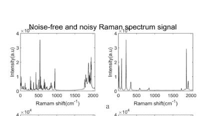
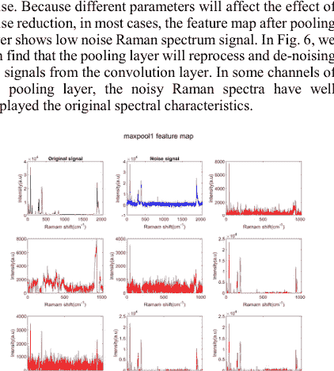

# 2020 第13届计算智能与设计国际研讨会 (ISCID)(中国杭州 2020.12.12-2020.12.13)


Liangjun Pan
电气工程系，
工程学院
宋加叻大学
泰国
lip141772@gmail.com

Pronehep Phipsuwanthan
电气工程系，
工程学院
宋加叻大学
泰国
pronehep@gmail.com

Peng Zhang
电气工程系，
工程学院
宋加叻大学
泰国
131953773@ig63.com

Chalong Daengaeng
物理科学学部，
科学学院
宋加叻大学
chalong@psu.ac.th

Apidach Boaratuwan-wan
电气工程系，
工程学院
宋加叻大学
泰国
gpidad@gmail.gmail.com

Michai Chongechawechanan
电气工程系，
工程学院
宋加叻大学
泰国
michai@psu.ac.th

**摘要**—在正常环境下，拉曼光谱经常受到宇宙噪声的干扰。本文提出使用深度学习（DL）对拉曼光谱进行降噪。利用拉曼光谱开发并训练了深度学习网络。所提技术被应用于降噪方法。我们对比了与不同降噪方法的性能。输出信比（SNR）、均方根误差（RMSE）和平均绝对百分误差（MAPE）是性能指标。结果表明，所提降噪方法的 SNR 大于其他降噪方法，而 RMSE 和 MAPE 分别为 292.63 和 10.99，优于所提技术。

神经层数具有最大的已知结构，总层数为数百或上千层 [1], [2]。

DNN 使用卷积层或 LSTM 单元。卷积神经网络（CNN）和循环神经网络（RNN）是两种 DNN 架构，广泛应用于信号处理任务。CNN [3] 的特点是提取空间特征，而 RNN 的特点是具有良好的序列单元建模能力。在正常情况下，CNN 是一种具有空间结构的分层架构。在 RNN 中，神经元可以在下一个时间步直接激活自己，这正是当时 $l+1$ 层神经元的输入，也是该时刻该层的输出。因此，使用 DNN 降低拉曼光谱中的噪声已得到证明。

*关键词*—深度学习，小波，降噪，CNN。

# I. 引言

拉曼光谱是一种广泛用于描述材料特性的方法，包括工业过程、行星探测、环境安全、生命科学、地质调查和材料科学。在所有情况下，拉曼光谱在过程中都会与各种噪声混合。拉曼是分析和检测物质的强大工具，但在信号采集过程中有必要降低噪声。从降噪的角度来看，各种降噪方法（如小波方法、经验分解法）被用于减少信号中的噪声。由于其独特特性，拉曼光谱具有许多重叠的峰和信号。不同的峰之间存在峰谷之间的间隙，代表了物质的不同属性。

在过去的十年里，深度学习神经网络（DNNs）在信号处理方面取得了进展。研究发现，深度神经网络的性能可以随着其深度和结构而提高。

基于小波的方法用于拉曼光谱且性能优于其他方法。然而，其他因素如过程、不同的小波以及频率和时间也会影响信号处理的性能。经验模态分解不需要分析和使用若干模态分量；但该方法包含两个部分：整个数据，极值点数量和零均值数量通过多次计算得出。局部最小点处的包络平均值由极大点和下包络形成。即上包络和下包络分量对应于时间尺度。

为了避免这些方法的限制，本文提出了一种用于拉曼光谱降噪的深度学习（DL）网络。由于神经网络是一种噪声回归，它不仅能降低拉曼光谱的噪声，还能检测信号结构。本文的结构如下：第二部分介绍数据集的收集和分布。第三部分介绍 DL 模型和评估。第四部分讨论基于 DL、CNN 和小波的方法性能。最后一部分是结论。

## 数据收集与处理

拉曼光谱数据集的准备将使所有后续步骤的实施更容易。例如，约 190 种危险化学品的无噪声拉曼光谱，由长度为 2051 个数据点的一维信号组成。拉曼光谱主要由荧光和拉曼噪声引起。噪声将直接影响拉曼光谱的质量。由于 DL 网络的需求，我们需要收集更多的无噪声数据集。拉曼光谱加入了不同噪声水平的基线。然后在基线噪声统计中加入了加性高斯噪声。添加白噪声后获得了约 80 种危险化学品。在表 1 中，使用了 1390 个和 500 个噪声拉曼数据集进行训练和测试。

### 1. 训练与测试结果总结

| 名称 | 数值 |
|---|---|
| 危险材料 | 190 |
| SNR | 0-80 dB |
| 训练数据 | 1390 |
| 测试数据 | 500 |



图 2 无噪声与噪声拉曼光谱

# II. 方法与评估

## A. 网络

DL 模型基于神经网络（CNN）在 MATLAB 中实现。神经网络被用于分类特征。本文的结构如下：第二部分介绍数据集的收集和分布。第三部分介绍 DL 模型和评估。第四部分讨论基于 DL、CNN 和小波的方法性能。最后一部分是结论。

拉曼光谱数据集的准备将使所有后续步骤的实施更容易。例如，约 190 种危险化学品的无噪声拉曼光谱，由长度为 2051 个数据点的一维信号组成。拉曼光谱主要由荧光和拉曼噪声引起。噪声将直接影响拉曼光谱的质量。由于 DL 网络的需求，我们需要收集更多的无噪声数据集。拉曼光谱加入了不同噪声水平的基线。然后在基线噪声统计中加入了加性高斯噪声。添加白噪声后获得了约 80 种危险化学品。在表 1 中，使用了 1390 个和 500 个噪声拉曼数据集进行训练和测试。


图 2 无噪声与噪声拉曼光谱

DL 模型基于神经网络（CNN）在 MATLAB 中实现。神经网络被用于分类特征。本文的结构如下：第二部分介绍数据集的收集和分布。第三部分介绍 DL 模型和评估。第四部分

的，的是，的降噪。


小波变换被广泛应用于信号处理。通过正向变换和逆小波变换，它实现了空间（时间）和频率的局部变换。它可以通过伸缩和平移对函数和信号进行多尺度或多分辨率分析，从而更有效地从信号中提取信息。相比之下，输入信号 $x(t)$ 的小波变换为：

```
$W_{a,b} = \int_{-\infty}^{\infty} x(t)\psi\left(\frac{t-b}{a}\right)dt, \quad (2)$
```

其中 $W_{a,b}$ 是 $x(t)$ 的小波变换，$a$ 是尺度因子，$b$ 是位置参数，$\psi^*(t)$ 是小波变换的复共轭。

我们的方法基于集成方法、Black-James-Stein 错误发现率、极小极大差值估计、Stein 风险无偏通用阈值法对信号进行去噪。该方法实现在 DL 网络中用于去噪。这里的 4 是矩阶数。根据小波密度，选择小波、规则和去噪噪声的方法还有许多其他选择，实验也尝试了不同的参数。因此，与 DL 去噪方法相比，有许多改进去噪方法，我们可以使用不同的方法进行去噪过程。

MAPE 衡量预测结果与真实结果之间的百分比，定义如下：

```
$MAPE = \frac{1}{N}\sum\left|\frac{original-forecast}{original}\right|\times100\%, \quad (5)$
```

其中 original 是无噪声信号，forecast 代表拉曼信号。

# III. 结果与讨论

在本节中，我们对 DL 模型学习的特征进行了可视化处理，特征图展示了 DL 去噪降噪的效果。其次，在相同噪声信号功率的情况下，使用了评价指标对 DL 网络和基于小波的方法进行了对比和评估。通过将拉曼信号和噪声放在一起，以直观地比较去噪信号与原始信号、以及 DL 网络去噪结果之间的相似性。

## A. 实验结果

由于卷积核的幅度和大小，池化层的方法会影响回归效果。在拉曼信号输入池化层后，DL 网络将提取噪声特征，然后返回去噪后的信号。由于不同效应对噪声的影响不同，拉曼信号池化后的特征图是不同的，因此我们可以从卷积层到池化层中发现这一点。在池化层的某些通道中，噪声频谱显示出了光谱特征。

## B. 评价指标

在本文中，输入信噪比 (SNR)、均方根误差 (RMSE) 和绝对百分比误差被选择为去噪拉曼信号的评价指标。这些指标具有以下特性：噪声与 SNR 反比，输出 SNR 高于拉曼信号的噪声。RMSE 和 MAPE 与信号质量成正比。当 RMSE 和 MAPE 较大时，说明拉曼信号质量差，原始信号与噪声信号之间的相似性较低。

### 1. SNR

实验使用输入和输出 SNR 来评估输入噪声的幅度，其中 $P_s$ 是信号功率，$P_n$ 是噪声功率。SNR 定义为：

```
$SNR = 10\log_{10}(\frac{P_s}{P_n}), \quad (3)$
```

### 2. RMSE

RMSE 计算预测值与真实值之间平方比与样本数量的平方根。RMSE 定义为：

```
$RMSE = \sqrt{\frac{1}{n}\sum(original-forecast)^2}, \quad (4)$
```

其中 original 是无噪声信号，forecast 代表去噪后的信号。

### 3. MAPE



图 6 池化层处理后的拉曼信号特征图。

对于经 DL 网络去噪的拉曼信号，我们使用输出 SNR、RMSE、MAPE 进行测量。表 2 总结了评估不同方法降噪效果的指标。噪声信号的输入 SNR 为 9.5 dB。DL 网络将 SNR 提高了 26.5 dB，远优于原始 SNR。通过对 RMSE 和 MAPE 的分析，去噪后的拉曼光谱信号之间的差异……

# IV. 结论

在本文，我们提出了一种用于拉曼光谱降噪的 DL 模型。由于在拉曼光谱重建过程中无法避免绝对噪声，去噪方法可以有效减少拉曼信号的噪声。在分析中，噪声、SNR、RMSE 和 MAPE 三个评价指标表明，我们的降噪比小波去噪大了 10.2 dB。RMSE 比小波去噪方法小 29.5，MAPE 为 10.9。我们的 DL 去噪方法成功超越了小波去噪方法。尽管两种方法相似，但小波去噪方法处理后的信号峰值优于原始值。

## B. 讨论

我们将去噪方法的性能与基于 DL 的方法进行了对比。由于在……过程中无法避免绝对噪声，去噪方法可以有效减少……噪声。在图 7 中，DL 在降噪方面优于其他方法。

表 I. 降噪统计数据。

| 方法 | SNR (dB) | RMSE |
| :--- | :--- | :--- |
| 噪声信号 | 9.5 | 107.0 |
| CNN | 26.5 | 9.5 |
| 经验贝叶斯 | 16.25 | 27.59 |
| 滤波器 | 14.98 | 27.5 |
| 小波降噪 | 15.38 | 34.6 |
| 通用阈值 | 12.64 | 42.98 |


