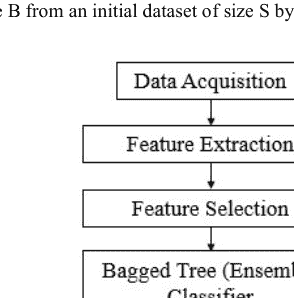
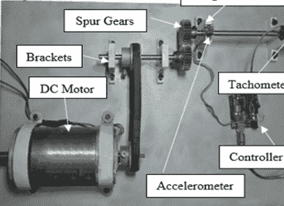
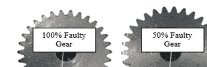
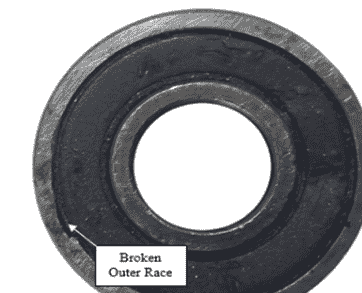
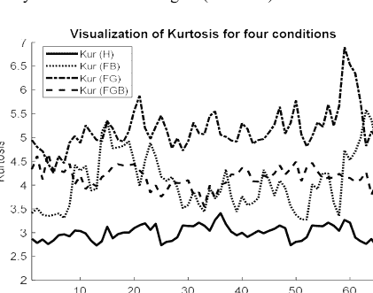
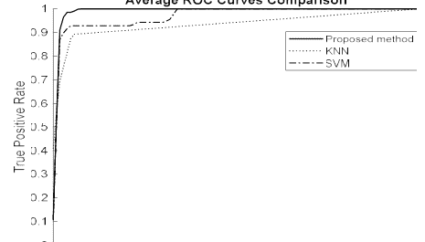

# 2020 第14届国际开源系统与技术会议 (ICOSST)

Muhammad Usman*, Shahzad Anwar, Muhammad Akmal 和 Abdul Hafez

巴基斯坦，开译尔-帕什图图瓦省，白塞培尔工程技术大学，机械工程系

*通讯作者：uetpmwct@upeteshawar.edu

**摘要** 旋转机械是任何工业运行中必不可少的组件。这些机器的故障会导致某些损坏，从而引发系统的致命性故障。本工作开发了一种低频技术，通过使用 `MATLAB` 从侧面提取低频数据，利用监测台观察系统中齿轮和轴承的振动特性，从而有效检测齿轮轴承系统中的各种故障。基于袋装树（bagged tree）的机器学习模型对这些特征进行了训练和验证。在 80% 和 20% 的划分比例下，达到了 96.65% 的最高准确率，显示了所开发算法的有效性，并与 SVC 和 KNN 方法进行了对比演示。

集成分类器通过加权或未加权的分类来聚合单个分类器的结果。集成分类的准确率通常高于单个分类器 [6]。通常介绍了许多集成分类器，如装袋（作为自助聚合）[7]、提升（boosting）和随机森林。许多随机算法可以增加预测性维护。在本研究中，六种通用算法和随机森林（RF）在与算法比较时，达到了平均准确率 95.56%，而另一种算法的平均准确率为 95.33%。

在监督学习中，决策树在设计稳健变体算法方面非常流行，它们模拟人类的决策过程，适用于工业应用。Item 等人 [10] 研究了用于工业应用的决策树选择。对于轴承状态，Lee 等人 [12] 使用主成分分析（PCA）结合 C 检测了故障轴承。在决策树故障检测中，结果显示，许多类型的决策树具有独特特征并适用于故障分类。在某些情况下，[13] 使用 AdaBoost 和反向传播（BP）神经网络诊断了齿箱故障。Vernek 等人 [14] 展示了从特征集中提取的决策树选择。

**关键词** 故障诊断，集成，树，频率数据，统计特征。

# 引言

齿轮和轴承是机器的主要组件。这些组件的缺陷有时会触发灾难性故障。根据 Ni 等人 [1]，40.55% 的故障由于轴承发生。齿轮箱（机器中的重要组件）由于高速度和复杂运行可能导致故障。机器学习策略专注于机器故障预测和检测，从而减少生产损失。因此，许多开发方法采用了基于振动的故障检测。其他常用技术包括特征分析、温度监控、声学特征分析和包络分析。

从原始信号提取故障是耗时且容易出错的。因此，基于特征的机器学习方法对于故障检测是必不可少的 [5]。支持向量机（SVM）分类算法在分类器比较中高效地分类故障。Solamani 等人 [16] 使用 SVM 处理信号并识别了四种类型的齿轮，其研究结果在齿轮故障分类中的准确率为 22.5% 和 25%。

Gunerkar 等人 [18] 提出了 ANN 和 KNN 方法用于轴承故障分类。来自加速度计的信号经过处理并使用小波变换去噪，从去噪信号中提取特征。这些特征在不同的速度和负载条件下通过 80% 和 20% 的训练测试划分作为 ANN 和 KNN 的输入。在文献中，有许多学习算法用于特定任务的分类。Carana 等人 [19] 使用了包括决策树、随机森林、SVM、神经网络、逻辑回归和增强分类桩（boosted stumps）在内的多种机器学习算法。他们的研究得出，最好的算法是增强树、随机森林、未校准树和未校准神经网络。在本研究中，决策树用于齿轮和轴承的分类。

在许多实验设置中，采集数据的频率至关重要。然而，在大多数研究中，高采样频率很少见。Soleimani 等人 [16] 使用了 16384 Hz 和 1420 rpm。Zhang 等人 [13] 使用 5120 Hz 和 880 rpm。Chen 等人 [15] 分别使用了 44.1 Hz 和 1900 rpm。

本文贡献了一个用于测试 400-600 rpm 标记速度齿轮和轴承的台架。数据使用频率为 500 Hz 的加速度计采集，该频率远低于目标特征频率。

# II. 材料与方法

该设备由电机、轴承、齿轮、传感器和其他组件组成。传感器信号是复杂的，提取故障信息需要专业知识。下节介绍方法论。

## A. 统计特征

特征提取是本研究的重要部分。表 1 中选择了峭度、偏度、平均值和一些其他特征。峭度和偏度是高级函数。峭度显示概率密度函数（PDF）的峰值，偏度显示信号是正偏还是负偏。对于健康组件，当峭度约为 3，偏度为 0；当故障发生时，信号产生负偏或正偏 [20][21]。

在表 1 中，$x_i$ 是输入值，$\bar{x}$ 是输入向量的平均值，$n$ 是输入向量中的元素个数，$\sigma$ 是标准差。模型训练的质量取决于数据的特征。这些特征是通过加速度计获取数据后提取的，如图 1 所示。

### 参数

| 名称 | 描述 |
| :--- | :--- |
| 偏度 | $g = \sum(x_i-\bar{x})^3/\sigma^3$ |
| 峭度 | $k = \sum(x_i-\bar{x})^4/\sigma^4 - 3$ |
| 方差 | $v = \sum(x_i-\bar{x})^2/n$ |
| 平均值 | $m = x_1 + ... + x_n/n$ |
| 中位数 | $M = (n+1)/2$ |
| 标准差 | $\sigma = \sqrt{\sum(x_i-\bar{x})^2/n}$ |
| 均方根 (RMS) | $RMS = \sqrt{\sum x_i^2/n}$ |

## B. 决策树算法

决策树构建为自上而下的流程图，其中每个块代表一个树节点。每个节点有两个或多个分支。决策树根据节点中的条件划分类别。选择最佳划分方式从根节点将数据划分为分支节点，形成树结构。最后，在决策树的终端节点应用停止准则。

### C. 袋装树算法

装袋（作为自助聚合）是一种减少方差的通用算法。决策树用于分类和回归的模型通常具有高方差。这些算法在产生方差特定数据上效果完美。在这种情况下，许多不同的决策树存在差异。因此，装袋用于减少决策树的方差。投票分类器使用自助采样技术创建。在 Bauer 等人 [8] 中，通过从初始数据集 S 中随机采样一个大小为 B 的均匀样本来创建自助样本。

来自初始数据集的元素。创建了大小为 B 的 T 个自助样本。每个 B 产生一个分类器 $C_t$，总共创建了 T 个个体。最终的分类器 $C'$ 由 $C_t$ 构建而成，其输出由其子分类器预测，并随机打破平局。

设 $T$ 为自助样本数量，$S$ 为样本数量，$I$ 为数量，则 bagging 算法可以表述为 [8]：

1. $i = 1$ 到 $I$
2. $S' = \text{来自 } S \text{ 的自助样本}$
3. $C_i = C(S')$
4. $C' = \text{argmax}_{y} \sigma_{C_i}(x)$ （预测频率值）。

本文的重点是恒定负载为 500 rpm 的单级齿轮装置。从 10 秒内收集的 5000 个样本数组中提取数值特征。这些特征提取自表 II 所示的不同配置状态。本研究采用的流程如图1 所示。过滤掉方差最小的特征。剩余特征作为子集的输入向量。基于装袋树（bagged tree）的建议算法使用 80% 的过滤特征进行训练，剩余 20% 用于测试和验证。使用不同数量的学习器和迭代对学习算法进行测试。

通过混淆矩阵和接收者工作特征（ROC）曲线分析了算法的性能。ROC 曲线通过不同的阈值衡量分类器的性能 [22]。阈值条件区分一个特征与其他特征。在 ROC 曲线中，真阳率和假阳率相互绘制。ROC 曲线中使用的参数定义在表 中。混淆矩阵是详细可视化算法性能的最佳方法。混淆矩阵的每一列显示预测类别的样本数。矩阵的行包含目标类或输入类的元素。

还分析了移除方差极小特征的方法。为了展示算法的有效性，将其与其他机器学习算法进行了比较。

# III. 实验

由 24V 直流电机驱动的单级齿轮实验台，其最大速度为 1000 rpm，额定功率为 60W，如图2 所示。

产生的故障如图3 所示。齿轮缺齿，量化了部分故障。左侧齿轮缺少了一个齿，这属于 100% 故障齿轮生成。如图4 所示，轴承外圈受损，出现了外圈损坏以及对侧边的影响。

| 标签 | 组名 | |
|---|---|---|
| 1 | TE | 所有组件均健康 |
| 4 | FG | 动轮为 100% 故障 |
| 2 | FB | 仅动轮轴承故障，且在某次实验中 FB |
| 3 | FGB | 此配置结合了 FG 和 FB |
| 5 | | 动轮为 50% 故障 |

以及外圈。实验在各种故障下进行，传感器数据采集见于表 II。数据使用灵敏度为 270mV/g 的加速度计采集。传感器安装在目标模型上。传感器以 500 Hz 的频率读取动轮数据。螺旋齿轮产生径向振动，振动在 `SIMULINK` 和 `MATLAB` 中执行处理。本文建议的采样率可以通过低成本获得，这是本研究的目标之一。对于每个机器状态，记录了多个 10 秒。

## A. 数据提取

统计特征提取所示表 I。这些特征代表了用于分类的振动。我们对每个故障观察了七种原始信号。其他特征是均值、偏度和所有峰值之和。这些被用作机器学习算法的输入。从表 IV 的数据可以明显看出，峭度随着故障的发展而增加，且准确性远高；然而，当元件健康时，它保持为 0，当发生故障时变为负值。分类水平由严重程度决定。例如，在图5中，健康和故障状态之间存在一条垂直线。这意味着学习器可以完美地分类故障状态。然而，不同故障之间不存在分离，这为学习算法带来了挑战。针对表 I 中的每个故障列，计算了 60 次实验的方差。

| ROC 曲线参数表 III | 参数 | 公式 |
|---|---|---|
| 真阳率 (TPR) | TP + FN |
| 特异性 | TN + FP |
| 假阳率 (FPR) | 1-特异性 |

## B. 用于故障检测的装袋算法

bagged 算法通过不同数量的学习器实现。学习器代表合并集成的个体弱分类器。最简单的代表分类器的分支数或节点数。训练使用总共 350 个样本进行。每个样本包含的特征向量属于特定故障。装袋树与 SVM 和 KNN 的结果进行了比较。算法的性能在图6 和图7 的 ROC 曲线中所示。

# IV. 结果

建议方法和集成算法的结果所示表 V。学习模型使用 80% 的数据进行训练，20% 用于验证。发现由于去除了低方差特征，建议方法优于装袋树。

| 表 V 统计特征 | 数据类型 | 样本数 | 均值 | 中位数 | RMS | 偏度 | 峭度 |
|---|---|---|---|---|---|---|---|
| H | 1 | 0.0118 | 0.0163 | 0.0297 | 0.0149 | -0.1650 | 2.8702 |
| H | 2 | -0.0485 | -0.0311 | 0.0214 | 0.0275 | 0.0045 | 2.9829 |
| H | 3 | -0.0118 | 0.0173 | 0.0199 | 0.0172 | -0.0032 | -0.4496 |
| FG | 1 | 0.0091 | -0.0082 | 0.0118 | 0.0232 | 0.0000 | -0.0441 | 3.5729 |
| FG | 2 | -0.0095 | -0.0028 | 0.0232 | 0.0336 | 0.0000 | -1.0957 | 3.1001 |
| FGB | 1 | -0.0256 | -0.0192 | 0.0313 | 0.0424 | 0.0011 | -0.8135 | 4.3416 |
| FGB | 2 | -0.0234 | -0.0123 | 0.0315 | 0.0388 | 0.0006 | -0.7115 | 4.3414 |
| PPG | 1 | -0.0128 | -0.0062 | 0.0292 | 0.0319 | 0.0009 | -0.7027 | 4.7026 |
| PPG | 2 | -0.0117 | -0.0110 | 0.0320 | 0.0341 | 0.0010 | -0.3414 | 4.0147 |

## 表 V 集成分类器准确率

## 表 VI 与不同算法的对比

| 序号 | 集成方法 | 学习器数量 | 划分次数 | 特征数量 | 准确率 |
|---|---|---|---|---|---|
| 1 | 提议方法 | 40 | 40 | 8 | 98.6% |
| 2 | Bag [6] | 40 | 40 | 9 | 96.2% |
| 3 | Bag [6] | 40 | 40 | 7 | 97.1% |

| 留出测试比例 | SVM [15] | KNN [16] | 提议方法 |
|---|---|---|---|
| 0.45 | 91.1% | 89.2% | 98.4% |
| 0.35 | 91.8% | 88.6% | 97.0% |
| 0.23 | 92.9% | 89.4% | 97.1% |
| 0.15 | 93.1% | 86.2% | 94.3% |
| 0.1 | 93.7% | 88.8% | 96.8% |
| 0.05 | 94.0% | 88.5% | 92.3% |

提议方法实现的准确率达到 98.6%。在开发的方法中，输入矩阵包含总计 8 个特征。当使用特征用于算法时，准确率仅为 96.2%，当排除更多具有显著性证据的特征时，准确率下降到 71%。

图 6 中的混淆矩阵显示，一个示例 FB 被错误分类为 FG。这部分是因为轴承故障以及未能产生显著振动导致的；它们改变了振动特征，使其难以检测。该方法成功地以 100% 的准确率识别了机器状态；FG 和 G 的严重故障也以 100% 的准确率被完美识别。

为了评估提议算法的有效性，与 KNN [16] 和 SVM [15] 进行了对比。结果如表 VI 所示。开发的方法显示，在 0.2 的留出测试比例下，提议方法的准确率为 96.6%，而 SVM 为 91.4%，KNN 为 90%。提议方法的准确率达到了 97.1% 和 87%。卷积神经网络 [15] 算法也对数据进行了测试，在 22 个 epoch（轮次）下的平均准确率为 96%。

所有故障类型的 ROC 曲线如图 7 所示。留出测试比例和曲线下面积给出表 VII 中。提议方法的 AUC 非常高，达到 99.7%。SVM 紧随开发方法之后，而 KNN 紧随其后。提议方法的真正例率为：

| 方法 | 准确率 |
|---|---|
| 提议方法 | 99.7% |
| SVM | 97.7% |
| KNN | 93% |

# 准确率：98.6%

| | H | FG | FB | PFG |
|---|---|---|---|---|
| H | 14 | 0 | 0 | 0 |
| FG | 14 | 0 | 0 | 0 |
| FB | 0 | 1 | 0 | 0 |
| FGB | 0 | 0 | 13 | 0 |
| PFG | 0 | 0 | 14 | |

该方法在留出测试比例下的准确率高于 SVM 和 KNN，部分是因为轴承故障以及未能产生显著振动导致的；它们改变了振动特征，使其难以检测。

# V. 结论与未来工作

在该研究中，通过 Bag 方法提议方法的准确率高于 SVM 和 KNN。未来将增加特征数量的研究。

IEEE 保留所有权利。

# 参考文献

- [1] S. Nandi, H. A., "检测," IEEE Transactions on Electric.
- [2] C. Wu, J. Jiang, and F. Chen, "故障诊断," Signal Processing.
- [3] Y. Yan, S. Gao, and L. Li, "故障诊断," Soft Processing.
- [4] S. Chen, A. Osman, and M. Mostafa, "预测性维护," J. Eng. Res. Sci.
- [5] N. Nandi, T. G., and L. Li, "故障诊断," International Conference on.
- [6] L. Breiman, "Bagging," Machine Learning.
- [7] E. Bauer and R. Kohavi, "An Empirical Comparison of Supervised Learning," Machine Learning.
- [8] Y. Zhang, L. Liu, and T., "A Simple Generalisation of the Area Under the ROC for Multiple Classification Problems," Machine Learning.

## 参考文献

- [9] S. Nandi, H. A., "检测," *IEEE*.
- [10] D. Guidi, A. Samraoui, and M. El Badouai, "技术分析," *13th Int. Conf. Cond. Mon. Mach. Fail. Prev. Tech.*.
- [11] W. Gassaint and T. Tilp, "特征提取方法的综述," *Mach.*.
- [12] W. Gassaint and T. Tilp, "特征提取方法的综述,".
- [13] Y. Zhang, L. Liu, and R. S., "基于多特征的故障," *Symmetry.*.
- [14] K. V. Gikar, and M. Kamar, "基于卷积网络的齿箱识别与分类," *Shock.*.
- [15] Z. Q. Chen, L. Li, and R. S., "基于机器学习的故障,".
- [16] A. Soleiman, M. J., and M. Sharif, "振动分析与预测性维护,".
- [17] C. Scheffer and P. Girdhar, "机器振动分析与预测性维护.".
- [18] R. S. Guner, A. K. Jalan, and S. G, "人工神经网络滚动轴承故障诊断," *J. Mech. Sci. Technol.*.
- [19] M. Caruana, "监督学习算法的经验比较," *International Conference on.*.
- [20] W. Gassaint and T. Tilp, "特征提取方法的综述及其在低速设备下降趋势预测中的应用,".
