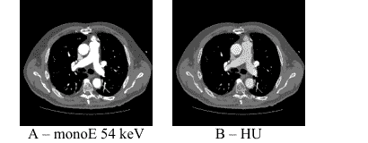
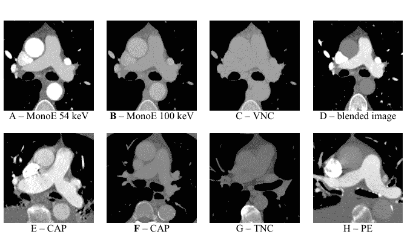
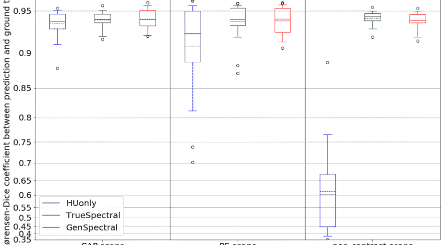
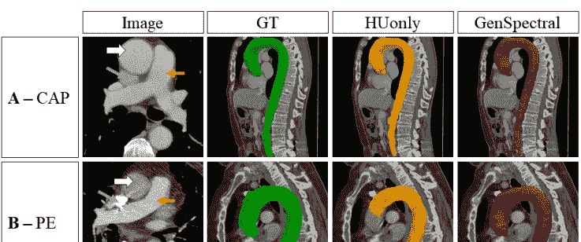

# 2020 第15届 IEEE 国际信号处理会议 (ICSP) ｜｜ CASPER：常规 CT


Pierre-Jean Lartaud¹, Aymeric Rouchaud¹, Hamid Dessousky², Anna Vlakhmitrou³, Jean-Michel Rouet², Olivier Nemment³, Loïc
¹ CREATIS UM5820 INSERM, 里昂大学，法国
² 飞浦研究中心，Sures，法国
³ 里昂医院（Hospices de Lyon），里昂，法国

邮箱：pierre-jean.lartaud@creats-insa.fr, aymeric.rouchaud@chu-lyon.fr, hamid.dessousky@creats-insa-lyon.fr, anna.vlakhmitrou@gmail.com, jean-michael.rouet@philips.com, olivier.nemment@philips.com, loic.bussel@chu-lyon.fr, philippic.douc@chu-lyon.fr.

**摘要—** SPCT 扫描是临床领域的一项新兴技术，允许从单次扫描生成传统图像、虚拟无对比扫描（VNC）以增强传统 CT 图像。据认为，不同 k 值下的非对比扫描可能（在高 k 值处）有助于（在低 k 值处）碘对比增强研究。它可以用作心血管结构的数据增强，提高对比增强图像上的 Dice 分数，并对非对比（TNC/TNC）扫描进行分割。然而，这尚未得到证实，使得这一数据处理尚未广泛应用。

为这些图像分割真值（grounds truths）仍然缺乏足够的半自动软件。相反，即使是专家也经常无法捕捉非对比 CT 扫描中的结构。为这些图像创建真值需要逐层进行分割，这在确定一个高质量的训练数据集时可能非常繁琐。因此，对于自动钙质计算，只有少数关于图像心血管结构分割的论文。

为了克服这一局限性，我们提出了一种数据增强工作流，为传统 CT 训练提供 CT 增强能力。我们使用图像翻译网络（USetNet）在包含 2500 次扫描的不平衡数据集上进行训练，将对比增强图像和 VNC 人体图像进行映射。随后可以将传统 CT 扫描转换为 SPCT 图像。

SPCT 数据增强方法面临许多困难 [4–6]。双能扫描仪作为一种新出的医疗程序，允许从单次扫描不仅生成与任何其他 CT 扫描仪类似的传统 HU 图像，还能生成增强的、虚拟无对比和真实的非对比（VNC）图像，其对比剂浓度从低（在高 k 值处）到高（在低 k 值处）不等。可以在以下增强和虚拟图像上对目标分割。使用这些图像作为数据增强，可以训练一个网络来分割训练集中不存在的 TNC 和 TNC 协议。

我们通过在 143 份标注的传统扫描上训练 3D U-Net 来分割主动脉，并在使用和未使用数据增强的情况下评估了我们的方法。在包含 70 名患者的测试集上比较了网络性能。结果显示，使用增强扫描训练的网络性能优于未使用扫描训练的网络，特别是在肺动脉方面。

**关键词—** 数据增强，SPCT，双能，深度学习，图像翻译，血管分割，分类，非对比 CT

## I. 引言

在过去的十年中，深度学习已成为一种自动器官分割的可行方法，因为所提的网络架构在具有挑战性的血管结构分割中实现了最先进的性能 [1, 2]，这是由于圆内诱导对比剂浓度的变化引起的。事实上，在临床实践中，根据图像的指征和感兴趣的结构使用注射方案。对比剂量以及注射和成像的时机差异很大。常见情况是肺栓塞（PE）诊断，这需要突显肺动脉，因此在注射后完全增强；以及针对肿瘤局部增强需求的胸部-腹部-盆腔（CAS）扫描，且图像采集在注射后开始。这使得为给定器官的分割创建一个具有代表性的训练数据集变得困难，因此，大多数研究集中在 [1] 上。

因此，在这项研究中，我们完整提出了一种数据增强工作流，为任何传统 CT 训练数据集提供 CT 增强能力，使用配对图像翻译网络（USetNet）将人体图像的增强扫描和 VNC 进行映射。为了说明我们的目的，我们从传统 HU 图像数据集训练了一个 3D U-Net 来分割主动脉，并评估了我们提出的增强工作流对网络性能的益处。



低能光子被内部探测器吸收，而高能光子穿过内部并被外层捕捉。使用基于投影的分解，低能的衰减表示为材料的衰减贡献，取决于它们的衰减特性 [8]，图像中像素的强度对应于主体中的物质含量，碘图和水图，monoE 图像的强度可以如下式生成：

```
$monoE_{keV} = \alpha\mu_{I}^{keV} + \beta\mu_{W}^{keV}$
```

其中 $\alpha$ 和 $\beta$ 是碘和水浓度图，单位为 $cm^{-1}$，$\mu_{I}^{keV}$ 和 $\mu_{W}^{keV}$ 是 $keV$ 处的衰减系数 [9]。因此，从两个单能图像或两个材料图，可以反推方程 (1) 以重建任何光谱图像。高能光子被患者吸收的少于低能，因此单能图像的对比度较低，如图 2 所示。最后，VNC 是缩放到亨斯菲德单位的水图。

A - monoE 54 keV
B - HU
C - monoE 100 keV
D - VNC

图 1. 从光谱 CT 重建的图像示例。应用 600-1600 窗。

本文结构如下：第 2 节详细描述光谱图像的生成。在第 3 节中，我们介绍了数据增强工作流，第 4 节描述了我们在主动脉上的应用结果。

## II. 光谱图像重建

双能 CT 也称为光谱 CT，是一种最近临床可计算机断层技术，允许同时获取两种 X 射线光谱。为了获得两个光谱，使用了不同的技术（双层、快速切换）。在这项研究中，我们使用双层。

## III. 光谱增强方法

如图 2 所示，全局工作流包含两个步骤。首先，我们训练图像翻译网络，将 HU 图像转换为 mono 54 keV 和 mono 100 keV。然后，将传统 HU 数据集输入网络以生成上述单能图像。使用方程 (1)，对这些 monoEs 进行重建用于数据增强。


步骤 1 – HuSpecNet
步骤 2 – 数据增强
图 2. CASPER 工作流。HuSpecNet 在 2500 次扫描上训练。在该方法中，前两行是 HuSpecNet 训练。根据不同目的，光谱图像是混合的。最后一行显示了图的真值。

### A. HuSpecNet

表 I HUSPECNET 统计

| 类型 | 范围 | 均值 ± 标准差 | 最小值 - 最大值 |
| --- | --- | --- | --- |
| Mono-54 | 307 | 16.893 ± 5.096 | 11.378-50.223 |
| Mono-100 | 307 | 14.690 ± 1.676 | 7.453 - 18.926 |
| Mono-100 | 307 | 11.796 ± 2.349 | 8.807 - 23.653 |
| VNC | 307 | 22.066 ± 3.316 | 14.182-51.358 |
| VNC | 307 | 13.469 ± 2.295 | 8.517 - 21.637 |

图 3. 光谱图像与生成扫描的对比。对每个图像应用了 600-1600 窗。

我们的传统训练数据集包含 143 名患者，带有使用半自动工具（Philips ISP）从真实图像到分叉生成的生成图像。这些传统扫描是用光谱 CT 生成的，用于与真实图像对比。

### B. 光谱数据增强

一旦使用 HuSpecNet 从传统数据集创建了 mono 54 和 100 keV，就可以为了不同数据增强进行光谱数据增强。使用方程 (1)。如图 4 所示，对比剂从高到低的混合可以使用不同能量的 mono 图像和 VNC 图像模拟。根据目标器官和器官的真值将 mono 混合在一起，因为执行了不同的注射方案（如图 4D）。对于具有大量标注数据的情况，这种具有更灵活的结果——对给定的注射方案不敏感——可以用于分割或分类。

为了评估方法的益处并与真实的光谱增强进行比较，我们训练了分割网络。HuOnly 仅在真实图像上训练。真实光谱图像和生成图像通过 HuSpecNet 进行训练。由于每个策略都是从相同的 143 名患者进行训练，光谱增强的存在与否彼此不同。

该网络由 3D-Net [12] 组成，具有五个通过残差线性层（ReLU）激活的分层和一个最大池化，每层的特征通道数从 16 翻倍到 26。




图 4. 来自单个 HU 患者的数据增强示例。A 到 D 是使用具有不同注射方案的患者的原始常规 HU 图像重建的不同图像。应用了 [600-1680] 窗。

使用最近邻插值法将其重采样为恒定的 [2, 2, 21] mm 间距。然后将随机选择的块（patches）输入到网络进行训练。

在推理过程中，将体积数据重采样回原始尺寸，并使用引导图像滤波器 [13] 进行后处理。

在每个预测结果和真值（GT）上计算了 Sorensen-Dice 系数。使用重复测量方差分析 (ANOVA) 并执行了 Bonferroni 校正的 t 检验，比较了整个测试数据集以及 PE、CAP、非对比子集上三种训练方法之间的 Dice 系数。当推断出经 Bonferroni 校正的 p 值小于或等于 0.05 时，我们认为存在显著差异。

关于分割网络方法，在整个数据集以及 PE 和 TNC 子集上，HUonly 与 GenSpectral 以及 TrueSpectral 之间均存在显著差异 (p < 0.05)，但在 CAP 子集上没有。这是由于训练数据集中存在 CAP 方案扫描，而其中缺少 TNC 和 PE。当使用随机方法将 VNC 添加到训练后的数据集中时：这有助于分割未使用的 CT 方案上的对比度，因为 PE 图像的结果在 Dice 上超出了预期；然而，光谱增强方法在改进学习数据集后，其性能优于 HUonly。此外，GenSpectral 和 TrueSpectral 在整个数据集以及 PE、CAP 和 TNC 子集上的 Dice 系数没有发现显著差异 (p > 0.05)，这证实了我们提出的常规数据集增强工作流提供了。



图 5. CAP、PE 和 TNC 种种训练相对于真值（GT）的 Dice 预测结果。箱体显示第 25 和第 75 百分位数，平均值用实线和虚线表示。



图 6. PE、CAP 和 TNC 扫描的 HUonly 和 GenSpectral 预测示例（带真值 GT）。掩码以带背景上下文的 3D 渲染呈现。肺动脉（橙色箭头）、主动脉（白色箭头）和上静脉（蓝色箭头）的结果相当于真实的光谱数据集。如图 5 所示，GenSpectral 和 TrueSpectral 获得了非常接近的结果，具有每个子集的位数和平均值。此外，应该注意的是，GenSpectral 未获得低于 0.9 的 Dice 值，而 TrueSpectral 处有两个 PE 扫描显示出较低的结果。

## V. 结论

我们提出的 Casper 方法成功地将光谱数据引入常规训练数据集，允许针对常规 CT 应用训练更具通用且更有效的网络。然而，该方法考虑了创建从 HU 生成的非对比数据集（VNC），通过某些自动化分割工具可以轻松获取真值（GT）。未来的发展将包括在其他数据集上进行器官分割应用、改进生成的 VNC 图像以及可能转换到其他光谱模式，例如电子密度或 Z 有效测量值。

## 参考文献

- [1] S. Senquarta 等， "医学架构、模式和近期趋势中深度学习应用的综," Knowledge-Based Systems 199, 2020.
- [2] A. Maier, C. Tyler, T. Lasker 和 C. Ries, "医学图像处理中深度学习的性介绍," Zeitschrift für Medical Physics, vol. 64, no. 2, 81–103, 2019.
- [3] G. Singh, 等., 心脏 CT 中的机器学习: 基础概念与当代数据, 12, 2020.
- [4] S. Schneider, M. Wolteren, R. W. van Hamersfelt, M. Treik, T. Liner 和 I. Igum, "利用分割信息改进心脏 CT 血管造的心肌分割," 2018.
- [5] P. Lamont, J. M. Roset, O. Nempont, 和 L. Boussel, "常规 CT 分割的光谱 CT 训练数据集生成与增强," 医学影像与计算机辅助干预 – MICCAI 2019, Cham, 2019, pp. 768–775.
- [6] S. Chen 等， "基于 3D 全卷积断层的双能 CT (DECT) 自动多器官分割," Medical Physics, vol. 47, no. 5, 552–562, 2020.
- [7] C. H. Mcclough, S. Long, L. Yu, 和 J. G. Fischer, "分光与多能 CT: 技术方法与临床应用," Medical Physics, vol. 47, no. 6, 786–795, 2020.
- [8] R. E. Alvareaz 和 A. Macovicki, "X射线计算机断层中的能量选择重建," Medical Phys Biol, vol. 21, no. 5, 97.
- [9] NIST XCOM: 合物/混合, https://nist.gov/PubData/Datas/xcom/index.html
- [10] P. Hola, J. Zhou, T. Zhao, 和 J. Efos, "生成对抗网络," 2017 IEEE 视觉与模式识别会议 (CVPR), 2017, pp. 5994–5976.
- [11] J. Tran, J. Zhou, 和 J. Efos, "使用循环一致对抗网络的非成对图像到图像翻译," 2017 IEEE 计算机视觉国际会议, pp. 2241–2249.
- [12] X. Sun 和 J. Tang, "图像分割引导学习," Pattern Analysis and Machine Intelligence, vol. 35, no. 6, 1499–1509, 2023.

