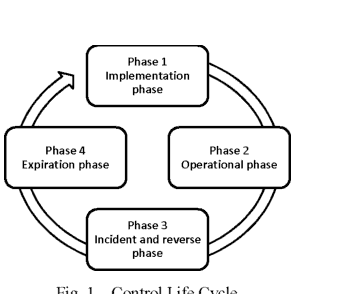

# 2020 第15届国际计算机工程与系统会议 (ICCES) (埃及开罗 2020.12.15-2020.12.16) 2020 第15届国际计算机工程与系统会议 (ICCES) ｜｜ S

**摘要—** 物联网（IoT）技术的引入通过设备、人与网络之间的交互提供了新的体验。示例包括智能电网、智能健康、智能家居、智能办公场所、工业管理。每天都有更多的设备被连接，造成了更大的安全威胁和问题。为了解决基于资源的 IoT 设备和终端问题，需要一种 IoT 安全模型。在本文中，我们提出了策略性方法来寻找有效的解决方案。在构建 IoT 系统时，遗憾的是，IoT 设备在制造时并未考虑安全问题 [3]。

进一步的安全忧虑可能源于 IoT 系统的配置和管理。因此，IoT 设备需要恰当的配置和身份验证。此外，IoT 厂商在部署之前尚未提供安全保障。潜在的 IoT 系统风险可能与物理攻击有关。攻击者可能攻击 IoT 设备以连接到本地或家庭网络，攻击者可能访问加密的 IoT 数据或 IoT 凭据。攻击者可能使用恶意软件攻击 IoT 框架，或攻击连接到家庭网络的 IoT 设备。

*关键词—* 应用、攻击；IoT；安全；智能

## 引言

物联网允许我们世界中的物体通过互联网连接起来，并能够在没有人工干预的情况下进行交互。物联网由多种可以通过有线或无线网络连接的各种类型组成。这些物体具有特殊的地址，允许它们被用于各种应用，如房屋、智能家居、交通、连接车辆、智能电网、智能城市、智能交通控制等 [1]。物联网被认为是最具前景的技术之一，但容易受到对 IoT 及其元素的不良威胁的影响，且难以保护环境免受损坏。为了设计提供安全可靠系统的新架构，构建具有框架安全性的 IoT 被纳入考虑范围内 [2]。

在本文中，我们提供了主要的 IoT 安全问题概述，讨论了攻击向量、IoT 安全综述文献技术，以及面向 IoT 安全架构的网络安全方法。

本文的其余部分结构如下：第二节和第三节节介绍了相关工作；第四 节关注 IoT 安全组织架构；第五 节提出了建议的框架；第六 节介绍了结论和未来工作。

从制造到 IoT 技术实现的整个过程都应该讨论 IoT 设备安全。需要解决作为 IoT 安全关注点的组件，即：网络和 IoT 设备。例如，由于配置不安全或漏洞，IoT 设备可能会被攻破。需要解决安全挑战。

## II. 相关工作

文献中对 IoT 安全有各种建议：

[4] 中的作者提出了一种基于硬件的安全技术。为了在硬件层面实现保护，采用了一种基于椭圆曲线密码术的密码学方法。对于他们的方法，[5] 中的作者建议了一种基于软件的框架。他们的工作使用了一种防御通用攻击的策略，并在 [5] 中提出了一种密钥生成和完整性验证方案。第三方使用了梅尔克树根列表（Merkle list）来检查存储数据的有效性。

IoT 网络无法防止能够入侵网络内部或外部的攻击者。引入基于签名和异常的入侵检测解决方案可以使用安全机制来防止网络中的任何入侵。攻击签名对于确定任何网络不当行为至关重要。此外，对于常规网络活动进行连接并在偏离正常行为时发出警报。两种方法都有优缺点。[6] 中的作者建议了一种混合方法，将匿名和基于签名的方法都扩展到所提的系统中。

[7] 中的指纹可以识别设备为基站或访问点。识别来自无线网络的未识别信号的身份。[8] 中的作者建议了使用哈希链、哈希链接和身份验证协议的 IoT 身份验证协议。然而，这些协议保护了资源并奖励了 IoT 性能。

[9] 中的作者推荐了一个防止 IoT 攻击的框架。他们引入了一个模型，在不受维护限制的情况下使 IoT 系统安全，以便为低限制设备（如网关或其他 IoT 设备）实现安全。它利用 IoT 设备特征进行识别，例如信号频率和容量。

## III. 安全性

在本节中，我们讨论了安全需求以及针对 IoT 的不同攻击。它们分别在 A、B、C 三部分中介绍。

#### A. 安全需求

IoT 系统的需求面临如下挑战：

- IoT 由异构技术组成，使得安全需求的确定和理解变得更加困难。
- IoT 可能具有需要多功能性的移动设备，这增加了安全风险。
- IoT 产生大量信息，大数据有其自身的安全和管理问题。

IoT 系统要求用户和设备经过身份验证、授权和控制。用户或设备的身份由 IoT 系统验证。数据完整性确保了一性和准确性，而不可否认性确保了数据的真实性。利用任何漏洞都会违反上述的一个或多个属性。安全属性和需求总结如表1所示。

| 属性 | 技术 | 需求描述 |
|---|---|---|
| 机密性 | 加密 | 需要保护数据，任何人都不应读取或编辑。 |
| 完整性 | 哈希生成 | 应该确保没有未经授权的更改。 |
| AAA | 实现策略、安全凭据和认证服务器 | 用户和设备的识别。数字签名。发送者不能否认其来源。 |

表 I. 安全属性、技术与需求

#### B. 安全担忧

开放应用安全项目 (OWASP) 针对 IoT 有一些安全担忧如下 [11]。

- 弱的身份验证或授权。
- 网络安全脆弱。
- 配置不安全。
- 传输过程中缺乏加密。
- 云端接口安全脆弱。
- 移动设备安全脆弱。
- 固件安全问题。
- 物理安全问题。

某些 IoT 设备未更新固件和加密数字签名。有时客户端设备与服务器之间的相互验证没有执行。身份验证可能被攻破。我们的应用程序也存在数据库网络漏洞用于获取访问。大多数客户端使用弱凭据，例如设置“12345”密码。这很容易通过暴力破解实现。大多数云平台没有强制执行多因素或双因子身份验证，而这对人们很有帮助。某些密码很弱，可以被破解。大多数控制 IoT 设备的智能应用程序没有使用安全连接。为了与云进行安全通信，连接应用程序应使用安全套接层 (SSL)，它是移动的并跨越从物理设备、有线到无线连接。物理设备可以通过未经授权的授权进行物理保护，但无线介质的完全安全是不可能的，因为在开放无线介质中传输数据的无线电波可以被。某些技术可以保护无线电波，但它们需要更大的计算能力。因此，这些向量成为攻击者利用并获取控制权的漏洞，在网络和云背景下也是如此。

#### C. 攻击类型

在本节中，我们介绍了针对物联网（IoT）系统的不同类型的攻击。这些攻击在表2中给出。

| 攻击类型 | 攻击描述 | 从攻击者角度来看的优势 |
|---|---|---|
| 物理攻击 [12] | 针对硬件组件。这类实施非常困难，但需要昂贵的资源。 | 可以帮助攻击者对设备进行完全且有效的控制。 |
| 侧信道攻击 [13] | 关注从加密设备中检索的相关性随机偏差（这既不是密文，也不是加密过程）。加密设备可以产生易于测量的信息和能耗统计数据。 | 帮助攻击者根据取决于数据的逻辑操作物理特征，检索设备使用的密钥。 |
| 密码分析攻击 [14] | 专注于密文并尝试破解加密。 | 帮助黑客找到待获取的加密密钥。 |
| 软件攻击 [15] | 通过自身的通信接口利用系统中的不同漏洞。 | 帮助黑客利用软件漏洞获取未经授权的访问或敏感信息。 |
| 无线网络攻击 [16] | 由于传输介质的广泛性，无线通信系统容易受到网络攻击。这些攻击被分为主动攻击和被动攻击。 | 帮助攻击者拦截数据传输并发送敏感数据。 |

## IV. 安全组织化方法

参与物联网技术部署的组织必须考虑物联网隐私和安全风险。为了保护客户和公司的安全利益，组织必须对其解决方案考虑安全措施。为了解决物联网的安全性，我们建议如下：

#### A. 衡量安全影响

必须衡量每个组织对消费者和企业的安全影响。这些客户和企业的损失是什么？谁来负责安全？如何确保物联网的安全？解决方案的影响是什么？

#### B. 多层安全方法：

安全方法应涵盖所有可能的方面或安全属性，如身份验证、访问控制、加密机制、网络安全分析。

#### C. 控制周期：

定义从部署到运行、从事件发生到中物联网设备的安全控制。控制周期由图1所示的阶段组成。

- 在物联网系统中部署安全，例如识别。
- 运行阶段：通过在“监控已知对象”的过程中持续监控和维护更新及修复，使安全投入运行。
- 事件与反转阶段：如果发生任何意外的安全违规或对措施失效，应消除影响并恢复到正常状态。
- 过期阶段：退出系统并更换设备，返回第一阶段。

设备可以分为两类，使用如 Wi-Fi 或以太网连接等现有网络技术。第二类包括用于本地通信的传感器设备，使用 Zigbee、Z-Wave、电力线和其他射频。

最高级别的攻击是攻击者能够访问本地网络。此时攻击者将能够关闭设备，系统参数可能被错误配置或修改，并且可以被远程擦除。恶意更新还可以读取并访问固件，以理解设备的操作和漏洞。攻击者也可以访问加密信息。

入侵者可能针对 Wi-Fi 或以太网接口，而系统更新状态会从远程服务器获取信息。攻击者可能通过 ARP 投毒或更改 DNS 设置来重定向流量。自签名证书也有助于通过 HTTPS 连接安装进行攻击，允许攻击者绕过验证机制。如果攻击者通过 USB 插即用（P&P）或发现协议获得物理访问，就可以扫描本地网络设备。

可以通过锁定机架防止设备被访问来缓解。此外还包括使用有线连接代替无线连接、禁用不必要的功能、更改默认、使用强密码、需要时限制远程访问、确保定期更新，并在供应商购买之前在设备上实施安全措施。如果可能，使用自愈机制保护设备可以防止针对物联网系统潜在故障的攻击。可能会有很多问题和更多可能的解决方案，但对于未知的攻击向量还没有办法。

#### D. 保护方法：

制造商应该考虑保护物联网设备。例如；物联网网关应内置安全性。此功能减少了组织的安全开销。通过与安全供应商和研究人员合作，可以在不同市场增加物联网设备的使用。

## V. 提议架构

在本节中，我们提出了一种考虑了物理、网络和应用的安全架构。

#### A. 物理安全

必须衡量每个组织对消费者和企业的安全影响。这些客户和企业的损失是什么？谁来负责安全？如何确保物联网的安全？解决方案的影响是什么？

#### B. 网络安全

必须衡量每个组织对消费者和企业的安全影响。这些客户和企业的损失是什么？谁来负责安全？如何确保物联网的安全？解决方案的影响是什么？

#### C. 应用安全

必须衡量每个组织对消费者和企业的安全影响。这些客户和企业的损失是什么？谁来负责安全？如何确保物联网的安全？解决方案的影响是什么？

## VI. 结论与未来工作

物联网系统面临比普通物联网系统更多的安全挑战。物联网系统包含新技术且资源受限。有不同的攻击会威胁物联网。可以通过根据特定需求提供安全框架在物联网系统中部署安全。安全框架有助于理解和降低物联网的安全风险。证书。通过使用数字证书、密钥和安全凭证，可以实现经过验证和加密的通信。我们未来的工作将解决回连接的特殊问题以及实现细节。

Wang, Q., Wang, C., Ren, K., et al. (2011) “云计算安全中的公共审计性与数据动态实现.” IEEE并行与分布式系统事务, 22(5):827-850, 2011年5月。

Rose, K., Wagner, J., Vogt, S. (2011) “物联网、自组织网络中的实时入侵检测,” 11(6), 2661-2674。

Duance, B., Zametti, D., and Capcoup, S. (2012) “关于无线设备的物理层识别。” ACM 计算机调查, 11(2):45(1).

Yan, L., et al. (2013) “物联网安全系统的构建与策略.” 国际移动通信期刊“绿色物联网”，IEEE 与物联网 IEEE 国际会议以及 IEEE 物理通信会议, pp.1129-1223, 2013年8月。

Gupta, S., Chen, X., Khan, K. (2014) “利用信息融合防御物联网中的国际攻击.” IEEE IoT 日刊, 第1卷, 第6期。

Xu, Q., Zhang, R., Saul, W., and Han, Z. (2016) “无线网络中的设备指纹、挑战与机遇,” 第18卷, 第4期, 94-104。

Pan, Yao, et al. (2017) “信息安全项目，主机,”https://owasp.org/www-project-internet-of-things

Backencstra, T., et al. (2016) “防止侧道攻击实现的 ECC 码保护.” 验证与安全工作会议 (IVSW), IEEE 国际. IEEE。

Bhaswani, Mohamed A., et al. (2016) “物联网安全算法的 ASIS 比较审查.” 微电子 (ICM), 第28次国际会议。

Gouzalez, Jesus David Terras, and Witmore Kim (2016) “Levy 游走的过零点分析与用于实时特征提取的 DDoS 数据集：针对物联网强威胁的复合与应用信号分析.” 国际软件科学与计算智能期刊 (IJSCI) 8.4, 1-28。

Han, Guanjie, et al. (2016) “物联网中的安全与隐私：方法、架构与解决方案,” 安全与通信 9:15, 2641-2642。

