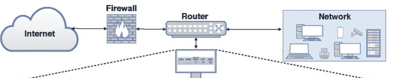

# 2020 第16届国际移动性、感知与网络会议 (MSN) (东京，2020.12.17-2020.12.19) 2020 第16届国际移动性、感知与网络会议 (MSN) ｜｜ 早期版本

Anderson Bergamani de Vieira, Alexandre Medeiros Araujo, Michele Nogueira
CCCSC - 计算安全科学中心
巴西帕拉纳联邦大学
邮箱：<abneira, araujojo, michele>@inf.upr.br

摘要—互联网产生的高昂成本以及受感染设备（IoT）数量的增加，迫使僵尸网络的早期检测（即尽早检测）以便在对抗攻击中占据优势。由于持续的变异、复杂性以及海量数据（其中许多源于众多网络和物联网），僵尸网络检测面临巨大挑战。为了通过识别恶意软件属性、恶意流量分类和攻击类型来减轻影响，本文提出了 ANTE，这是一种基于机器学习的僵尸网络预测系统，用于在其执行过程中检测不同的威胁场景。因此，ANTE 自主地为每种僵尸网络选择最合适的机器学习流水线，以提高分类准确率。我们使用三个数据集：IoT Helmet、BTU 和 CICD2019 将我们的方法与现有文献进行了对比。结果显示，平均准确率达到 99.87%，僵尸网络检测平均精确率为 100%。

僵尸程序（bot）是网络安全领域最大的问题之一。

僵尸是指连接到互联网或物联网并被恶意软件感染的设备，允许攻击者远程控制恶意行为。僵尸网络由受感染设备以及（即受攻击者控制的设备）组成 [4]。僵尸的危险之处在于它可以发起不同类型的攻击。特别是，僵尸网络作为通道用于：(i) 发送大量邮件（垃圾邮件）；(ii) 敏感信息；(iii) 发起分布式拒绝服务（DDoS）攻击。僵尸网络提供了利用僵尸的新方法 [6] 以及新型的攻击。此外，文献强调僵尸网络为软件对策措施带来了挑战 [7]。

技术的多样性为僵尸网络创建者提供了独特的特性，使得僵尸网络检测变得 [8]。地理分布和多样性也增加了检测难度 [5]。僵尸网络覆盖不同地区并具有全球影响力 [9]。Romero 等人 [10] 声称恶意软件隐藏了恶意代码，导致特征码难以检测。随着新技术的出现和反复杂的手段，许多攻击者成功逃避了检测。研究 [11] 表明，通常攻击者用与真实类似的恶意数据包淹没网络，使得从真实流量中识别恶意流量具有挑战性。Li 等人 [12] 指出，攻击者在发送数据包和临时不活动之间切换，以隐藏僵尸网络检测和攻击顺序。其他严重的局限性在于，选择合适的检测技术及其配置并非易事，特别是在面对零日攻击时。鉴于僵尸用户的多样性以及识别僵尸的困难，显而易见的是文献提供了检测僵尸网络的解决方案。解决方案需要预测未来威胁以限制攻击造成的服务，并适应以处理每种攻击 [5]。

这项工作介绍了 ANTE，一种用于预测的系统

# 1. 互联网

物联网（IoT）在学术界和工业界都非常突出，具有许多应用。物联网设备在带宽、处理、内存和能量方面受到限制。它们被硬件和软件漏洞渗透，使得这些设备容易被攻击者利用。攻击者利用漏洞并从缺乏安全性的获益。2019 年，CSO 报告存在 74 亿台连接设备，这是对 2025 年的估计。然而，连接设备的数量预计将增加，到 2023 年将达到 293 亿。因此 [1] 预测到 2022 年，全球每月将产生 396 艾字节 [3]。这种增长导致了设备被攻击者利用时的破坏性潜力。ANTE 使用自主机器学习技术预测僵尸行为。与文献中的其他工作 [13] 不同，ANTE 的设计允许在其执行过程中识别不同类型的僵尸网络。因此，ANTE 自动为场景选择最合适的机器学习引擎，以最大化正确分类准确率。自主机器学习流水线由三部分组成：(i) 数据收集和预处理；(ii) 估计器；(iii) 自适应和评估。机器学习算法对于识别高维数据中的僵尸非常重要。然而，每个机器学习算法都有局限性，且在不同性能上表现不同。

本节重点关注所选僵尸网络的特征和超参数选择。僵尸网络的攻击是不可逆的，例如由于 DDoS 攻击导致的严重耗尽。在捕获网络流量后，系统提取网络主机的行为，并使用机器学习（AutoML），ANTE 经过预处理、分类器和

自主机器学习（AutoML）系统旨在最大化机器学习的使用。在这里，AutoML 通过特征和超参数的选择实现了部分工作的自动化 [21]。不同的方法 [22] 显示了选择最佳超参数的困难。然而，人们努力统一特征和超参数的选择。

## 2. 相关工作

文献中的不同工作研究了如何识别和检测设备。它们在不同的规模和网络层级解决了这一问题。此外，它们使用了机器学习技术，如 (i) 基于异常的检测、(ii) 基于特征的检测、(iii) 图，或无监督机器学习。

ANTE 检测技术旨在根据观察到的特性识别异常行为，例如数据中使用的端口、高延迟或流量。在基于特征的检测中，解决方案提供了检测感染设备的已知方法。基于图的技术生成数学模型来显示网络对象之间的关系并检测僵尸。熵映射了网络的随机程度以及恶意设备之间通信的拦截。

## 3. ANTE 系统

本节描述了基于机器学习技术的僵尸网络预测系统（ANTE）。ANTE 系统捕获网络流量并为所选僵尸网络搜索特征、选择和超参数。

领域最早的方法之一是 Auto-Wiki (2014)，随后是其他方法，如 Auto-Sklearn [25] 和 Auto-Keras [20]。

分类器的超参数。为了这些信息，ANTE 创建了一个机器学习流水线，并进行预处理，随后它训练选定的技术来预测攻击的开始或瓶颈。

通过对数据应用一系列聚合函数来实现。特征需要对数据进行进一步分组。对于基于主机的传出或入站流量的特征，数据包按源或目的进行分组。此外，这些特征允许将数据转换为完全不同的结构。这些转换的结果随后被用于构建数据集。

ANTE 涉及五个步骤：(i) 网络流量；(ii) 主机行为识别；(iii) 识别最佳模型（AutoML）；(iv) 机器人预测；以及 (v) 通知。它必须有一个监控端口，以便网络管理员可以配置将网络流量的副本转发到托管 ANTE 的设备。ANTE 分析代表每个设备行为的特征。ANTE 采用自主机器学习来识别当前的流水线。该流水线通过处理流量副本来优化数据分布并选择最合适的学习模型。定义完成后，系统已准备好在现实世界中部署，在识别出机器人时，它能够分析网络上设备的行为。后续小节定义了这些步骤之间的关系。

### 3.2. 识别最佳模型 (AutoML)

在这一步中，ANTE 利用 AutoML 框架分析训练窗口中的数据，并选择最佳机器学习流水线，该流水线由数据预处理、机器学习技术和超参数组合组成。某些框架可能不具备处理分类的能力，但可以通过预处理对结果进行分类。预处理方法中的某些选项可以改进数据分布，例如降维、修改低区分度特征以及选择最具代表性的特征。

### 3.1. 流量与行为提取

系统分析流量。因此，首先由内部组件负责收集所有网络流量并提取其特征。在真实网络，内部组件实现在物理设备或虚拟设备中。在流量很大的情况下，内部组件可能会使用捕获流量的一部分，而不是全部捕获流量。这种操作的发生不会产生显著影响。

内部组件在滑动窗口中运行以进行实时数据处理，并在离线模式下使用历史数据作为输入。ANTE 使用内部组件通过滑动窗口收集所有流量。系统网络流量的处理方式如下。使用这种方法，有两个参数至关重要：窗口长度和滑动窗口。滑动是将新的网络包添加到窗口并将旧数据包排除在计算之外的频率。小窗口可以减少延迟，但会随着准确性的下降，如此小的窗口无法正确捕捉机器人的行为。ANTE 还可以通过增加滑动窗口来提高流量段的处理速度并提高准确性。这一问题表明，设计和实现必须基于计算成本与性能之间的平衡。

在按时间窗口对观察到的流量进行分组后，将提取并计算一组特征。

### 3.3. 机器人检测预测

为了识别机器人，机器学习算法必须对一个或多个机器人进行分类。当分类结果返回 ANTE 时，ANTE 检查该设备是否被分类为机器人。当 ANTE 识别出机器人时，它决定通知相关服务。地址提供了多种选项，如限制或阻止对设备的访问，这些可以在防火墙中手动或自动执行。这是为了通过电子邮件提供双方的互联网协议 (IP) 地址列表来通知网络管理员；用于自动化事件响应的另一种方法是发送包含包含数据数据的 JavaScript 对象表示法 (JSON) 消息，例如机器人列表和设备的概率。

# ANTE 系统

| 1. 捕获网络数据 | 2. 提取主机行为 | 3. 识别最佳模型 (AutoML) | 4. 预测机器人 | 5. 通知管理员 |
|---|---|---|---|---|
| 数据 | 行为 | 机器学习 | 模型 | 机器人列表 |

图 1：ANTE 架构

## 4. 性能评估

图 2 展示了 ANTE 的评估方法。评估使用数据集作为输入，其中包含来自（机器人）设备和（非机器人）设备的流量。数据集是：(i) 信息安全观测站 (ISOT) HTTP 僵尸网络数据集；(ii) 捷克工业大学数据集第 51 号捕获 (CTU-13)；以及 (iii) Doox 评估数据集 (CIDCS020)。然后 ANTE 设置架构，所有测试均在一台具有 8 核心、1TB 硬盘和 8GB字节 (GB) 随机内存的计算机上进行。

如图 2 所示，使用 (i) 网络流量 (ii) 作为输入数据集对于定义分析中心（攻击开始的时间）是必要的。定义分析中心后，ANTE 执行捕获、预测和测试窗口（如图 2 中的第 2 项所示）。评估窗口由三个阶段组成。ANTE 将这些窗口分为两部分。第一部分为30 分钟，第二个窗口包含 30 分钟的捕获。分析后，ANTE 提取 2 分钟用于攻击期间的识别测试。ANTE 定义预测和测试窗口以分析机器人生命周期。ANTE 为所有窗口生成逗号分隔 (CSV) 文件。这些 CSV 包含与设备及其数据交换的数据，代表行为组。

| 1. 场景选择 | 2. 行为提取 |
|---|---|
| 训练 (2 min) | 预测 (30 min) |
| 分析中心 | 测试 (2 min) |

| 3. ANTE 流水线对主机分类 | 3. Auto-sklearn 执行 |
|---|---|
| 预测 (30 min) | 测试 (2 min) |
| 分析中心 | 训练 (2 min) |

图 2：ANTE 评估步骤（注：原文为图 2 说明了 ANTE 的评估方法论）。评估使用数据集作为输入，其中来自（机器人）和（非机器人）设备的流量。数据集是：(i) 信息安全观测站 (ISOT) HTTP 僵尸网络数据集；(ii) 捷克工业大学数据集第 51 号捕获 (CTU-13)；以及 (iii) Doox 评估数据集 (CIDCS020)。然后 ANTE 设置架构，所有测试均在一台具有 8 核心、1TB 硬盘和 8GB字节 (GB) 随机内存的计算机上进行。

如图 2 所示，使用 (i) 网络流量 (ii) 作为输入数据集对于定义分析中心（攻击开始的时间）是必要的。定义分析中心后，ANTE 执行捕获、预测和测试窗口（如图 2 中的第 2 项所示）。评估窗口由三个阶段组成。ANTE 将这些窗口分为两部分。第一部分为30 分钟，第二个窗口包含 30 分钟的捕获。分析后，ANTE 提取 2 分钟用于攻击期间的识别测试。ANTE 定义预测和测试窗口以分析机器人生命周期。ANTE 为所有窗口生成逗号分隔 (CSV) 文件。这些 CSV 包含与设备及其数据交换的数据，代表行为组。

| 特征 | 描述 |
|---|---|
| Tsz/Tss | 发出流量大小 (bytes) |
| Rpc/Spc | 接收流量 |
| Smin | 最小发送大小 (bytes) |
| Svar | 最大发送大小 (bytes) |
| Rav | 发送方差 (bytes) |
| Rmin | 最小接收大小 |
| Rmax | 最大接收大小 (bytes) |
| Rvar | 接收方差 (bytes) |
| STmin | 发送时间 |
| STavg | 平均发送时间 |
| RTmin | 最小接收时间 |
| RTmax | 最大接收时间 |
| RTvar | 接收方差 |
| Indr | 指向节点的边数 |
| BC | 经过节点的节点路径数 |
| EG | 节点中心性程度 |

表 1：代表设备的元素

对于评估，如图 2 所示，ANTE 系统采用预处理技术、机器学习模型和由 Auto-sklearn 检测的超参数来分类正常和攻击（攻击窗口）。对于测试数据，ANTE 使用 30 秒的滑动窗口并每 30 秒开始一次。为了衡量分类质量，ANTE 使用准确率、召回率和 F 分数等指标与原始标签进行比较，以评估多样性。接下来，它分析处理器、超参数和架构选择的多样性，使用支持向量机 (SVM)、原生贝叶斯 (NB) 和多层感知器 (MLP)。这种比较将 ANTE 的结果于 [28]。

Auto-sklearn 的配置几乎是自动的，处理时间限制为 30 分钟。Auto-sklearn 选择最佳的机器学习模型。为了保持操作稳定，sklearn 使用四个处理器核心。为了防止过拟合并保持合法性，使用 F 分数来选择 Auto-sklearn 有效分类的模型。

ANTE 在收集训练数据后为每个场景定义机器学习流水线。该机器学习流水线包含三种处理缺失数据的策略。第一种策略解决缺失数据问题，我们称为填充策略。缺失数据是指某些设备某些特征的信息丢失，例如故障或其他原因。此外，所有分析的设备始终具有估计的属性。这意味着训练数据中没有缺失数据。我们决定在出现缺失数据时让 ANTE 使用填充策略。第二种策略是数据缩放，以确保数据在特定范围内表示，例如将属性值表示在零到一之间的范围。ANTE 为所有场景选择缩放。最后一种策略是特征选择。属性选择旨在移除低区分度属性并改进整体功能。最后，流水线中的最后一个策略是估计器。估计器定义了将使用的机器学习技术。

ISOT 场景是多个类别和非匿名数据集的组合。维多利亚大学

> ¹. https://github.com/axms/ANTE

## (A) ISOT 流水线

## (B) CTU-13 流水线

## (C) CICDDoS 流水线

| 数据处理器 | 特征预处理器 | 估计器 | 数据处理器 | 特征预处理器 | 估计器 | 数据处理器 | 特征预处理器 | 估计器 |
|---|---|---|---|---|---|---|---|---|
| 填充：中位数 | 选定速率 ANOVA F值 | AdaBoost | 填充：中位数 | 选定速率 ANOVA F值 | 随机森林 | | 特征聚类 | 被动攻击回归 |
| 缩放：归一化 | | 缩放：标准器 (Standard-Scaler) | | 缩放：量化变换 | | | | |

图 3：ANTE 识别的最佳机器学习流水线

加拿大² 是设计领域的大师。我们在对恶意和良性域名系统（DNS）流量进行评估时，使用的场景由 35 台设备生成，共计 780 兆字节流量，其中没有任何一个设备的数据是 2017 年 5 月 30 日协调世界时 (UTC) 29:31 分析的信息。ANTE 的攻击目标是在攻击开始前交换过数据包的 35 台设备中识别出得分最高的设备。

ANTE 在使用 ISOT 训练数据后，通过特征配置了机器学习流水线。关于这些配置的更多信息请参阅仓库¹。ANTE 使用均值 (Mean) 作为选择策略。这意味着如果策略执行，特征配置可以为 ANTE 正在使用的任何设备组件计算任何属性，ANTE 使用的是场景中设备的值。ANTE 还发现，通过应用属性归一化有助于分类任务。ANTE 运行在网络上。改进训练数据的策略是应用“选定速率”（Select Rates）方法。Select Rates 是一种基于统计测试选择特征的方法。Select Rates 可以遵循三种策略，通过最小化反向分类来提高分类质量。该策略使用了标签与特征之间的 ANOVA F 值。

表 2 显示了我们通过 ANTE 的整个机器学习流水线的结果。在两个窗口中对所有设备进行正确分类，不如在工具中将其标记为普通设备更为有效。在表 2 中，我们看到 SVM、NB 和 MLP 必须正确分类设备。

| 方法 | 窗口 | 精确率 | 召回率 | F1 分 |
|---|---|---|---|---|
| ANTE | 预测 | 100% | 100% | 100% |
| SVM | 预测 | 100% | 96% | 98% |
| Naive | 预测 | 100% | 72% | 84% |
| MLP | 预测 | 72% | 50% | 62% |
| ANTE | 测试 | 96% | 86% | 92% |
| MLP | 测试 | 94% | 71% | 81% |

表 2：ISOT 项目结果

该数据集包含 66 组和两种攻击。在该场景中，我们分析了从 2021 年 8 月 18 日中部标准时间 14:23 开始的第二次攻击。该场景包含大量使用 10 台机器人机流量的 DDoS 流量。对于第三次攻击，ANTE 识别出 30 台设备，其中 10 台是家庭设备。

图 3 展示了 ANTE 选择的机器学习流水线配置。在之前的场景中，ANTE 选择了“最频繁”（Most Frequent）作为填充策略，并选择“标准”（Standard）作为其他设备。Standard 通过应用一个过程来标准化特征，在该过程中，ANTE 识别跨边界的每个特征的平均值和标准差。ANTE 移除离群值，并将每个特征的值除以之前计算的标准差。

CTU-13 场景使用了属于 13 台设备的采集 51，称为 CTU-13 [29]。这组 13 个机器人流量捕包记录在捷克国家大学，可通过 Stratosphere.org 获取。

ANTE 处理数据并使用图 3 所示的配置对预测和测试窗口中存在的设备进行分类，该场景的流水线与之前场景的流水线有所不同。表 3 显示，该方法能够在两个窗口中正确分类所有设备。与之前的场景相似的特征是，SVM、NB 和 MLP 难以获得作为最佳估计器的有效性。

CICDoS 场景使用了 CICDDoS2019

> 2. https://www.uvca.ca/engineering/ece/ice/datasets/botnet-ransomware
> 访问日期：08/2020

> 3. https://github.com/akme/ANTE

521

## 4.2 与文献的比较

为了对比，我们使用 CTU13 数据集重现了 [28] 中获得的结果。此外，我们增加了对 ISOT HTTP 流量和 CICDDoS2019 数据集的分析。第一次对比使用了 [28] 中提出的技术在 ISOT HTTP 机器人数据集上获得的结果。在这个数据集中，Pekang 和 Acoran 的解决方案也优于填充方法（窗口）。对于 CTU13 数据集，ANTE 能够正确分类所有主机，然而 Pekang 和 Acoran 优于 ANTE 和 Aorcan。最后一次对比是 CICDDoS2019 数据集。在这种情况下，Pekang 和 Acoran 获得了 96.87% 的准确率。结果是，尽管填充方法未能识别机器人，但 ANTE 能够正确分类所有。

## 5. 结论

考虑到攻击的多样化潜力，以及由于物联网 (IoT) 和移动设备的出现导致检测这些攻击的困难，我们提出了 ANTE 通过机器学习早期检测机器人。对于三个分析的场景，ANTE 在分类机器人方面是有效的，并在评估节点攻击后提出了相应的方案。对于系统架构，我们的机器学习系统为每个场景选择最佳学习机。我们发现 ANTE 考虑了每个场景的特殊性，包括不同类型的攻击以及每个场景最高要求的部分。因此，ANTE 强调了选择技术以确保机器人检测高断准确性的重要性。另一个重要发现是，ANTE 在在攻击开始之前检测数据包时没有误报。即使在没有攻击的情况下，ANTE 也能正确识别。最后，结果表明，通过 ANTE 方法是可行的。

## 感谢

这项工作得到了巴西国家科学委员会 (CNPq) 支持。

| 方法 | 窗口 | 精确率 | 召回率 |
|---|---|---|---|
| ANTE | 预测 | 100% | 100% |
| SVM | 预测 | 100% | 96% |
| Naive | 预测 | 100% | 72% |
| MLP | 预测 | 72% | 50% |
| ANTE | 测试 | 96% | 86% |
| MLP | 测试 | 94% | 71% |

表 2：ISOT 项目结果

| 方法 | 窗口 | 精确率 | 召回率 |
|---|---|---|---|
| ANTE | 预测 | 100% | 100% | 100% |
| SVM | 预测 | 100% | 96% | 98% |
| Naive | 预测 | 100% | 72% | 84% |
| MLP | 预测 | 72% | 50% | 62% |
| ANTE | 测试 | 96% | 86% | 92% |
| MLP | 测试 | 94% | 71% | 81% |

| 数据集 | 系统 | 精确率 | 召回率 |
|---|---|---|---|
| ANTE | 预测 | 100% | 100% | 100% |
| SVM | 预测 | 100% | 96% | 98% |
| Naive | 预测 | 100% | 72% | 84% |
| MLP | 预测 | 72% | 50% | 62% |
| ANTE | 测试 | 96% | 86% | 92% |
| MLP | 测试 | 94% | 71% | 81% |

| 方法 | 窗口 | 精确率 | 召回率 |
|---|---|---|---|---|
| ANTE | 预测 | 100% | 100% | 100% |
| SVM | 预测 | 100% | 96% | 98% |
| Naive | 预测 | 100% | 72% | 84% |
| MLP | 预测 | 72% | 50% | 62% |
| ANTE | 测试 | 96% | 86% | 92% |
| MLP | 测试 | 94% | 71% | 81% |

| 方法 | 窗口 | 精确率 | 召回率 |
|---|---|---|---|---|
| ANTE | 预测 | 100% | 100% | 100% |
| SVM | 预测 | 100% | 96% | 98% |
| Naive | 预测 | 100% | 72% | 84% |
| MLP | 预测 | 72% | 50% | 62% |
| ANTE | 测试 | 96% | 86% | 92% |
| MLP | 测试 | 94% | 71% | 81% |

| 方法 | 窗口 | 精确率 | 召回率 |
|---|---|---|---|---|
| ANTE | 预测 | 100% | 100% | 100% |
| SVM | 预测 | 100% | 96% | 98% |
| Naive | 预测 | 100% | 72% | 84% |
| MLP | 预测 | 72% | 50% | 62% |
| ANTE | 测试 | 96% | 86% | 92% |
| MLP | 测试 | 94% | 71% | 81% |

| 方法 | 窗口 | 精确率 | 召回率 |
|---|---|---|---|---|
| ANTE | 预测 | 100% | 100% | 100% |
| SVM | 预测 | 100% | 96% | 98% |
| Naive | 预测 | 100% | 72% | 84% |
| MLP | 预测 | 72% | 50% | 62% |
| ANTE | 测试 | 96% | 86% | 92% |
| MLP | 测试 | 94% | 71% | 81% |

| 方法 | 窗口 | 精确率 | 召回率 |
|---|---|---|---|---|
| ANTE | 预测 | 100% | 100% | 100% |
| SVM | 预测 | 100% | 96% | 98% |
| Naive | 预测 | 100% | 72% | 84% |
| MLP | 预测 | 72% | 50% | 62% |
| ANTE | 测试 | 96% | 86% | 92% |
| MLP | 测试 | 94% | 71% | 81% |

| 方法 | 窗口 | 精确率 | 召回率 |
|---|---|---|---|---|
| ANTE | 预测 | 100% | 100% | 100% |
| SVM | 预测 | 100% | 96% | 98% |
| Naive | 预测 | 100% | 72% | 84% |
| MLP | 预测 | 72% | 50% | 62% |
| ANTE | 测试 | 96% | 86% | 92% |
| MLP | 测试 | 94% | 71% | 81% |

| 方法 | 窗口 | 精确率 | 召回率 |
|---|---|---|---|---|
| ANTE | 预测 | 100% | 100% | 100% |
| SVM | 预测 | 100% | 96% | 98% |
| Naive | 预测 | 100% | 72% | 84% |
| MLP | 预测 | 72% | 50% | 62% |
| ANTE | 测试 | 96% | 86% | 92% |
| MLP | 测试 | 94% | 71% | 81% |

| 方法 | 窗口 | 精确率 | 召回率 |
|---|---|---|---|---|
| ANTE | 预测 | 100% | 100% | 100% |
| SVM | 预测 | 100% | 96% | 98% |
| Naive | 预测 | 100% | 72% | 84% |
| MLP | 预测 | 72% | 50% | 62% |
| ANTE | 测试 | 96% | 86% | 92% |
| MLP | 测试 | 94% | 71% | 81% |

| 方法 | 窗口 | 精确率 | 召回率 |
|---|---|---|---|---|
| ANTE | 预测 | 100% | 100% | 100% |
| SVM | 预测 | 100% | 96% | 98% |
| Naive | 预测 | 100% | 72% | 84% |
| MLP | 预测 | 72% | 50% | 62% |
| ANTE | 测试 | 96% | 86% | 92% |
| MLP | 测试 | 94% | 71% | 81% |

表 5：文献结果

表 4：对于 CICDDoS2019 数据集

5. www.unb.ca/cic/datasets/ddos-2019. 访问日期：08/02/2020

522

授权许可限制：Dedan Kim 大学。下载于 2021/05/15 11:28:11 UTC，来自 IEEE Springer。适用相关限制。

数据集 [30] 由新布伦瑞克大学 (UNB) 提供。我们选择该数据集是因为它于 2019 年发布，包含 20 GB 网络流量，并包含了 30 天内不同类型的攻击。在该场景报告的 12 次攻击中，场景包含了实验第一天的网络基础输入输出系统 (NetBIOS)攻击。在检测到攻击后，我们分析了第一天 10:30 的流量。通过分析数据，无法找到特定时间的流量。因此，测试调查了 12 月 5 日发生的峰值流量。

#309129/2017-6 和 #432204/2018-0，由圣保罗研究基金会（FAPESP）资助 #2018/23098-0；由巴西高等教育人员改进协调局（CAPES/Brazil）资助 #88887.5018270-0 和 #88887.09309-2020；由国家技术与研究网络（RSNP）通过 GE-Technical 项目资助。

## 参考文献

- [1] A. Nordum,‘2020年500亿设备的物联网流行兴趣将实现’,https://www.ieee.org/popular-interest-of-things-for-50-billion-devices-is-out.html [访问于：2021年]。
- [2] V. N. I. Cisco,‘思科年度互联网报告2017-2018：移动互联网的未来’，https://www.cisco.com/c/en/us/products/coll/white-paper/cisco-annual-internet-report-2017-2018.html [访问于：2021年]。
- [3] T. Samit, S. J. Indra, and T. Kirchner,‘思科世界市场统计：2027年完整预测更新：美洲/欧洲非洲/亚太’，思科网络会议研讨会，2021年。
- [4] Y. Mane,‘IoT中P2P僵尸网络的检测与防御’，IEEE Internet Journal,第5卷，第75–78页。
- [5] A. A. Santos, M. Nogheira, and J. M. Fuchs,‘用于探索移动僵尸网络的随机攻击模型’，IEEE Commun. Lett.,,第23卷，第2期，第88–90页。
- [6] S. Venkesanan, M. Albasi, A. Khan, Ranjan, and S. Sajidia,‘在资源受限的环境中使用机器学习检测隐性僵尸网络’，收录于 Moving on Target Defense, STD 17, 美国纽约, NY: IEEE, 2019,第75–85页。[在线]. 可用：http://doi.org/10.1109/STD.2019.2891554
- [7] Y. D. Huang, D. Dharmani, S. Melekioğlu, V. Drake, C. Davis, D. Mocasy, S. Wagner, N. Senner, and K. Leencker,‘使用深度学习进行僵尸网络检测’，IEEE Access,2020年。
- [8] S. Ruisco, R. Santos, V. Begum, and S. Gallatti,‘来自异构数据源、物联网网络的僵尸网络活动分析’，见于2015年计算机通信网络国际会议 (ICCCN)，2015年,第391–396页。
- [9] S. S. Silva, R. M. Silva, C. Pinto, and E. R. Santos,‘僵尸网络的检测与分类’，Computer Networks,第55卷，第2期，第378–403页,2011年. 活动章节：检测与关闭。[在线]. 可用：http://www.sciencedirect.com/science/article/pii/S1389347X1100033X
- [10] A. Karim, R. B. Billa, M. Sharif, and N. A. Baar,‘使用机器学习进行僵尸网络检测与分类’，德黑兰大学科学期刊C,第15卷，第11期，第933–948页,2013年。[在线]. 可用：http://doi.org/10.2205/utssc.v1511
- [11] B. Gupta and O. P. Badve,‘云计算中DDoS攻击的分类及检测防御机制’，Computer Security,第56卷,第172–180页,2016年。
- [12] W. Chang, M. Mohain, and S. Wang,‘对抗性僵尸网络募’，见于2018年计算机、通信与安全国际会议 (ICCSC),第197–204页。
- [13] B. Gupta, M. Rahul, and A. Santos,‘基于架构的分布式僵尸网络检测’，IEEE Access,第8卷。
- [14] S. Saad, I. Traore, and D. Wu,‘僵尸网络的实证方法’，IEEE Access,第7卷。
- [15] S. Garcia, M. Grill, J. Siborek, and A. Zurina,‘僵尸网络检测方法的实证方法’，IEEE Access,第6卷,第54551–54560页,2018年。[在线]. 可用：http://www.sciencedirect.com/science/article/pii/S18770519183XXXX
- [26] J. Shafarzani, A. L. Hashemi, S. Khan, and A. G. Ghorbani,‘使用深度学习评估拒绝服务 (DDoS)攻击检测’，IEEE Access,2020年。
- [27] A. Pektak and T. Ackerman,‘通过网络流摘要使用深度学习检测僵尸网络’，NCCA,2018年7月。[在线]. 可用：https://doi.org/10.1007/s00521-018-3595-x

