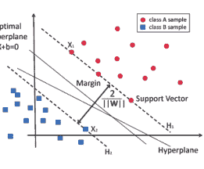
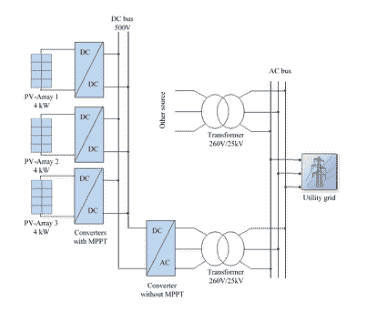
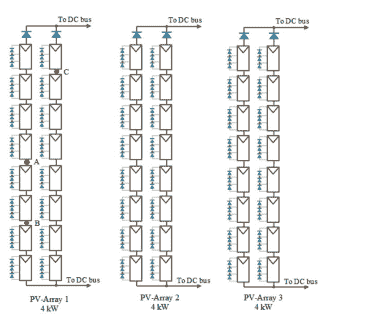
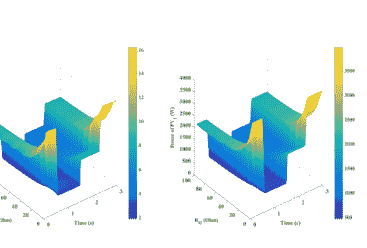
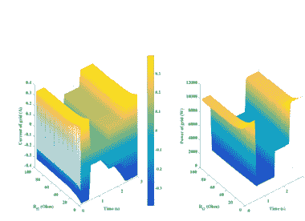
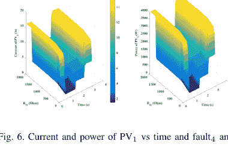
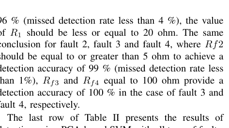

# 2020 第17届国际系统、信号与设备学术会议 (SSD)

**摘要** 为了确保并网光伏（PV）系统的高可靠性，故障检测和自动监控对于保持光伏系统和电网的正常运行至关重要。无论故障类型如何，隐性故障更难以检测和精确隔离。作为一种替代且有效的方法，提出了主成分分析（PCA）来提取特征，并使用支持向量机（SVM）技术来快速检测光伏系统中发生的故障。在 PCA 框架内，通常提取并选择 T 平方误差（SPE）策略。

其引入是为了灵活且可靠地解决问题。在这种情况下，采用卷积神经网络（CNN）来处理故障分类。此外，开发了一种基于使用分类器检测串联电阻增加的故障检测（FD）方法 [11]，用于光伏系统的运行状态。还开发了一种决策树（DT）用于检测光伏系统中的若干常规故障 [12], [13]。在 [7] 及其参考文献中可以找到用于各种类型光伏系统的不同智能技术。

所提的任务是从主成分分析（PCA）、并网光伏系统、故障提取与选择、故障检测中学习。

Davarif 等人 [14] 使用了功率和统计信号处理技术进行光伏系统检测。Silvestres 等人 [15] 开发了一种基于新型电压和电流指标的改进故障检测程序。Silvestres 等人 [16] 开发了基于功率分析的四个指标，用于故障划分和光伏侧故障的检测。另一方面，[17]、[6], [5] 中的作者使用了多种多变量和单变量方法进行光伏故障检测。为了解决故障的复杂性并处理温度问题，数据驱动方法（如机器学习技术）已应用于建立光伏检测系统。支持向量机（SVM）是用于电力检测（PD）故障的著名学习方法 [18]。Spartaru 等人 [19] 并验证了基于模糊分类器的串联电阻增加检测。这种方法对于隔离无故障更好，但对其他故障的准确性较低。

# I. 引言

在过去的20年里，对光伏（PV）能量的需求不断增长了20%到25%，并在网系统取得了许多重大进展。未来并网光伏（GCPV）系统需要考虑的一个关键因素是故障检测 [9]。文献中已经提出了多种基于模型、基于电信号和基于数据驱动的故障检测技术 [2], [3], [4], [5], [7]。

例如，Dress 等人 [8] 开发了一项利用卫星监控和利用传感器局部监控来监测 GPV 系统异常情况的故障检测任务。还提出了一种基于小波变换的资源较少的简单方法 [19]。该方法使用光伏故障电压的小波系数的标准差。在 [10] 中，航空光伏模块图像的故障模式识别基于深度学习的。

Spartaru 等人 [19] 根据 I-V 曲线特征提取的参数将序列特征向量作为故障诊断模型的输入。基于核的极学习（KBEL）的出现已用于利用改进的 Simulink 光伏模型建立自动故障诊断系统。

光伏系统的故障有很多原因，根据其特征可分为三大类：间歇性、突发性或隐性。间歇性故障是指随时间变化的故障，例如局部阴影或环境压力（如灰尘或污染）。永久性或突发性故障是指由于光伏阵列损坏而瞬间发生的故障，如线间短路或线对地、接线盒或电池连接。热点作为永久性故障最具挑战性，它们最初很难检测，因为它们很小且随时间变化。如果及早识别出它们，可能会导致光伏电池的逐渐损坏。隐性故障可能发生在直流侧或交流侧。示例包括光伏模块缺陷和 DC/DC 转换器。交流侧故障（逆变器侧）包括双栅逆变器（BGI）故障、布线老化和过热。

本文的目的是提供一个使用 SVM 分类器的框架来检测 DC/DC 转换器中的 GCPV 故障（专注于隐性故障）。在开发的方法中，使用主成分分析（PCA）从 GCPV 数据提取并选择足够重要的特征。这些特征被输入 SVM 分类器，该分类器可以在检测到满意的随机环境下检测 GCPV 的故障。

本文的其余部分组织如下：第 2 节简要回顾用于提取和选择特征的 PCA 类型。第 3 节专门介绍机器学习技术。第 4 节给出评估基于基于 PCA 的 SVM 性能的仿真结果。第 5 节总结全文。

# II. 特征提取与选择

## A. 基于 PCA 的特征提取

我们考虑正常条件下具有 $N$ 个变量的数据矩阵 $X$，数据归一化为零均值单位方差

$X = [X_1, X_2, ..., X_m] \in \mathbb{R}^{N \times m}$ (1)

PCA 将数据转换为新矩阵 $T \in \mathbb{R}^{N \times m}$ 的相关特征 $t_1, t_2, ..., t_m$

$T = XP$ (2)

$P$ 是通过协方差矩阵 $\Phi$ 的正交变换得到的，可以通过特征值分解找到

$\Phi = P\Lambda P^T$ (3)

其中 $\Lambda = \text{diag}(\lambda_1, \lambda_2, ..., \lambda_m)$ 是包含降序排列特征值的对角矩阵。

数据降维可以通过将 $P$ 和 $A$ 分为建模和非建模部分来实现。第一个 $P_k \in \mathbb{R}^{m \times k}$ 和 $A_k \in \mathbb{R}^{k \times k}$ 跨越主空间，另一个 $P_t \in \mathbb{R}^{m \times (m-k)}$ 和 $A_t \in \mathbb{R}^{(m-k) \times (m-k)}$ 跨越残差空间。$P_k$ 的列是对应前 $k$ 个最大特征值 $\lambda_i$ 的协方差矩阵特征向量，对应主成分。$P_t$ 的列是 $\Lambda_t$ 中剩余的 $m-k$ 个特征向量。

结果，PCA 将数据 $X$ 分解为

$X = XT + \hat{E}$ (4)

$\hat{T}$ 代表所选特征，通过投影到对应于协方差矩阵方差最大的特征向量实现。总之，PCA 模型基于协方差矩阵 $\Phi$ 的特征分解。

所选特征应以某种方式构建，以增强正常状态与各种异常运行状态之间的差异。为了获得基于 SVM 分类方法的良好性能，通过枚举可能值通过基于 PCA 模型提取状态特征是重要的。这种特征计算简单且高效稳健。适用于 GCPV 故障诊断的特征包括：$T^2$ 测量主空间内的方差。其给出为

$T^2 = X^T P \Lambda_k^{-1} P^T X$ (6)

平方重构误差（SWE）是剩余主成分空间中最重要的指标。它定义为

$SWE = X^T P_t \Lambda_t^{-1} P_t^T X$ (7)

# III. 基于 PCA 的 SVM 故障检测技术

下一节的目标是将基于 PCA 的 SVM 技术应用于故障检测（FD）。

## A. 支持向量机

Vapnik 首次引入了支持向量机 (SVM) [18]。接下来，考虑了开发 SVM 分类的基本思想概述。给定一个包含 $N$ 个样本 $x_k \in \mathbb{R}^m$ 的训练集，输出为 $y_k \in \{-1,1\}$，代表一组标记过的训练数据。SVM 采用如下形式：

```
$y_k = f(x_k) = w^Tx_k + b$
```

其中 $w \in \mathbb{R}^m$ 且 $b \in \mathbb{R}$。为了确保分离平面尽可能远离支持向量，应该最大化由 $b$ 定义的间隔（见图1）。这等同于：

```
$\min \frac{1}{2}||w||^2$ subject to $y_k(w^Tx_k + b) \geq 0 \quad \forall k$
```

分配拉格朗日乘子 $\alpha_k$，其中 $\alpha_k \geq 0$，二次规划 (QP) 优化问题 (9) 变为：

```
$L_{QP} = \frac{1}{2}||w||^2 - \sum \alpha_k y_k(w^Tx_k + b) + \sum \alpha_k$
```

通过对 $w$ 和 $b$ 求导并令其为零：

```
$\begin{cases} \frac{\partial L_{QP}}{\partial w} = 0 \\ \frac{\partial L_{QP}}{\partial b} = 0 \end{cases} \Rightarrow \begin{cases} w = \sum \alpha_k y_k x_k \\ \sum \alpha_k y_k = 0 \end{cases}$
```

将 (11) 代入 (10) 得到主 QP 的最优解取决于：

其中 $H = [x_i^Tx_j]_{i,j=1}^N$。确定 $\alpha$ 后使用 (11) 很容易计算出来。为了确定 $b$，引入一个满足 (11) 的新数据 $x_s$，支持向量采取如下形式：

```
$y_s(w^Tx_s + b) = 1$
```

参考支持平面方程，无论类别 $y_s$ 如何，变量 $b$ 由下给出：

```
$b = -w^Tx + \sum_{m \in S} \alpha_m y_m x_m$
```

反之，得到了分离平面的最优方向。



# IV. 基于 PCA 的 SVM 故障检测技术

建议的方法包含三个阶段，包括特征提取、特征选择和检测。这些方法适用于不同的场景。PCA 仅使用正常运行条件下训练集中的数据构建。这种投影通过将数据投影到正信息子空间来实现。得到的 PCA 模型结构由子空间的方向表示，其维度小于原始数据的维度。通过这一操作，提取了显著特征（见 II-A 节观测结果）。之后，它们将使用逻辑分类进行处理。这些代码保留在 $\{-1,1\}$ 中，代表一组标记过的训练数据。所得分类器与特征集之间的比较允许做出有效决策。此外，利用从中提取并选择的不同特征执行了基于 SVM 的实验。

## A. 并网系统描述

在这项研究中，考虑了分布式结构。这种结构是一种模块化应用，允许技术的倍增和多样化，可以组合多种不同类型的光伏传感器。图2 显示了可能配置的一个方面。它是一个电压值为 500 V 的直流母线。所有面板板/转换器元件并联连接到该母线。下游转换器不控制全局 MPPT 跟踪，每个面板板都以优化方式被单独控制。此外，控制器对扰动具有鲁棒性。高电压使得避免减少电缆截面成为，这在材料（铜或铝）上是一种收益。





该光伏电站由三个最大输出 4 kW 的光伏阵列组成。一个光伏阵列块由 2 条并联链路组成，每条链路有 4 个串联模块。每个模块包含 2 个电池（见图3）。每个光伏阵列连接到一个 DC/DC 转换器。输出连接到 500 V 的直流母线。每个转换器由单独的最大功率点跟踪器 (MPPT) 控制。MPPT 使用“摄动与观测”技术来验证光伏阵列终端相对于最大功率的行为。一个三相串联转换器在功率耦合中将 500 V 转换为直流和交流电，用于将功率馈到电网。获取了不同辐照度下的仿真结果。考虑了三类光伏故障（fault_1, fault_2 和 fault_3）。故障通过引入电阻变化来影响母线。当前故障（fault_2）被考虑在链路 1 中，位于模块 1 和 12 之间。该故障通过 A 点的可变电阻（$R_{12}$）建模。电阻描述了电流的状态。同样，故障 3 和 4 分别通过电阻 $R_3$ 和 $R_4$ 建模。这些电阻分别位于 A 点与电网之间，以及 B 点与 C 点之间。对于两种故障（fault_1 和 fault_2），建立了 0.5, 1, 5, 10, 20, 30, 40, 50, 60 和 70 欧姆的电阻故障。对于情况3 和 4，考虑了 15, 20, 30, 50, 100, 1000, 1500 和 2000 欧姆的电阻故障。

| 变量 | 描述 |
|---|---|
| $x_1$ | $PV_1$ 电流 (A) |
| $x_2$ | $PV_2$ 电流 (A) |
| $x_3$ | $PV_1$ 电压 (V) |
| $x_4$ | $PV_2$ 电压 (V) |
| $x_5$ | $PV_3$ 电压 (V) |
| $x_6$ | $PV_1$ 功率 (W) |
| $x_7$ | $PV_2$ 功率 (W) |
| $x_8$ | 电网功率 (W) |

表 I 变量描述



图 4. $PV_1$ 的电流和功率随 fault_2 幅值的变化。

为了出于 FDI（故障检测与隔离）目的进行实验，收集了各种仿真变量（见表 I）。图 4, 5, 6 和 7 显示了 $PV_1$ 输出电流、供电流以及电网可用功率随时间以及故障 2 和 4 的幅值的变化。在给定条件下，$I=1000$ (W/m^2) 从 0 到 0.5 (s)，$I=200$ (W/m^2) 从 0.5 到 1.5s，$I=500$ (W/m^2) 从 1.5 到 2.3 (s) 存在故障 3。



图 5. 电网的电流 ($i_o$) 和功率随时间及故障 $\lambda$ 幅值的变化。

| 故障 | 数值 | 分类器 | 类别 | 召回率 (%) | 精确率 (%) |
|---|---|---|---|---|---|
| fault 1 | $R_{f1}=0$ 欧姆 | SVM | C1 | 83.25 | 68.00 |
| fault 2 | $R_{f2}=50$ 欧姆 | SVM | C1 | 96.89 | 96.62 |
| fault 3 | $R_{f3}=100$ 欧姆 | SVM | C1 | 73.86 | 73.67 |
| fault 4 | $R_{f4}=200$ 欧姆 | SVM | C1 | 99.96 | 99.88 |
| fault 5 | $R_{f5}=500$ 欧姆 | SVM | C1 | 81.36 | 72.24 |
| fault 6 | $R_{f6}=1000$ 欧姆 | SVM | C1 | 100.00 | 100.00 |
| fault 7 | $R_{f7}=2,3,4,5000$ 欧姆 | SVM | C1 | 97.66 | 96.66 |

不同故障值使用 SVM 分类的准确率结果



图 6. $PV_1$ 的电流和功率随故障 $\lambda$ 幅值的变化。



图 7. 电网的电流 ($i_o$) 和功率随时间及故障 $\lambda$ 幅值的变化。

## B. 故障检测结果

PCA 模型根据正常条件下的健康数据构建，然后在故障条件下在残差和主子空间中提取特征。本研究的特征是 $T^2$ 和 $SWE$ 统计。为了展示早期检测能力，对不同的故障幅值进行了仿真并使用 SVM 计算检测准确率。表表所示，对于 $R_{f1}=30$ 欧姆的故障 1，SVM 分类器的检测准确率为 86%；当幅值增大到 $R_{f1}=20$ 欧姆时，准确率提高到 96.61%。因此能够以至少的准确率检测故障 1

# VI. 结论

在本文，我们考虑了并网光伏（GCPV）系统的早期故障检测（FD）问题。开发的技术基于支持向量机 (SVM) 和主成分分析 (PCA)。通过 SVM 进行特征提取和选择，并使用 SVM 分类器进行检测，$T^2$ 和 $SWE$ 统计被准确地应用于故障检测。对每种情况进行了调查，以展示所提方法的鲁棒性和效率。所提解决方案能够检测 GCPV 系统在正常和异常条件下的早期故障。

# 致谢

本工作得到了卡塔尔国家基金会（基金会成员）NPR 资助 NPR999-330-2-140。本文中的发现完全由作者负责。
