# 2020 第19届 IEEE 机器学习与应用国际会议 (ICMLA) (美国佛罗里达州迈阿密 2020.12.14-2020.12.17)

**摘要** 非负矩阵分解（NMF）通过将文本的词频（TF-IDF）表示 `X` 分解为两个低秩非负矩阵对文本主题建模：其中 `W` 代表主题，`H` 将文档映射到主题。所有主题模型共同面临的挑战之一是确定主题的数量。正确的主题数量非常重要：低估计会导致主题分离度差，高估计则会导致主题重叠。在这里，我们介绍了 SeNMF，一种基于语义的 NMF 主题建模方法，该方法结合了语义信息来指导主题数量的确定。SeNMF 基于 TF-IDF 耦合分解创建随机矩阵系，以获取对噪声鲁棒的稳定相干主题。主题的确定基于这些主题的稳定性。我们证明了与其它工作相比，SeNMF 能够在各种文本语料库中准确地确定主题数量。

**索引术语** `NMF`、主题模型、文档聚类、`NLF`

被视为通过将文档映射到小得多的的空间执行的密集降维。在这种情况下，通过对主题空间中每个主题的坐标进行聚类，我们可以导出与某些主题相关的文档组，即进行聚类。这是主题建模中的一个关键挑战：确定语料库的隐维度。确定正确的隐维度对于语料库的有意义的分析至关重要，因为低估计主题数量会导致主题分离度差，高估计会导致主题重叠。

在本文中，我们引入了一种新的主题建模方法 SeNMF，它利用基于库尔巴贝克-莱布勒散度（KL）的非负矩阵分解（NMF）来实现：(a) 考虑了语料库的耦合词频（TF-IDF）表示 `X` 和上下文矩阵 `M`；以及 (b) 使用自定义重采样来确定隐维度。具体而言，基于 TF-IDF 和词汇-上下文矩阵 `X` 和 `M`，通过添加微小噪声 `ε` 创建两个噪声版本 `X'` 和 `M'`，其中 `X' = X + ε` 且 `M' = M + ε`。SeNMF 对这些对中的每一对执行耦合分解，以获得准确聚类的主题集。我们根据生成主题的稳定性来确定隐维度。我们证明了 SeNMF 能够在基准比较中识别正确的主题数量，并与最先进的技术相当。最后，我们对空间中（通过耦合分解获得）的每个文档结果进行聚类，并识别与某些主题相关的文档组。我们观察到，组的数量并不总是与提取的主题数量相同，但它们呈现了有意义的文档聚类。

# I. 引言

随着世界新闻文章、社交媒体、信息消息和其他文本数据数字内容的海量增长，从噪声中保留相关信息是一项双重挑战。为了从大型语料库中提取并提取丰富信息，我们需要自动表征每个文档的内容，即检测跨越每个文档含义的主题。提取和学习隐主题的过程（即观察跨越语料库的隐藏主题信息）被称为主题建模。

主题模型基于以下原理：(i) 每个主题都是词汇的集合，且 (ii) 每个文档都可以表示为主题的混合。

文档聚类识别语料库中属于同一主题或相关主题的文档组，并将它们归为一类。我们证明了聚类和聚类之间紧密相关，主题建模可以被视为通过将文档映射到小得多的的空间执行的密集降维。

本文的主要贡献有：

- SeNMF，一种用于寻找隐主题数量的鲁棒语义非负矩阵分解方法。
- 我们推导了带有语义正则化的 KL 散度 NMF 多层。
- 我们证明了 SeNMF 能够准确确定文本语料库的主题模型。
- 我们证明了单词矩阵与语料库 TF-IDF 表示的耦合分解结合统计支持，可以在基准数据集上产生高质量的主题和准确的文档聚类。

本文结构如下：第二节讨论相关工作。第三节介绍 SeNMF。第四节在五个基准数据集上对我们的方法进行评估。最后，第五节给出结论。

# II. 相关工作

## A. 主题建模

有很多主题建模方法：潜在语义分析（LSA）[2]、概率 LSA [3]、潜在狄利克分配（LDA）[4] 和非负矩阵分解（NMF）[5]。在这些方法中，LDA 遵循概率模型，该模型假设一组主题遵循狄利克分布。NMF 遵循线性模型，使用词袋（BoW）或 TF-IDF 分解文本语料库。NMF 使用类似于奇异值分解（SVD）的相似性进行主题表示，这对于主题来说是不适用且不自然的。这两种方法（概率的和基于分解的）之间的巨大差异是一个关注点。因此，带有 KL 散度约束的 NMF 和 LDA 引向了一个生成模型 [6]，该模型在狄利克先验下等同于 LDA。

NMF 家族有很多方法，例如用于集成 NMF 算法与先验 UPN [9]。其他方法 [10] 用于发现和约束主题。

## B. 模型确定

若干启发式方法有助于确定主题数量。其中一些基于主题质量的衡量。最早的指标之一是估计质量困惑度 [4]，它衡量概率模型预测留出测试集的效果。遗憾的是，困惑度不能反映主题的语义内容 [17]，并提出了一种新的指标——相干性，用于评估主题。

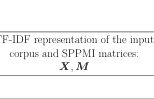


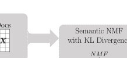

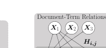

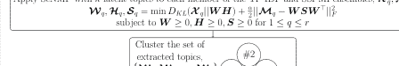

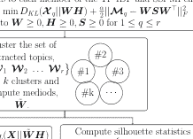

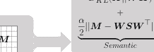

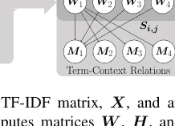

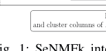

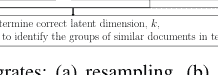

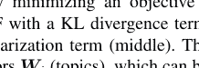

最小化的准确性。SNMF 集成了最小化、聚类和轮廓系数统计 [35]。

```
D_KL(X||Y) = ∑_i,j X_ij log(X_ij / Y_ij) - Y_ij
```

# III. 方法论 – SNMF

在这里我们详细描述我们的 SNMF 模型及其细节 [6]。它包括：

1. 通过对初始 TF-IDF 矩阵 `X` 和 SPMF 矩阵 `M` 应用随机扰动，组装 TF-IDF 和 SPMF 矩阵对；
2. 对于每个集合和主题数量 `k`，运行带有 KL 散度和正则项的聚类 SNMF，以考虑语义信息；
3. 聚类提取的主题集，以导出最终主题 `W`，并使用聚类的统计数据估计其稳定性；
4. 确定最新的潜在维度，以及 (5) 使用轮廓指数和聚类结果确定文档矩阵 `H`。我们随后描述以下步骤：

共现矩阵表示为包含每个词出现频率的向量。共现矩阵表示两个词 (`i` 和 `j`) 在预定义窗口（例如 +/- 5 个词）内出现的次数。已经证明词嵌入可以通过分解 SPMF 词-上下文矩阵 `M` 来构建。共现矩阵的单元格包含点对互信息 (PMI)，定义为 (log) PMI 以保证非负性。在数学上，PMI 定义为：

## A. KL 散度辅助的 SNMF

```
PMI(i, j) = log(c_ij / (∑_k c_ik ∑_k c_kj))  (2)
```

在本节中，我们讨论正则化 SNMF，如图 2 所示。我们的 NMF 通过两个低秩矩阵 `W ∈ ℝ^(n×k)` 和 `H ∈ ℝ^(k×m)` 的乘积，近似非负文档矩阵 TF-IDF 表示 `X ∈ ℝ^(n×m)`。`W` 的 `k` 列表示提取的主题，而 `H` 的 `k` 列提供了文档-词表示。对于文档-词矩阵，泊松噪声模型是合适的，因此使用共现矩阵计算点对互信息。PMI 解释了词 `i` 和 `j` 相对于它们独立出现的情况如何共现。

为了考虑词之间的语义关系，我们利用语料库 TF-IDF 表示 `X` 和 SPMF 词-上下文矩阵 `M`。具体而言，我们的 SNMF 使用带有 KL 散度和正则项的 NMF，因此：

```
min_{W,H ≥ 0} D_KL(X||WH)
```

```
min_{W,H ≥ 0} D_KL(X||WH) + λ/2 ||M - SW||^2
```

最小化，330

`M ∈ ℝ^(m×n), S ∈ ℝ^(k×k)` 是非负矩阵。该语义正则化 `λ ∈ ℝ_+` 是一个正则化参数。引入 [13]，涉及 `M` 和 `X` 与公共因子 `S` 的耦合分解。

为了解决方程 3 中的 SNMF 优化问题，我们将 SPM 正则化整合到 NMF 的乘法更新中 [36]。乘法更新可以使用增广拉格朗日 `L(W, H, Λ_W, Λ_S)` 导出，如方程 3 所示：

```
L = D(X||WH) + λ/2 ||M - W^T S||^2 + ∑_i=1^m ∑_j=1^n (Λ_W,ij) + ∑_i=1^m ∑_j=1^n (Λ_H,ij) + ∑_i=1^k ∑_j=1^k (Λ_S,ij)
```

其中 `Λ_W, Λ_H, Λ_S` 是 `W, H, S` 约束的拉格朗日变量。`L` 对 `W_ij, H_ij` 和 `S_ij` 的导数为：

```
∂L/∂W_ij = -(H^T)_ij + (X_ij - (WH)_ij)/W_ij + (W^T S)_ij - Λ_W,ij
```

```
∂L/∂H_ij = -(W^T)_ij + (X_ij - (WH)_ij)/H_ij + (W^T S)_ij + Λ_H,ij
```

```
∂L/∂S_ij = -(W^T)_ij + (W^T S W)_ij + Λ_S,ij
```

从导数中，我们获得了防止变量非负性的乘法更新：

```
W_i,· ← W_i,· * (X^T H)_i,· + (H^T S)_i,· / (H^T H + S W)_i,·
```

```
H_·,j ← H_·,j * (W^T X)_·,j + (W^T S)_·,j / (W^T W + S)_·,j
```

```
S_ij ← S_ij * (W^T X)_ij / (W^T S)_ij
```

对于固定的 SNMF，我们有许多乘法更新规则。根据实验（见 IV-D），目标函数 `J` 能够收敛到局部最优。图 2 显示了混合词-文档矩阵和上下文矩阵的益处。

## B. 模型选择的语义 NMF

SNMF 集成了正则化、SNMF 和聚类以确定主题数量。图 1 展示了 SNMF 的不同步骤。我们的方法是迭代的。首先，通过重采样 `X` 和 `M` 创建一个随机集合。具体而言，我们使用随机噪声 `X = {X^(1), ..., X^(l)}`。为了稳定聚类，我们对发现的类进行聚类，如算法 1 所示：

**算法 1 SNMF 聚类**

| **输入：** | `X ∈ ℝ^(m×n), M ∈ ℝ^(m×n), k ∈ ℝ, k_max ∈ ℝ` |
| :--- | :--- |
| **执行：** | |
| 1. | 对于 `k` 从 1 到 `k_max`： |
| 2. | 对于 `l` 从 1 到 `l`： |
| 3. | `X', M' = Perturb(X, M)` ← 创建因子 |
| 4. | `W =` 集合中第 `q` 个成员，`H, S = SNMF(X', M', k')` |
| 5. | 对于： |
| 6. | `W = cluster(W, H, S)` ← 因子的聚类 |
| 7. | `W = median(W)` ← `k` 中位数 `W` |
| 8. | `H = getcluster(W, H)` ← 继承 `H` 类 |
| 9. | 列误差 |
| 10. | `s_k = Silhouette*(W)` ← 类的轮廓系数 |
| | 结束 `[k_min, k_max]` |
| **输出：** | `k = opt{s_k}, W[k] ∈ ℝ^(m×k), H ∈ ℝ^(k×n), X ≈ W[k]H` |

我们使用的另一种方法是相对重构误差。我们使用类的中位数 `W` 作为我们的最终

对于已过去的 `k` 个解，重构矩阵 `X^rec = WH^T` 用于计算重构误差 `R = ||X - X^rec|| / ||X||`。`R` 评估了我们解的准确性并减少了初始误差。

为了确定隐含主题的数量 `k`，SenMF 选择 `k` 为能够以稳定方式重构初始文档矩阵的主题（即其重构误差 `R` 达到平台期），且集合的聚类具有足够的稳健性（即隐含特征的聚类和最终确定可以在 [27], [28] 中找到）。

## C. 文档聚类：识别文本语料库中的相似文档

在识别出文本后，我们采用了一种称为 H-聚类的算法，根据这些主题对文本语料库中的文档进行分类。我们对矩阵 `H` 中的元素采用 `k-means` 聚类，这些元素代表了每个主题在主题空间中的文档中心。为了从 `H` 中选择最具代表性的主题，我们以标准的方法使用了轮廓系数统计。最后，我们通过跨越文档空间的聚类来映射识别出的簇，并在文本语料库中识别这些簇。

# IV. 数值结果

在本节中，我们验证并评估了第 3 节引入的 SenMF 方法。首先，我们证明了 SenMF 可以通过计算归一化互信息（NMI）准确确定自由文本语料库的隐含主题数量，然后展示了 SenMF 生成的文档簇以及每个分析的文本语料库通过 H-聚类生成的簇，并与专家评估的“地面真值”进行对比。最后，我们计算了提取主题的相干性以评估其质量，并证明对 SenMF 进行语义正则化可以获得更优的主题。

## A. 数据

五个文本语料库包括：(a) 来自 [24] 的用于主题识别的数据集之一 mbc，它属于知名新闻机构 BBC，具有五个主题；(b) 两个类新闻类型（ng [30]，s-ng-2，具有 2 和 3 个主题）；以及 (c) 两个路透社的语料库，分别具有 4 和 5 个主题。对于路透社，变体的选择是基于基准测试的类别数量。我们包含了路透社报告中属于前 4 个类别的所有文档。表 1 提供了数据的详细描述。

## B. 预处理

在文本预处理阶段，我们移除了标点符号和英语常用词。在预处理后的文本中，我们忽略出现次数少于 20 次的词。

生成的文档矩阵变为标准的 log TF-IDF 矩阵，并带有文档-文档 `L_2` 归一化。我们使用文档长度窗口准备词共现矩阵。然后利用共现矩阵计算 SPPM 矩阵 `M`。

## C. 实验设置

对于每个分析的文本，我们都运行了 SenMF 和 NMF，以评估考虑词汇语义的正则项的作用。对于超参数，我们采用了之前 NMF 使用的方法。对于每个语料库，我们基于 TF-IDF 表示 `X` 和对应的 SPPM 矩阵 `M` 创建了一个随机矩阵系。每个矩阵的元素从随机均匀分布中采样，其逐元素均值等于 `X` 和 `M_ij`。对于矩阵的每个元素 `x_ij`，选择为 `x_ij^* = x_ij * U(1, 1+β)`，其中 `U(1, 1+β)` 从均匀分布 `(1, 1+β)` 中采样。`β` 的幅度以 `7%, 5%, 3%, 1%, 0%` 的步长变化，以探索所得结果的稳定性。我们还在实验中通过无放回采样文档将 `X_q` 的数量从 20 增加到 64。我们观察到簇的数量与上一组相比变化不超过 15%。在这种情况下，我们运行了 SenMF 和 NMF 优化（通常我们的方法运行时间超过 10 次）。我们还探索了 `{k_1, k_2, ..., k_n}` 的 `k` 值范围，针对主题数量，并使用非负奇异值分解（NNDSD）[38] 处理 `X_q` 和 `M_q`。参数 `α` 的选择是为了使得 `X_q` 具有相似值。H-聚类运行直到收敛或最多 100 次迭代。

## D. 模型选择：确定主题数量


我们的模型选择基于高轮廓系数和低重构误差。图 3 显示了 `bbc` 的隐含主题。表 I：语料库描述，包括文档数量 (`N`)、词汇量 (`|V|`) 和簇的数量 (`k`)。

| # | 数据集 | N | |V| | k | 备注 |
|---|---|---|---|---|---|---|
| 1 | abc | 2225 | 6659 | 5 | 2003年的 BBC 文章 |
| 2 | s-ng-2 | 1000 | 3626 | 5 | 20 新闻组的两个主题平衡集合 |
| 3 | s-ng-3 | 1509 | 4781 | 3 | 20 新闻组三个主题平衡集合 |
| 4 | Reuters-4 | 6387 | 5605 | 4 | 路透社的前 4 个类别文档 |
| 5 | Reuters-5 | 6632 | 5911 | 5 | 路透社的前 5 个类别文档 |


图 4：具有 2 个主题的 NewsGroup 的轮廓系数和相对误差

## E. H-聚类与文档簇

标注语料库的“地面真值”通常基于我们方法中的文档聚类。然而，理论上已知（除 PLSA 外），簇中的文档数量可能并不是隐含主题的数量。我们可以观察到某个文档簇的方差需要多个隐含主题来解释，从而导致比隐含主题更好的聚类。为了将获得的结果与“地面真值”对比，我们需要知道我们的方法识别了多少个文档簇。为了确定这一点，我们使用 `k-means` 对矩阵 `H` 的列进行聚类，因为它们代表了文档在主题中的坐标。

我们使用归一化互信息（NMI）来评估文档簇的质量。我们衡量了 H-聚类生成的文档标签与专家分配的“地面真值”标签之间的相互依赖性。预测标签与真实标签越接近，互信息越高。

表 1 显示了五种方法的平均 NMI 分数。我们观察到我们的方法在大多数基准测试中表现得更好。在所有数据集中，其中一种方法（Nmfk 或带有 H-聚类的 SenMF）优于其他方法。考虑到 SenNMF 的解是相应的均值

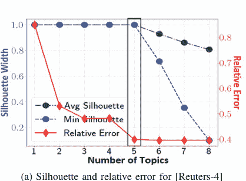
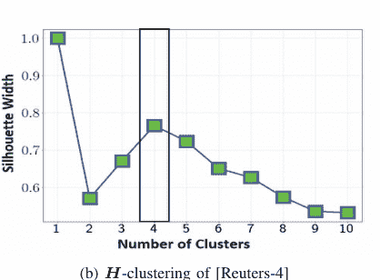
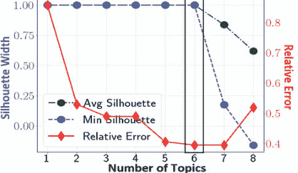
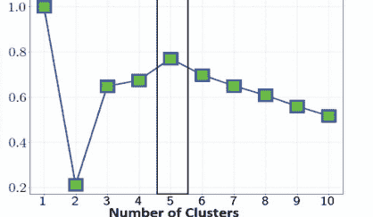

表 II：使用 NMI 比较各种模型的质量

| 数据集 | LDA | NMF | Kmeans | SeNMF | 我们的 SeNMF |
|---|---|---|---|---|---|
| bbc | 0.810 | 0.661 | 0.867 | 0.853 | 0.881 |
| ssg-2 | 0.754 | 0.893 | 0.890 | 0.899 | 0.906 |
| ssg-3 | 0.858 | 0.701 | 0.906 | 0.923 | 0.941 |
| Reuters-4 | 0.798 | 0.755 | 0.768 | 0.823 | 0.831 |
| Reuters-5 | 0.339 | 0.496 | 0.488 | 0.501 | 0.501 |

表 III：使用 $C_v$ 一致性比较各种聚类方法的质量

| 数据集 | LDA | NMKF | Skmeans | NMFK | 我们的 SeNMF |
|---|---|---|---|---|---|
| bbc | 0.677 | 0.816 | 0.808 | 0.811 | 0.879 |
| ssg-2 | 0.732 | 0.772 | 0.768 | 0.770 | 0.797 |
| ssg-3 | 0.801 | 0.831 | 0.849 | 0.839 | 0.850 |
| Reuters-4 | 0.553 | 0.726 | 0.752 | 0.683 | 0.814 |
| Reuters-5 | 0.561 | 0.776 | 0.748 | 0.737 | 0.814 |

图 5：Reuters-4 和 Reuters-5：寻找潜在主题 (a-b) 以及各种聚类的性质 (c-d)

聚类总体上是稳健且稳定的，我们的方法性能优于先进方法。

为了评估提取方法的质量，我们采用了 $C_v$。然而，$C_v$ 一致性依赖于人类对一致性的估算。此外，$C_v$ 一致性不依赖于“地面真值”标签，因为它考虑了词对的语义信息。它是使用归一化点互信息（NPMI）来计算词聚类的指标。表 III 显示了 LDA、Kmeans、NMFK 和 SeNMF 的质量。通过这一分析，我们证明对于大多数分析的文本语料库，我们的方法具有竞争性且/或优于现有方法。

# V. 结论

在本文中，我们引入了一种基于 NMF 且能自动确定主题数量的语义主题模型 SeNMF。SeNMF 具有几个特点：首先，通过使用一种小方法来识别文本初始 TF-IDF 表示 `X` 的潜在主题，并构建词-上下文-矩阵 `M`，SeNMF 创建了潜在词对 `{X_q, X_r}` 的表示。接下来，对于每个可能的潜在主题数量 `k ∈ {1, …, k_max}`，通过基于 KL 散度和基于 `M_k` 的正则项进行聚类，对该词的对进行重构。潜在维度通过比较所提取主题集合的稳定性来确定。最终的潜在主题是作为所选主题集的均值提取的。此外，SeNMF 执行了 `H`-聚类，即对潜在空间中的文档坐标进行 `k-means` 聚类。我们证明了 SeNMF 在五个基准文本语料库上的质量，并将我们的结果与最先进的带有已知“地面真值”标签的预测主题数量、一致性和文档 EMI 的语义方法进行了比较。

# VI. 致谢

本研究由美国能源部（DOE）国家安全管理局（NSSA）核不扩散办公室（NA-22）资助，洛斯阿拉莫斯国家实验室计算计划和 LRD 资助（201902DR），美国能源部合同 8923318CA00001。

# 参考文献

1. S. Rullback and A. R. Lee, "Information and similarity," The annals of mathematical statistics, 22, no. 2, pp. 79–86, 1991.
2. D. Seerwee, S. Dumas, G. Wagner, and F. Lander, "Indexing by latent semantic," Journal of Information Science, 31(4), pp. 349–363, 2005.
3. T. Hofman, "Probabilistic latent," arXiv preprint:0903.3133, 2009.
4. D. M. et al., "Latent Dirichlet allocation," Journal of machine learning research, 9, pp. 993–1023, 2008.
5. W. Xu, X. Liu, and Y. Gong, "Clustering based on non-negative matrix," Proceedings of the ACM SIGIR Conference on Research and retrieval, 2003, pp. 267–273.
6. C. Hu et al., "On the relationship between non-negative matrix factorization and probabilistic latent analysis," Statistics & Data Analysis, 58, no. 2, pp. 445–462, 2007.
7. J. Casey and B. Lee, "Topic models in data mining," Proceedings of 27th international ACM SIGIR Conference on Research and retrieval, 2014.
8. D. F. Toledo and A. Londeira, "Using algorithms for non-negative matrix factorization and latent Dirichlet for document clustering," Knowledge-Based Systems, 155, pp. 53–67, 2018.
9. J. Cho et al., "User-driven topic modeling for automatic document clustering," Proceedings of 2012 International Conference on World, 2012, pp. 1992–2003.
10. H. Kim et al., "Simultaneous discovery of discourse and document clustering using non-negative matrix factorization," Proceedings of 21st ACMKDD Conference on Data and Information Mining, 2015, pp. 556–562.
11. M. Müller and T. Hardman, "Representation of words and their compositionality," In NAACL, 2014, pp. 3111–3119.
12. M. Ali, A. Salam, and M. Maed, "Non-negative matrix factorization for text clustering," In Proceedings of 11th ACM SIGIR Conference on Research and Retrieval, 2008, pp. 73–80.
13. T. Shi et al., "Text-specific topic modeling using non-negative matrix factorization with word-level constraints," Proceedings of EMNLP, 2011, pp. 504–518.
14. P. Hargavas, G. Chen, N. Samuthi, P. Romero, and J. S. Eidenberg, "Code visualization for graph mining and capsule networks," IEEE Access, vol. 8, pp. 13706–13715, 2020.
15. J. Chang, G. Servan, C. Wang, J. L. Bordord, and D. M. Rea, "Scalable sparse topic model with non-negative matrix factorization," Advances in neural information processing systems, 2009, pp. 288–296.
16. K. Stevens et al., "Hierarchical clustering to cover many models," In EMNLP, 2018, pp. 4089–4099.
17. T. Liu, N. L. Zhang, and J. Chen, "Hierarchical latent tree analysis for topic detection," In European European conference on machine learning and knowledge discovery, 2014, pp. 256–272.
18. A. Mirza, "Nonparametric regression and its application in cancer clustering," IEEE transactions on computational biology and bioinformatics, vol. 11, no. 6, pp. 1208–1217, 2014.
19. D. J. McKinney and R. M. Real, "Automatic relevance detection for document clustering," Technical Report of Stanford University, 1994.
20. V. Y. Tan and C. Févotte, "Automatic relevance detection in non-negative matrix factorization with beta-divergence," IEEE Transactions on Pattern Analysis and Machine Intelligence, vol. 35, pp. 790–803, 2012.
21. J.-P. Brun et al., "Metagenatures and pattern discovery using matrix factorization," Proceedings of the Academy of Sciences, 115(44), pp. 21494–21499, 2018.
22. D. Grees, O. D'Gallagher, and C. Huffman, "How many topics? sparse topic-model analysis using methods of EMNLP," Springer, 2018, pp. 498–515.
23. L. B. Alexandrov, S. Nik-Zamac, C. D. Wege, J. P. Campbell, and M. Rea, "Non-negative matrix factorization of gene expression in human cells," vol. 8, no. 1, pp. 246–259, 2003.
24. S. Baxter and V. V. Benceau, "Sequence-nonnegative matrix factorization," Statistics & Data Analysis, 50, no. 7, pp. 7332–7347, 2019.
25. R. Vanga, K. O. Rausanen, G. Bel, and S. Alexander, "Non-negative matrix factorization with determination of the number of topics," The Journal of Machine Learning Research, 76, 2005.
26. R. Vanga, K. O. Rausanen, G. Bel, and S. Alexander, "Non-negative matrix factorization for document clustering," Physical Review Research, 22, no. 2, 02348, 2020.
27. P. Hargavas, G. Chen, N. Samuthi, P. Romero, and J. S. Eidenberg, "Code visualization for graph mining and capsule networks," IEEE Access, vol. 8, pp. 10749–10750, 2020.
28. V. Stanev, V. Vev, A. Gose, K. Iwasake, and T. Tanaka, "Unsupervised topic modeling using non-negative matrix factorization with document clustering," Computational Materials, 4, no. 1, pp. 1–10, 2013.
