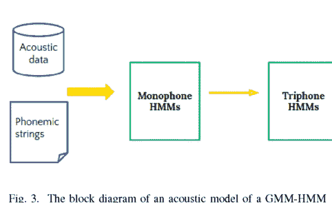
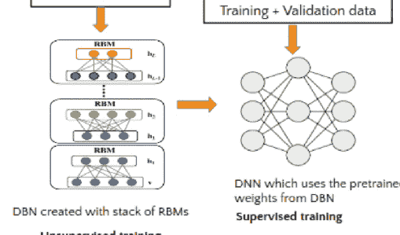
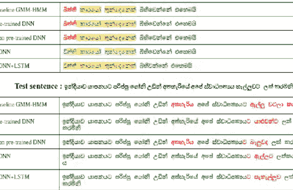

# 2020 第20届新兴地区信息通信技术进展国际会议

**摘要**——在过去的十年里，自动语音识别在大多数欧洲语言方面取得了显著进展，但对于大多数低资源语言而言，它仍然是一个重要的研究领域。本文介绍了一项使用 `Kaldi` 工具包构建辛哈拉语自动语音识别（ASR系统）的研究，该语言具有丰富的词汇变化。我们探索了各种神经网络架构，如 `DNN`、`TDNN`、`TDNN-LSTM` 和 `LSTM`，以增强深度学习方法的有效性。同时训练了 `GMM-HMM` 统计模型进行比较。对于该语言，使用了包含 200 多个辛哈拉语句子的语料库。实验在 25 小时语音数据的平衡训练数据集上进行。结果表明，深度神经网络在测试集上的性能比统计基准高出 12.48%。

## I. 引言

在过去的几十年里，人们对让计算机理解只有人类才能理解的内容感到好奇。机器学习范式的显著发展帮助语音识别、自然语言处理、图像处理等取得了难以置信的成功。许多研究人员对开发语音识别感兴趣，因为它用于实现人机之间的交互。语音是最有效、方便的通信方式，包括 `Google Assistant`、`Apple` 的 `Siri` 和 `Alexa` 等商业产品正在快速使用这种 ASR 技术 [3]。人口较少的研究开发贡献较少的语言没有获得同等的投资和发展。辛哈拉语是一种低资源语言。

辛哈拉语是斯里兰卡大部分人口使用的官方语言之一。这种语言具有丰富的词汇变化，导致了巨大的词汇量。缺乏基于资源的语音识别系统阻碍了本地系统和大多数商用现设备（COTS）实现可达的性能。因此，包括本地和全球性机构在内的许多组织可以利用辛哈拉语自动语音识别（ASR）工具来增强识别能力。本研究的目标是为辛哈拉语开发一个 ASR 系统。为此，我们打算采用深度学习方法和对辛哈拉语语音表现良好的深度神经网络架构。在声学建模方面，深度神经网络是目前先进的方法，并在英语和其他欧洲语言中显示出显著的改进 [5], [6]。我们使用了多种 `DNN` 模型进行辛哈拉语语音识别。每个 `DNN` 模型的性能将与传统的统计模型 `GMM-HMM` 进行比较评估。

本文的结构组织如下：第二节提到相关工作，第三节描述方法论和训练配方，第四节描述实验结果和评估，第五节给出结论。

## II. 相关工作

典型 ASR 系统的目标是将输入转换为单词序列。ASR 的内部过程由几个阶段组成：特征提取，将音频转换为声学特征向量序列；声学建模，将语音转换为音素；自然语言建模，定义目标语言中期望的单词类型、序列及其概率。

由于语音识别的模式匹配方法已经经历了多种不同的方法 [7]。从基于模板的、动态时间规整、基于统计的和基于神经网络的方法，其中一些已得到广泛讨论。研究人员已尝试使用统计的 `GMM-HMM` 方法为辛哈拉语构建语音识别系统 [8]–[11]。然而，在语音识别初步研究工作中，实现了 4% 的词错误率（WER）。但是，该模型是 100% 依赖说话人的。这项工作需要与人无关 [8], [9]。但该 ASR 系统的精度取决于它能处理的数据量。在这里，这项工作提出了一个通用领域的领域无关 ASR 系统。最近，基于神经网络（ANN）的声学模型相比 `GMM` 显示了显著的性能提升。`Hinton` 等人 (2013) 在研究论文中通过四个研究小组展示了使用深度网络实现成功的语音识别模型的深度概述。作者在这里表明，当数据有限时，预训练比浅层网络更有帮助。`Alexey` (2017) 显示深层架构优于浅层架构。`Xu` 和 `Liang` (2016) 报告说深层架构优于原生 `LSTM`。`Daniel` 等人 (2015) 显示在该领域深度架构优于 `LSTM`。时间延迟神经网络（`TDNN`）在学习更好的时间依赖关系方面有效。`DNN` 在土耳其语、阿萨姆语、孟加拉语等许多语言中显示出显著改进 [16], [17], [19]。

## III. 方法

### A. 数据准备

本研究使用的语音语料库收集自女性和男性（25 小时语音）。数据用于训练、验证和测试，其中音频文件组是由说话者朗读脚本录制的（700 小时语音）。

### B. 特征提取

首先，对音频文件进行预处理以获得数值向量，这通常被称为“梅尔频率频谱图”，它包含了声学信息。然后，从梅尔频率中提取语音特征。

图 1. 研究设计的高层架构

经过 13 维倒谱方差归一化后的梅尔频率谱系数（`MFCC`）特征。

### C. 从 GMM-HMM 模型获取对齐

对于神经网络的监督训练需要一组标注数据。由于很难为每个特征到对应的音素标注标签，因此通过训练如图 2 所示的 `GMM-HMM` 统计模型生成对齐。然后，使用展示音素与音频对齐的标注帧来启动 `DNN` 训练。

图 2. `DNN` 从 `GMM-HMM` 的对齐中启动

### D. 基于 DNN 的声学建模

开发自动语音识别（ASR）系统的两种主要方法可以认为是 `DNN-HMM` [21] 和端到端 (`E2E`) `DNN`。`DNN-HMM` 是一种混合架构，它使用 `DNN` 进行声学建模，并利用 `DNN` 的强大学习能力和 `HMM` 的序列建模能力进行增强。端到端 `DNN` 是一种单一的集成方法，缺乏灵活性。当训练数据有限时，ASR 系统会受到过拟合等局限性。因此，我们采用了 `DNN-HMM` 方法。

本节将简要介绍实验中使用的神经网络架构。所有实验都是使用 `Kaldi` 工具包进行的。所有深度网络和模型解码均在单块 `GPU`——`GeForce RTX 2080 Ti` (10.8GB) 上完成。

- **1 预训练 DNN**：根据 [12]，来自预训练网络的监督优化所产生的性能远优于神经网络中的随机初始化权重。对于我们的方法，预训练权重是通过训练深度置信网络 (`DBN`) 的。然后将特征连接到全连接前馈网络，并直接使用训练和验证数据对其进行训练。

- **2 前馈神经网络**：使用许多层预训练 `DNN` 模型是有帮助的，但计算时间也比普通的层前馈网络更稳定。然而，我们在训练和验证数据上对随机初始化权重的全连接前馈网络进行了实验。其他网络设置与预训练 `DNN` 保持一致。

- **3 时延神经网络**：在如 [22], [15] 和 [23] 等研究中，提出了具有子采样的时延神经网络，用于对语音长上下文进行有效建模。

`DNN` 代表了过去与现在值之间的映射。虽然 `RNN` 可以实现相同的记忆捕捉，但在使用 `RNN` 学习时间依赖时，可以避免梯度“消失/爆炸”问题。

#### 无监督训练

- **4 DNN+LSTM**：下一个神经网络架构选择是 `DNN` 网络后接一个 `LSTM` 层。在针对俄语标准汉语进行的研究 [23] 中，也使用了 `LSTM` 的嵌入以获得更好的结果。该架构的实验是使用 `DNN` 和 `TDNN` 分因子神经网络共同进行的。

### E. 语言模型与词表

建模语言中单词如何连接成句子的方式。使用语料库、词表、静音函数和非静音素构建了三元模型。为此，使用了 `SRI` 语言工具包 [20]。

我们研究词表是 `graphene` 类型。我们的大型词表包含 22 万条目，具有唯一的音字母前缀。该词表用于生成 `UCSC LTRI` 语音平衡语料库的转录。根据语音翻译规则转换为英文字母。为此，使用了 "`SubIn`" 字幕翻译软件。使用的非静音素集长度为 47。

## IV. 结果与评估

该 ASR 的性能根据在安静环境中录制的记录的准确率方面进行了评估。准确率使用词错误率 (`WER`) 计算，这是评估 ASR 系统性能的标准衡量。测试数据集还包含五位女性和两位男性说话者，他们总共说了 150 个句子。验证和测试数据长度为 1.6 小时。

### 基准 GMM-HMM 模型

如第 III 部分所述，在训练数据集上训练了 `GMM-HMM` 模型以生成对齐。在单音训练后，算法通过了其他三个过程，即通过修改 `HMM` 模型和高斯分布总数进行微调。通过该过程后的循环训练和单音通过，观察到了结果。在表 1 中观察到最低 `WER`。

### 表 I

### GMM-HMM 模型结果

| 训练轮次 | 验证集 WER% | 测试集 WER% |
| :--- | :--- | :--- |
| 单音 (Monophone) | 42.64 | 48.07 |
| Iphone Pass 1 | 3.81 | 42.88 |
| Iphone Pass 2 | 3.92 | 42.69 |
| Iphone Pass 3 | 3.80 | 42.64 |

从表 1 可以看出，基准 `GMM-HMM` 模型的最低 `WER` 为 42.64%。

### D. DNN 声学

`MFCC` 和对齐是通过最后阶段使用每种神经网络架构训练数据集产生的。使用 `sigmoid` 激活函数和 .008 学习率生成的的结果如表 2 所示。然而，结果并未清楚显示目标模型是如何实现最终性能的。为具有相同配置的预训练模型生成的结果如表 3 所示。

### 表 III

### 预训练 DNN 模型结果

| 隐藏层数 | 每层单元 | 验证集 WER% | 测试集 WER% |
| :--- | :--- | :--- | :--- |
| 2 | 256 | 35.4 | 40.52 |
| 3 | 512 | 35.68 | 40.32 |
| 3 | 1024 | 37.56 | 40.28 |
| 4 | 256 | 35.69 | 40.27 |
| 4 | 512 | 37.78 | 39.91 |
| 4 | 1024 | 35.89 | 39.93 |
| 5 | 256 | 31.65 | 40.09 |
| 5 | 512 | 35.88 | 40.06 |
| 5 | 1024 | 36.61 | 40.05 |
| 6 | 256 | 35.12 | 40.22 |
| 6 | 512 | 35.58 | 40.19 |
| 6 | 1024 | 37.15 | 40.15 |
| 7 | 256 | 35.58 | 41.60 |
| 7 | 1024 | 37.26 | 41.29 |

前馈网络的 `WER` 为 39.6%，比预训练 `DNN` 低 0.23%。这是在具有 512 个隐藏层的 6 层观察到的。根据表 3 的结果，这两种架构超过了基准模型。两种 `TDNN` 类型的实验。

### 表 II

### 预训练 DNN 模型结果

| TDNN 网络类型 | 隐藏层数 每层单元 | 验证集 WER% | 测试集 WER% |
| :--- | :--- | :--- | :--- |
| 非因子 (Non factorized) | 6 | 128 | 34.2 | 40.49 |
| | | 512 | 35.2 | 39.97 |
| | | 1024 | 37.1 | 40.36 |
| 分因子 (Factorized) | 9 | 1024 | 32.6 | 35.48 |
| | | 256 | 28.6 | 35.16 |
| | | 13 | 512 | 30.09 | 35.16 |
| | | 1024 | 27.5 | 35.45 |

从 `TDNN` (`TDNN-F`) 网络观察到最佳结果为 35.16%。与基准和预训练模型相比，`WER` 分别降低了 7.48%、4.76% 和 4.53%。如第 II 部分所述，在 `TDNN` 和 `TDNN-F` 层顶部使用 `LSTM` 进行了另一种 `TDNN` 网络变体。然而，当使用 `LSTM` 开发获得 35.16% 的 `TDNN-F` 模型时，`WER` 得到了改进。实验观察到的整体结果如表 X 所示。观察到最低 `WER` 为 39.92，比基准低 2.72%。

### 表 V

### TDNN+LSTM 模型结果

| TDNN 层数 | LSTM 层数 | 层维度 | 验证集 WER% | 测试集 WER% |
| :--- | :--- | :--- | :--- | :--- |
| 4 | | 512 - TDNN 384 - LSTM | 4.40 | 36.23 |
| | | 256 - TDNN 384 - LSTM | 4.80 | 36.33 |
| 13 | | 256 - TDNN 384 - LSTM | 4.35 | 35.87 |

可以通过具有 13 层 `TDNN` 具有 256 个隐藏单元的因子 `TDNN` 设置获得。这是所有构建模型中的最佳 `WER`。随后，与有限数据集相比，使用混合方法 - `TDNN+LSTM`，`WER` 显著增加。此外，因子 `TDNN` 证明了它们在有限数据语音识别中的效率。在评估结果时，观察到

## V. 结论与未来工作

评估基准 `GMM-HMM` 模型时，为 42.64%。通过手动比较结果，可以观察到预训练 (39.92) 和普通 `DNN` (39.69) 相似。然而，这两个 `DNN` 模型之间有 2.22% 和 2.95% 的差异。从 `TDNN` 获得的结果远优于其他模型。这证明了 `TDNN` 网络在语音识别任务中的效率。从 `TDNN` 获得的最佳 `WER` 为 35.16

## 致谢

作者对哥伦堡大学语言研究提供的见解和专业知识表示诚挚感谢。我们对通过本研究展示的奖励做出贡献的任何人深表感谢。

## 参考文献

1. `Pauer`, `Dunlop`, `Adams`, `Raubaud`, `Gies`, `Burget`, `Lukic`, `Ghelberg`, `Olendl`, `Nor Grady`, `Hannekmaa`, `Mikko`, `Petric`, `Seeger`, `Karel.`, `Pytannen Š`, `Silvestijö`, `Jan`. (2011): The speech recognition spotlight: IEEE 2011 International Conference on Speech and Language Processing.

2. Language Research Laboratory - Initiative: Applied Linguistics, University of Colombo School of Computing for providing insight and expertise.

3. `Joraa`, `Shrija`, `Singh`, `Rithika`. (2012): Speech recognition technique: A Review. International Journal of Computer Applications, 60: 34-34.

4. `Jurafski`, `Daniel`, `Martin`, `James`. (2008): Speech and Language Processing: An Introduction to Natural Language Processing, Computational Linguistics, Pearson Education.

5. `Dominique Frey`, `Öhde`, `Müller`, `Ina`. `Niada`. New Paradigm in Speech Recognition for Low-Resource Languages. IEEE International Conference on Information Systems and Engineering Intelligence, 2017 Marrakech, Morocco, 2017-0184444

`Hirunika Karunathila`, `Viraj Velgama`, `Thilini Nadudingage`, `Ruan Weerasinghe`

- [66] `Markovska`, `Nikita`, `Kripakova`, `Ivan`, `Karpov`, `Alexander`, `Skeleton`. (2018). 语音识别中的深度神经网络。语音会议, 54-67. doi:10.1109/ICASASSP.2018.8623594-5033

- [67] `Sakumada`, `Tatsunori`, `Fujimura`, `P. D.`, and `Hashimoto`, `R.`. (2015). 语音识别系统现代方法综述。国际计算机应用杂志, 115, 23-30. doi:10.5120/ijca.2015.1152302024

- [68] `Waramarajiga`, `D.` and `Gamangi`, `S.`. (2012). 改进语音对话会议的语音识别。ICT技术进步国际会议 (ICTER 2012), 柯伦坡, 2012年10月, 页码 3-6。

- [69] `Manamperiya`, `Wangaesha`, `Karathilage`, `Dinesha`, and `Madumhani`, `Thilini` & `Gunadasera`, `Rohan`. (2018). 用于手机设备交互式语音响应系统的深度学习。

- [70] `Nadududingage`, `Thilini`, `Weerasinghe`, `Ruan`. (2011). 卷积语音识别。

- [71] `Gunarajawardena`, `Madhuwa` and `Meegama`, `Gayan`. (2015). 语音识别到无编码文本的实时翻译。

- [72] `Hinton`, `Geoffrey`, `Lee`, `Yu`, `Dahl`, `Mohamed`, `Abdelrahman Jaitly`, `Naydeau`, `Andrew`, `Beshout`, `Vincent`, `Nguyen`, `Pyatkovsky`. (2009). 用于声建模的深度神经网络：共享观点。IEEE国际音频信号处理会议, IEEE. 29, 82-97. doi:10.1109/ICASSP.2009.2205597

- [73] `Li`, `Xiangliang`, `Wang`, `Xu`. (2015). 构建用于高效语音识别的短期记忆循环网络。

- [74] `Lin`, `Hao`, `Zhang`, `Y.`, and `Chen`, `James`. (2016). 用于语音识别的优先级门控长短期记忆RNN。 467-473, doi:10.1109/ICLT.2016.7846035

- [75] `Pasindiev`, `Sergey`. (2015). 用于长上下文高效建模的时延神经网络架构。INTER-SPPEECH (2015)。

## 参考文献

- [76] 基于深度神经网络的土耳其语音识别——UssenAbreKIMANU*1, Osman BUYUK。

- [17] 假设性语音识别系统的开发——Baha Deka I., S.R. Namala, I. Sumarayandra。

- [18] 用于语音搜索的孟加拉语音识别——Islam Rahman Saur, Shakawat Amin, Shafkat K., Mujibur Rahman。

- [19] Yang, Mohammad, G. Gul, S., and Varhan, Yash, Raza, Nasir. (2016). 使用基于深度神经网络的ASR进行连续语音识别。10.1109/ICASSP.2016.7452.2119。

- [20] Gul, S., and Mohammad, Yang. (2017). 开放学习的卷积深度学习综述。应用。IEEE_HDMM-SPEECH RECOGNITION TECHNIQUES：综述。国际计算机应用杂志, 170(4), 1442-1450。

- [21] Ying Zhang, Mohammad Pezhadi, Philemon Rafael, Saizheng Zhang, Chen, Yu. (2019). 用于语音识别的时延循环神经网络。物理学会议系列, 1229, 012078. doi:10.1088/1745-6597/1229/1/012078。

- [22] Li, Xiangliang, Xu, Dongcheng. (2019). 用于语音识别的时延循环神经网络。物理学会议系列, 1229, 012078. doi:10.1088/1745-6597/1229/1/012078。

- [23] Huang, Xiangrong, Zhang, Wei, Xu, Yan, Ruitian, Chen, Yu. 用于高效声建模的时延神经网络。物理学会议系列, 1229, 012078. doi:10.1088/1745-6597/1229/1/012078。

- [24] 用于学生分级问题解决的深度学习。人工智能与知识库国际杂志。 6, 107-116. doi:10.1142/S02785021150048。

- [25] Povey, Daniel Chen, Gaofeng, Wang, Yiming, Ke, Xu, Haidun, Simpson, Andreas. (2016). 用于深度网络的半监督低秩矩阵分解。3743-3747, 2016. doi:10.2147/Interspeech.2016.7417。

- [26] SRIL: 语言建模工具包*。可用：`http://www.sri.com/projects/srln/`。 [访问日期：2020年10月24日]。

- [27] 辛哈拉语转译器*。可用：`http://translation.sinhala.subasa.lk/`。 [访问日期：2020年10月24日]。
