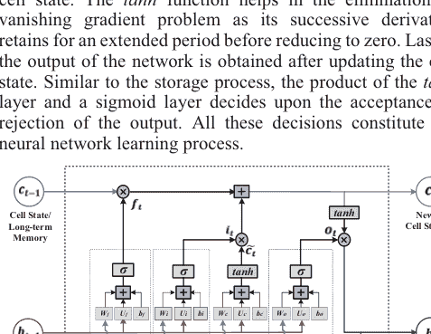
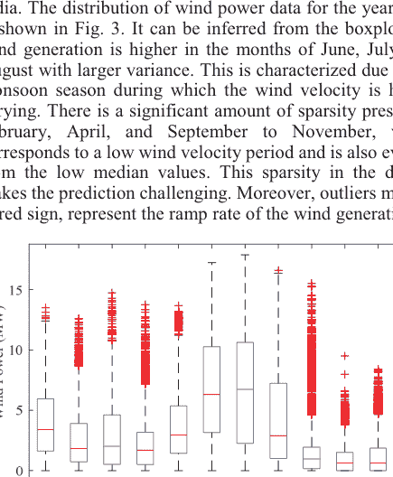
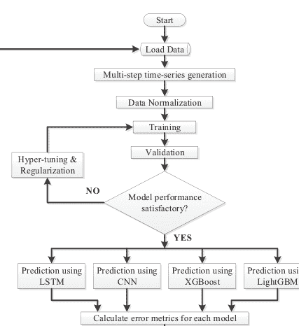
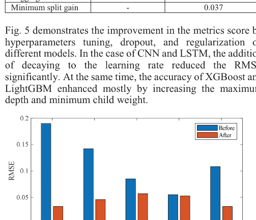
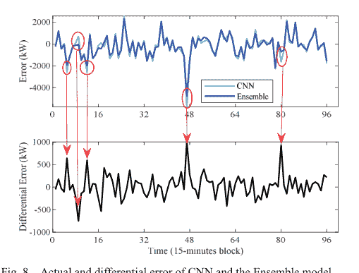
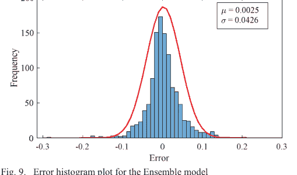

# 2020 第21届国家电力系统会议 (NPSC)（印度甘地纳加尔 2020.12.17-2020.12.19） 2020 第21届国家电力系统会议 (NPSC) ｜｜ 用于短期风电预测的集成模型


摘要— 准确的风电功率预测对于能源管理至关重要，并在提高风电发电人在电力市场中的竞争力起着重要作用。深度学习和基于梯度提升的决策算法已证明在极端情况下取得良好的结果。由于风速具有高度波动性，并在时间和空间上存在差异，算法在受限数据集上表现良好，而在另一些数据集上表现差。例如，使用集成模型比依赖单一模型更好。我们通过结合四种机器学习算法（包括卷积神经网络 (CNN)、长短期记忆 (LSTM)、梯度提升 (LightGBM) 和极端梯度提升 (XGB)）的优点，利用实际风场研究的数据证明了所提模型的有效性。所提模型优于单一模型，并以很高的精度预测不同月份的风电功率。

另一方面，这些方法在没有显式编程的情况下学习过去与未来数据之间的关系。决策学习算法因其可解释性和简单性被用于预测 [7]。它使用了一种提升技术，利用弱学习器来减少偏差并改进在每个序列上的误差。梯度提升是一种强大的技术，它利用并行处理和正则化来克服偏差和过拟合 [8]。梯度提升机 (LightGBM) 是一种极其高效的基于梯度的算法，它促进层级增长，导致损失显著减少 [9]。

关键词—神经网络，深度学习，集成模型，极端梯度提升，短期记忆，风电功率预测。

在机器学习算法中，人工神经网络 (ANN) 过去由于处理输入与输出之间非线性关系的复杂性而受到限制。研究人员已利用 ANN 的多种变体进行风电功率预测，例如自适应神经模糊推理系统 [10]、基于波的神经网络 [11]。最近，深度学习已广泛应用于各个领域。深度学习利用 ANN 的分级结构，例如由深度神经网络组成的卷积神经网络 (CNN)，以及长短期记忆 (LSTM)，后者具有顺序输入以处理序列中的长期依赖。这种方法通过循环神经网络解决了梯度消失问题。卷积神经网络 (CNN) 在性能方面具有更好的能力，并且远比 LSTM 快。

# I. 引言

随着对风电需求的增加，风电预测变得越来越重要。所有发电厂都根据风电功率预测进行运行。预测与实际输出之间的偏差将产生经济负担。此外，这可能会影响电网的稳定性。因此，准确的风电功率预测对于电力市场策略的发展至关重要 [1]。

风电预测可以通过两种策略实现。第一种确定风速输出的方法取决于温度、湿度和空气密度等大气参数。这种预测通过数值天气预报 (NWP) 实现，基于数学模型和资源 [2]。第二种方法直接涉及风场的风电预测，这些方法使用递归技术寻找过去与未来时间序列数据之间的关系。常用的风电统计方法有 ARIMA [3]、ARIMA [4]、季节性 ARIMA 和带有外输入的 ARIMA (ARIMAX) [6]。

观察到所有模型在不同数据集上表现良好。由于风电功率高度间歇且变化，要识别一个适用于所有情况的单一算法是困难的。因此，结合两个或多个模型具有更好的预测鲁棒性 [15], [16]。本文提出了一种结合 CNN、LSTM 和 LightGBM 的新型集成模型。每个算法的精度通过超参数调优和正则化得到增强。所提模型预测实际风场的风电数据。

本文其余部分的结构如下：第二部分解释个体算法和所提集成模型。第三部分描述数据处理和超参数调优。第四部分讨论方法的比较和结果，第五部分给出结论。

# II. 方法论

深度学习架构在学习数据集的复杂特征方面非常高效，但代价是训练需求和计算功率高。相比之下，树模型计算成本低，所需数据较少即可提供满意的预测。我们的研究考虑了两个神经网络（CNN 和 LSTM）和两个梯度决策树 (GBDT) 算法（Xgboost 和 LightGBM）。

## A. 长短期记忆 (LSTM)

LSTM 背后的基本原理带有记忆细胞，它在整个网络中传输并通过特定的调节结构控制信息。标准的 LSTM 架构如图 1 所示，由公式 (1) 解释：

```
$f_t = \sigma(W_f x_t + U_f h_{t-1} + b_f)$ (1)
$i_t = \sigma(W_i x_t + U_i h_{t-1} + b_i)$ (2)
$o_t = \sigma(W_o x_t + U_o h_{t-1} + b_o)$ (3)
$$\tilde{c}_t = \tanh(W_c x_t + U_c h_{t-1} + b_c)$ (4)
$c_t = f_t \odot c_{t-1} + i_t \odot \tilde{c}_t$ (5)
$h_t = o_t \odot \tanh(c_t)$ (6)
```

其中 $f_t, i_t$ 和 $o_t$ 分别是遗忘门、输入门和输出门。h$ 和 $c$ 分别表示隐藏层和记忆细胞状态。W 代表权重系数，$b 代表偏差向量。$\odot$ 是元素级乘法，sigma$ 是 sigmoid 函数，tanh 是正切函数。例如，带有 sigmoid 层的门决定对代表长期记忆的细胞状态信息的接受或拒绝。带有 sigmoid 层的细胞决定将什么新信息添加到细胞状态中。由于 tanh 函数的连续导数接近 1，该函数有助于防止梯度消失问题。因此，在更新细胞状态后获得网络的输出。类似于存储过程，tanh 层和 sigmoid 层的积决定了输出的接受或拒绝。所有这些构成了神经网络过程。



图 2. 架构

## B. 卷积神经网络 (CNN)

CNN 的主要设计是创建一个网络层尺度，初始层执行特征提取并传播到下一层以生成高阶特征。标准的 CNN 架构如图 2 所示。在时间功率数据进入该层后，通过与输入宽度相同的卷积层。接下来，池化层减少维度并为进一步训练做准备。将池化层的输出数据展平后，馈全连接层（这是一个标准的神经网络）。输出中存在非线性激活函数，从中获得最终输出。

## C. 极端梯度提升 (XGBoost)

XGBoost 是一个可扩展的学习系统，实现了优化的梯度 GBDT 框架。通用算法由 (7)-(10) 所示，每个集成模型使用加法技术一次学习一树。

```
$y^{(k)} = \sum_{i} f_k(x_i) = y^{(k-1)} + f_k(x_i), f_k \in \mathcal{F}$ (7)
$\Omega(f) = \gamma T + \lambda ||f||^2$ (8)
$L^{(k)} = \sum_{i} (l(y_i, y^{(k-1)} + f_k(x_i))) + \Omega(f_k)$ (9)
$f_k = \arg\min_{f} \sum_{i} (l^{(k-1)}(y_i, f(x_i)) + \alpha \Omega(f)$ (10)
```


使用公式 (9) 给出的目标函数 $\mathcal{L}^{(i)}$。求和中的第一项 $l(y^{(i)}, y)$ 是可微损失函数，其中 $n$ 表示样本量，第二项带有正则化函数用于处理模型复杂度。公式 (10) 给出了结合了 (7)-(9) 的目标函数。XGBoost 采用分布式、并行处理，并带有正则化以防止过拟合。数据中的稀疏性也能被 XGBoost 很好处理，如 [19] 所示：

模型。分配的权重将与模型表现最优/次优的次数、$R^2$ 分数以及 RMSE 成比例，如公式 (14)-(15) 所示。公式 (16) 给出了集成预测，它是所有模型预测结果的加权平均值。

## D. 轻量梯度提升 (LightGBM)

LightGBM 是一种梯度提升算法，它通过叶节点最优（leaf-wise）策略分裂树 [20]。与传统的 GBM 不同，在信息增益搜索期间减少了每个特征的数据点。LightGBM 的学习过程可以通过 [11] 解释。大梯度和小梯度均指代与其一起训练的实例数量。该技术用于训练数据，即保留具有大梯度的实例，并随机丢弃已经训练过的小样本 [19]：

```
$V_p = \frac{1}{n} \sum_{i=1}^{n} (1 - \alpha_i)(\sigma_{i_t} + \beta_i)^2 + \frac{\alpha_i}{n} \sum_{i=1}^{n}(\sigma_{i_t} - \beta_i)^2 \quad (11)$
```

```
$w_j^{(i)} = -\frac{N_j^{(i)}}{N_i} + \frac{S_j^{(i)}}{N_i} + \frac{\Sigma_j^{(i)}}{\Sigma_i^{(i)}} - \frac{V_j^{(i)}}{\Sigma_i^{(i)}} \quad (14)$
```

```
$\beta_i + \beta_j + \beta_k = 1 \quad (15)$
```

其中 $N_j^{(i)}$ 和 $N_i^{(i)}$ 是第 $i$ 个模型表现最优/次优的实例数。总观测数、$R^2$ 和 $\mathcal{E}^{(i)}$ 分别是第 $i$ 个模型的平均 RMSE 和分数。分配给每个模型的权重为 $\beta_i$。$y_p^{(i)}$ 是第 $i$ 个模型的预测值，$y_p$ 是 $i$ 时刻的集成预测值。

```
$y_p = \sum_{i=1}^{n} \beta_i y_p^{(i)} \quad (16)$
```

其中 $j$ 在点 $p$ 处分裂，$V_p$ 是分裂的方差，$(i_1, i_2, ..., i_n)$ 分别是左右数据的 $n$ 个独立同分布实例。每个实例的梯度损失由 $(\sigma_{i_t}, \beta_i)$ 给出，其中 $\sigma$ 和 $\beta$ 分别是大梯度样本和小梯度样本。使用近似集和验证集来确定准确性和方差，其衡量方法类似于 XGBoost。LightGBM 能够很好地处理高维数据中的稀疏性。通过对特征空间中的某些特征进行捆绑，将其合并在一起，减少了训练过程中的复杂度。

## E. 提出的模型

时间序列预测的准确性非常敏感，对于哪种模型最好并没有共识。最常见且简单的方法是使用所有可用模型的线性组合。在本文中，我们提出了一种凸组合方法，通过结合基于误差的方法和表现最优的模型 [21] 来计算相应的权重，对之前讨论的四个模型的预测进行加权平均。计算每年每月的误差，然后根据性能进行排名。性能使用均方根误差 (RMSE) 和 R 方评分 ($R^2$) 进行衡量，由公式 (12)-(13) 给出。



```
$RMSE = \sqrt{\frac{\sum_{i=1}^{n}(y_i - \hat{y}_i)^2}{n}} \quad (12)$
```

```
$R^2 = 1 - \frac{\sum_{i=1}^{n}(y_i - \hat{y}_i)^2}{\sum_{i=1}^{n}(y_i - \bar{y})^2} \quad (13)$
```

其中 $y_i$ 和 $\hat{y}_i$ 是第 $i$ 步的实际功率和预测功率，$\bar{y}$ 是样本量 $n$ 内实际功率的平均值。我们计算了每个月的 RMSE 和 $R^2$，并对最优和次优性能进行了排名。

图. 3. 风电数据

### A. 数据预处理

```
$[x_{t-w_1}, x_{t-w_2}, ..., x_{t-w_t}, 0\}, \n[x_{t-1-w_1}, ..., x_{t-1}, \{0+t_p\}] \quad (17)$
```



其中 $t$ 是训练输入，$o$ 是待预测的输出标签。窗口大小由 $w$ 决定，它是输入向量的长度。当有 $t_{wr} = 12$ 且 $t_p = 9$ 时，我们训练多步序列。得到的多步序列通过公式 (18) 归一化到 [0,1]。

```
$x_i = \frac{x_i - x_{min}}{x_{max} - x_{min}} \quad (18)$
```

使用单个模型和集成模型的预测过程如图4 所示。

### B. 超参数调优和正则化

算法往往容易出现过拟合（高方差），可以通过正则化来防止。另一方面，欠拟合或高偏差可以通过调优超参数来减少。超参数调优和正则化有助于提高算法准确性。

- LSTM：我们使用了双向层和 tan-sigmoid 激活函数。考虑到训练过程，我们在准确性和计算时间之间通过选择 batch size 和 epochs 进行了权衡。
- CNN：我们使用了一维模型。与 LSTM 模型类似，L2 正则化和丢弃（dropout）提高了模型性能。此外，添加池化层显著提高了指标和预测 [23]。
- XGBoost：通过调优估计器数量、最小权重、gamma 和学习率提高了预测精度。
- LightGBM：与 XGBoost 类似，最小权重学习率增强了模型性能。此外，通过调优最大深度和叶节点提高了算法的计算速度和准确性。如下所示：

#### I. LSTM & CNN 的控制参数

| 控制参数 | LSTM | CNN |
| :--- | :--- | :--- |
| 模型类型 | 双向 | 1D 卷积 |
| Mini batch size | 256 | 256 |
| Dropout | 0.2 | 100 |
| 激活函数 | tan-sigmoid | rectified linear |
| 优化器 | Adam | Adam |
| L2 正则化 | 0.01 | 0.001 |
| 层 | 6 | 6 |
| 全连接层 | 2 | 2 |
| 输出维度 | 每层 50 | 32, 16, 4 |
| 学习率 | 0.2 | 0.01/epoch |
| 卷积大小 | - | 2 |

#### II. XGBOST & LIGHTGBM 的控制参数

| 调优值 | XGBoost | LightGBM |
| :--- | :--- | :--- |
| 估计器数量 | 2500 | |
| 最大深度 | 6 | 5 |
| 最小子权重 | 1 | 7 |
| 学习率 | 0.3 | 0.02 |
| Gamma | 1 | |
| 样本量 | - | GBDT |
|  Boosting 类型 | - | |
| 叶节点数量 | - | 64 |
| 特征比例 | - | 0.9 |
| Bagging 比例 | - | |
| 最小分裂增益 | - | 0.037 |

图 5 展示了不同模型通过超参数、dropout 和正则化带来的改进。在 CNN 和 LSTM 的情况下，学习率降低了 RMSE。同样，XGBoost 和 LightGBM 的准确性通过增加最大深度和最小权重得到了提高。




图 6. 所有模型的日前风电预测

# IV. 结果与讨论

我们对2014年的每个月份运行了四个模型以确定每个模型的权重。然后，我们使用这些权重预测每个月的风电。八月的风电权重最高。在图 7 中，我们使用 $R^2$ 分数比较了所有模型和集成模型，如表 III 和表 IV 所示。从上述表中可以看出，CNN表现最好。此外，平均 RMSE 和 $R^2$ 分数分别为 CNN、LSTM、LightGBM 和 XGBoost。对于集成模型，增强效果足以使深度学习模型优于基于 GBDT 的模型。然而，我们观察到 XGBoost 预测过度，而其他模型似乎存在欠拟合。

| | CNN | LSTM | XGBoost | LightGBM | 提出的集成 |
| :--- | :--- | :--- | :--- | :--- | :--- |
| Feb | 0.9732 | 0.9407 | 0.8773 | 0.8809 | 0.9689 |
| Mar | 0.9518 | 0.9531 | 0.8813 | 0.8096 | 0.9668 |
| Apr | 0.9731 | 0.9291 | 0.8215 | 0.8365 | 0.9563 |
| May | 0.9703 | 0.9418 | 0.9107 | 0.9229 | 0.9707 |
| Jun | | | | | |
| Jul | | | | | |
| Aug | | | | | |
| Sep | | | | | |
| Oct | | | | | |
| Nov | | | | | |
| Dec | | | | | |

## 所有模型的 RMSE 比较
| | CNN | LSTM | XGBoost | LightGBM | 提出的集成 |
| :--- | :--- | :--- | :--- | :--- | :--- |
| Feb | 0.9732 | 0.9407 | 0.8773 | 0.8809 | 0.9689 |
| Mar | 0.9518 | 0.9531 | 0.8813 | 0.8096 | 0.9668 |
| Apr | 0.9731 | 0.9291 | 0.8215 | 0.8365 | 0.9563 |
| May | 0.9703 | 0.9418 | 0.9107 | 0.9229 | 0.9707 |
| Jun | | | | | |
| Jul | | | | | |
| Aug | | | | | |
| Sep | | | | | |
| Oct | | | | | |
| Nov | | | | | |
| Dec | | | | | |


# 参考文献



- [1] R. Abhin and M. Pidoriya, “印度电力市场高渗透率下风能预测的关键挑战”，Energy Surveys, vol. 47, pp. 53–63.
- [2] S. Ahmed, M. Okada, and I. Cook, “用于风电功率预测的风模式识别与基于 NWP 的参考风数据相关性分析”，IEEE Trans. Ind Informatics, vol. 12, pp. 1085–1095, 2016.
- [3] J. L. Torres, A. Garcia, M. Blas and A. Franco, “利用 ARMA 模型对西班牙纳瓦拉地区的每小时风速进行预测”,
- [4] O. Fathi, “使用 ARIMA 和 LSTM 模型的时间序列预测”，Soft Systems, vol. 71, pp. 55–67, 2019.
- [5] D. Barbosa, A. C. Ferreira, R. C. Lima, and J. C. Filho, “用于巴西短期风电预测的混合 ARIMA LSTM”，Energy Access, vol. 6, pp. 455–466, 2018.
- [6] C. E-Rodriguez and D. Decomchao, “用于中期风电预测的分解 Transformer”，IAF-PaperOnline, vol. 51, no. 13, pp. 49–54, 2018年8月.
- [7] A. Galicia, T. Ramirez-Jimenez, A. Tronco, I. Kofinasinas, and F. Martinez, “基于集成学习的多变量风电预测”，Knowledge-Based Syst., vol. 63, pp. 415–426, 2015.
- [8] T. Chen and C. Guest, “XGBoost：一种用于机器学习的可扩展树系统”，Proc. KDD Conf. on Data Mining, vol. 22, pp. 785–794, 2016.
- [9] G. Ke, 等, “高高效梯度提升决策树”，Adv. Neural Inf. Syst. Data Mining, vol. 30, pp. 4781–4798, 2017.
- [10] M. Mohammad and A. Karimi, “使用 LSTM-RNN 预测风轮机发电量”，IEEE J. Renewable Energy, vol. 10, pp. 1025–1034, 2019.
- [11] R. Abhin, N. Pidoriya, Y. Liu, and C. Long, “基于深度神经网络的短期风电预测”，IEEE Energy Produc., vol. 42, pp. 455–460, 2017.
- [12] H. Li and C. Wang, “基于深度卷积神经网络的风电预测”，IEEE Trans. Power Energy Soc. Gen., 2017年8月.
- [14] J. Wang and K. Voltan, “用于序列预测的卷积与循环网络集成”，Knowledge-Based Syst., 2018.
- [15] J. Heermann and O. Karimian, “风电预测的集成方法”，Energy, vol. 89, pp. 671–679, 2019年4月.
- [16] H. Li, Z. Wang, G. Li, B. Wang, J. Peng, H. Huang, and Y. Liu, “基于深度学习的风电预测”，IEEE Trans Smart Grid, vol. 10, pp. 2019–2020.
- [17] K. Reef, R. Sivasast, K. Smutnik, B. Berstein, and J. Smolenjak, “用于序列建模的 LSTM”，IEEE Trans. Neural Net. Syst., vol. 29, no. 10, pp. 1828.
- [18] A. Gu, 等，“卷积神经网络进展”，Nature, vol. 535, pp. 444–457, 2016.
- [19] Y. Wang and Y. Guo, “基于 ARMA 和 XGBoost 的股票市场波动率预测”,
- [20] Q. Meng, 等，“一种通信高效的决策树划分算法”，Adv. Neural Inf. Syst. Data Mining, vol. 7, pp. 115–125, 2016.
- [21] A. Elahi and M. Khoshand, “基于排序的风电预测预测集成方法”，IEEE Trans. Power, vol. 14, pp. 292–300, 2019.
- [22] A. Ruwal, A. J. Smith, K. Burakh, R. Prasad, G. Sivagasad, and D. Rao，“用于风电预测的深度学习 LSTM-CNN”，IEEE Geosci. Remote Sens. Lett., vol. 11, pp. 1–5, 2020年5月.



图 8 CNN 与集成模型的实际误差

图 9 集成模型的误差直方图

# V. 结论

本文提出了一种用于短期风电预测的四种算法集成，即 CNN、LSTM、LGBM 和 XGBoost。提出的方法通过加权平均模型来改进模型性能，并通过基于性能的方法调整每个模型的权重。在两种深度学习模型中，CNN 与 LSTM 相当，但在所有模型中速度最快。由于 LSTM 模型的时间成本较高，LGBM 的学习对该方法的速度没有产生显著影响。集成正则化和调整超参数可以增强两者的性能和灵活性。两种深度学习算法之所以有效，是因为有足够的数据进行训练。CNN 检测到集成模型与其他模型相比，其性能在全年表现良好。该方法足够稳健，能够以较低的 RMSE 和较高的 $R^2$ 对不同月份进行预测。

# 致谢

这项工作得到了印度科学与技术部 (DST) 的支持，来源于 DST/INT/UK/P-138/2016。作者感谢古吉拉特邦负荷调度中心 (SLDC-Gujarat) 为本文使用的风电数据提供支持。

