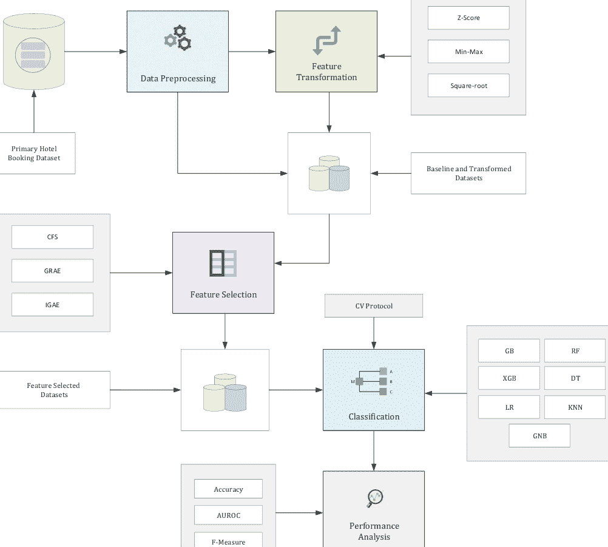
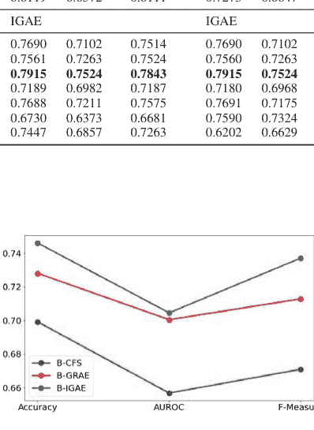

# 2020 第23届计算机与信息技术国际会议 (ICCIT) (孟加拉国达卡 2020.12.19-2020.12.21)

**Md. Shahriare Sutor**  
管理信息系统系, NSTU  
诺阿哈利, 孟加拉国  
shahriare.mis@nstu.edu

**Khair Ahamed**  
信息技术学院, NSTU  
诺阿哈利, 孟加拉国  
khairahmd6@gmail.com

**Mohammad Zynrul Abedin**  
金融与银行系, HSTU  
迪纳杰普, 孟加拉国  
abedimz@yahoo.com

## 摘要

酒店预订取消对酒店业的需求管理决策影响巨大。本工作的目标是调查来自 Kaggle 数据的酒店预订取消数据集中，使用的不同机器学习方法的影响。然后，通过特征选择方法在原始数据和数据集中实施了不同的特征转换技术。在原始数据和子数据集中采用了多种分类器，并探索了最佳方法。在所有方法中，我们发现 `XGB` 是处理数据集最频繁的方法。单个分类器产生了最高的准确率。该方法也可以作为互补工具，更有效地研究酒店预订取消。

## 索引术语

酒店预订取消，机器学习，特征转换，特征选择，分类

## I. 引言

在酒店行业中，酒店预订取消是关于接受需求决策的重要组成部分。它影响酒店的预计收入。酒店管理部门通过分析这些过程来关注客户的需求。酒店预订取消可能有许多原因，如设施缺乏、意外优惠、义务、疾病和计划变更。根据 [6], [7]，由于客户处理倾向的变化，取消率正在大幅增加。有时，他们可能会评估多个选项和政策，最终拒绝所有选项。为了最大限度地减少损失，酒店官方采取了严格的取消规则和政策。然而，在某些情况下，灵活性是有益的，因为会损害服务质量，且低额/不可退款政策也会减少收入和预订数量 [5, 16]。因此，一些酒店实施了过拟合策略导致在拒绝提供服务时产生糟糕体验 [12]。

近年来，机器学习被广泛用于提取重要信息并预测酒店旅游管理领域的各个方面。酒店预订取消有多种原因，但这些原因并没有明确或准确说明。Morales 和 Wang [11] 指出，很难想象能够以高准确率预测预订是否会被取消。然而，Huang 等人 [9] 的几项工作开发了酒店取消。例如，一种基于人工神经网络 (`ANN`) 的客户预测模型，其中生成了反向传播 (`BPN`) 和通用回归神经网络 (`RNN`) 来预测酒店取消。在台湾的西餐连锁店，Anton [3] 提供了一种类似的使用 `XGBoost` (`XGB`) 的酒店预订策略技术，用于预测哪些预订可能取消，并通过支持向量机 (`SVM`) 和 `ANN` 等分类方法在四个酒店数据集中未进行特征选择，而是预测取消概率。他们 [1] 提出了一种基于机器学习的决策支持系统，显示了两种方法重要性，并评估了决策树、决策森林、类似支持向量机的方法捕捉取消模式的能力，并衡量了随时间变化的预测精确度。Sam [13] 在乘客姓名数据集中使用 `ANN` 实现并使用遗传算法优化了随机森林、`SVM`、决策树和 `ANN`。在这项工作中，我们提出了一种利用客户实例估算收入的酒店预订取消方法。然后，实施了并恰当地探索了各种特征选择和分类方法以寻找最佳方案。该方法估计了客户需求，并减少了酒店预订取消过程中的不确定性，有助于收益管理、库存分配、物资采购和定价决策。

## 表 I：描述性统计

| 范围 | 最小值 | 最大值 | 平均值 | 标准差 | 方差 | 偏度 | 峰度 |
|---|---|---|---|---|---|---|---|
| 取消 (Canceled) | 0 | 7 | 0.37 | 0.48 | 0.231 | 0.537 | -1.712 |
| 提前期 (Lead Time) | 717 | 737 | 104.01 | 106.83 | 11419.72 | 0.501 | -1.669 |
| 到达年份 (Arrival Year) | 00:00:11 | 2015 | 十二 | 六月 | 00:00:03.95 | 0.501 | -0.028 | -0.995 |
| 到达周 (Arrival Week) | 52 | 33 | 21.37 | | | | |
| 到达日 (Arrival Day) | 30 | 31 | | | | | |
| 停留晚数 (Stayed Nights) | 19 | 19 | | | | | |
| 成人 (Adults) | 55 | 50 | | | | | |
| 儿童 (Children) | 10 | 10 | | | | | |
| 重复客客 (Repeat Guest) | 26 | 26 | | | | | |
| 之前的客户 (Previous Customers) | 0 | 0 | | | | | |
| 之前的酒店 (Previous Hotels) | 72 | 72 | | | | | |
| 价值 (Value) | 390 | 391 | | | | | |
| 需要停车位 (Required Car Parking) | 540 | 538 | | | | | |
| 特殊总量 (Total Special) | 5 | 8 | | | | | |
| 预订日期 (Reservation Date) | 06:00:00 | 2017/14 | 2014/09 | | | | | |

## II. 方法论

本工作通过机器学习方法，对酒店预订数据进行处理以获得良好结果。图 1 显示了如何提出许多模型来研究此问题并评估单个模型的影响。所提方法详细如下：

### A. 数据描述

此数据由 Antonio, Almeida 和 Neves [2] 生成，包含两种酒店信息，如度假村 (`H1`) 和酒店 (`H2`)。使用事务结构化查询语言 (`TSQL`) 查询从其数据库中收集。删除了所有包含酒店或身份信息的实例。然后，我们将 40,060 个 `H1` 和 79,330 个 `H2` 合并在一起。然而，城市酒店的取消率 (38%) 高于度假酒店 (27.69%)。该表包含从 2015 年 7 月 1 日到 2017 年 8 月 31 日三年的信息。

### B. 数据预处理与探索

数据预处理用于清理和处理数据集以供未来分析。此外，为了构建泛化的机器学习模型，仔细检查了异常值、缺失值和数据净化等不同情况。该数据集包含三个缺失值。

### C. 特征转换与选择

特征转换从现有变量创建新变量 [10]。发现了三种属性，如缩放、标准化和归一化 [8]。将值缩放到 0-1 之间而不影响分布，以及从均值进行标准化 [1]。因此，分布遵循正钟形曲线 [8]。

在数据集中实施了各种特征方法，并自动或手动识别它们以产生更高的结果 [7]。特征检测提高准确性减少了过拟合概率并使模型更简单。

本文的结构如下：第 2 节描述了所提方法，包括数据集描述、预处理、分类和评估。第 3 节展示了实验部分，我们最后通过指出未来方向来总结我们的工作。

我们采用了三种算法，例如相关性特征选择 (`CFS`)、信息增益属性评估 (`IGAE`) 和增益率属性评估 (`GRAE`)，也被许多之前的变量采用并产生了更好的结果 [14, 15]。在 `CFS` 中，它展示了与目标值之间的相关性，并使用首次搜索方法仅接受高度相关的特征。因此，这些变量没有通过皮尔逊相关系数或斯皮尔曼相关系数、最小描述长度 (`MDL`)、relief 和对称不确定性进行维护。`GRAE` 使用分支的大小来识别特征，`IGAE` 则检查所选变量与目标变量之间的依赖关系。两者都使用了 `rankeder` 算法对单个特征进行优先级排序，并手动设置了特征选择阈值。`IGAE` 和 `GRAE` 的阈值分别定义为 0.0133 和 0.0153。在图 1 中，它说明了这些实现到特征转换和主数据集中的，并从中生成了 12 个子集。

### D. 分类

分类是一种监督技术，通过对相关实例进行标记来预测类别或标签。其目标是仔细审查单个相关的记录，并估计客户的取消订单。我们在酒店预订数据集中使用了分类器，如梯度提升 (`GB`)、随机森林 (`RF`)、`XGBoost` (`XGB`)、决策树 (`DT`)、逻辑回归 (`LR`)、k 近邻 (`KNN`) 和高斯朴素贝叶斯 (`GNB`)，并分析单个分类器的性能，以估计它们的表现如何以及构建更高效的模型。因此，大多数模型在之前的工作中被广泛应用于不同类型的数据集学习项目中 [3, 4, 1, 15]。表 II 显示了这些机器学习分类器的相关参数。我们考虑了 10 折交叉验证，以评估单个模型且不对解决拟合问题产生偏差。

## 表 II：机器学习分类器的相关参数

| 分类器 | 参数 |
|---|---|
| GB | max_features=2, max_depth=2, random_state=0, Learning_rate=0.1, max_depth=3 |
| XGB | max_depth=none, random_state=0 |
| DT | |
| RF | Linear solver, max_iter=1000 |
| KNN | k=5 |
| AROC | |

### E. 评估指标

使用多种评估方法来执行机器学习模型并在所有模型中探索最佳模型。混淆矩阵将实例表示为正类 (`TP`)、假正 (`FP`)、真负 (`TN`) 和负类 (`FN`)。模型性能通过不同的指标进行评估：准确率 (`Accuracy`)、`AUROC` 和 F 值 (`F-Measure`)。

* **准确率**：代表分类器的效率，使用以下公式衡量正确性：
> `Accuracy = (TP + TN) / (TP + TN + FP + FN)` (1)

* **AUROC**：提供了分类器与负类分离的概率。然而，可以通过以下公式确定，其中正性率 (`TPR`) 和真负性率 (`TNR`) 为：
> `AUROC = (TPR + TN) / (TPR + FN)` (2)

* **F 值**：精确率 (`Precision`) 定义为少数实例除以总实例数；召回率 (`Recall`) 是正确分类相似记录的性能。因此，F 值是精确率和召回率的调和平均数，表示如下：
> `Precision = TP / (TP + FP)` (3)
> `Recall = TP / (TP + FN)` (4)
> `F-Measure = (2 * Precision * Recall) / (Precision + Recall)` (5)

## III. 实验结果与讨论

在实验中，我们分别使用 `scikit-learn` 库实现了不同的特征转换、选择和分类技术。表 III 显示了所有实验结果，但 `GB` 在主数据集、min 和 z 转换数据集上显示出最高准确率。此外，它在主数据上显示了最佳 `AUROC` 和 F 值。此外，`LR` 在平方根、min-max、z 和 z 平方转换数据集上显示了最高 `AUROC` 和 F 值。`XGB` 在主数据上显示了最高准确率和 `AUROC`。然而，`LR` 在主数据、min-max 和 z 数据集上显示了最高 F 值。`XGB` 在主数据上显示了最高 `AUROC`。它在平方根、min-max 和 z 转换数据集上显示了最佳 `AUROC` 和 F 值。`XGB` 在主数据和转换数据集上显示了最高准确率。因此，检测最佳算法是非常困难的。在子集中，`GB` 在主数据上是最佳分类器，`RF` 在转换数据上表现最佳。在 `GB` 子集中，`XGB` 在主数据上是最佳分类器。在 `XGB` 子集中，主数据比转换数据更重要。因此，特征转换技术并不更好。在模型比较中，通过探索 `AUROC` 和 F 值，`GB` 和 `XGB` 在主数据上生成的输出是更灵活的分类器，除了 `IGAE` 子集外。

## IV. 结论与未来工作

在这工作中，我们调查了酒店预订实例以减少损失并增加收入。这项工作主要评估了酒店预订数据集中的机器学习技术。此外，采用了不同的数据分析方法。未来还有更先进的机器学习和研究机会。

## 表 III：实验结果

| CT | Acc | AUROC | F-M | Acc | AUROC | F-M | Acc | AUROC | F-M |
|---|---|---|---|---|---|---|---|---|---|
| Baseline | | | | Min-Max | | | Z-Transformation | | | Square-root | | |
| CFS | | | | | | | | | | |
| RF | 0.7628 | 0.6835 | 0.7268 | 0.7421 | 0.6750 | 0.7183 | 0.7451 | 0.6750 | 0.7183 |
| XGB | 0.7628 | 0.6827 | 0.7281 | 0.5529 | 0.5360 | 0.5644 | 0.6870 | 0.6850 | 0.6641 | 0.6870 | 0.5239 | 0.6841 |
| DT | 0.7628 | 0.6827 | 0.7281 | 0.5111 | 0.4993 | 0.5172 | 0.5113 | 0.4936 | 0.5191 | 0.6296 | 0.5132 | 0.5192 |
| LR | 0.7713 | 0.6713 | 0.7161 | 0.7571 | 0.7236 | 0.7310 | 0.7111 | 0.4951 | 0.5191 | 0.7206 | 0.4733 | 0.5117 |
| KNN | 0.6528 | 0.5954 | 0.5021 | 0.4901 | 0.4754 | 0.5574 | 0.5570 | 0.5830 | 0.5582 | 0.6194 | 0.5950 | 0.6114 |
| GNB | 0.6619 | 0.6527 | 0.6111 | 0.7223 | 0.6647 | 0.7059 | 0.7223 | 0.6647 | 0.7059 | 0.6390 | 0.6775 | 0.6854 |
| GRS | | | | | | | | | | | | |
| CFS | | | | 0.7508 | 0.7056 | 0.7225 | 0.7419 | 0.6750 | 0.7183 | 0.7451 | 0.6750 | 0.7183 |
| RF | 0.7529 | 0.7262 | 0.7525 | 0.6870 | 0.5236 | 0.5540 | 0.5533 | 0.5520 | 0.5539 | 0.7235 | 0.7213 | 0.7523 |
| XGB | 0.7314 | 0.6966 | 0.7105 | 0.6570 | 0.6867 | 0.6841 | 0.6881 | 0.6457 | 0.6641 | 0.6680 | 0.6457 | 0.6503 |
| DT | 0.7194 | 0.6966 | 0.7105 | 0.7330 | 0.6982 | 0.7263 | 0.5113 | 0.4951 | 0.5191 | 0.7131 | 0.4731 | 0.5179 |
| LR | 0.7722 | 0.7052 | 0.7512 | 0.7330 | 0.7066 | 0.7291 | 0.7030 | 0.6996 | 0.7291 | 0.7687 | 0.7305 | 0.7618 |
| KNN | 0.6630 | 0.6333 | 0.6881 | 0.7590 | 0.7324 | 0.7563 | 0.7542 | 0.7270 | 0.7151 | 0.7393 | 0.7144 | 0.7375 |
| GNB | 0.6619 | 0.6527 | 0.6111 | 0.7223 | 0.6647 | 0.7059 | 0.7223 | 0.6647 | 0.7059 | 0.6390 | 0.6775 | 0.6854 |
| IGAE | | | | | | | | | | |
| GAE | 0.7690 | 0.7102 | 0.7514 | 0.7690 | 0.7102 | 0.7514 | 0.7190 | 0.7102 | 0.7514 | 0.7690 | 0.7102 | 0.7514 |
| RF | 0.7263 | 0.6982 | 0.7534 | 0.7208 | 0.7263 | 0.7523 | 0.7190 | 0.7201 | 0.7523 | 0.7213 | 0.7253 | 0.7513 |
| XGB | 0.7314 | 0.6966 | 0.7105 | 0.6570 | 0.6867 | 0.6841 | 0.6881 | 0.6457 | 0.6641 | 0.6680 | 0.6457 | 0.6503 |
| DT | 0.7194 | 0.6966 | 0.7105 | 0.7330 | 0.6982 | 0.7263 | 0.5113 | 0.4951 | 0.5191 | 0.7131 | 0.4731 | 0.5179 |
| LR | 0.7722 | 0.7052 | 0.7512 | 0.7330 | 0.7066 | 0.7291 | 0.7030 | 0.6996 | 0.7291 | 0.7687 | 0.7305 | 0.7618 |
| KNN | 0.6630 | 0.6333 | 0.6881 | 0.7590 | 0.7324 | 0.7563 | 0.7542 | 0.7270 | 0.7151 | 0.7393 | 0.7144 | 0.7375 |
| GNB | 0.6619 | 0.6527 | 0.6111 | 0.7223 | 0.6647 | 0.7059 | 0.7223 | 0.6647 | 0.7059 | 0.6390 | 0.6775 | 0.6854 |

这种学习方法对于构建各种预测模型将非常有用。未来，我们将从异构源收集更多数据，并提出创新的模型，以更准确地预测酒店预订取消。

## 参考文献

## 参考文献

- [1] Nano Antonio, De Almeida, and Luis Nunes. 一基于自动机器学习的酒店预订取消预测决策支持系统。In: 基于自动机器学习的酒店预订取消决策支持系统 (2019), pp. 1–20.

- [2] Nano Antonio, De Almeida, and Luis Nunes. "酒店预订需求数据集"。In: Data in brief (2022), pp. 41–49.

- [3] Nano Antonio, De Almeida, and Luis Nunes. "使用机器学习模型预测酒店预订取消"。In: 2017 IEEE 信息学与应用国际会议 (ICMLA). IEEE, 2017

- [4] Nano Antonio, De Almeida, and Luis Nunes. "预测酒店预订取消以减少不确定性并增加收入"。In: Tourism & Management 32 (2017), pp. 25–39.

- [5] Chih-Chien Chen, Jenny Schwartz, and Patrick Vargas. "寻找优惠：酒店取消政策如何影响价格敏感客户的搜索和预订决策"。In: International Journal of Hospitality Management 30.1 (2011), pp. 125–135.

- [6] Chih-Chien Chen and Karen Jia Xieie. "美国酒店业取消政策的差异化"。In: International Journal of Hospitality Management 34 (2013), pp. 66–77.

- [7] Mananjan Dash and Huan Liu. "用于分类和回归的特征选择"。In: Intelligent data analysis 3.1 (1997), pp. 131–156.

- [8] Jeff Hale. 使用 Scikit-Learn 进行缩放、标准化或归一化。Feb 2020。URL: https://scikit-learn.org/stable/modules/preprocessing.html#scale-standardize-or-normalize-with-scikit-learn

- [9] Han-Cien Huang, Allen Y Chang, Chiang-Chu Ho, et al. "利用人工神经网络建立客户取消模型"。In: Prezegad Electrotechniki 89.1 (2013), pp. 178–180.

- [10] Hashimoto Tanaka and Hiroasa Morota. "特征变换和子集选择"。In: IEEE Syst Their App 13.2 (1998), pp. 26–28.

- [11] Dolores Romero Morales and Jimenez Wang. "使用数据挖掘进行服务收益管理中的取消率预测"。In: European Journal of Operational Research 202.2 (2010), pp. 554–562.

- [12] Breffini M Noone and Chung Lee. "酒店预订：过度补偿对客户的影响：需求对服务的影响"。In: Journal of Hospitality & Tourism Research 35.3 (2011), pp. 334–357.

- [13] Agustin Sánchez-Medina, C Eleazar, et al. "机器学习和大数据，用于酒店预订取消的有效预测"。In: International Journal of Hospitality Management 89 (2020), pp. 10256.

- [14] Md Shahriari Tatu, Anita, and Jamal Uddullah. "使用蛋白质数据挖掘技术和神经网络对定位位进行分类的性能分析"。In: 2017 IEEE 电、计算机与通信工程国际会议 (ICECE). IEEE, 2017, pp. 860–866.

- [15] Scott J et al. "酒店取消政策、分配公平与程序公平，以及消费者愤怒：忠诚度行业的策略"。In: Journal of Travel & Tourism Marketing 32 (2015), pp. 886–906.
