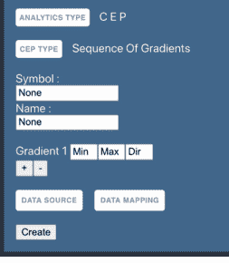
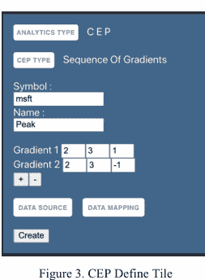
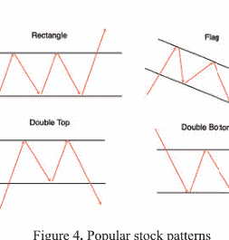
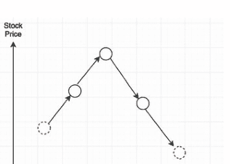
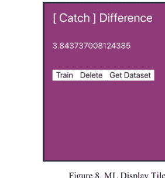
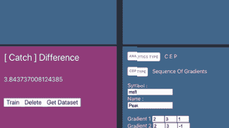

# 2020 第24届国际信息可视化会议 (IV) ｜｜ 视觉交互分析

**摘要**——在流式数据上应用机器学习技术是复杂的，因为它需要谨慎地整合技术并为专家提供简单的接口。本文提出的解决方案基于一种开放架构，其中复杂事件处理 (CEP) 引擎为下游机器学习 (ML) 提供功能。下一节介绍了涉及机器学习和人工智能的流式分析的相关工作。第三部分描述了实现细节，重点关注为领域专家开发的用户体验。第四部分提供了我们方法和所选场景的概述。第五部分讨论了结论和未来方向。

**关键词**——可视化分析；实时分析；复杂事件处理；机器学习；人工智能；金融市场；数据。

# I. 引言

如今，机器学习 (ML) 技术和工具已应用于医疗保健等领域，其中机器学习代理比人类在检测模式方面更快、更准确。它们也被用于让汽车学习如何自动驾驶。当市场发生变化时，机器学习需要能够快速适应环境因素并协助投资者进行决策过程。因此，集成实时数据流以确保机器学习算法在可用数据上运行至关重要。

分析流式数据的技术（如复杂事件处理 CEP）和用于预测的工具通常是孤立开发的，领域专家通常不具备解决问题的技能。本文描述了一种解决方案，基于开放架构，允许领域专家从金融市场数据流中提取实时模式。

# II. 相关工作，集成基于事件的流

在金融领域，人们对基于事件流 (ADC) 的兴趣日益增加，这种系统可以捕捉到传统方法无法捕捉的重要点。在计算领域，Gal 在 2014 年的研究调查了监控背景下机器学习和 CEP 的集成，并提供了性能基准。作者建议将这两种技术结合，以增加整个系统的准确性。CEP 技术处理多个事件之间的相关性，同时允许机器学习算法在数据流上指定操作。Gal 在 [5] 中进行的近期工作引入了使用深度学习分析流式数据的可扩展框架。另一项相关研究关于大规模数据分析 (MOA) 的使用，这是一个在流式数据上进行机器学习实验的软件环境，它是流行的 WEKA 项目的继任者。上述参考文献允许数据科学家利用技术知识发现海量数据中的相关性。然而，这些项目缺乏对 CEP 引擎处理流式数据的潜在集成的支持，也没有专家可以使用重新配置系统的交互式用户界面。

我们在 [3] 中的近期研究提出了一种新架构，遵循以下设计原则：

- 将 CEP 解决方案与新兴流式解决方案分离，例如 `Kafka` [1]、`Flink` [2]，这些解决方案正被广泛使用；
- 使用来自流或 CEP 引擎的预处理流式数据作为机器学习（训练）能力的输入；
- 允许任何预测器链接到机器学习模型。

在此架构中，持续学习通过收集由 CEP 引擎检测到的满足模式条件的轨迹来支持。这些轨迹随后在流式处理器的消息层中处理，并可以作为训练器的训练数据。例如，在股票价格场景中，可以在一天结束时根据需要进行。我们还分离了训练器（`Trainer`）和预测器（`Predictor`）的功能，以允许模型在后台更新，而预测器不中断地继续预测。特定组件的细节在 [3] 中给出。

这种架构只是第一步，提供了利用技术的可能性，但并未保证专家可用性。此外，这项工作必须后续开发满足需求的交互式用户界面。

# III. 提出的解决方案

本文的主要贡献是扩展了 [3] 中的实现，为领域专家提供了一种在金融流上结合 CEP/ML 分析的新方法。我们通过对用户体验的描述提供了有关实现的更多细节。

## A. 所用实现的描述

所使用的实现是通过许多开源组件实现的，描述如下：


图1 [3] 中描述的架构和实现。

- **仪表板 (Dashboard)**：允许用户友好地指定 CEP 事件、时间和特定应用程序的重要事件，例如指示股票价格上涨或下降的事件序列；仪表板将具有视觉相关并存储提取的模式。
- **编排器 (Orchestrator)**：目的是将这些事件模式的定义传递给组件，即 `Flink`（用于访问数据源）和 `Catch`（用于处理 CEP 规则）。它还处理应用程序的内部状态，例如事件之间的关系并控制它们的执行。
- **抓取器 (Fetch)**：从 `Dashboard` `Catch` 访问外部数据流。`Fetch` 组件本质上是模式类型事件的观察者，这些事件从环境中获取以进行流式处理。
- **流式处理器 (Stream Processor)**：执行事件处理函数，如过滤、连接不同通道上的模式事件以及保持持久的事件存储，随后可以为了分析目的处理。
- **Catch**：是一个事件检测引擎，处理流式处理器捕获的事件，然后将其作为 CEP 处理规则进行分析。该组件旨在处理交付交付复杂 CEP 功能的机会。
- **训练器 (Trainer)**：一个机器学习组件，旨在访问由流式处理器递增的训练数据集。该数据集由流式处理器从 `Fetch` 接收到的事件，或由 `Catch` 执行 CEP 处理后检测到的事件实例组成，使用底层的机器学习模型（在这种情况下是 `TensorFlow` [7]）。
- **预测器 (Predictor)**：使用训练器产生的已训练模型，然后将其应用于新数据以生成预测。这是持续学习方法的一部分，图中未显示，但我们可以在未来调查这一点。

用户看到的是图 2 所示的深蓝色仪表板。他们使用的第一个标题是“定义标题”（Define Title）。它被用于定义 CEP 或 ML 配置，用户可以使用顶部的“分析类型”（Analytics Type）菜单在这些类型之间切换。值得注意的是，如果正在定义 ML 配置，定义标题的颜色会变为粉色，否则在定义 CEP 规则时保持蓝色。本节的其余部分将详细描述如何使用这些类型的标题。

## B. 定义标题 (Define Title)

定义标题是以 CEP 作为其分析类型的定义标题。它允许你定义用于提取序列模式的规则。由于底层 CEP 引擎支持多种 CEP 类型，在“分析类型”下方提供了一个“CEP 类型”菜单，允许用户选择选项。根据原型，支持“梯度序列”（Sequence of Gradients）CEP（如图 3 所示）。梯度是一种特殊的事件，描述了连续增加、减少或保持不变的数值序列。每个梯度（线段）由关键事件处的股票价格值定义。相同方向的两个或多个梯度形成一个作为 CEP 序列规则的事件模式。

这种简单的梯度模式不足以探索复杂的模式，例如重叠模式（图 4）。梯度的组合由单个梯度组成，可以使用图 3 所示的序列编辑器进行组合，这被称为“梯度序列”。

在此原型中，我们分析了源自 Yahoo Finance [1] 的每日数据。因此，梯度正在寻找每个交易日的开盘价（或收盘价），如果配置切换到不同的数据源，它将捕捉日内价格数据流。所有梯度都背尾连接到每个起始梯度。每个梯度都有最小长度和最大长度，以及一个方向（`+1` 表示上升，`-1` 表示下降，`0` 表示平直）。以图 3 为例，序列中的值所示：

- 梯度 1 捕捉一个连续增加的开盘模式序列，最小长度为 2，最大长度为 3。
- 梯度 2 捕捉一个连续减少的开盘模式序列，最小长度为 2，最大长度为 3。



图 2 仪表板的初始状态



图 3. CEP 定义标题

将梯度 1 和梯度 2 结合，我们得到了图 5 图表可视化的“双梯度序列”，其中每个事件都用圆圈表示。实线创建了一组由指定参数匹配的最小序列，而最大值则包含了实线和虚线。用户可以使用 "+/-"按钮添加或删除梯度。

用户还需要选择“股票代码”（Stock Symbol），这是用于唯一标识交易股票的缩写（例如微软的“MSFT”）。



图 4 热门股票模式



图 5 梯度事件序列可视化

最终，用户必须选择从哪个源获取数据。需要注意的是，这并不是获取股票数据的数据源（Yahoo Finance），而是指系统的内部机制。有两个选项：

- **Fetch（获取）**：直接从 Yahoo Finance 获取的原始数据。
- **Catch（捕获）**：每个原始股票数据与之前定义的 CEP 标题所定义的事件模式之间的匹配。这些事件中的许多取决于用户在第一步中定义的 CEP 规则。因此，在对用户感兴趣捕捉的特定字段应用映射之前，捕获的事件无法直接馈送到 CEP 显示标题（Display Title）。

用户可以为标题赋予自定义名称，并使用相应的菜单指定 ML 可以训练的数据源。有两种数据源，即是 `Fetch` 组件或是 `Catch` 组件，如果用户决定使用 `Catch` 源，他们还必须指定“数据映射”（Data Mapping）。这与 Titan II.B 中使用的机制完全相同。

用户可以点击底部的“创建”（Create）按钮创建一个 CEP 显示标题（第 III 节）。

用户需要使用提供的监督式 ML 算法之一。目前，平台仅支持动态时间规整（DTW）和长短期记忆神经网络（LSTM）算法。默认情况下，DTW 被选为“创建”按钮的默认算法，并生成响应式的 CEP 显示标题（第 III 节）。

| 分析类型 | 机器学习 |
| :--- | :--- |
| ML 类型 | 监督式 |
| 名称无 | |
| ML 算法数据源数据映射 | |
| 创建 | |

图 6. ML 定义标题

## C. ML 定义标题 (ML Define Title)

ML 定义标题是以 ML 作为分析类型的标题（图 6）。用户可以定义配置来执行各种分析任务。标题顶部有一个“ML 类型”菜单，定义了使用的 ML 类别。向用户提供了两种主要的 ML 算法：

- **监督式（Supervised）**：ML 算法在标记数据集上进行训练。注意有许多类型的监督式 ML 算法，如回归或 LSTM 算法。
- **无监督式（Unsupervised）**：ML 算法自行发现并展示数据中有趣的模式或结构。

## D. CEP 显示标题 (CEP Display Title)

CEP 显示标题（图 7）是使用相应 CEP 标题产生的 CEP 规则输出的可视化。它非常简单，... 图表中显示符号，图旁边显示 CEP 标题名称，以及一个显示检测到的 catch 组件数量的计数器。用户可以点击标题上的“激活”（Activate）按钮启动获取配置，该配置每分钟检索一次有关股票事件的新数据，以及 catch 组件中的事件序列处理。如果原始股票数据与匹配的数据，将通过 `Kafka`（图 1 中的红线）增加 CEP 显示标题上的计数器。一旦用户完成实验，可以使用“删除”（Delete）按钮移除标题并清理系统。

```
[ msft ] | Peak 1
18
event detected
Activate Delete
```

图 7. CEP 显示标题

## E. ML 显示标题 (ML Display Title)

ML 显示标题（图 9） 是使用 ML 定义结果产生的 ML 输出的可视化。它允许用户启动训练过程。后台发生的情况是 `Trainer` 组件从 `Kafka` 源拉取数据，然后执行训练。一旦过程完成，模型将传输到 `Prediction` 组件以对来自数据源的新输入数据进行预测。结果直接显示在标题上。第 IV 节将给出使用此方法并解释结果示例。

用户还可以使用“获取数据”（Get Data）按钮下载训练数据集，该数据集为 CSV 格式，并根据创建阶段使用 ML 定义指定的参数创建。如果需要，此数据集可以作为其他系统的输入进一步分析。如果用户任何时候想要删除标题，可以点击“删除”按钮。

我们演示了使用此方法并解释结果的示例如下。

# IV. 评估场景 (Evaluation Scenarios)

## A. 场景 1

在这种场景中，我们感兴趣的是微软 (MSFT) 和苹果 (AAPL) 的两个不同场景显示先上升后下降。以下是用户必须执行的特定步骤：

- 用户创建一个名为“Peak 1”的 CEP 标题，并获取“MSFT”符号的数据。然后创建“梯度序列”规则：第一个最小长度为 2，最大长度为 3，方向上升；第二个最小长度为 1，最大长度为 3，方向为 -1（下降）。他应该使用 Fetch 数据源并在显示标题上点击“激活”以查看。
- 用户创建一个另一个名为“Peak 2”的 CEP 标题，并获取“AAPL”符号的数据。他可以创建相同的“梯度序列”规则。
- 用户可以通过“监督式 ML”类型创建一个 ML 标题，带有源、“DTW”ML 算法以及适当的数据映射。然后可以点击“训练”（Train）按钮获取显示事件差异的数字。



在遵循上述步骤后，生成的仪表板将如所示图 9 所示。呈现的标题有：

- 左上：捕捉微软 (MSFT) 开盘价模式的 CEP 标题（图 5）。
- 右上：捕捉苹果 (AAPL) 开盘价模式的 CEP 标题（图 5）。
- 左下：计算微软和苹果事件模式差异的 ML 标题。
- 右下：由用户填充参数的 CEP 定义，用于创建新的相应的 CEP 标题。

通过确保如图，我们发现微软 (MSFT) 和苹果 (AAPL) 分别检测到 18 和 21 个事件模式，在 ML 显示标题 (3.8473) 中，这些事件模式之间的距离较小。这些事件模式相关的较小距离意味着：换句话说，两只股票似乎以相似的方式移动。

| msft | Peak 1 | aapl | Peak 2 |
|---|---|---|---|
| 18 | | 21 | |
| event patterns detected | | event patterns detected | |
| Activate | | Activate | |



图 9. 实现场景 1 后的仪表板

## B. 场景 II

在此场景下，投资者想知道哪些证券（例如，微软 MSFT 和苹果 AAPL）会同时出现峰值。操作方法如下：

- 对于峰值检测，投资者定义了两个名为“MSFT Peak”和“AAPL Peak”的 CEP 显示（CEP Displays），它们分别获取股票代码的数据。每个显示都应该有一个通用的 CEP 类型以及两个梯度（gradients）。第一个最小长度为 5，最大长度为 10，方向为 -1（递增）。第二个最小长度为 5，最大长度为 10，方向为 -1（下降）。他应该使用数据源（Fetch Data Source）并“激活”（Activate）磁片以开始捕事件。
- 对于阈值，投资者按照上述描述创建了一个模式序列，并使用了一组对比的梯度。
- 为了计算事件模式序列之间的差异，投资者通过指定“监督机器学习类型”（Supervised ML Type）、数据源“DTW ML”以及适当的映射（Mapping）创建一个 ML 表，以创建磁片并显示事件模式序列之间的差异。如果数字很大，说明 MSFT 和 AAPL 没有重叠的峰值，反之亦然。

来自雅虎财经的数据每分钟更新一次，而高频数据指的是在数秒内发生的任何时间序列更新。

- 当前平台会在激活时启动所有 ML 训练任务。这可能会导致问题，因为机器学习算法的计算开销很大。

# 结论与未来工作

本文的目标是为金融专家提供一个交互且易用的平台，以便以交互方式探索 CEP 和 ML 引擎的结合力量。我们开发了平台的通用架构，该架构由相互作用的组件组成，以及一个通过用户界面所有元素处理金融数据的特定实现，并解释了它们的工作原理，正如金融专家可能想要探索的两个特定用例所描述。在探索平台时，我们得出了一些观察，并遇到了一些局限性，我们将在平台工作中提到这些局限性。

在未来工作方面，我们的首要任务是支持更多 CEP 和 ML 算法。我们将进行可用性测试，以查看该平台的易用程度。用户反馈非常重要，因为平台是为金融专家构建的，所以我们希望平台对于这类利益相关者来说尽可能简单。最后，我们将提高平台的稳定性和用户体验，解决处理大型复杂实验时的限制。

# 参考文献

- [1] 实时智能与事件处理，https://complexevent.com (访问于2020年4月27日)
- [2] M. Kamparidis and F. B. E. Otov (2017). 使用有向事件评估交易策略。Expert Systems, 72, 145-160, doi:10.1016/j.esys.2016.12.002
- [3] J. Santos, A. Berg and F. Liu (2019). 高级开放集成架构、复杂事件处理和机器学习，发表于 IEEE 2019 计算机工程国际会议, 2020。
- [4] A. Bifert, R. Guadal, G. Holmes and B. Pihrainer Machine Learning for Data Streams, with Practical Applications in MOA
- [5] S. Ge, Ha, I. Sulifkan, and S. Khan (2019). 基于深度学习的多维数据分析框架及应用，发表于 IEEE International Conference (COMPACS)。
- [6] R. Gast, M. Kakeshi and I. Medina-Bulo (2014). 利用股票市场结合 CEP、EDA 和机器学习 的可行性，发表于 Congresso de Computação e Engenharia de Sistemas (JACIS - SISTEMAS 2014), Madrid。
- [7] Apache TensorFlow，https://www.tensorflow.org (访问于2020年4月30日)
- [8] Apache Kafka, https://kafka.apache.org (访问于2020年4月27日)
- [9] Apache Flink, https://flink.apache.org (访问于2020年4月27日)
- [10] Apache Spark, https://spark.apache.org (访问于2020年4月27日)
- [11] Weka 项目，https://www.waikato.ac.nz/weka/index.html (访问于2020年5月28日)


## C. 观察

在测试上述场景及其他一些场景时，我们有几点观察：

- 平台运行快速且响应迅速，因为所提架构中的所有组件都是松耦合的
- 平台为用户提供了高度的灵活性。磁片设计允许用户创建各种磁片，每个磁片都能处理极其复杂的用例
- 主要功能之一是在创建时编辑磁片。这可以通过删除并重建磁片来实现，我们希望在未来的工作中实现这一功能
- 为了从雅虎财经以外的其他来源获取数据，需要软件工程师参与扩展 `Fetch` 组件
- 平台目前不支持 ML 算法或 CEP 模式。所有这些目前硬编码在组件中，需要软件工程师参与实现此类功能以适应新案例
- 我们在第四部分提出的两个场景最适用于低频数据。股票

## 参考文献

- [12] 雅虎财经，https://finance.yahoo.com (访问于2020年5月1日)
