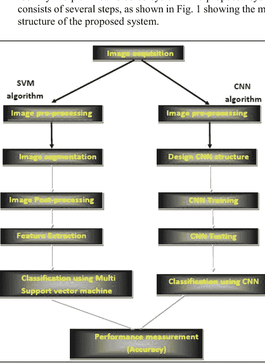
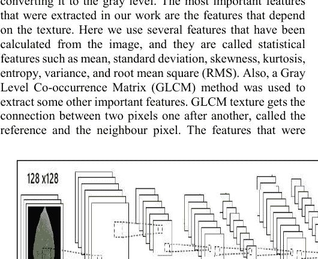
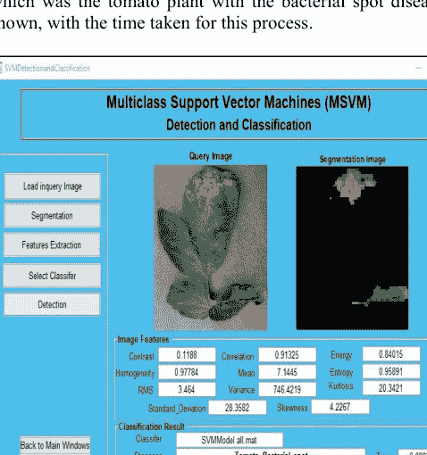
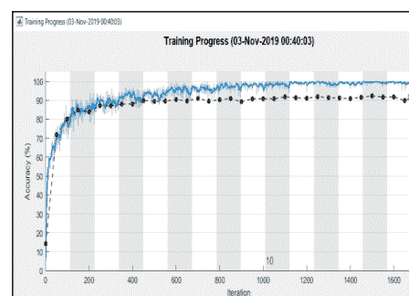

# 2020 第二届 Al-Noor 国际科学技术会议 (NICST) (阿塞拜疆巴库 2020.8.28-2020.8.30) 2020 第二届 Al-Noor 国际科学技术会议 (NICST)

Jamal M. Al-Tuwajari
计算机科学系，
科学学院，迪亚拉大学，
伊拉克迪亚拉
dru.altuwajari@sciences.diyala.edu

Marwan A. Jasim
计算机科学系，
科学学院，迪亚拉大学，
伊拉克迪亚拉
marwan.admani@sciences.diyala.edu

Mustafa Abdullah-Baqi Rahem
区域学习系。
穆坦西尔大学，
伊拉克迪亚拉
mustafatayajar@gmail.com

**摘要** 本文介绍了一种利用深度学习技术进行分类和检测的叶片疾病的系统。所提系统包含两种分类方法以及它们之间的比较：支持向量机（SVM）算法和多阶段分级分类。特别是，使用了特定类型的叶片，如番茄、辣椒，这些是世界上（尤其是伊拉克境内）常见的植物种类。第二种方法使用了卷积神经网络（CNN）进行分类。在这些方法中，使用了18个数据集，包括不同类型的植物，这些植物被分为三类叶片。比较结果显示，SVM算法在准确性方面更好，因此在植物叶片疾病的检测和分类中更有效、更准确。

**关键词** 植物叶片疾病、K类聚类、SVM深度学习、CNN算法、修正线性单元（ReLU）。

# I. 引言

农业是文明的基石。目前的重点是提高生产率，而没有考虑到其导致的环境退化而产生的环境影响。植物疾病是能够显著影响农业发展过程中作物质量和数量许多重要因素。

疾病包括真菌、细菌、病毒和霉菌。农民通常通过肉眼观察叶片来进行疾病识别和诊断 [1], [12]。然而，这种方法既耗时又昂贵，且不准确。其他人使用图像处理和深度学习方法，工作速度快且准确。叶片图像上植物症状的摄影照片用于植物疾病的检测以及研究、教学和分析 [3]-[4]。利用计算机图像处理和深度学习进行植物叶片疾病检测 [5]-[6]；

我们可以研究叶片图像，并根据颜色、纹理和其他特征从表示点获取斑点特征。通过关注受区域变化影响的区域 [7], [8]。研究人员证明图像识别技术和深度学习是有效的方法 [9]。在过去的几年技术发展中，该领域的专家找到了用于此任务的最佳方法 [11], [12]。在植物系统的田野里，每年生长着大量的叶片。在这项工作中，我们提出了一个使用两种机器学习方法进行分类的系统。第一是支持向量机（SVM）方法 [15]，它在分类过程之前包含几个步骤；第二种，我们使用了深度学习，即卷积神经网络（CNN）方法 [16]。我们将针对取自全球数据集（植物品种，Plant Variety，包含许多叶片）的相同数据，解释这些方法在准确性上的比较。我们的工作限制在世界范围内闻名的不同类型的植物上。

本文的结构如下：第二部分反映了引言中完成的工作。第三部分阐明了实现预期结果步骤中使用方法和方法，第四部分涵盖了对建议方法的分析。第五部分提供了结论和未来的展望。

# II. 相关工作

本节描述了之前使用图像处理和深度学习检测植物疾病方面的工作。TM 等人 [17] 设计了一个系统，通过测量名为 LeNet 的卷积神经网络设计的细微差异来识别和分类叶片中的不同模式。这项工作的主要目标是发现一种在最小化计算资源的同时利用该方法检测番茄叶片疾病的解决方案。

神经网络使用自动特征提取来将输入图像分为若干类项目。该系统的整体方法是通过考虑神经网络的变量来进行学习。Francis 和 C. Derry [18] 使用 CNN 模型创建了一种深层学习方法。该系统由几个卷积层组成，随后是池化层。此外，全连接层以及 Sigmoid 函数也用于检测叶片是否患病。该方法使用一个包含 500 张图像的数据集对番茄的健康和健康叶片进行了分类。准确率达到了 87%。Palma Rajan 等人在 [19] 中使用了一种通用方法。他们使用 CNN 提取特征，使用人工神经网络（ANN）提取出的值来检测健康症状，ANN CNN 的性能准确率高出 80%。Sassivam, G.,

# III. 所提技术

在本节中，我们介绍一个识别植物叶片疾病的计算机系统。所提系统包含几个步骤，如图1 所示，显示了所提系统的主要结构。

图 1 植物叶片疾病检测与分类的通用图

植物叶片检测和分类系统将通过以下步骤解释。两种算法中的图像与数据相同。因此，算法之前的第一步是图像获取，将在下一节中进行说明。

### A. 获取（数据集）

植物叶片图像已从网站 (www.plantvillage.org) 的 (Plant Village) 库获取。收集的数据集包含 20636 张属于 15 不同类的图像，如表 1 所示。该数据集包含了主要类型叶片的所有图像，这些是世界上最著名的植物之一，在伊拉克也是如此。（注：原文此段存在大量重复内容，此处已去重翻译）。

### B. 支持向量机 (SVM)

在该算法中，所提系统被分为几个步骤：1. 图像处理。预处理步骤用于使图像适用于后续处理。在此步骤中，我们将颜色空间从 RGB 转换为 LAB 空间。因为 L*a*b 是三维空间，它只能在三维空间内被正确检测。为了区分背景和受影响区域，采用了图像分割。对于图像分割，使用了两种主要方法：基于聚类基于颜色。所提系统将使用 K-means 聚类的聚类结果，根据一组属性识别对象。通过减少实体与相关组之间的距离平方来有效地分类。图 2 展示了我们对番茄感染叶片进行分割的示例。

### C. 卷积神经网络 (CNN)

在此部分，我们详细介绍了卷积神经网络（CNN）架构。CNN 能够自动从图像中学习特征，这比手动提取特征更有效。

提取自 GLCM 区域特征、同质性和相关性特征。

#### 3. 图像后处理

在对图像分割后，我们需要通过一个名为“处理”的过程来为下一步配置数据。在所提的系统和该过程中，图像分割被转换为画布，以便从图像“1”中提取特征。

灰度 $(L_j) = ((0.3 * R) + (0.59 * G) + (0.1 * B))$

其中 R 代表红色，G 代表绿色，B 代表蓝色。

图 2：目标斑点的图像分割

## C. 卷积神经网络算法

卷积神经网络 (CNN) 是深度学习中最流行的方法之一，其中包含许多训练好的层。据观察，它非常有效，并在计算机视觉应用中用得最广泛。CNN 可以应用于处理图像输入的复杂函数，通过将其转换为输出类别进行分类。在这种方法中，有以下几个步骤：

从受影响区域提取出表征受感染区域的不同特征。在这一步中，在将图像转换为灰度级后，从图中提取重要特征。最重要的特征是在对纹理进行特征的工作中提取的。我们使用了多种计算出的特征：标准差、偏度、熵、方差和均方根 (RMS)。此外，还使用了灰度共生矩阵 (GLCM) 方法来提取其他其他重要特征。GLCM 纹理检测两个相邻像素之间的连接，并称为参考像素和相邻像素。所提取的特征是——

#### 1. 图像预处理

数据集中的图像被调整大小为 128 x 128 分辨率。因此，训练方式可以加快，模型测试可以真实地调整输入或目标变量来加速训练过程，同时保持图像的完整性不丢失。

- 土豆叶片
- 番茄叶片，关节
- 番茄叶片晚疫病
- 土豆早疫病
- 辣椒叶霉病

图 3：CNN 模型架构

#### 2. 输入层

输入层包含输入特征和像素值。

#### 3. 卷积层

CNN 在层中使用卷积核卷积将整个对象转换为我们优化的特征图，创建不同的特征图。在我们的研究中，我们使用了 4 个卷积层。每层都是 2D 的。我们使用了 10 个高度和宽度均为 3 且带有 'same' 填充字符的过滤器。填充被添加到输入边缘。像素以相同的方式设置，使得输出尺寸与输入尺寸相同。在第二个卷积层中，我们有 20 个高度和宽度均为 3 带有 'same' 填充字符的过滤器。第三层卷积层有 64 个高度和宽度均为 3 带有 'same' 填充字符的过滤器，在第四层卷积层中有 30 个高度和宽度均为 3 带有 'same' 填充字符的过滤器，如图 3 所示。

#### 4. 池化

池化层紧随卷积层之后，用于减少特征图和网络参数。池化层在解释上也是不变的，类似于卷积层，因为它们的计算考虑了相邻像素。广泛使用的方法是平均池化和最大池化。在我们的研究中，我们使用最大池化 (max-pooling)。

卷积网络对输入应用非线性变换，以便稍后对特征进行分类。在 CNN 中我们使用线性整流单元 (ReLU)。整流单元通常用作非线性变换。这种层执行一种带有阈值的简单操作，任何小于 0 的值被设置为 0。

### 多分类支持向量机 (MSVM)
检测与分类

#### 6. 全连接

数据到达卷积神经网络的层，即全连接层，稍后在两个相邻层中检测，神经元直接连接到全连接网络内的神经元，如图 3 所示。

| | | | | |
|---|---|---|---|---|
| 图像特征 | 0.1198 | 0.9135 | 0.7239 | 0.8461 |
| 异质性 | 0.9734 | 7.1461 | 0.9589 | | |
| 叶片 | 3.4415 | 0.271 | 4.2567 | | |

图 4.MSVM 检测与分类

#### 7. 归一化

在所提系统中，我们使用批量归一化。批量归一化层通过微批 (mini-batch) 对任何通道进行归一化。这有助于减少对变化的敏感性。

| 分类结果 | |
|---|---|
| 细菌性腐烂 | 0.9999 |

#### 8. Softmax

网络的性能可能很难解释。在卷积层和全连接层优化神经元的分类时，以 softmax 函数结束是正常的，以减少与指定真值标签之间的差异。在我们的研究中，我们使用 70% 的数据进行训练，30% 用于测试。

#### 9. 归一化

在所提系统中，我们使用批量归一化。批量归一化层通过微批对任何通道进行归一化。这有助于减少对变化的敏感性。

#### 8. Softmax

网络的性能可能很难解释。在卷积层和全连接层优化神经元的分类时，以 softmax 函数结束是正常的，以减少与指定真值标签之间的差异。在我们的研究中，我们使用 70% 的数据进行训练，30% 用于测试。

#### 9. 归一化

在所提系统中，我们使用批量归一化。批量归一化层通过微批对任何通道进行归一化。这有助于减少对变化的敏感性。

## IV. 实验结果

对两种算法进行了对比。

| 序号 | 类名 | CNN | SVM | | | |
|---|---|---|---|---|---|
| 1 | 辣椒斑点 | 62.90 | 58.50 | | | |
| 2 | 辣椒健康 | 58.20 | 50.00 | | | |
| 3 | 土豆早疫病 | 73.60 | 63.70 | | | |
| 4 | 土豆健康 | 84.10 | 80.10 | | | |
| 5 | 土豆晚疫病 | 46.50 | 32.00 | | | |
| 6 | 番茄斑点 | 55.50 | 46.60 | | | |
| 7 | 番茄马赛病毒 | 71.40 | 58.70 | | | |
| 8 | 番茄叶卷病 | 60.50 | 63.50 | | | |
| 9 | 番茄健康 | 69.20 | 67.20 | | | |
| 10 | 番茄早疫病 | 60.70 | 40.30 | | | |
| 11 | 番茄晚疫病 | 78.50 | 74.30 | | | |
| 12 | 番茄叶霉 | 60.80 | 51.60 | | | |
| 13 | 番茄叶锈病 | 53.70 | 53.70 | | | |
| 14 | 番茄红螨 | 64.80 | 61.00 | | | |

图 5：CNN 对植物病害的检测与分类

图 6：训练进度（准确率）和损失函数

### 2nd Al-Noor 针对科学与所提系统对比 (NICT2020)。

| 作者 | 参考文献 | 算法（分类） | 数据集规模（数量） | 准确率 |
|---|---|---|---|---|
| Prajala T. M. | [17] | CNN | 18160 | 94.95% |
| Francis, M. and C. Destiny | [18] | CNN | 3666 | 87% |
| Malika | [19] | ANN | 未提及 | 80% |
| Sambasivam, J.Gandcooffee | [20] | CNN | 10000 | 93% |
| 所提技术 | | CNN | 20636 | 98.02% |

- [8] R. C., 等人，“使用图像处理进行叶片疾病检测与识别，”国际工程研究与计算机科学杂志 (2021)，第 9(1) ，第 1-14 页。
- [9] Sharada P Mohanty, David P Hughes, and Marcus Carlesc，“利用深度学习进行植物叶片疾病检测，”植物科学前沿 (Frontiers in Plant Science)，2016年。
- [10] I. Heredia，“基于深度神经网络和模式识别的草分类，”IEEE会议论文集，2017年。
- [11] Githal Ghangay and Vinay Kumar & Amit Hari Joshi，“使用深度学习和分类器的叶片疾病检测首次研究，”Springer Science-Business Media, LLC, part 2017 Springer https://doi.org/10.1007/978-3-030-41445-8。
- [12] H. Ahmed 等人，“使用深度神经网络识别植物病害，”IEEE 计算机视觉模式识别会议论文集 (2017)。
- [13] J. M. Al-Tawaji, S. Yachen, C. Zhanling, and H. Wonga，“基于机器学习方法的叶片疾病检测，”国际计算机科学与信息安全杂志 (2017)，第 15(11) ，第 547-553 页。
- [14] S. Wahid，“基于图检测的机器学习方法的植物病害自动检测，”国际计算机科学与工程杂志 - 第 06 卷 (2018年12月12日)，CSE. IEEE 学会，美国华盛顿特区。491-498 页。
- [15] J. M. Al-Tawaji, S. Yachen，“基于 SVM 的神经视觉叶片分类的性能评估，”农业研究与技术杂志 (2018)。
- [16] G. L. Lubrical, C. I. Uz, M. Lage, and P. M. Grantin，“使用人工神经网络进行叶片疾病的检测与分类，”国际农业研究杂志，11(4)，第 415-419 页。
- [17] P. T. Pramani, R. Kailaj, A. Sahir, N. Bithari, Shashikhar, K. Gulkarni，“使用人工神经网络检测植物病害，”第288届国际以网络为中心的计算与技术会议 (ICCNC)，2018年8月2-3日。
- [18] Francis, Merlin, and C. Destiny，“使用人工神经网络进行叶片疾病的检测与分类 —— 一项视觉研究，”信号处理与神经网络国际会议 (ISSPN)，第 48-55 页。
- [19] M. Ranjan, R. Majgir Weber, A. Nehbhoshi，“使用卷积神经网络进行叶片疾病的检测与分类，”应用会议：E-IEEE-2015-，第 3 卷，第 1 期 (2015年6月-5月)。
- [20] G. Sambasivam, and G. Chandan Aqu-nino，“农业中有效的机器学习应用：使用卷积网络进行木薯疾病检测与分类，”电子信息杂志 (2020)。
- [21] S. B. Sadhan，“使用卷积神经网络增强叶片疾病检测性能，”国际计算机科学杂志 (IJCS)，2019年，第 81-88 页。
- [22] S. B. Sadhan, A. I. Mahdi, R. Mohamad，“近期声地震轨迹与视觉质量测量，”国际计算机科学与应用杂志 (2015)，第 238-243 页。
- [23] S. B. Sadhan, A. J. Alusa, A. N Mahmud，“基于神经网络的盲源分离算法性能增强，”第5届通信系统、网络与数据科学国际会议 (CNSDS)，2019年。
- [25] Dh. M. Reza, B. B. Sadhan，“基于信息理论的线性传输密文安全性评估，”巴比伦大学杂志，2014年，第 22 卷，第 7 期，第 1862–1870 页。

在表 III 中，我们展示了所提方法与一些研究工作的对比，以支持我们的工作。

## V. 结论

对农业和生产危害最大的是。这激励我们使用基于计算机设施和技术的强大系统。该系统通过两种方法识别并检测叶片疾病：SVM 和卷积神经网络 (CNN)。从我们的 CNN 在性能和准确率方面的比较结果来看，获得了 98.02% 的得分。在国际知名且重要的植物类别上准确率尚不足，包括番茄、土豆和辣椒。不同的学习率和优化器可以作为系统的一部分使用。

- [1] P. Nasek and S. Patil，“使用 CNN 的新型叶片检测，”国际工程研究与科学杂志第 3 卷，第 1 期，1220-1244，2015。
- [2] S. V. D., Singh, A. Ghangani, C. Kapoor, K. Gupta, P. Singh，“农业叶片疾病成像技术，”2011年第2届国际计算机科学与技术会议 (ICCIT)，第 1-6 页。印度，2011年11月3-5日。
- [3] R. K Rai, 等人，“使用 CNN 神经网络图像识别与分类植物病害的自动模型”(IJRDIC)，2018。
- [4] V. M. Abhirami and S. S. Bharathi，“植物病识别综述，”国际计算机科学与技术杂志 (ICST) – 第 3 卷，第 6 期，2015年11-12月。
- [5] K. P. Kumar，“用于叶片疾病检测和分类器的深度学习，”计算机与农业，2020。
- [6] J. Hossain, M.A. Amin，“基于生物识别的叶片形状识别，”2010年第13届国际计算机与信息技术会议 (ICCIT) 论文集，孟加拉国，2010年12月23-25日；第 458-463 页。
- [7] P. J.K and R. Kumaraj2，“病叶片图像特征提取，”信号与图像处理

