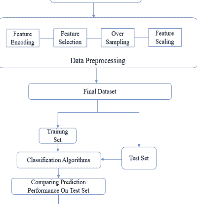
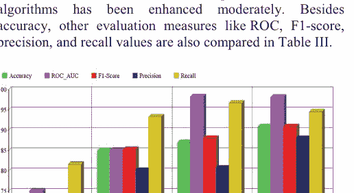
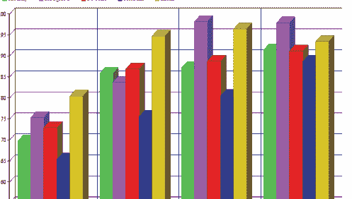
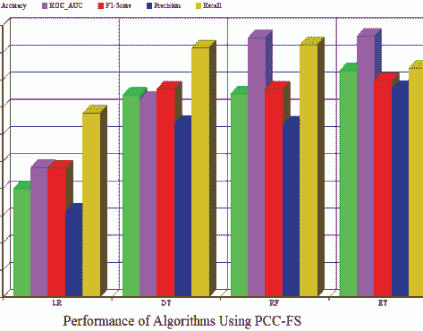
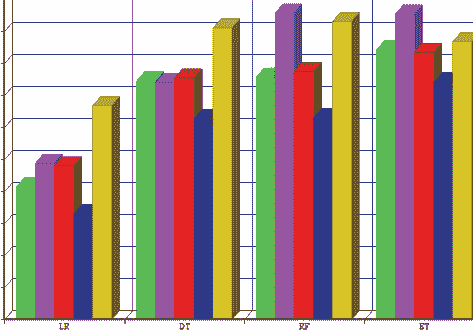

# 2020 第二届先进信息与通信技术国际会议 (ICAICT) (孟加拉国达卡 2020.11.28-2020.11.29)

Md. Fazle Rabbi*, S. M. Mahed Hasan*, Arifa Islam Champa*, Md. Asif Zaman*, Md. Kamrul Hasan*

*伊斯兰技术大学计算机科学与工程系

**拉杰沙希工程技术大学计算机科学与工程系，Rajshahi-6204, Bangladesh**

***孟加拉国国际科学技术大学计算机科学与工程系

南大大学

## 摘要

肝脏是人体的一关器官，其主要任务是消除代谢产生的废物、消化食物和能量物质。肝脏疾病会导致各种健康问题，为了降低这些致命疾病的风险，对患者进行治疗是必须的。肝疾病的诊断非常广泛，已有许多使用机器学习（ML）进行的研究。在本文中，我们比较了四种机器学习算法（逻辑回归、决策树、随机森林和 SVM）来分类肝患者数据集（LPDP）。应用了基于皮尔逊相关系数的特征选择（PCS）来消除数据集中的无关特征。从 ROC、F-1 分、精确率和召回率对所有算法的性能进行了分析。我们的实验结果表明，融合 SVM 提供了 92.19% 的最高准确率。其中，每年有 200 万死于肝疾病。早期诊断和适当治疗是解决这一问题的唯一途径。该疾病的诊断可能包括血液检查、CT 扫描、MRI 和超声，以检查一个人是否受到。肝疾病的检测总是困难的，因为我们需要经验丰富的医生并花费大量时间。为了辅助实践，机器学习是一个重要的工具。它可以从医学数据集中提取有用信息并建立模型来识别患者。研究人员已经使用了机器学习和数据挖掘技术，但由于肝脏数据集结构复杂且具有非线性特征，预测疾病非常困难。它包含许多缺失值和异常值，这使得预测变得困难。

**关键词**—肝疾病、分类、机器学习、皮尔逊相关系数

## I. 引言

肝脏是人体最重要的器官，位于身体右侧。它在毒素代谢、蛋白质合成以及产生不同类型的碳水化合物、脂肪和化学物质以消化食物方面起着至关重要的作用。它是唯一只要至少保留 25% 就能再生的器官。保持健康的肝脏对于生存至关重要。多种致命疾病如肝硬化、肝炎、脂肪肝病、肝癌、肝衰竭、贫血和脂肪变性等是导致由于过度饮酒引起的感染等肝疾病的许多原因。肝疾病的征象和症状包括黄疸、腹痛、瘙痒、食欲不振和疲劳。根据统计，约有 5000 万人患肝疾病，约占总人口的 4.5%。

本文中比较了多种方法，如`逻辑回归（LR）`、`决策树（DT）`、`随机森林（RF）`和`极端树（ET）`来预测肝疾病。以前已经在提高预测准确率。在预处理阶段，通过标签编码对类别值进行编码。我们利用了合成少数过采样技术（SMOTE）来消除数据不平衡。在删除冗余特征后，使用特征选择来缓解类别分布问题，并使用`AdaBoost`分类器提高每个分类算法的性能。

## II. 文献综述

近年来，已进行了对肝患者进行分类的研究。Ramana 等人 [6] 考虑了不同的数据集来预测肝患者。比较实验结果，装袋分类器（bagging classifier）被证明更好，准确率为 69.3%。

研究论文的其余部分设计如下：第二节介绍了预测肝疾病的相关工作。第三节详细介绍了数据集。第四节描述了我们的方法以及实验和结果。第五节为分析。最后，第六节总结了论文。

Anagawa 等人 [7] 设计了一种名为互补朴素贝叶斯（CNB）的双重学习模型，其中使用噪声构建模型。它缩短了时间并显示出优于 K 最近邻（KNN）的性能，准确率为 71.96%。

Rahman 等人 [8] 设计了六种不同的分类方法使用`逻辑回归（LR）`、KNN、`决策树（DT）`、支持机（SVM）、NB 和`随机森林（RF）`预测肝疾病。他们的实验显示 LR 达到了 75% 的准确率。

Veena 等人 [9] 使用数据挖掘工具 R 在印度肝脏数据集上实现了不同的算法。使用 C5.0 算法，他们实现了 75.19% 的准确率。[10] 提出了一种分类肝患者的方法。使用皮尔逊相关系数进行特征选择。虽然实施了不同的分类器，如 DT、NB、SVM 和人工神经网络（ANN），但 DT 达到了 81% 的最高准确率。

Kuzillahi 等人 [11] 使用带有遗传算法的 XGBoost 分类器，并使用 LR、KNN、DT 和 RF 等分类器优于使用遗传算法（GA）和少数过采样技术（SMOTE）的数据分类。在检测并删除异常值后，分类提供了 88% 的最高准确率。

Ramesh 等人 [12] 使用了不同的数据集 ILPD。为了减少特征维度，他们利用了主成分分析（PCA），然后利用 NB、KNN、SVM、DT、RF 等分类方法。此外，他们对算法使用了增强（boosting）和装袋（bagging）。在这些，SVM 上的自适应增强产生了 89.1% 的最高准确率。

### 表 I. ILPD 数据集的属性（部分）

| 序号 | 属性 | 描述 |
|---|---|---|
| 5 | Alkoph | 碱性磷酸酶 |
| 6 | Spt | 丙酮氨基转移酶 |
| 7 | Sgot | 天门冬酸氨基转移酶 |
| 8 | TP | 总蛋白 |
| 9 | ALB | 白蛋白 |
| 10 | A/G | 白蛋白与球蛋白比例 |
| 11 | Class | 1 正性 0 阴性 |

## III. ILPD 数据集描述

在我们的研究中，使用了加州大学欧文（UCI）印度肝患者机器学习库。该数据集有 583 条记录，包含 167 个非癌症样本和 416 个肝患者。数据集的详情如表 I 所示：

### 表 I. ILPD 数据集的属性

| 序号 | 属性 | 描述 |
|---|---|---|
| 1 | Age | 年龄（以年为单位） |
| 2 | Sex | 患者性别 |
| 3 | TB | 总白蛋白 |
| 4 | DB | 直接白蛋白 |

### A. 预处理

数据预处理是分类提高预测准确率的必要部分。任何预测算法可能会降低数据质量。如果数据集包含噪声值、异常值，那么整体性能和准确率可能会降低。我们的研究是增加肝患者分类的预测准确率。在该研究中，数据预处理包括类别特征值、删除无关特征、处理异常值和过采样。我们的工作流程如图 1 所示。

```text

```

图 1. 我们的方法流程

#### 1) 标签编码

在该数据集中，性别属性包含 Male 和 Female 等值。标签编码用于将类别值转换为数值标签，例如 1 代表男性，0 代表女性。

#### 2) 基于皮尔逊相关系数的特征选择 (PCC-FS)

特征选择通过减少特征数量来提高模型性能。基于统计的特征选择技术评估每个独立变量与数据分类之间的关系。变量那些与下一步分类中选定的类别相比，具有更高的统计值。在本研究中，使用相关系数来选择最重要的特征。范围从 -1 到 1 的皮尔逊相关系数规定了两个变量之间的关系，记为皮尔逊相关系数 (P)。接近 1 的值表示正相关较强，-1 表示负相关。接近 0 的值表示变量之间的相关性较弱。随机变量对 (X, Y) 的皮尔逊相关系数公式化为：

```
$$\rho(X,Y) = \frac{cov(X,Y)}{\sigma_X\sigma_Y}$$ (1)
```

其中 `cov(X,Y)` 表示协方差，`\sigma_X`、`\sigma_Y` 是 X 和 Y 的标准差。

#### 3) 过采样

过采样是指对少数类进行随机复制。正如我们所见的，HLP 数据集包含 67 个负样本和 416 个正样本。它可能面临类别分布不平衡的问题，这可能导致多数类偏向预测。为了解决这个问题，使用了随机过采样器（Random OverSampler）来增加少数类样本。

#### 4) 特征缩放

特征缩放将特征值归一化到指定的范围内。它是构建机器学习模型最重要的步骤之一。它缩短了训练时间，并有助于许多机器学习和神经网络算法实现收敛。如果数据集包含许多异常值，使用均值和标准差的效果可能会不同。我们使用 Z-score 异常值技术，通过鲁棒缩放（Robust Scaling）检测并处理异常值。使用四分位范围（Interquartile Range）的鲁棒缩放来处理异常值并缩放数据。

### B. 分类

#### 1) 逻辑回归 (LR)

逻辑回归（LR）是一种基于概率概念的预测性机器学习算法。旨在解决类别为 0 或 1 的二分类问题。它使用逻辑函数将输出压缩在 0 和 1 之间。预测概率 (P) 为：

```
$P = \frac{1}{1+e^{-(w_0+w_1x_1+w_2x_2-...-w_nx_n)}}$ (2)
```

#### 2) 决策树 (DT)

决策树用于树结构解决分类和回归问题。树根指的是数据集属性的最佳特征、信息增益或吉尼指数。每个叶节点指的是属性、类别或因变量。该算法可以处理分类数据和数值数据。

#### 3) 随机森林 (RF)

随机森林（RF）是一种集成机器学习方法，可应用于回归和分类问题 [14]。它构建了多棵决策树以获得良好且准确的预测。RF 通过使用训练样本解决了 DT 的过拟合问题。DT 通常从样本中挑选最佳特征，这种方法会导致过拟合。但随机森林可以轻松地解决过拟合问题。

#### 4) 极端树 (Extra Trees)

极端树或随机森林是与 RF 相似的集成机器学习算法。但 ET 和 RF 之间有两个根本区别。一个是样本不放回抽样，另一个是不是选择最佳特征，而是选择随机特征。在分割树节点后，通过对分类中的所有树情况取平均或通过聚合投票情况来构建树。

#### 5) AdaBoost

自适应提升（Adaptive boosting）是一种集成学习算法，通过改进弱分类器的弱点来构建更强的分类器。它通过为每个算法设置权重，并在训练阶段的每次迭代中确保预测正确，来减少偏差和方差并提高性能。弱分类器的组合可以表示为：

```
$f(x) = \sum_{t=1}^{T} \alpha_t h_t(x)$ (3)
```

其中 `h(x)` 是弱分类器。最终（强）分类器的结果是 `H(x)=sign(f(x))`。

### C. 评估指标

为了评估多个机器学习模型的性能，我们采用了 K 折交叉验证将数据集划分为 k 个子集。在每一步中，使用 k-1 个样本进行训练，剩余的一个子集用于验证性能。最终结果通过重复此过程并汇总测试子集的结果获得。在本文中我们使用 10 折交叉验证进行评估。分类准确率是机器学习的标准评估指标。我们还使用了不同的统计度量，如 F-Score、精确率（Precision）、召回率（Recall）和整体分类器来评估性能。混淆矩阵总结了机器学习模型的性能。使用混淆矩阵可以获得准确率、F-Score、召回率和精确率：

#### 表 II. 混淆矩阵

| | 预测正 | 预测负 |
|---|---|---|
| 正 | 真阳 (TP) | 假阴 (FN) |
| 负 | 假正 (FP) | 真阴 (TN) |

```
Accuracy = (TN+TP)/(TN+TP+FN+FP)
Precision = TP/(TP+FP)
Recall = TP/(TP+FN)
F1 - 分数 = 2*TP/(2*TP+FP+FN)
```

## V. 结果与讨论

Google Colab [15] 是一种免费的云服务，适用于所有人。为了在不过拟合的情况下有效评估机器学习算法的性能，使用了 10 折交叉验证 [16]。我们按照 80/20 的比例将数据集分为训练和测试 [17]。在本研究中，我们比较了四（4）种算法如 LR、DT、RF 和 ET 的性能。在不应用选择技术的情况下应用数据预处理，利用算法进行分类。LR、DT、RF 和 ET 分别提供了 68.75%、84.86%、86.9% 和 90.76% 的准确率，如图 2 所示。AdaBoost 也显示了算法的性能。从图 3 可以观察到这些算法的整体性能得到了增强。准确率、ROC、F1-score、精确率和召回率在表 III 中进行了比较。

```text


```

图 3. 所有所有方法的性能分析

### 表 III 使用所有方法的性能

| 评估 | 准确率 | ROC | F1 分数 | 精确率 | 召回率 |
|---|---|---|---|---|---|
| LR | 68.75 | 71.33 | 64.97 | 81.58 | 55.53 |
| 机器学习 | 84.86 | 84.25 | 80.78 | 91.41 | 83.23 |
| RF | 86.9 | 82.79 | 80.62 | 96.62 | 82.18 |
| ET | 90.6 | 90.78 | 87.89 | 91.47 | 88.55 |
| AdaBoost | 69.71 | 75.22 | 68.57 | 76.63 | 71.5 |
| 分类器 | 81.53 | 83.71 | 80.68 | 94.69 | 91.5 |

我们注意到不重要的特征会降低算法的预测性能。我们采用皮尔逊相关系数移除无关特征。通过对四（4）种用于预测患者的算法进行数据预处理，LR、DT、RF 和 ET 分别提供了 70.07%、81.14%、83.38% 和 91.77% 的准确率，如图 2 所示。AdaBoost 算法显示了 70.68%、87.26% 和 92.19% 的准确率，如图 5 所示。准确率、ROC、F1-score 和召回率值在表 IV 中进行了比较。

### 表 IV 使用 PCC-FS 的性能

| 评估 | 准确率 | ROC | F1 分数 | 精确率 | 召回率 |
|---|---|---|---|---|---|
| LR | 70.03 | 73.87 | 65.89 | 83.89 | 91.57 |
| 机器学习 | 87.14 | 84.61 | 88.35 | 91.58 | 87.34 |
| RF | 87.38 | 87.97 | 81.32 | 86.38 | 91.7 |
| ET | 91.7 | 90.87 | 88.55 | 92.18 | 90.54 |
| AdaBoost 分类器 | 70.68 | 74.38 | 66.52 | 83.34 | 82.76 |
| | | 87.65 | 81.51 | 95.64 | 92.19 97.14 93.37 |

为了证明我们的工作，表 V 与之前的研究进行了比较。该表证实我们获得了比提到文献更高的准确率。

### 表 V 与早期研究的准确率比较

| 作者 (年份) | 方法 | 准确率 |
|---|---|---|
| Ramana (2019) [6] | Bagging | 69.3% |
| Anagaw (2019) [7] | CNB | 71.36% |
| Rahman (2019) [8] | LR | 75% |
| Veena (2019) [9] | C5.0 Boosting | 75.19% |
| Auxilia (2018) [10] | PCC+DT | |
| Kuzhillareth (2020) [11] | GA-RF | 88% |
| Ramesh (2019) [12] | PCA+SVM | 89.1% |
| 我们的模型 | PCC+Adaptive (ET) | 92.19% |

更好，为了达到预期结果，我们在 LR、RF 和 ET 算法上应用了自适应提升（AdaBoost）。带有 PCC-FS 的 AdaBoost 提高了这些算法的整体性能，因为自适应方法的估计准确率为 92.1%。通过对比分析，我们可以说，这将有助于医疗从业人员对患者诊断做出有效决策。在未来，我们将使用深度学习和结合各种特征选择技术来分类患者。

```text

```

图 4. 使用 PCC-FS 的机器学习性能分析

```text

```

图 5. 使用 PCC-FS 的 AdaBoost 性能分析

## 参考文献

[17] Box, George E.P., Meyer, Daniel, “未重复分数因子实验的分析。”《计量学》(Technometrics)，第28卷，第1期，第11-18页，1986年。
