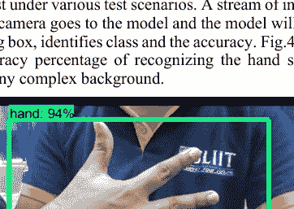

# 2020 第二届国际计算进展会议 (ICAC) (斯里兰卡，马拉贝 2020.12.10-2020.12.11)

**EasyTalk：一种基于斯里兰卡手语的实时翻译系统**

D. Manoj Kumar  
软件工程系  
斯里兰卡信息技术学院  
科伦坡，斯里兰卡  
it17050272@my.slit

K. Basavanaja  
软件工程系  
斯里兰卡信息技术学院  
科伦坡，斯里兰卡  
it17032766@my.slit

S. Thavananthan  
软件工程系  
斯里兰卡信息技术学院  
科伦坡，斯里兰卡  
it17068192@my.slit

G.M.A.S. Bastiansz  
软件工程系  
斯里兰卡信息技术学院  
科伦坡，斯里兰卡  
it17143959@my.slit

S.M.B. Harshanantha  
软件工程系  
斯里兰卡信息技术学院  
科伦坡，斯里兰卡  
harshanantha.s@slit.lk

J. Aloius  
信息技术系  
斯里兰卡信息技术学院  
科伦坡，斯里兰卡  
jesuthasan.a@slit.lk

**摘要**  
EasyTalk 旨在帮助听障和言语障碍人士与他人进行交流。但并非所有人都能理解手语，因此需要一种翻译工具。斯里兰卡手语与听障及言语障碍者密切相关。该项目提供了 EasyTalk 这一手语翻译器，它可以将斯里兰卡手语转换为文本和音频形式，并进行口语翻译，这将使交流困难的人士受益。在第一个组件中，`Gesture Detector`（手势检测器）使用预训练模型捕捉手部手势。图像分类器对检测到的手部进行分类。文本和语音生成器为检测到的手势生成输出。最后，文本到手语转换器负责将英文文本转换为手语。它能够以卓越的准确性翻译并产生结果。这可以实现该国家不同残障人士之间高效且有效的沟通。

听障和言语障碍群体无法向普通人表达他们的感受。这个特殊群体需要手语来进行交流。遗憾的是，普通人并不了解手语，正如这个特殊群体不了解口语一样。在普通人与言语困难者之间建立沟通桥梁是不容忽视的。

全球有 2.5 亿到 3 亿的人患有听力和语言障碍。如上述段所示，手语已被引入供人们与他人交流。手语并不是通用的，每个国家都有自己的手语。正因如此，可以使用手势、手部和动作、面部表情和动作来代替口头交流。手语不是通用的，且随国家而异，但也存在相似的手语。所有国家都有自己的手语，例如斯里兰卡手语、美国手语、英国手语。大多数时候，这些手语对于听障人士并不熟悉，他们无法与普通人交流。

**关键词**  
机器学习、图像处理、分辨率无关识别、卷积网络、自然语言处理、实时翻译、语义分析、文本语音。

---

# I. 引言

沟通是全人类日常生活中最重要的方面。马尔可曾说：“沟通是人之间一种非常有意义的互动。具体来说，它是人类之间感知和理解意义的方式。”地球上的每种生物都有其独特的方式进行相互交流。人类的沟通通过各种类型的群体进行，通过信息流和相互理解，成为个人与群体之间的桥梁。人类总是使用语言将信息从一个人传递给另一个人。但最好的例子是那些无法通过口头交流的人，他们通常被称为听障和言语障碍群体，斯里兰卡也有一种独特的手语。当普通人对斯里兰卡手语（SSL）缺乏正确理解时，问题就会出现。在那里，双方都拒绝友好地交流，因为他们无法理解对方想说什么。为了解决这个问题并在普通人与听障及言语障碍人士之间建立沟通桥梁，斯里兰卡发明了一些翻译器，特别是针对听力及言语系统的活动。最近的大多数发明表明，普通人能够从中获得最大收益。此外，他们还可以使用翻译器将斯里兰卡语翻译成自然语音或手语，这有助于通过单一引擎发现这两种翻译模式。

通过 `Nidhida` 学习语言。该系统由三个主要部分组成，即 3D 监控、动作跟踪和语音识别。使用 `Nidhida`，听障儿童可以根据输入的片段获得 2D 虚拟形象动画。该系统使用通过图像视频识别手语和特征的方法。由于整个系统中使用了不同的模型，听障儿童可以自我激励，分享他们的学习能力。

本研究聚焦于一种基于斯里兰卡手语的实时翻译器，可以将斯里兰卡手语转换为文本或其他格式（如英文文本、斯里兰卡语）。研究的目标是在斯里兰卡普通人与听/言障人士之间建立沟通纽带，同时为他们提供自学语言指南。

---

# II. 背景与文献综述

全球范围内与手语相关的搜索正在进行。中文手语、美国手语、锡语 [1] 是其中一些。手语检测有两种：一种是基于图像视觉的，另一种是基于设备的 [2]。特征识别、特征提取、处理和分类是由于预处理消除了无关元素。感兴趣区域（ROI），图像特征将进行提取并使用深度学习进行分类。

考虑到基于设备的手部识别，Gibson 和 Perez 使用 `Kinect` 传感器开发的系统 [5]。该系统使用实时色彩深度和动作跟踪技术。动态时间规整（DTW）算法被用于该系统以解释手势。他们使用了 K 折验证方法。这种方法在测试模拟中证明了 90% 的平均准确率。Ahmed 及其团队使用了使用 `Microsoft Kinect` 的程序 [6]。他们使用了支持向量机（SVM）算法，并与之前的努力进行了比较。他们方法使用带有径基函数（RBF）内核的 SVM 比线性内核具有更高的准确率。Deep 团队提出了一种使用动作跟踪的系统，在 520 个样本的数据集上获得了 99% 的准确率 [7]。

分类器显示出 98% 的准确率。`Nidhida Ridma` [9] 是一位斯里兰卡翻译人员，为带有设备的听障儿童实施了该系统。由于这是一个基于游戏的学习系统，听障儿童通过 `Sandabha` [11] 学习要容易得多。其主要目的是通过斯里兰卡听障应用程序提供许多任务、活动和新思想，帮助使用系统的听障用户的知识和教育。

---

# III. 方法论

## A. 手势检测器

该组件将实现在 `TensorFlow` 模型训练器上，并使用 RNN（递归卷积神经网络）。对于训练，每个斯里兰卡语言字母表 ([1]) 对应三张图像，总共 247 张。首先，为类别创建一个映射。感兴趣的系统只有一个类别：无。

为了实现成功的模型检测，训练后的图像被分为训练集和测试集，并使用标注工具以 `Pascal VOC` 格式进行标注，以获取可扩展的标记语言（XML）记录。单幅图像被转换为逗号分隔值（CSV），用于训练集和测试数据集。使用这些 CSV 文件，进行模型训练器和 `Faster RNN` 配置。该配置基于 `RCNN` 模型，该模型广泛用于根据颜色和肤色检测人类手掌。训练过程非常简单，应该通过终端中的损失值（`loss`）进行检查，或者当损失值低于 0.25 时即可获得具有概率的结果。这可以通过数学方程 (1) 实现：

```
$best = argmax_c \in P(c)$
```

或者，你可以在代码中使用 Python 来识别以下内容的使用 (2)：

```python
$best = max(candidates, key=P)$
```

概率模型是涉及词序列考虑的概率。它广泛强调了在所有预测中，根据单词的语境分析的每个词的概率。

模型成功后，网络摄像头将打开并使用预训练模型检测图像。一旦图像检测的平均率超过 95%，该图像将被发送到图像分类器的 API 进行分类。

## B. 图像分类器

```
$P(w|c) = \pi(w|c)/n(w_k;w_{k-1})$
```

图像分类器在 API 下运行，获取抽象图像并预测英语字母。该 API 是使用卷积神经网络（CNN）构建的机器学习模型。我们的分类器使用了动物中的神经网络模式概念，广泛用于视觉分析。CNN 分类器可以处理图像并在不同的类别进行分类。由于系统实现使用了 Python，因此使用该库来构建 CNN。模型训练需要数据来帮助更准确地预测。在这里，使用了英语字母的检测。字母表的每个字母都被定义为一个类。然而，数据集有 26 个类，包含 250 个手势，这些手势是通过相机拍摄的。

方程 (3) 可以应用于分割，其中可以定义为序列或函数，作为单词字符串的输入，该字符串在最佳分割中没有叶子节点。

> >> 'chooserniklika'
> ['Chrosinka']

图像分类器将经过几个步骤。第一步，图像通过一系列卷积层。应用降维来突出特征，这被称为池化（`pooling`）。之后，添加许多卷积层并反复进行池化，直到满足过滤要求。然后，将输出展平化并通过全连接层。最后，通过激活函数识别类别。预测的手势将通过 API 发送到文本和音频生成器。

在对输入单词进行拼写检查时，可以使用分割方法来确定单词背后的意图。贝叶斯定理（如 (4) 所示）的使用有效，用于判断正确性：

```
$P(w|c) = argmax P(w|c) P(c)$
```

其中 `$P(c)$` 模型语言代表 `$c$` 为意图单词的概率，而 `$P(w|c)$` 代表作者意图写 `$c$` 但出错错误的概率。下表 1 显示了单词 `$w$` 和 `$c$` 的各种产品关系。

## C. 文本和音频生成器

为了识别单词并将文本序列转换为单词，此处使用了语言数据库（`Linguistic Data Corpus`）。数据被用作语料，并将单词序列和发音作为标记。在这方面，目标是解决涉及各种数据集和标记的方法。

**表 1 产品矩阵**

| w | w|c | P(w|c) | P(c) | 10^P(w|c) |
|---|---|---|---|---|
| the | we | .000007 | 0 | 144 |
| the | we | .0000009 | 0 | 90 |
| the | ea | .000001 | 0 | 7 |
| the | hr | .0000004 | 0 | 3 |
| the | ew | .0000003 | 0 | 0.0001 |

定义概率模型：这是将随机变量与事件模型的概率分布相结合，收集的数据被用于计算概率的确定性。这是通过列出候选者并展示它们在领域内的性能来对其分析。

选择最有可能的候选者：这是使用语言模型选择最佳候选的过程。

此阶段涉及对找到单词进行替换并在英语语料库中匹配。影响在于提交的语音和单词也存在损失。该过程涉及两个部分：自然语言处理（NLP）和数字处理。NLP 是使用自然语言的人类与计算机之间的接口。这是通过系统中的韵律特征实现的，涉及文本分析中的三个组件：韵律断句和语音转换。文本分析，例如，将初始输入分割为标记，其中每个单词都作为词性（POS）的一部分进行分析。语音字典被用作初始输入单词语音转录的方法。对于输入文本，必须包含在字典中。最后，对功能和内容进行分类，并伴有一些修改。

最后，合成语音是尽可能地用可理解的声音产生语音。与其他方法相比，拼接法（`Concatenative`）是最自然的方法。该方法涉及从语音数据库中选择最佳单元，以与音素流和目标韵律匹配。自然合成在完成所需话语时，提供了单词特定领域的拼接音素单元的信息。

## D. 文本转手语器

文本转手语器用作斯里兰卡普通人的学习材料。通过此组件，用户可以实时获取相关的手势，将动词文本转换为手语。利用 NLP [12] 和语义分析 [13] 中的各种库支持文本转换。重要的是，NLP 用于分析、处理和生成人类语言，而语义分析用于使用选定的手势创建图形格式（GIF）图像。该组件的系统设计如图 1 所示。

如果有任何相似词，系统将从系统数据库获取相关手势并返回到后端。否则，单词将拆分为字符数组并传递给系统数据库。一旦为字符选择了相关字符，系统将考虑将字符重新排序并返回后端。完成后，使用语义分析，系统将为输入中的每个单词生成 GIF 图像并显示给用户。

---

# IV. 结果与讨论

本节详细介绍了实验结果，该实验旨在通过构建并改进普通人与听障或视障人士之间的沟通，引入一种斯里兰卡语翻译器，这是本研究的主要目标。结果的高准确性使使用户在处理漏洞时能够理解翻译内容，在此期间，组织了一个简单的系统来识别斯里兰卡用户的知识水平，以收集他们的建议和想法。调查结果显示了许多方面。第一个方面是图 2 中的结果尚不清晰。

此外，许多人建议为了语言目的拥有一个翻译器更好。根据下图 3 所示，大多数人建议开发一个基于 Web 的语言翻译器。许多调查结果显示，人们很难通过实时图像检测手势。在系统显示手势 GIF 作为最终输出之前，用户将经过几个步骤。一旦用户输入内容，它将转换为系统后端。然后系统将使用 NLP 中的自然语言工具包（`nltk`）库将输入拆分为多个单词。之后，拆分后的单词将与预定义的字典单词集对比，以识别用户输入与预定义单词之间是否存在相似性。

**图 1. 文本转手语器图**

如上段所述，该系统有两个主要功能。第一个是“将斯里兰卡手语转换为文本/语音”。该主功能由三个子功能组成，即“手部检测”、“文本-音频生成”以及在 `TensorFlow` 模型上使用 `Faster RCNN` 训练的手势检测。在成功训练后，模型被用于各种场景的测试。来自网络摄像头的输入流引导模型在任何复杂背景下检测手部，并显示最佳结果。`Faster RCNN` 的主要功能不仅是对图像进行分类，还能在实时流中检测多个物体（类别）。这被认为是即使在低分辨率下也能检测手部的最重要因素。此外，模型还通过网络摄像头的实时视频进行了测试。`Faster RCNN` 能够在上述场景下以高准确率检测出手部。



**图 4. 复杂背景下的手势识别**

下表 II 表示了数据采集组件在不同场景下手部图像检测的准确率。

EasyTalk 的第二个组件是分类分类。CNN 模型使用 26 个类别进行训练，每个类别有 250 张图像。在数据集中，85% 的样本用于训练，15% 的样本用于测试。为了获得更好的训练效果，`epochs` 设置为 50，并使用每个类别的 38 个样本进行测试。

### 各类别准确率

**表 II 手势检测准确率**

| 类别 | 准确率 (%) | 类别 | 准确率 (%) |
|---|---|---|---|
| A | 100 | N | 97 |
| B | 100 | O | 97 |
| C | 97 | P | 95 |
| D | 100 | Q | 100 |
| E | 100 | R | 92 |
| F | 97 | S | 95 |
| G | 100 | T | 97 |
| H | 100 | U | 95 |
| J | 95 | W | 100 |
| K | 100 | X | 95 |
| L | 100 | Y | 97 |
| M | 95 | Z | 100 |

| 测试场景 | 测试次数 | 平均检测准确率 (%) |
|---|---|---|
| 手部检测 复杂背景 | 20 | 93 |
| 手部检测 - 明亮环境 | 20 | 92 |
| 手部检测 黑暗环境 | 20 | 89 |
| 来自大手掌的手势 | 20 | 95 |
| 手部检测 翻转手部 | 20 | 87 |

模型在测试阶段的准确率为 97%。即使对于手势，也存在一些细微的差异，这会在实时操作中产生问题。例如，“I”和“J”的符号相似，很难通过正向摄像头进行检测。识别方面的主要问题在于文本和音频生成部分，即用于将斯里兰卡手语转换为文本/音频的第 3 个子功能。

根据表 II 所示，模型在所有测试场景下的检测准确率为 91%。这远高于 80% 的准确率限制，被认为是该组件的最优方案。识别出的组件将作为图像帧发送到下一个组件，以匹配文本进行分类和翻译。与斯里兰卡手语翻译相比，证明 EasyTalk 可以以高准确率处理手部。与其通过网络摄像头捕捉整个图像，EasyTalk 只专注于在相应场景下锁定手部图像。

在这里，应用程序识别字母的单词段，并正确对每个部分进行深度检查。该定理用于识别字母集合中的单词段。再次，检查拼写错误的过程最终会生成用户喜欢的格式的文本。表 IV 表示了文本和音频生成器的输出准确率。该组件在大多数场景下的准确率均高于 80%。这远高于 75% 的准确率限制，被认为是该组件的最优方案。

此前考虑使用 `Mask RCNN` 来训练和检测网络摄像头流的手部。它是使用 500 张图像的数据集训练的。其主要缺点是 `Mask RCNN` 在检测图像流时性能较差。为了避免这种情况，在考虑速度后，决定使用 `Faster RCNN`。

### 各输入准确率

| 输入 | 单词段 | 拼写检查 | 准确率 (%) |
|---|---|---|---|
| welcome | welcome back | welcome back | 80 |
| howaeroy | how are you | How are you | 78 |
| Thisthisym | This is him | This is mine | 85 |
| goodmorning | Good morning | Good morning | 80 |

第二个主功能是“将英语转换为手语”（SL 至 GIF）。这也是子功能之一——“命名句子识别”和“将符号显示为 GIF”。这种方法基于自然语言处理（NLP）。通过 NLP，可以将文本翻译为更小的单元（单词或子词）。因此，EasyTalk 擅长翻译如“How are you?”之类的句子以及“Peter”之类的特定单词，将文本转换为手语更加经济高效，且翻译快速方便。

此前，应用程序用于解析用户文本。这也是子功能之一——“命名句子识别”和“将符号显示为 GIF”。这种方法基于 NLP。通过 NLP，可以将文本翻译为更小的单元（单词或子词）。因此，EasyTalk 擅长翻译如“How are you?”之类的句子以及“Peter”之类的特定单词，将文本转换为手语更加经济高效，且翻译快速方便。

（注：OCR 文本后半部分存在大量重复，此处已根据提供的逻辑提供了一个清晰的去重版本。）
