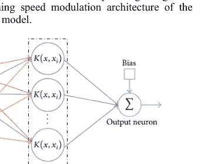
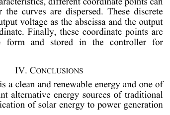

# 2020年第二届人工智能与先进制造国际会议 (AIAM)(英国曼彻斯特 2020.10.15-2020.10.17)

董忠*，方阳*

*山威职业学院，广东山威，516600，桂林理工大学，桂林，541004，中国
*scientificai@163.com

**摘要—** 随着能源和环境问题的日益凸显，太阳能已成为世界上开发潜力最大的新形式。作为一种新型可再生能源，太阳能因其高强度而超过了其他能源。光伏发电是一种利用光子将光能电能的直接发电形式。在实际情况下，光强度是不稳定的，太阳能电池（SPCs）受到其他因素的影响，因此对对光伏阵列的特性进行建模以实现光伏发电的动态仿真。本文设计了基于深度学习的太阳能电池仿真模型，分析了太阳能电池的输出特性。增加太阳辐射、温度、串联电阻和二极管反向修正可以提高光伏电池的性能，增大开路电压和短路电流有助于提高其输出功率和效率。

**关键词—** 光伏发电，太阳能电池，输出特性，仿真

## I. 引言

随着对能源和环境问题日益日益关注，清洁能源的发展至关重要。作为一种新型可再生能源，太阳能与其他能源相比具有很高的利用率，是理想的可再生能源。光伏发电是光电效应的过程，即利用太阳能电池将太阳能转换为电能 [2]。随着其日益普及，太阳能作为世界上具有巨大潜力的新形式，在近年来已成为清洁能源的主要来源之一 [3]。太阳光伏电池是具有将太阳能转换为电的核心部件。然而，光伏电池的转换效率仍受限于器件复杂的特性。太阳能已成为具有无害、巨大和长期等优势的新能源研发热点领域。高生产成本和低效率限制了其能力 [4]。

由于光伏电池成本高且实际实验困难，仿真已成为研究该领域的主要方法 [5]。在实际情况下，光强度是不稳定的，太阳能电池容易受到其他因素的影响，因此对对光伏阵列的特性进行建模以实现光伏发电的动态仿真 [6]。

由于太阳能电池的发电效率受光强度和环境温度的影响，将建立一个太阳能电池模型来研究光强度和环境特的影响 [7]。太阳能是一种利用太阳能板将太阳能转换为电能的直接发电形式。太阳能电池表面有一层薄金属层和芯片。金属与薄片另一侧之间将产生一个恒值，这就是太阳能电池的特性。由于其许多优势，太阳能已成为该领域的热点。光伏发电领域的研究具有广泛意义。基于人脑分析的深度学习形成了更高级的特征，改进了对底层数据的学习，提高了识别和分类能力 [8]。本文介绍了太阳光伏电池的原理，设计了基于深度学习的太阳能电池仿真模型，并分析了太阳能电池的输出特性。

## II. 太阳能光伏电池模型

太阳能电池是利用半导体材料的光电效应的光伏转换器件，是光伏发电中最小的功率单元和元件。其特性是指电输出 [9]。考虑到天气条件对太阳能电池输出的影响可能远低于平均值，有必要确保光伏阵列的设计和储电池的设计在各种条件下协同工作 [11]。为了评估 SPC 的发电性能，有必要定量地分析表征其发电能力的一些特性参数及其影响因素。辐照度的高敏感性，辐照强度是影响太阳能电池发电最重要的因素。其次，辐照度的测量应对不同频率的光具有均匀性，以便最真实准确地反映环境中阳光照射在太阳能电池上的影响。

参考传统储能系统的特性数据，储能系统的优先顺序表1所示。由于储能系统 1 和 2 容量较大且能量较高，它们可以作为承担基础负载的能源系统。

### 表 I 储能系统

| 储能系统 | 1 | 2 | 3 | 4 |
| :--- | :--- | :--- | :--- | :--- |
| P | 450 | 546 | 385 | 312 |
| μ | 14.85 | 13.56 | 26.87 | 30.71 |

太阳能电池匹配负载阻抗没有变化。

典型储电池的等效电路如图1所示于R_{solution}$ 是溶液电阻，$R_{electrolyte}$ 是电极电阻，$C_{electrolyte}$ 是双层电容。

img/976a933ef3a16501c833_0.png

图 1 储电池等效电路

img/976a933ef3a16501c833_1.png

在原始功率 $P_n(t)$ 加上高斯噪声 $\omega(t)$ 以获得共同信号 $P(t)$，

$P(t) = P_e(t) + \omega(t) (1)$

分解信号函数分量 $P^{(i)}(t)$ 以获得内在

$P(t) = r_n(t) + \sum_{i=1}^{n} c_i(t) (2)$

每个电容器的端电压为 $U_c$，电容值为 $C_c$。假设电容器组由 n 个电容器组成，总能量为：

$E_c = \frac{1}{2} C_c \cdot U_c^2 (3)$
388

$E_{c\max} = 0.5 \cdot n \cdot C_u \cdot U_{c\max}^2 = 3.6 \cdot 10^4$

最小值为：

$E_{c\min} = 0.5 \cdot n \cdot C_u \cdot U_{c\min}^2 = 3.6 \cdot 10^{-5}$

假设超级电容器的最大工作电流为 $I_{c\max}$，超级电容器的最大输出可以表示为：

$P_{\max} = n \cdot U_{c\max} \cdot I_{c\max}$

在实际应用中，单个电池的输出不足以达到预期效果。此时，通常通过并联形成模块或阵列来满足设计要求。然而，根据实际需要，可以改变电池的串联排列。通过在并电路中组装电池模块，我们遵循了太阳能电池串联并的原则。从太阳能电池随光照强度温度变化的特性曲线可以看出，太阳能电池提供的功率由阳光提供的能量决定，但它可能为负载提供无限功率 [12]。随着太阳能电池功率的增加，电池的输出也随之增加。通过配置太阳能电池板阵列以获得最大输出并减少差异，相同参数的电池板性能更好。即使所选面板不相同，太阳能电池也会受到光照均匀的影响。

## III. 光伏电池输出特性分析

传统方法很难突破，因为它们需要设计低级视觉特征，依赖先验知识，且难以完全表达图像，导致表达粗糙且难以描述复杂变化。目标对象是不同的个体。光伏电池是非线性直流源，光伏阵列的输出特性受强度和温度的影响。在分析串并联模块的输出时，应遵循串联等流和光强变化引起并联等压的原则。并电路中的开关损随开关频率的增加，这不仅降低了电路效率，还阻碍了开关频率的提高。开关噪声会电路带来电磁干扰，对其他电子设备的正常运行产生一定影响。最大功率点跟踪过程本质上是一个自优化过程，通过控制光伏电池的端子电压来控制最大功率输出 [13]。无论光伏电池是非线性直流源，光伏阵列的输出都会受到不同强度温度的影响。当模块在特定光照强度或温度下遵循工作点时，可以判断分支是否失效或串联二极管是否工作。

数字太阳能阵列作为开关电源提供了一种特殊的控制策略，使我们的输出与模拟的光能阵列特性一致。当发生短路情况时，可以通过并联二极管是否导通来判断电池。对于太阳能电池，可以观察到电池特性曲线在有效范围内具有单性和非线性。图3显示了功率预测模型的方案调制架构

图3 显示功率预测模型的方案调制架构

电池在光伏系统中起着重要作用，系统的正常运行受到电池故障的影响。因此，合理选择电池并确定合适的电池容量对于光伏系统的运行角色至关重要 [14]。每个节点的物理位置对于收集能量非常重要，带有位置信息的数据也同样重要。我们需要意识到其位置的特性，以便设计师能够做出更好的判断和决策。

太阳能是一种清洁的可再生能源，是传统能源最重要的替代能源来源之一。太阳能发电的应用是人们关注的焦点。

## IV. 结论

光伏电池是非线性电源，其输出与许多变量密切相关。光伏发电的成本高于煤炭和水电，这使其与传统能源相比竞争力较低。SPVC 的输出主要受太阳辐射、电池温度、串联电阻和短路电流的影响。太阳能电池的输出受环境温度影响，可以提高太阳能电池的利用率。电池输出将稳定增长，电价将变得更低。

## REFERENCES

- [1] Yang Shang, Wang Rui. Design and synthesis of solar cells. Chinese Journal of Lumininescence, vol. 33, no. 3, pp. 286-293, 2012.
- [2] Chen Jing, Chen Xu. Design of dye-sensitized cells. Fine Chemicals, vol. 28, no. 7, pp. 633-638, 2011.
- [3] Chen Jing, Chen Xu. Design of dye-sensitized cells. Fine Chemicals, vol. 28, no. 7, pp. 633-638, 2011.
- [4] Chen Jing, Chen Xu. Design of dye-sensitized cells. Fine Chemicals, vol. 28, no. 7, pp. 633-638, 2011.
- [5] Chen Jing, Chen Xu. Design of dye-sensitized cells. Fine Chemicals, vol. 28, no. 7, pp. 633-638, 2011.
- [6] Chen Jing, Chen Xu. Design of dye-sensitized cells. Fine Chemicals, vol. 28, no. 7, pp. 633-638, 2011.
- [7] Chen Jing, Chen Xu. Design of dye-sensitized cells. Fine Chemicals, vol. 28, no. 7, pp. 633-638, 2011.
- [8] Chen Jing, Chen Xu. Design of dye-sensitized cells. Fine Chemicals, vol. 28, no. 7, pp. 633-638, 2011.
- [9] Chen Jing, Chen Xu. Design of dye-sensitized cells. Fine Chemicals, vol. 28, no. 7, pp. 633-638, 2011.
- [10] Chen Jing, Chen Xu. Design of dye-sensitized cells. Fine Chemicals, vol. 28, no. 7, pp. 633-638, 2011.
- [11] Chen Jing, Chen Xu. Design of dye-sensitized cells. Fine Chemicals, vol. 28, no. 7, pp. 633-638, 2011.
- [12] Yang Shang, Wang Rui. Design and synthesis of solar cells. Chinese Journal of Lumininescence, vol. 33, no. 3, pp. 286-293, 2012.
- [13] Dai Chunyun, Yuan Jianhua, Zhang Fanghu. Research on the output characteristics of photovoltaic array based on DMPPT. Power Technology, vol. 41, no. 2, pp. 253-256, 2017.
