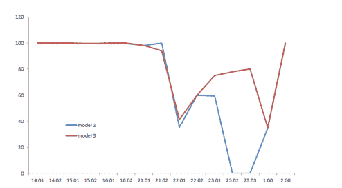
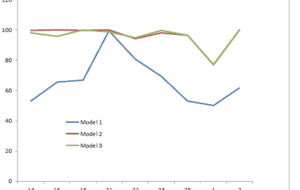
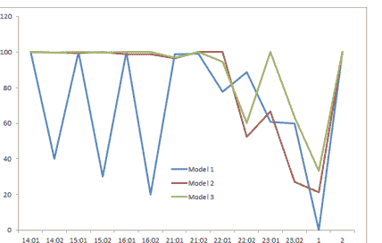

# 2020 第二届工业 4.0 可持续技术国际会议（孟加拉 达卡 2020.12.19-2020.12.20）

**Arunavo Dey**

孟加拉科技技术大学

邮箱: `arunavo071@gmail.com`

## 摘要

入侵检测是工业 4.0 安全中重要的领域之一。应用深度学习模型为该领域开辟了新范围。但数据集的可用性和数量往往限制了最新技术的应用。新型机器学习算法的出现总有助于在现有基础上进行改进。本文针对 `IDS 2018` 数据集，对现有入侵检测学习技术的有效性提出了建议并提出了一种新的基于注意力的模型。为了这一点，本文对 `IDS 2018` 进行了详细的评估。

**关键词：** 入侵检测、注意力检测、机械神经网络、`LSTM`、`CNN`

## I. 引言

随着物联网和 `5G` 网络的到来，网络随着扩展而显著增长，攻击也呈大规模增长趋势，例如受到 `APT` 攻击、`DDoS` 攻击和恶意软件的影响。

零日攻击也是列表中的一个，多年来通过不同方法被利用，从蜜罐网 [2]、沙箱到深度学习框架 [3]。通常，每日攻击由边界防御机制或入侵检测系统的运行机制来处理。性能指标对于检测此类攻击至关重要。这些入侵检测系统包括基于签名的系统和异常检测系统 [5]。基于签名的方法依赖于模式匹配，而异常检测可以通过偏离正常行为来检测未见的攻击。从这些研究中学习到的技术涵盖了从分布式检测 [6]、神经网络 [7] 到基于图的技术 [8]。

从深度学习技术开始已被证明在该领域非常有用。但网络攻击逐年增加，可用的大数据集用于创建用于入侵检测的建议网络架构。`DARPA`、`KDD`、`NSL-KDD-95`、`DEFCON`、`CAIDAS`、`CIC`、`KYOTO`、`TOTWE`、`CIC IDS` 和 `IDS` 都是旧数据集。其中 `CIC KDD` 和 `IDS 2018` 是最新的数据集，具有海量的网络流量和不同类型的攻击数据。几种深度学习

论文的其余部分结构如下：第 2 节采用文献综述，第 3 节包含方法论，第 4 节包含实验设置和数据集，第 5 节包含性能评估和结果，最后是结论和未来展望。

入侵检测是一个老的话题，机器学习技术在该领域已经做了大量工作。J 提出了一种神经网络入侵检测系统 [11]，该系统提出了一种可以检测通用数据攻击的神经网络。S 和 Mukmukha A 在其工作 [12] 中提出了一种基于 `5 SVM` 的 `IDS`，其中神经网络被用于对特征排序。AH 在其工作 [13] 中提出。Chunqiling 和 Zhang Lu 在其工作 [14] 中提出了一种分层 `IDS (SHIDS)` 和实时入侵检测。最近，K J 提出了一种用于 `DDoS` 攻击的 `CNN` 模型 [15]。J 在其工作 [17] 中针对定义网络提出了一种基于深度学习的注意力模型。S 和 Bandyopadhyay 在其工作 [19] 中提出了一种用于入侵检测的注意力 `LSTM` 神经网络。

## II. 背景

### A. 相关工作

但在 `IDS 2018` 上研究的模型非常少。此外，[9] 中提出的 `JIS` 模型存在一些实现错误和未指定的观察结果。在这里，通过正确的配置对所提出的模型进行研究，并与所提出的模型进行比较以证明其有效性。

### D. 全连接层

全连接层通过以下等式对注意力层的输出执行操作：

```
$V_i = f(c_i * W_i + b_i)$
```

## III. 方法论

- 我们使用 "`Relu`" 作为 `f`。我们使用两个具有 15 个隐藏节点的全连接层，最后一层根据配置具有节点并使用 "`softmax`" 激活函数。

在提出的模型中，`CNN` 的有效性与注意力机制和 `LSTM` 耦合。该模型的实现包含一个 `CNN` 层，随后是 `LSTM` 和一个注意力层，最后是两个全连接层。

## IV. 实验设置和数据集

### A. CNN 层

#### 超参数配置

| 超参数 | 数值 |
| :--- | :--- |
| `CNN` 层 | 1 |
| `CNN` 卷积核 | 32 |
| 全连接层 | 24 |

卷积层对输入层馈送的输入执行操作。如果操作是在权重矩阵 `$W \in R^{m \times n}$` 的 `m` 维向量上执行：

```
$O_i = f(X_{i-1} * W_i + b_i)$
```

提出的架构的超参数值见表 1。除了卷积层外，每层使用 `Relu` 作为激活函数。在卷积层中，使用了大小为 2 的步长。使用 `Adam` 优化器在训练期间更新模型。操作完成后，在输出上执行最大池化：

```
$M_i = max(O_i)$
```

使用交叉熵函数进行损失计算。为了避免过拟合，使用了 0.2 的丢弃率。`L1-L2` 正则化器也被用于控制这一点。

### B. LSTM 层

`LSTM` 是能够成功捕捉长期依赖关系的 `RNN` 变体之一。我们将从 `CNN` 学习的特征图输入 `LSTM` 层：

```
$h_i = lstm(M_i)$
```

### C. 注意力层

我们将最大池化层的输出通过 `LSTM` 层馈送到注意力层。`LSTM` 为我们提供了前向状态。注意力层计算得分：

```
$score(F, O) = v_a^T(W_F + W_O)$
```

为了评估提出的模型，在 `IDS 2018` 数据集上进行了实验，该数据集包含 `pcap` 原始文件。不同类型攻击的文件的总结见表 II。

其中 `F` 和 `O` 是前一个层的前向状态，`C` 是注意力权重：

```
$\alpha_{ts} = \frac{exp(score(F, O))}{\sum_{i} exp(score(F_i, O_i))}$
```

为了验证，使用了分层折（`Stratified Fold`）策略和独热编码（`One-hot encoding`）。

### B. 特征提取

使用了 80 个时间时间戳特征。

### C. 数据处理

**表 II：数据分布**

| 文件名称 | 攻击类型 | 数量 |
| :--- | :--- | :--- |
| D1: 14-02-2018 | FTP | 6630 |
| D2: 15-02-2018 | SSH | 19354 |
| D3: 16-02-2018 | Entropy | 46191 |
| D4: 20-02-2018 | SlowHTTP | 53833 |
| D5: 21-02-2018 | LOIC | 47612 |
| D6: 22-02-2018 | HOIC | 28619 |
| D7: 23-02-2018 | UDP | 53001 |
| D8: 28-02-2018 | BruteForce | 62866 |
| D9: 01-03-2018 | SQL-Injection | 23578 |
| D10: 02-03-2018 | Infiltration | 75834 |

准确性被用于评估提出的模型，并在验证准确性（`ACC`）方面进行比较。等式 1 计算准确性，`tp` 代表真正例（正确分类为异常的样本），`fp` 代表假正例（被错误分类为异常的样本）。

```
$Accuracy = \frac{tp + tn}{tp + fp} (1)$
```

在这里，另一个指标代表检测率，它是入侵系统的重要因素。我们可以通过计算 `F1` 分数得到总体评估，当 $\rho$ 表示精确率且 $\gamma$ 表示召回率时，

```
$F1 = \frac{2 * \rho * \gamma}{\rho + \gamma} (3)$
```

这里可以看到 `LSTM` 和注意力在 `IDS 2018` 数据集上的性能位于不同的日期。在 14、15 和 16 2 月 18 日，添加的模型性能优于 `LSTM` 模型，作为准确性的

在 2018-02-16，`LSTM` 的准确率为 99.7%，而基于注意力的模型实现了 99.98% 的准确率。但在 2018-02-22 和 2018-02-23，基于注意力的 `LSTM` 保持领先地位，且优势比之前略大。

但在 22 号，在几乎所有类型的情况下，基于注意力的模型都比 `LSTM` 模型具有更好的检测率，而 `LSTM` 模型仅检测出了跨越数日的不同类型攻击以及同一天内的 1.2 种不同类型攻击。在这里可以清楚地看到，特别是对于攻击数据相当不足的暴力破解 Web（`Brute Force Web`）和暴力破解 Xss（`Brute Force Xss`）攻击，基于注意力的模型表现良好。



## VI. 结论与展望

本文中，该模型通过得分提升的性能优于其最新的单元。带有此类单元的堆叠编码器可以显著提高性能。未来将通过混合自组织映射机制添加不同的架构和方法论。

## 参考文献



再次从图 3 可以看出模型 3 优于模型 1，并接近模型 2。但从检测率来看，图 4 显示模型 3 优于其他两个模型，

[1] B. K. Yu, S. V. J Kim, D. Kim, (2020). 同调环境下针对零日攻击的检测研究。[在线]. 可用: https://ieexplore.ieee.org/document/4089094

[2] S. A. H Al-Ruhain, M. Sharman, (2020). 在软件定义网络中使用布谷机交换对零日攻击的检测与预防。[在线]. 可用: https://ieexplore.ieee.org/document/9155555

[3] S. Khan, (2020). 使用混合自组织映射防止物联网传感器网络中僵尸网络的轻量级深度学习。[在线]. 可用: https://ieexplore.ieee.org/document/9155555

[4] M. Mahmoud and G. B. Chen, (2016). 用于计算机入侵检测系统的深度学习。[在线]. 可用: https://doi.org/10.1109/ACCESS.2016.2551598

[5] G. D. T. G. L. H. SR Sharp, J. Trentini (1997). 入侵检测系统——动机与预防。[在线]. 可用: https://doi.org/10.1109/45.59970600336

[7] D. S. H Debar, M. Becker, (1992) 用于入侵检测系统的神经网络。[在线]. 可用: https://doi.org/10.1109/45.1992.158152

[8] R. C. S Stanford-Field, S. Cheng (1998). 基于组的入侵检测机制。[在线]. 可用: https://www.researchgate.net/publication/228433333_Group-Based-Intrusion-Detection-System-for-Networks



由于模型 2 和 3 的表现明显优于模型 1，我们通过 `F1` 分数对两者进行比较，直到模型 3 在图 5 中脱颖而出。

[10] C.-Y. L. Wei-Chih Tang, Y.-H. Yu, (2019). 使用深度学习技术进行入侵检测。[在线]. 可用: https://doi.org/10.1109/ACCESS.2019.2905029

[11] R. Huang, Li, (2018). 使用神经网络进行入侵检测。[在线]. 可用: https://doi.org/10.1109/ACCESS.2018.2833737

[12] S. M. A. Sung, (2003). 使用支持向量机和神经网络识别入侵检测的特征。[在线]. 可用: https://doi.org/10.1109/45.12511111111

[13] A. S. Mukmugala, J. Kim, (2020) 基于 `CNN` 的拒绝服务攻击网络入侵检测。[在线]. 可用: https://doi.org/10.1109/ACCESS.2020.2999907

[14] H. K. M., S. E. C. C. J. Kim, (2020) 基于 `CNN` 的拒绝服务攻击网络入侵检测。[在线]. 可用: https://doi.org/10.1109/ACCESS.2020.2999907

[15] F. Y. Zhang, F. Li. 一种基于集成的网络入侵检测系统的构建。授权许可限制于：斯特拉斯克莱大学。于 2021 年 6 月 18 日 18:39:06 UTC 由 `IEEE Xplore` 使用。适用相关条款。

[16] M. K. Cholin Zhang, Y. Jiang, (2005) 使用小波神经网络进行入侵检测。[在线]. 可用: https://doi.org/10.1016/j.patc.2004.06.045

[17] S. X, F. L. S Yang, M Tan. (2020) 基于注意力机制神经网络的入侵检测方法。[在线]. 可用: https://doi.org/10.1016/j.future.2019.05.006

[18] A. R. B. S. S Bandopadhyay, R. Chowdhury. (2020) 使用深度卷积神经网络向革命性入侵检测系统迈出一步。[在线]. 可用: http://dx.doi.org/10.20944/preprints20207.0187.v1

[19] K. K. MT Nguyen. (2020) 用于入侵检测系统的遗传卷积神经网络。[在线]. 可用: https://doi.org/10.1016/future.2020.07.042
