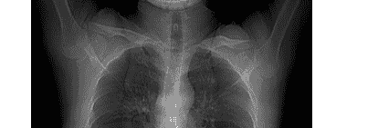

# 2020年第二届以人为中心的健康与福祉智能环境国际研讨会 (IHSH) (阿尔及利亚布梅尔德斯 2021.2.9-2021.2.10)

**摘要**—COVID-19 疫情对全球人口的健康和福祉造成了毁灭性的影响。抗击这一疫情的最新进展之一是使用 X 射线等辐射对患者进行有效筛选。针对这一挑战，研究人员提出了多种基于深度学习的人工智能（AI）框架，并不断优化识别阳性病例的 `result`。根据之前在自动 X 光筛选方面的工作，我们训练了不同的模型来将病理情况分类为正常、肺炎和 COVID-19。我们使用了三个开源数据集来验证我们的方法，以应对严重阻碍 COVID-19 识别的挑战。在本文中，我们评估了几种不同的架构。

**索引词**—COVID-19、肺炎、胸部 X 光、深度学习、卷积神经网络、迁移学习

用于 COVID-19 胸部 X 光分类的卷积神经网络。在第 III 节中，我们阐述了研究用工具的理论背景。随后我们在第 IV 节中解释了我们的方法论，重点介绍了所使用的数据和方法。第 V 节提供了实验结果和深度学习分类器的对比性能。论文最后总结了我们的发现，并给出了一些未来方向。

# I. 引言

冠状病毒在全球范围内都构成了医学威胁。根据世界卫生组织的最新报告，感染人数和死亡人数不断增加。报告显示，截至本文写作日期，该感染已夺了 126 万人的生命。自疫情开始以来，许多人工智能专家提出了各种方法和策略，用于检测感染的演变或识别。判断患者是否感染了 COVID-19 的潜在方法之一是通过分析胸部 X 光图像实现的。由于医院中有大量患者，手动处理大量的 X 光图像将既枯燥又困难，因此需要一个自动化系统。

自动检测系统的性能取决于训练阶段。后者需要高质量且足够数量的数据才能充分发挥潜力。然而，由于可用的 COVID-19 数据不足，开发胸部 X 光图像的 COVID-19 自动检测仍然是一项挑战。在本文中，我们比较了不同架构的性能，它们在自然识别任务中证明了自身的性能。

论文的其余部分结构如下：在第 II 节中，我们提供了对最先进深度的综述。

# II. 相关工作

正如世界卫生组织所强调的，COVID-19 疫情正使医疗系统面临严峻挑战，压力巨大。识别这种感染将有助于减轻医院负担。胸部 X 光数据在肺炎检测中发挥了作用。由于肺炎是 COVID-19 的一种类型，通过胸部 X 光筛选识别它至关重要。随着机器学习（ML）和深度学习领域的快速发展，研究人员已针对肺炎和正常病例提出了多种方法。

已有若干工作对 COVID-19 检测做出了贡献。文献 [1] 的作者提出了一种神经分类器，将图像分为三类：正常、肺炎和 COVID-19。他们使用了 X 光图像。他们还引入了 `CNN` 和 `ResNet50` 的概念来提高其准确性。在文献 [2] 中，作者提出了一种基于神经学习的 COVID-19 胸部 X 光图像分类。仅使用了 6 张 COVID-19 X 光图像。文献 [3] 提出了一种用于检测胸部 X 光图像中 COVID-19 病例的卷积神经网络。其他作者文献 [4] 提出了 COVID-19 这种深度学习框架，放射科医生可用其自动诊断 X 光图像中的 COVID-19。仅使用了 60 张 COVID-19 图像。文献 [5] 提出了七种通过 `VGG19` 和第二版 `MobileNet` 修改的不同架构。文献 [5] 的作者展示了如何使用迭代剪枝的深度学习集成模型通过胸部 X 光检测 COVID-19 感染。为了提高他们方法的性能，他们使用了迁移学习和微调方法。

在所有情况下，将深度学习应用于 X 光数据以区分和识别新型 COVID-19 仍然具有挑战性，因为缺乏公开的、现成的且足以用于算法训练的数据。此外，除了处理过程枯燥外，在当前全球健康状况下，准备训练数据集的优先级仍然较低。因此，在本文论文中，我们扩展了不同深度神经网络架构在 X 光图像中识别 COVID-19 的贡献。

# III. 肺炎胸部 X 光数据库与深度学习图像分类器

在本节中，我们讨论了文献中用于医学图像分析的胸部 X 光数据集。然后我们描述了一些最先进的深度图像分类器。

## A. 胸部 X 光数据集

创建一个大型标注图像数据集既枯燥又容易出错，由于这些原因，研究人员依赖公开数据。多项研究已尝试创建 COVID-19 数据集，以确保病理自动筛选工作。在著名的病毒性（COVID 及其他病毒）肺炎检测和分类方法集中的：

- **COVID-19 Radiography Database [6]:** 一组研究人员与医生合作创建了一个包含正常和病毒性肺炎图像的胸部 X 光数据集。在目前的发布中，有 219 例 COVID-19 病例、1341 例正常和 1345 例病毒性肺炎。

- **COVID Chest X-Ray Dataset [7]:** 这是一个确认或疑似感染 COVID-19 的病毒性或细菌性肺炎（MERS、SARS、ARDS）数据库。该项目已获得蒙特利尔大学伦理委员会的批准。

- **Medley Chest X-ray Images [8]:** 由 2856 张 X 光图像（JPEG 格式）组成，分为两类（肺炎/正常），包含 1 到 5 岁的患者。该数据集的特殊之处在于揭示了肺炎类型（病毒或细菌）。



## B. 深度图像分类模型

在本节中，我们回顾了一些性能经过证明的深度图像分类模型：

- **VGG:** 该网络引入于文献 [9]，用于图像识别的深度卷积网络。为了提高图像功能，`VGGNet` 仅堆叠了 3x3 卷积层以增加深度。该网络有两个版本：`VGG16` 和 `VGG19`。

- **Inception:** 该网络或 `GoogleNet` 架构引入于文献 [10]。该网络基于在同一模块内使用 1x1、3x3 和 5x5 卷积的多级特征提取器。后续层被称为 `Inception V`，其中 N 是数量。

- **ResNet:** 这种架构文献 [11] 依赖残差模块，即网络的基本构建块。尽管 `ResNet` 比 `VGG16` 和 `VGG19` 深得多，但其模块尺寸由于使用全局池化而非全连接层而更小。

- **Xception:** 提出于文献 [12]，是 `Inception` 架构的扩展，将标准的 `Inception` 模块替换为可分离卷积。

- **MobileNet:** 该网络文献 [13] 旨在最大化准确性的同时减少大多数深度神经网络的计算负担。该网络具有长期的塑性。

# IV. 方法论

在本节中，我们介绍了在上述数据集上测试的策略，以及每个网络在带有 COVID-19 的胸部 X 光图像上的性能。我们的主要目标是通过不同技术发现最合适的 COVID-19 筛选模型。

## A. 数据描述

由于 COVID-19 数据集稀缺，我们试图结合三个开源胸部 X 光数据集和一组阿尔及利亚病毒性 COVID-19 胸部 X 光数据集的数据。第一个数据集来自 GitHub 仓库的 `COVID Chest X-Ray Dataset` [7]，包含了感染 COVID-19 和其他类型肺炎患者的 X 光和 CT 病例。我们仅考虑了 X 光包含总计 261 个 COVID-19 样本的图像。第二个 `COVID-19 Radiography Database` [6] 包含 219 张 COVID-19 阳性图像、1341 张正常图像和 1345 张病毒性肺炎图像。第三个数据集是 `Mendeley X-Ray Image Dataset` [8]，它将 X 光图像分为两类：肺炎（非 COVID-19）和正常。后者在提高相对于 COVID-19 和普通肺炎之间选择性所收集的分类质量方面具有重要作用。最后一个是由我们研究收集的，仅包含胸部 X 光图像。数据集的详情如表 1 所示。

### 表 I 实验数据集

| 类别 | COVID-19 | 正常 | 病毒性肺炎 |
| --- | --- | --- | --- |
| [6] | 219 | 1341 | 1345 |
| [7] | 261 | 1583 | 1495 |
| [8] | 518 | 2924 | 2838 |

> * https://www.kaggle.com/datasets/afrahman/covid19-registry-database
> * https://github.com/lee8023/chest-xray-data
> * https://www.kaggle.com/paulimithmooney/chest-xray-pneumonia

占所考虑图像总数的 70%。剩余数据被分为 10% 用于验证（共 51 张图像），以及 20% 用于测试（共 204 张图像）。值得注意的是，所有的训练、验证和测试数据都是随机选择的。

## B. 架构

为了充分实现我们的研究，我们选择了图像识别领域中性能最好的深度学习模型。我们评估了在 `ImageNet` [5] 上训练的网络的性能：`VGG16` (1)、`VGG19` (2)、`Inception v3` (3)、`NasNet` (4)、`ResNet50` (5)、`Xception` (6)、`MobileNet` (7) 和 `VGG9` (8)。每个深度神经网络都被用于分析 X 光图像，以将样本分类为正常、COVID-19 或病毒性肺炎。所有图像均被缩放为 `400x400` 像素。我们在训练数据模型上应用了不同的数据增强技术，如旋转、翻转、剪切变换和缩放。作为预处理，我们使用了对比度自适应直方图均衡化技术来提高胸部 X 光图像的对比度。根据帕累托法则，80% 的数据用于这八个模型的训练和验证。我们将每个模型训练了 100 个 epoch。图 4 展示了 `VGG19` 训练性能的一个示例。

在不平衡数据集上训练的模型将在少数类上表现出偏差，在极端情况下，可能会完全忽略多数类 [14]。在我们的研究中，我们只考虑了包含相同样本数量的平衡数据。我们考虑了三类胸部 X 光图像：无肺部迹象的正常病例、患有 COVID-19 的患者和肺炎。由于我们感兴趣的 COVID-19 类样本数量最少，我们采用欠采样（RUS）丢弃原始类别中的样本以平衡样本数量；每类保留 518 个样本。我们随机选择了 363 张图像在 20% 的数据上进行测试，这应该是三个类别中的每一个样本。然后，我们计算评估指标以衡量各自的性能。

# V. 结果与讨论

我们使用了从混淆矩阵得到的四种性能指标来评估模型：准确率（Accuracy）；正确预测数占总预测数的比例，

```
Acc = (TP + TN) / (TP + TN + FP + FN)
```

精确率（Precision）；检测到的良好阳性占总阳性的比例：

```
Pr = TP / (TP + FP)
```

召回率（Recall）；正确分类样本的概率：

```
R = TP / (TP + FN)
```

F-score 是一个结合了精确率和召回率的指标：

```
F_score = (2 * Pr * R) / (Pr + R)
```

表二显示了不同模型在平衡数据集上实验的准确率结果。我们使用了 518 个样本进行测试，`VGG16`、`Inception` 和 `MobileNet` 的准确率为 0.99，`VGG9` 达到 0.91，准确率最低的模型是 `ResNet50`，为 0.85。表 III 说明了每个深度学习分类器在感兴趣的类别（COVID-19）上的精确率。最精确的网络是 `Inception`、`Xception` 和 `MobileNet`，`ResNet50` 在正常类上获得 0.83，`NasNet` 为 0.79。对于病毒性肺炎类，表四显示了不同模型跨四个类别的准确率，可以看到 `Xception` 在 COVID-19 上取得了最佳结果，为 0.93，而 `ResNet50` 为 0.82，`NasNet` 为 0.74。

## 表 II 测试模型的准确率 (ACC)

| | Inception v2 | Inception v3 | NasNet |
| --- | --- | --- | --- |
| VGG16 | 0.94 | 0.91 | 0.91 |
| ResNet50 | 0.85 | - | - |
| Xception | - | 0.94 | 0.94 |
| VGG19 | - | - | 0.92 |

## 表 III 各模型的精确率 (PRECISION)

| | COVID-19 | 正常 | 病毒性肺炎 |
| --- | --- | --- | --- |
| VGG16 | 0.99 | 0.89 | 0.92 |
| Inception v2 | 1.00 | 0.84 | 0.96 |
| Inception v3 | 0.99 | 0.79 | 0.91 |
| ResNet50 | 0.88 | 0.83 | 0.85 |
| MobileNet | 1.00 | 0.86 | 0.97 |
| VGG19 | 0.95 | 0.89 | 0.91 |

## 表 IV 不同模型的召回率 (RECALL)

| 类别 | COVID-19 | 正常 | 病毒性肺炎 |
| --- | --- | --- | --- |
| VGG16 | 0.98 | 0.96 | 0.88 |
| Inception ResNet v2 | 0.95 | 0.94 | 0.88 |
| Inception v3 | 0.99 | 1.00 | 0.74 |
| NasNet Large | 0.99 | 0.99 | 0.75 |
| ResNet150 | 0.97 | 0.94 | 0.71 |
| Xception | 0.98 | 0.97 | 0.78 |

## 表 V 不同模型各感染类型的 F 分数 (F-SCORE)

| 类别 | COVID-19 | 正常 | 病毒性肺炎 |
| --- | --- | --- | --- |
| VGG16 | 0.95 | 0.93 | 0.82 |
| Inception ResNet v2 | 0.98 | 0.89 | 0.88 |
| Inception v3 | 0.99 | 0.90 | 0.89 |
| NasNet Large | 0.99 | 0.89 | 0.85 |
| ResNet150 | 0.97 | 0.91 | 0.71 |
| Xception | 0.98 | 0.95 | 0.82 |
| VGG19 | 0.94 | 0.92 | 0.82 |

最后考虑的指标是 F 分数，它总结了不同模型的结果。`Xception` 模型在 COVID-19 上取得了最佳结果，`VGG19` 在正常类上为 0.94，在病毒性肺炎上为 0.92；`ResNet50` 在正常类上为 0.93，在病毒性肺炎上为 0.81，这些是它们测试集上得到的 F 分数。

# VI. 结论

在这项研究中，我们在四个数据集上训练了多种深度卷积网络，对 X 光图像进行三类分类：正常、病毒性肺炎和 COVID-19。数据的多样性有助于提高训练网络的泛化能力。遗憾的是，COVID-19 的数据在质量上仍不确定，这为自动系统的开发带来了巨大挑战。我们的数据包含 500 多张 X 光图像用于识别 COVID 阳性病例，与该领域以前的工作相比具有显著数量。本研究主要涉及比较多个网络在 COVID-19 分类任务上的性能。病毒性肺炎类的存在对于识别模型的重要性具有重要意义。作为展望，我们将继续检测受病毒影响的肺部区域，以推动放射科医生在感兴趣区域的作用，通过标签标记识别胸部 X 光中的异常。此外，在处理医学图像时，我们将考虑交叉验证方法。
