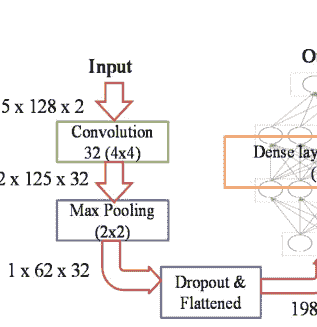

# 2020 第二届伦理驱动型创新与社会技术博士研讨会 (PhD EDITS)(印度班加罗尔 2020.11.8-2020.11.8)


Shachi P
电子与通信工程系
BMS 工程学院
班尔加罗尔，印度
shachi88@gmail.com

K R Sudindra
电子与通信工程系
BMS 工程学院
班尔加罗尔，印度
skrudhindra@bmscce.ac.in

Suma M
电子与通信工程系
BMS 工程学院
班尔加罗尔，印度
suma.cc@bmscce.ac.in

**摘要——频谱感知的性能**在极端条件下存在一定的局限性。随着深度学习成果的出现，本文尝试分析采用深度学习的协作频谱感测（CSS）的性能。我们关注动态信道条件下基于卷积神经网络（CNN）的CSS。系统在次级用户之间、以及具有时间阴影和衰落条件（瑞利和纳卡加米衰落）的路径上进行了测试。在分类准确性方面，将其性能与硬融合规则——OR、多数决（Majority）进行了比较。

在 SU 之间，对数正态路径以及两种不同条件——瑞利和纳卡加米。

论文内容遵循下述顺序。在第二部分中，介绍了认知无线电场景的系统模型。在第三部分中，我们讨论了数据和 CNN 架构。第四部分用于基于 CNN 的软融合 CSS 性能。在第五部分中，我们报告了结论结果。


# I. 引言

电信业的扩张受多种因素驱动，其中无线频谱至关重要。为了服务广泛的用户，频谱感知通过利用稀缺的频谱资源提供了一种有前景的解决方案。然而，在衰落和阴影无线环境中运行时，CSS 是一种可行的方法。在一组次级用户（SU）中，它们通过共享感知数据或由决策融合中心决策来进行协作。这被称为。

文献中关于 CSS 存在大量的分析。但用于 CSS 的潜在/次优机器学习/深度学习（ML）方法应用较少 [1]。这项工作适用于次级用户（SU）支持基于机器学习的分类的场景。在深度深度学习中使用了 CNN。考虑了多径衰落、阴影和衰落等动态信道条件，并使用了决策方法。在 [1][2] 中，使用 ML/DL 构建决策算法和数据融合方法。我们提出的 k-means 聚类算法在广义衰落信道 CSS 中的应用表明，与 OR 规则相比有所改进。[4] 中提出了基于两阶段 SVM（支持向量机）的 CSS，用于在模型中训练测试集。

这项工作是我们之前进行的工作 [5] 的扩展。本文的重点是给出了基于 CNN 的 CSS 与已知的 CSS 决策融合规则的对比性能。信道表征了空间相关性

由主用户（PU）和 M 个 SU 组成的认知无线电场景是 $n$ 时刻感知主信号 $x(n)$ 分类的测试统计量，它可以表示为：

```
y_i(n) = f_i(n)g_i x(n) + w_i(n)  \quad for i = 1
                                     (1)
```

其中，$h_{ji}$ 表示信道被占用，$h_{ji}$ 表示信道可用。信道的衰落增益表示为 $f_i(n)$，噪声 $w_i(n)$ 如 [5] 所示。空间相关因子包含在 $g_i(n)$ 中。在我们的分析中，假设系数 $f_i(n)$ 服从瑞利分布或纳卡加米分布。这里，$w_i(n)$ 是白噪声。接收信号样本被归一化作为数据预处理的一部分。

# II. 系统模型

## A. 深度学习架构

由于所考虑的系统具有空间相关性，可以使用 CNN 来解决我们的问题。层数和滤波器的大小是随机选择的，以提供更好的分类准确性。

用于分类感知用户的 CNN 架构非常简单（见图）。第一层是带有 ReLU（线性整流单元）激活的输入卷积层，随后是作用于图上的最大池化层（max-pooling layers），有助于提取特征。ReLU 是非线性激活函数之一。最大池化层有助于在应用 ReLU 之后压缩特征图。然后将大小为 128 的输出通过 sigmoid 激活馈到全连接层。带有 softmax 激活的最终输出层给出主用户信道状态的分类。优化器是 Adam，优化的损失函数是交叉熵。



图. 1 CNN 架构

## II. 仿真设置与数据集

我们考虑了如图 2 所示具有 M 个 SU 和一个移动 PU 的系统。PU 的移动性通过图中所示相对于 SU 的 10 个位置集合来实现。传输符号是均匀分布的突发，经窄带频率调制的 BPSK 调制，并经历瑞利和纳卡加米衰落（m=0.7）。传输功率变化，衰落，位于 [5]。数据集包含瑞利和纳卡加米。

在我们的分析中，SU 的数量为 12，如图 2 所示。数据集被划分为 70/30 的训练和测试集。

# IV. 性能分析

CSS（即能量检测）的性能在表 I 中与 CNN 进行了对比。对于 CNN，在 ROC 曲线下进行评估。如表 II 所示，CNN 的性能。

表 I 分类

| 衰落 | 融合方法 | CNN | 多数决 |
| :--- | :--- | :--- | :--- |
| 瑞利 | 58.17% | 67.02% | 90.24% |
| 纳卡加米 | 56.33% | 84.75% | 77.33% |


图. 2 PU 和 SU 的空间布局

表 II CNN 的其他指标

| 分类误差 | 瑞利 | 纳卡加米 |
| :--- | :--- | :--- |
| 灵敏度 | 0.2216 | 0.2233 |
| 1.0 | 1.0 |
| 精率 | 0.5429 | 0.5395 |
| AUC（曲线下） | 0.8360 | 0.8250 |

# V. 结论与展望

考虑到影响无线链路的综合特征（如路径损耗、大规模和小规模衰落），我们合成了随时间的接收信号数据集。进一步，将 CNN 及其架构应用于分类 PU 信号。通过与相同方法的对比评估了其性能。通过对比分析，我们可以识别 CNN 架构或在未来工作中选择更好的深度学习算法。

参考文献

[1] K. Th Minh, K. Choi, N. Saqu, and E. Hossain, "Machine Learning for Spectrum Sensing in Cognitive Radio Network," vol. 11, no. 1, pp. 2209–2221, 

[2] J. Y. Kim, and S. Lee, "Deep Learning Spectrum Sensing Based on Convolutional Neural Networks," IEEE Trans. Veh. Technol., vol. 68, no. 3, pp. 3015–3022, 

[3] V. Kumar, D. Candal, M. Raj, J. Ragopadhyay, and S. Dubey, "Deep learning-based spectrum sensing in cognitive networks," Communications, 2016, doi: 10.1109/M.COM.2016.256113,

[4] Elham Ghadzadeh, Aziz Mohammad, Hassan Nakagamami, "Comparison of CNN and SVM algorithms for spectrum sensing in cognitive radio networks," Int. J. Commun. Syst., vol. 32, no. 2, 2018, article:386.

[5] P. Shachi, K. R, S. Sudhindra, and N. M. Suma, "Convolutional Network for Spectrum Sensing in Spatio-Temporal Dataset," 2020 Int. Conf. Artif. Intell Signal Process AIPJ, 2020, pp. 1–5, doi: 10.1109/AIPSP.428273.2020.907175.

