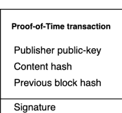
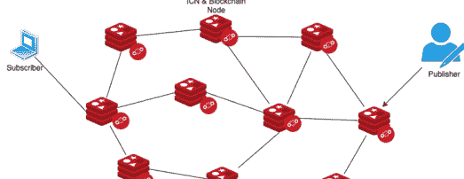
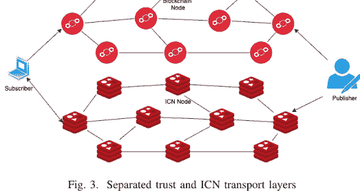
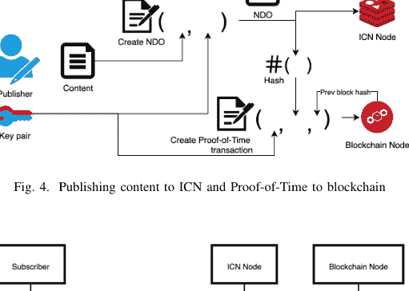
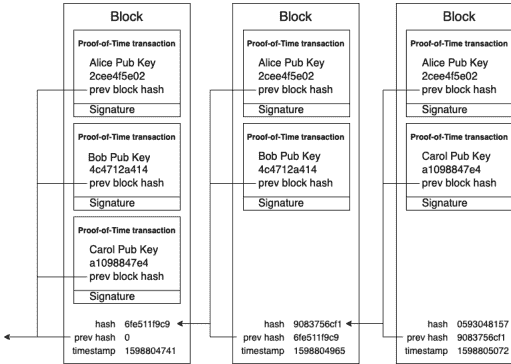
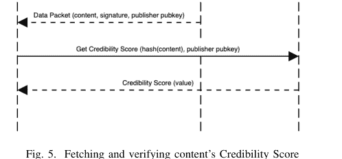

# 2020 第30届国际电信网络与应用会议 (ITNAC) (澳大利亚墨尔本 2020.11.25-2020.11.27)

## 摘要

信息内容网络面临内容投毒攻击（CPA）的困扰，当入侵者上传带有签名凭据的内容时，其更强的形式被称为“伪造数据 CPA”。遵循一种利用内容实施时受限时间的现有感染方法，我们设计了一种基于区块链的“时间证明”（Proof-of-Time）机制来区分入侵者和合法发布者，并认为区块链解决方案能更好地实现该机制。所提出的方案利用区块链提供了足够的安全性和细节，可以作为感染方法的有价值替代方案，且在顺序确定、韧性和容错性方面优于后者。

**关键词** 数据网络、内容投毒、区块链。

## I. 引言

信息内容网络 [1] 标志着从以内容为导向的范式转变。由于许多理想特性，如内容缓存、移动性支持和安全性，这些特性由 ICN 传输层或用于缓存主机导向应用程序的更有效网络来保证。一种名为命名数据网络（NDN）的 ICN 实现将作为本文后续部分的概念框架。NDN 允许通过交换数据和数据包向订阅者路由和转发内容，并管理对感兴趣的订阅者的访问。内容（Web 对象、文档、图像文件或数据流）通过其位置名称命名数据对象（NDO）被请求。每个内容都应由创建它的发布者进行验证。

当考虑到安全问题时，内容缓存的优势变成了一把双刃剑。获取了发布者密钥的入侵者可以创建带有有效签名的投毒内容。此类内容在 ICN 节点中很容易被检测。NDN 以及其他 ICN 方法中的内容投毒攻击（CPA）可以是损坏数据或伪造数据 [3]。在这两类中，内容被非法修改。在损坏数据 CPA [4], [6] 中，攻击者（入侵者发布者）不拥有合法发布者的签名密钥；因此内容无法通过签名验证。然而，验证是可选的，并且由于某些原因，可能并非每次都执行。其之一是经济因素：签名验证需要相应的公钥，而并不是每个节点都能维护/访问所有可能的密钥。

伪造数据 CPA [6], [7] 是最危险的情况，因为拥有合法发布者密钥的入侵者发布者无法与合法发布者区分——他们可以伪造在订阅者端能够通过成功验证的内容。一旦一个响应包在 NDN 的多个内容存储（Content Stores）中传播，请求该内容的订阅者都会接收并验证投毒内容。投毒内容无法被轻易删除，因为大多数 ICN 节点不支持除原生（例如使用缓存）机制之外的删除/撤销缓存内容。这种方法允许我们通过共享可疑 NDO 的信息并将其从内容存储中过滤掉来防止伪造内容——这在感兴趣的发布者固定并处理之前很难实现。该问题仍未解决，仅存在早期解决方案。

我们考虑一种涉及攻击者的场景，即通过合法发布者（凭据所有者）的过期或密钥撤销获得未经授权的凭据访问。因此，入侵者的发布者账户被限制在一个有限的时间窗口内，而合法发布者的访问不受影响。[7] 我们利用受限和不受限的时间访问序列之间的差异，要求每个发布者在某些时间段内访问凭据。我们将这种认证方法称为“时间证明”。我们通过以下方面扩展了传统的认证模型：

> 访问凭据 ⇒ 时间证明 ⇒ 真实性

访问凭据可以通过创建一个需要使用凭据的证书或签名来证明。时间证明可以通过随时间重复此过程来证明。通过共识来确保每个对象都具有足够强大的发布者凭据。然而，没有采用公钥加密，因此对等身份管理是极少数的，且该方法可以迁移到其他解决方案。

NDO 有其信誉（Credibility）——发布者活跃时间越长，信誉越高。理想情况下，另一个发布者应该让网络相信其正确性和可信度。时间证明的实现是要求此类节点在全网数据传输协议中不与网络断开。我们假设网络本身通过公开其信誉分，不包含入侵者发布者。

在本文中，我们提出了一种替代的感染模型，证明我们的方法是有前景且值得研究的。我们的贡献包括：

- 制定一个用于缓解 CPA 的区块链框架；
- 设计一种基于区块链的新型防御机制；
- 在可扩展性、容错性和韧性方面，定性地评估所提出的机制。

在第 II 节中，我们回顾了相关工作。在第 III 节中，我们概述了框架和区块链的概念。在第 IV 节中，我们详细说明了基于联邦协议（Federated Agreement）的区块链解决方案。最后，在第 V 节介绍了基于图方法的对比，并总结全文。

## II. 相关工作

CPA 已成为过去几年的活跃研究领域；详细说明请参见 [3]; [6] 以及 NDN 的综述。在 CPA 中，基于共识验证、转发和阻塞的攻击占据主导地位 [8], [9]。基于引用的 CPA 文档环境包括 Bitcoin 和 Whisper。该系统是一种具有成员制的内容导向服务，其中编辑器交换待发布文章的更改直到达成共识为止有效。投票可能会削弱 CPA，但会产生遭受女巫攻击（Sybil attacks）的漏洞。该机制无法良好扩展到全网。在 LOCKSS（一种 PDF 数字保护系统 [10]）中，邀请参与者紧密合作以投票剔除错误的共识。循环投票可能会触发一系列内容修复……

## III. 共识与区块链

我们提出了一种基于利用现有共识算法的解决方案。假设对拜占庭型区块链具有容错性 [11], [12]，对于一个由多个操作员管理的全网机制，可以预见所有节点都会可靠且诚实地运行。因此，可以放宽信任网络叠加关联，允许成员节点随时加入或离开网络。用于保护拜占庭型区块链的共识协议用于开放成员制的区块链系统。数据存储在区块链系统中，只要入侵者不控制大多数共识手段，就能防止入侵者。示例包括 Bitcoin [14]、Ethereum 和 Stellar [16]。我们使用了 Stellar，我们的联邦拜占庭协议（FBA），它与描述的共识机制相似。在第 IV 节中，我们还使用了一种略微修改的简单交易协议，以防止重放。

## IV. 提出的解决方案

我们提出了一种解决方案，其中所有或部分 ICN 节点参与区块链共识协议，与内容存储一起保护一个时间证明增益的公共数据库。事件一致性得到了保证，即每个节点都拥有其他节点具有相同版本的数据库。观察结果是，通过使用区块链系统，我们确保发布者只能发布时间证明。为了进行认证，如果是合法发布者，他们必须在足够的时间内访问相应的凭据，这对于入侵者发布者来说负担不起的，但对于合法发布者是可以的。想要确认内容权限的发布者必须不断提交一个微调准备就绪的交易，向区块链网络发送的时间证明（Proof-of-Time）声明。该交易包含以下内容（参见图1）：

- 我们提出了一个更灵活的模型，其中可以通过信誉分（Credibility Score，参见第 I 节）逐渐获得认证，这增加了认证的粒度。对于不同的内容类型可能使用不同的端点，例如，一个可以要求 10 分钟和 12 小时类型的时间证明。当使用被盗的凭据发布内容时，所有者有一定的时间撤销这些凭据并停止相应的认证过程。
- 内容真实性的哈希值，
- 链上的签名，证明了对相应凭据的访问，
- 用于验证签名的发布者公钥，以及
- 前一个区块的哈希值，以防止交易重复签名。

发布者将交易提交给最近的节点，该节点将其纳入区块并广播到网络的其余部分。一旦所有网络节点通过第 IV-G 节描述的共识协议批准该区块，发布者就可以创建一个新的时间证明交易并加入前一个区块。该过程不断重复，直到达到所需的信誉分（参见第 IV-B 节）。接下来，我们将详细介绍基于区块链的解决方案。

### A. 区块链层

网络可以扮演两个角色：参与路由和缓存的 ICN 节点，以及参与共识协议和区块链存储的区块链节点（参见图2）。连接到订阅者的节点不参与区块链，因为它们不包含信任内容。区块链层也可以由节点以外的管理，将（内容分发）层与信任层分离，参见图3。ICN 节点可以从网络开销中释放出来，以避免不必要的复杂。此外，独立的系统更适用于 ICN 解决方案和遗留系统，开发的信任并不取决于 ICN 架构，而是取决于内容哈希和发布者凭据。区块链信任可以由更强大的设备和可能的不同组织托管——实现关注点分离，这在长期内是困难的。在本文其余部分，我们假设 ICN 和区块链节点的分应该根据实现扮演一个或两个角色。

### B. 信誉分

在图协议 [7] 中，内容真实性有两种状态：已认证和未认证，这具有一定的局限性。我们喜欢的内容如天气预报，只要区块链中的数据就不应经过认证。

### C. 发布者工作流

为了在 ICN 网络上发布内容并通过区块链对其进行认证，发布者执行以下操作：

1. 创建 NDO 的哈希值。
2. 使用发布者的密钥对其进行计算。
3. 创建时间证明交易，该交易包含 NDO 和前一个区块链区块的哈希值，以及证明私钥的签名。
4. 将时间证明发布到区块链。
5. 重复步骤 3 和 4，直到达到所需的信誉分。

### D. 订阅者工作流

将内容发布到 ICN 节点以及将时间证明发布到区块链的过程如图 4 所示。

为了从 ICN 网络获取内容并通过区块链对其进行认证，订阅者执行以下操作：

1. 向最近的 ICN 节点发送带有 NDO 的兴趣包（Interest packet）（随后，ICN 返回一个包含请求内容、签名和发布者公钥的数据包 Data packet）
2. 向区块链节点发送带有内容哈希值和发布者公钥的信誉分请求（从区块链节点接收信誉分）
3. 判断信誉分是否足以信任该内容。

在图 6 中，我们展示了三个时间证明链的示例。我们声称区块每隔 10 分钟创建一次，且每份内容都会创建一个 20 分钟的信誉分。Alice 首先连接到 ICN 获取图 4 所示的内容哈希值，相应的时间证明交易被创建并发布到区块链节点。10 分钟后，她发布了时间证明交易，并在另一个 10 分钟后重复。与此同时，Bob 只能发布两个时间证明链，这不足以信任该内容；Carol 寻找第二个区块，即时间证明链；因此内容与第三个区块不同。信誉分的工作流如图 5 所示。

### E. 区块链结构

区块是基础性的原语。区块链系统允许通过共识协议来决定内容的一致性。发布者可以被多个认证，决定内容者的状态。区块以 10 分钟为间隔创建，且每份内容创建一个 20 分钟的信誉分。

### F. FBA

基于工作量证明的共识（Proof-of-work consensus）在网络中是不合适的，因为它会产生开销问题；然而，有许多其他算法可供选择。FBA 和其实现的共识协议（SCP）是符合我们需求的。它是快速、轻量且异步的。与图协议相反，新加入的节点无法贡献信任，区块链的活跃性是由多数法定人数（Quorum）支持的。一旦发生冲突，账本会分裂为两个不同的版本。在 FBA 系统中，多数节点对某些提议达成共识（Quorum）被接受，其他则被拒绝或失败，最终达成决策。

## V. 对比分析

基于韧性的方法，GI 涉及网络规模和拓扑，以及感染过程参数。另一方面，基于区块链的 FRI 解决方案依赖于连通性的存在。

通信复杂度-GI，每个节点都有固定数量的邻居，因此其复杂度为 O(N)，其中 N 是节点集。在区块链中，每个节点都必须与其他节点通信，因此通信复杂度为 O(N²)。

可扩展性（总内容的即时处理能力）——区块链让每个节点顺序处理每项内容，因此系统速度等同于单节点网络。然而，增加节点会提高总处理能力，因此为 O(1)。

容错性-GI 的形式本身甚至不具备容错性，更不用拜占庭区块链了。其容错能力最高支持拜占庭节点。

因此，区块链在韧性、确定性和容错性方面优于 GI，在通信复杂度和可扩展性方面持平。此外，它还需要从 SDN（软件定义网络）和关键基础设施（PKI）中部署区块链网络。

所提出的解决方案使用了 Stellar 以及拜占庭协议共识协议特性，在结果、韧性和容错性属性方面与 GI 协议相比良好，但在通信复杂性和可扩展性方面仍显逊色。因此，我们验证了基于区块链的证明（Proof-of）身份验证方案，区块链可以保护网络规模，使其成为虚假数据 CPA 的可行解决方案。

### 表 I GI 与基于区块链的解决方案对比

| 属性 | GI | 区块链 |
|---|---|---|
| 结果 | 非确定 | 确定性 |
| 韧性 | 取决于 {Nt} 连通性、感染过程参数 | 需要外部交互 |
| 通信复杂度 | O(N) | O(N²) |
| 可扩展性 | O(N) | O(1) |
| 容错性 | 高至拜占庭节点 | |
| 所需基础设施 | NDK。 | NDK 和区块链网络 |

## VI. 结论

假设一个类似于 [7] 的基础威胁模型，我们开发了 NDK（命名数据网络）中虚假数据 CPA 问题的替代方案；即引入对被盗取内容访问权限有限的未授权发布者。我们基于区块链的方法源于一种认识：内容认证在 NDK 中可以被视为存在合适算法和基础设施的共识。发布者面临的时间限制引起了注意。

## 参考文献

- [1] G. Xylomakis, C. N. Veridis, A. Siri, N. Thomas, and C. Tsiopoulos. Analysis of information-centric researching networks. IEEE Transactions on Surveys, vol. 15, no. 2, pp. 1024-1049, 2013.
- [2] L. Zhang, A. Atafaryan, J. Burke, Y. Jackson, K. McFlow, and P. Crawley, Wang, and B. Wang. “Network-based DDoS attacks: A survey.” IEEE Access, 7, 2019.
- [3] J. Y. Guo, E. Ruik, and L. Zhang. “DDoS and DDos in Decentralized Data Networking,” in 22nd Int. Conf. on Computer Applications and Networks, 2021.
- [4] S. Chen and J. Lee. “A need for content posing in Naming Networking.” In Proc. IEEE Workshop on Engineering Networking Technologies (SEIENT), 2014.
- [5] Y. Zhou and J. Chen. “Content posing in data naming: Challenges and potential solutions.” IEEE Communications Magazine, vol. 36, no. 1, pp. 82–87, 2017.
- [6] Y. Yang and T. T. Chen. “Content posing in Naming Network: A Federated model for implementation.” 2018.
- [7] J. Konoski. “Mitigating content-stale-sub contents posing in NDK.” In 29th Int. on Telecommunications Applications, 2018.
- [8] D. Silinitopoulos and C. Papadopoulos. “Mitigating posed content with fault-tolerant IEEE networks.” IEEE Access, vol. 6, pp. 21199-21210, 2018.
- [9] B. K Su and S. Sakia. “Naming NDK-based Byzantine content mitigation in opportunistic networks.” IEEE Transactions on Mobile Computing, vol. 14, no. 6, pp. 1275–1286, 2015.
- [10] P. Maniantis, S. Stergioglou, R. Mousropoulos, M. Baker, T. J. Jiang, and Y. Mulladi. “Prevent posed entries by rate-limited sampled voting.” IEEE Access, 7, 2019.
- [11] Y. Xiao, J. Wang, J. Li, and Y. H. Hou. “Distributed consensus protocols and algorithms.” In Blockchain in Distributed Systems, Springer, 2019.
- [12] L. Ramport, R. Shost, and M. Ba Castro. “The Byzantine problem in blockchain.” In: Works of Layer 2, 2019.
- [13] Y. Wang, J. Luo, and Y. Chen. “Consensus protocols and algorithms,” 2019.
- [14] [Online]. Available: http://www.bitcoin.com/.
