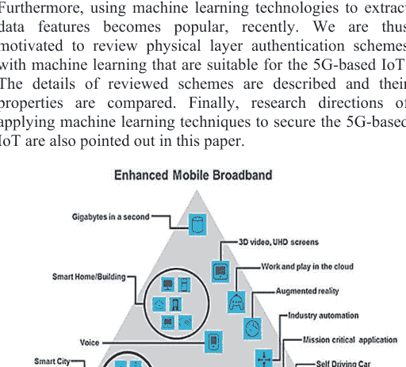
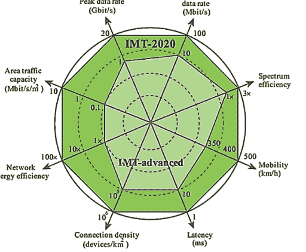
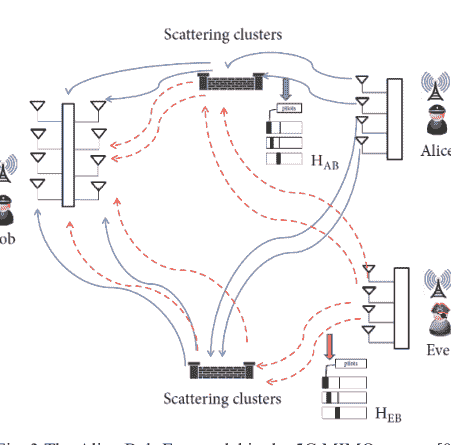

# 2020 第三届 IEEE 知识创新与发明国际会议 (ICKII)(台湾高雄 2020.8.21-2020.8.23)

*通讯作者：jrjiang@csie.ntu.tw

# 摘要

基于5G的物联网（IoT）包含大量峰值数据速率达 10 Gb/s、延迟低至 1 ms 的设备。确保基于5G物联网的安全性极具挑战性。物理层安全（PLS）依赖于物理层特性，这些特性是无条件的，因此适用于基于5G的物联网。本文综述了近期将机器学习应用于5G物联网的研究。文中详细介绍了这些方案，并对它们的特性进行了比较。此外，本文还指出了应用机器学习技术保障5G物联网设备的研究方向。

**关键词：** 5G IoT，机器学习， 物理层认证

# 引言

5G移动通信引起了广泛关注。3GPP（第三代移动计划小组）于2019年3月组织了5G Release 15（或3G Release 15-1），目前阶段5（或3G Release 16）正处于标准化阶段 [2]。它重点关注六大用例：增强型宽带（eMBB）、高可靠低延迟通信（URLLC）、海量机器通信（mMTC） [3]。(1) 为了满足5G的需求，案例利用多输入多输出（MIMO）、毫米波（mmWave）、异构网络（HetNet）和小基站技术等某些新技术，实现了10 Gb/s峰值数据速率、1 ms延迟以及每平方公里级设备密度的性能。

基于5G的物联网（IoT）包含大量峰值数据速率达 10 Gb/s、延迟低至 1 ms 的设备。传统加密学可用于保障基于5G物联网的安全。然而，由于它们依赖于复杂度，可能无法满足资源受限用户的5G性能需求。物理层安全基于计算不可行性，假设攻击者的计算能力有限。传统加密学在某种意义上是不安全的，因为量子计算机可能轻易破解它。

物理层安全（PLS）基于继承接收信号强度（RSS）和无线信道状态（CSI）的物理层特性来提供安全服务。与传统加密不同，PLS依赖完美安全的理论证明。它实现了无条件的通信安全。利用物理层安全的服务包括可用性、数据完整性、机密性和数据认证。认证验证实体。数据完整性验证传输数据未被修改或更改。数据机密性保证未经授权实体的安全。数据可用性防止攻击者干扰数据。

本文关注物理层认证（PLA），并综述了用于无线网络或基于5G物联网的流行技术及机器学习（ML）技术的PLA方案 [7-10]。在某些5G应用中，恶意设备连接到网络并经过认证以避免身份冒充和伪造。包含大量设备的基于5G物联网通常是资源受限的。

这些方案具有以下特点：复杂度低、对认证的预共享凭据或对认证的通信信道特征不作任何假设。机器学习被用于基于5G物联网的认证。文中描述了这些方案的细节并对其特性进行了比较。近期，本文还指出了应用机器学习技术保障基于5G物联网的研究方向。

# 背景

A. 5G移动通信系统
5G的关键性能指标（KPI）在IM-2020 [3]中规定，即全球5G规范。图2显示了这些指标以及与4G规范（IM-advanced）KPI的对比。首要几个KPI是：

- 1. 峰值速率（针对eMBB）：最大数据速率，在理想条件下为10 Gbit/s，而在某些条件下可以达到20 Gbit/s。
- 2. 延迟（针对URLLC）：源设备与目的地接收之间的延迟小于1 ms。
- 3. 连接密度（针对mMTC）：单位面积内的节点和连接设备总数为 1,000,000个设备/km²。
- 4. 用户体验数据速率：覆盖范围为100 Mbps的移动设备的可实现速率。
- 5. 移动性：在两个设备（或节点）可能属于不同层和/或容量的情况下，支持QoS和无缝传输的最大速度为500 km/h。
- 6. 区域容量：每个用户传输的总流量为。
- 7. 能量效率：能效率有两个方面。一方面，是无线接入网络（RAN）单位能量消耗传输的比特数。另一方面，是设备通信模块单位能量消耗接收/从RAN接收的比特数。IM-2020的能效率预计比IM-advanced好10倍。
- 8. 频谱效率：单位资源和单元的平均数据吞吐量为比特/Hz。IM-2020的频谱效率预计为30比特/Hz。

多址接入是移动通信的核心技术，因为它允许多个用户（UE）以有效且高效的方式共享分配的频谱。多址接入通过1G频分多址、2G时分多址（TDMA）、3G码分多址（CDMA）、4G正交频分多址（OFDMA）以及5G频分多址（OFDMA）和空间多址接入（SDMA，即大规模输入多输出（MIMO））来实现。多址接入的概念变得越来越复杂。大规模MIMO系统的基站（BS）具有许多天线（通常为几十或数千根天线），以便在同一信道上同时接收或传输信号。根据基站接收到的信号状态（CSI），在时分双工（TDD）模式下，上行和下行具有信道互惠性。

图2 IM-2020与IM-advanced的KPI

B. Alice-Bob-Eve 模型
基于5G的物联网基于继承接收信号强度（RSS）和无线信道状态（CSI）的物理层特性来提供安全服务。与传统加密不同，PLS依赖完美安全的理论证明。它实现了无条件的通信安全。在某些5G应用中，恶意设备连接到网络并经过认证以避免身份冒充和伪造。包含大量设备的基于5G物联网通常是资源受限的。Alice-Bob-Eve模型展示了基于5G的物联网易受攻击，Eve是身份冒充者或伪造者。图3展示了5G系统中的“Alice-Bob-Eve”模型。为了抵抗攻击，Alice和Bob在时分双工（TDD）模式下，上行和下行具有信道互惠性。

（注：此处原文文本似乎存在重复或错乱，翻译已根据上下文进行逻辑对齐）
物理层安全（PLS）基于继承接收信号强度（RSS）和无线信道状态（CSI）的物理层特性来提供安全服务。与传统加密不同，PLS依赖完美安全的理论证明。它实现了无条件的通信安全。利用物理层安全的服务包括可用性、数据完整性、机密性和数据认证。认证验证实体。数据完整性验证传输数据未被修改或更改。数据机密性保证未经授权实体的安全。可用性防止攻击者干扰数据。

（后续重复部分已已跳过）

| | | | | |
|---|---|---|---|---|
| [8] | Q-learning 和 Dyna-Q | 其他属性 | | |
| 方案-3 | AdaBoost 分类器 | 子载波幅度差异以及基于幅度和相位的静态值 | MIMO-OFDR 平台 | |
| 方案-4 | 核机 | 随时间变化的多维物理层属性 | 不需要 | 无实现 |

# 备注与研究讨论

本文综述了基于5G的物联网（IoT）中利用物理层身份认证（PLA）方案。所利用的机器学习技术基于自回归模型处理、强化学习（特别是 Q-learning 和 Dyna-Q）、AdaBoost 分类器以及核机。所有方案都依赖于多个物理层特征来实现认证性能。

物理层身份认证（PLA），机器学习技术还可用于基于5G的物联网的其他服务，例如入侵检测、异常检测和访问控制。此外，我们计划考虑引入深度学习（一种使用深度网络的特定强大机器学习技术）来改进安全服务。

# 参考文献

- [1] 3GPP, "Release 15", http://www.3gpp.org/release-15, 访问于2020年2月。
- [2] A. Ghosh, M. Baker, and D. Chandramouli, "5G evolution: a view on 5G cellular technology beyond the 12th 3G release 15," IEEE Access, 7:12769-127651, 2019.
- [3] 电信联盟 (ITU-R), 2020年及以后发展的IMT愿景框架和总体目标, Recommendation ITU-M R.2101, 2015.
- [4] T. C. Chaney, R. W. McGwier, and L. Chen, "Post-quantum encryption and security theory," in Proc. of the 12th IEEE Conference on Security and Mobile Networks, 223-228, 2019.
- [5] N. Wang, P. Alipour-Fall, L. Liao, and J. Zeng, "Physical-layer security of 5G wireless networks for IoT: challenges and opportunities," IEEE Internet of Things Journal, 6(5):8169-8181, 2019.
- [6] R. Melki, H. N. Noura, M. Mansour, and A. Chehab, "Physical layer security schemes for MIMO systems: wireless networks," 26(3):2089-2111, 2020.
- [7] W. Hou, X. Wang, J. Y. Bouchouinard, and A. Rafzey, "PHY-layer authentication for mobile systems with time-varying carrier offset," IEEE Communications, 62(5):1658-1667, 2014.
- [8] L. Xiao, Y. Li, G. Han, G. Liu, and Y. Zhang, "PHY spoofing detection with reinforcement learning in wireless networks," IEEE Transactions on Vehicular Technology, 65(12):10037-10047, 2016.
- [9] S. Chen, H. Wen, J. Ju, W. Liu, L. Hu, and Y. Chen, "Physical-layer authentication for 5G via machine learning," IEEE Communications and Mobile Computing, 2018.
- [10] H. Fang, L. Hanzo, "Learning-aided physical authentication as an intelligent process," IEEE Transactions on Communications, 63(3):2260-2273, 2015.
- [11] A. Shilah, and M. J. Kur, "Comprehensive survey of massive MIMO for communications," in Proc. of 2019 IEEE International Conference on Applications and Engineering (ICAE 2019), 1-5, 2019.
- [12] H. Fang, X. Wang, and S. Tomasin, "Machine learning for intelligent authentication in 5G and beyond wireless networks," IEEE Communications, 26(5):55-61, 2019.

