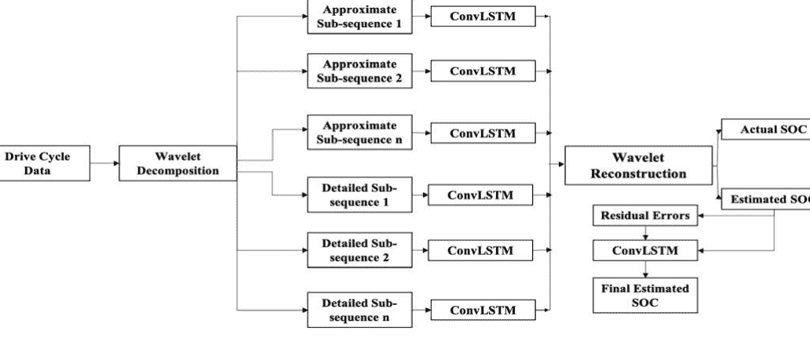
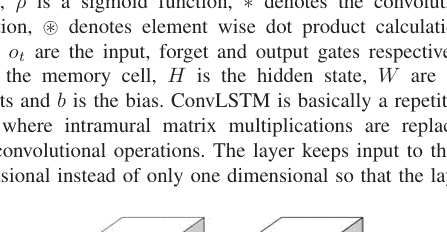
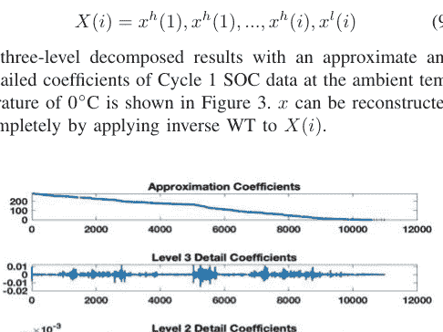
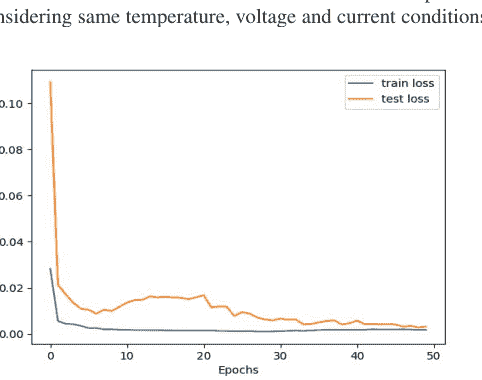
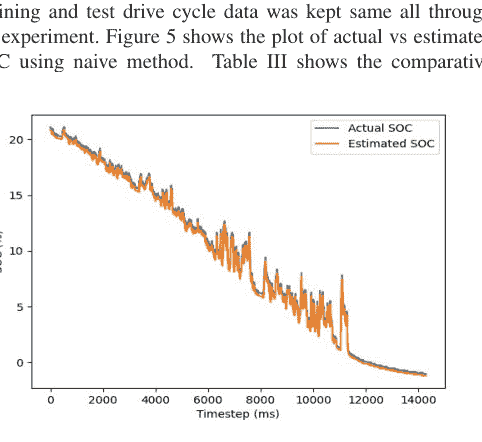

# 2020第三届能源、电力与环境国际会议：迈向清洁能源技术（印度梅加拉亚邦，实廊市，2021.3.5-2021.3.7）

电气工程系 | 电气与电子工程系 | 中央工程学院

印度理工学院 | 印度理工学院 | 印度海德拉巴

Haus Khas, 新德, 印度 | Haus Khas, 新德, 印度 | sreedhar803@gmail.com

mitushkumar@gmail.com | sukhamidarmitra@gmail.com

*摘要*—电量（`SOC`）估计已成为电池管理系统的基本需求，特别是对于电动汽车（`EVs`）而言。`SOC` 状态测量的是剩余电量，用以指示电动汽车还能使用多久。因此，对锂离子电池（`LIBs`）进行准确且持续的监控对于使用和电池生命周期至关重要。尽管对 `SOC` 估计的研究已多年，但由于无法在噪声条件下处理大量数据，目前尚无简单的电子设备可以直接测量 `SOC`。本文提出了一种结合残差特征卷积长短期记忆网络（`ConvLSTM`）深度学习模型的高效估计方法。实验和验证使用了公共锂电池数据集。多级小波分解提高了估计的准确性。所提方法在准确性和泛化能力方面表现良好。

锂离子电池最合适的问题是监控和测量剩余电量，因为它们的燃料动力系统不会直接面临电子仪器所面临的问题。测量电量状态对于电动汽车的能量管理至关重要。`SOC` 是任何电池相对于其容量的电量水平。它允许车辆利用能量通过电电机加速。同时，发动机作为发电机工作，为电池充电至达到所需的最低水平。

电池的状态需要对运行管理、生命周期成本、可靠性扩展和安全运行进行严谨的研究。可见，由于车辆和电流信号的时间依赖性和非线性特性，`SOC` 受运行条件、温度和行驶负载等多种参数的影响。多年来关于 `SOC` 估计已有大量研究。文献分类集中在三种方法：基于安培的方法、基于查找表的方法和基于滤波的估计方法。每种方法都适用于实验室环境估计。当电池最大容量已知且可测量时非常有效。查找表是 `SOC` 的函数，用于计算电池的块值。为了估计 `SOC`，需要随时间测量充电和放电。基于模型的方法通过构建历史将电池的复杂数学方程纳入其中。无模型方法是在电池数学模型未知时使用的数据驱动方法。该方法直接从电池、电压和温度数据中估计电池的内部状态。为了模拟电池单元的各种特性，文献 [2] 中利用电压、电流和温度提出了循环神经网络。它使用了通过动态应力测试、联邦城市等测试获得的数据。

# I. 引言

电动汽车在全球范围内不断扩大，它们极有可能减少化石燃料燃烧产生的温室气体排放。电动汽车是绿色的电力替代方案，因为它们由锂离子电池（`LIBs`）驱动。它们不会向环境中排放有害气体，为健康绿色的环境做出贡献。电动汽车电池的高效率、低碳足迹、高能量密度和低成本使其成为电力城市中燃料燃烧的替代品。锂离子电池（`LIBs`）是电动汽车中最常见的动力源。锂离子电池具有高能量密度、循环寿命和安全性等规格和类型。其特性和长寿命使其尺寸上比铅酸电池等其他充电车辆更小、更轻。使用锂电池有许多优势



图 1. 从计算时间、跟踪精度和对各种初始条件的鲁棒性方面对 `SOC` 进行了评估。电池包的可靠性取决于管理系统。作者在 [3] 中开发了一个完全基于电压测量和电流曲线的三二极管单元模型。并提出了一种基于多单元扩展卡尔曼滤波的方法来准确估计 `SOC`。

减少里程焦虑和提高电动汽车性能是可以通过精确 `SOC` 估计实现的关键因素。

```
h_t^l(i+1) = \sum_{k} x_{t-k+1}(i)h_k \quad (6)
```

`x_t^l(i)` 是第 `i^{th}` 层低频子信号的第 `t^{th}` 个值。信号通过表示为 `(t)` 的中间序列半下采样生成：

```
a_t^l(i) = a_t^l(i), a_t^l(i), \dots \quad (7)
```

```
h_t^l(i) = a_t^l(i), a_t^l(i), \dots \quad (8)
```

`x` 的第 `i^{th}` 层分解由式(9)给出：

```
X(i) = x^1(i), x^2(i), \dots, x^i(i)
```

图3显示了 `0^{\circ}C` 环境温度下第 1 循环 `SOC` 的近似和详细系数的三级分解。通过将 `W` 反转为 `X(i)` 可以完全重建 `x`。



Fig. 4. `ConvLSTM` DNN 模型架构。

使用共享重复网络将输入视为序列化时序数据，从而使其能够执行序列分析。

对于 `SOC` 估计，将电压 (`V`)、电流 (`I`) 和温度 (`T`) 作为所提模型的输入并预测 `SOC`。电池数据从时间 `t` 测量到最终时间 `t_{end}`。因此，源自 `{T, I, V}` 的 `SOC` 函数可以表述为：

```
SOC_t = f(T_t, I_t, V_t, S_{t-1}) \dots \quad (16)
```



图 3. `0^{\circ}C` 下的三级分解 `SOC`。

## C. ConvLSTM 模型

卷积长短期记忆 (`ConvLSTM`) DNN 是一种深度学习技术，用于解决输入和输出均具有时空性质的时序估计问题。结果表明 `ConvLSTM` 具有高能力捕捉数据中的时空模式，图 4 展示了 `ConvLSTM` 架构的整体概述。

公式 (15) 从数学上为时间分析制定了 `ConvLSTM` 架构；

### TABLE I

参数规格

| 参数 | 最佳性能值 |
|---|---|
| 隐藏层数 | 50 |
| 滤波器形状 | 16 |
| 最大池化层 | |
| 损失函数 | 均方误差 (`MSE`) |
| 激活函数 | |
| 批次大小 (`Batch size`) | 128 |
| 训练迭代轮数 (`Epochs`) | 40 |
| 优化器 | adam |

在损失误差方面获得了最佳结果。限制条件的最后一项是：

`\rho` 是 sigmoid 函数，`*` 表示卷积操作，`\odot` 表示元素级乘积卷积，`i_t, f_t, o_t` 分别是输入门、遗忘门和输出门，`C_t` 是记忆单元，`H` 是隐藏状态，`W` 是权重，`b` 是偏置。`ConvLSTM` 基本上是一个重复层，其中内部矩阵乘法被卷积操作取代。该层学习三维的一维数据，使得该层比训练更充分，由于于此，观察到训练时间大大减少。

如 II-A 节所示，该算法具有有效性。

## D. 伪代码

用于实现结果的伪代码可以在此处找到：

```
准备数据集：X_i = 1, 2, ..., n，
输出：y_1, y_2, ..., y_n
训练集、验证集和测试集
返回 (分割数据)
将其分解为不同的子级以进行去噪
设置（近似和定义系数）
设置（每个近似和定义系数精确等于）
ConvLSTM 架构层
设置隐藏层神经元、迭代轮数、激活函数
如果值或离群值数量发生时间偏移
在不同层级设置分解
否则（从逆小波分解）
返回 (估计的 SOC)
设置（实际 SOC - 估计 SOC）
设置（残差误差到 ConvLSTM 层）
返回 (最终 SOC)
```

```
RMSE = \frac{1}{n} \sum_{i=1}^{n}(SOC_i - SOC_i)^2
```

```
MAE = \frac{1}{n} \sum_{i=1}^{n}|SOC_i - SOC_i|
```

```
MAPE = \frac{1}{n} \sum_{i=1}^{n}\frac{|SOC_i - SOC_i|}{SOC_i}
```

表 II 显示了不通过分解的基准模型的对比结果。原生方法（naive method）是指在考虑某些时间范围、电压和电流条件时，假设值与上一步的值相同的方法。



图 6. 随迭代次数变化的训练和测试损失。

所提方法小波卷积残差误差 (`RE-ConvLSTM`) 的性能评估在三个指标上进行：均方根误差 (`RMSE`)、平均绝对误差 (`MAE`) 和平均绝对百分比误差 (`MAPE`)。公式 (17)-(19) 制定了这些指标。在这里，`SOC` 是实际 `SOC`，它是估计的 `SOC`，`n` 是总样本数。根据实验基础选择 `db` 作为母小波，这种小波提供了最佳结果和多级分解。使用配有 32GB 内存和 3 GHz Intel Core i7 CPU 的工作站来实现算法。代码方面，使用了 `Python` 进行编程。数据集被保留，并通过实验保留了训练和测试循环。图5 显示了使用原生方法的实际值值图。表 III 显示了对比



图 5. 使用原生方法的实际 `SOC` 与估计 `SOC` 对。

图 7. `RE-ConvLSTM` 在第 6 次分解时的实际 `SOC` 与估计 `SOC` 对。该算法的结果与机器学习算法不同，可以看出所提算法优于所有方法并证明了有效性。图 6 显示了使用不同行驶循环的验证图。

# TABLE II

不进行分解的对比结果

| 模型 | RMSE | MAE | MAPE |
|---|---|---|---|
| 原生 (Naive) | 7.619 | 8.667 | 4.447 |
| LSTM | 22.664 | 16.747 | 10.500 |
| ConvLSTM | 5.571 | 5.087 | 2.289 |

在混合循环方面的差异。所提方法可以结合各种优化方法，如粒子群优化、蚁群优化等，以获得更好的。

# 参考文献

[1] R. Xiong, Y. Cao, F. Sun, "电动汽车 SOC 方法的关键综述," IEEE Transactions on Energy, vol.67, pp. 4852-4863.

[2] Y. Fan, X. Song, Y. Tsai, "锂电池 SOC 估计的短期记忆," IEEE Access, vol.7, pp. 5279-5280.

[3] N. Wang, J. Ricci, F. G, "基于数值分析的 SOC 估计," IEEE Transactions on Industrial Electronics, vol.65, pp. 7185-7194.

[4] K. Sarraf, K. Mutqi, D. Dour, "使用深度神经网络的电动汽车 SOC 估计," IEEE Transactions on Smart, vol.56, pp. 5417-5428.

[5] Z. Wang, H. J., K. Liu, "锂电池 SOC 估计," IEEE Transactions on Industrial Applications, vol.57, pp. 5560-5574.

[6] G. S. M. Miskin, D. Apostopoulos, "基于混合方法的 SOC 估计," IEEE Transactions on Energy Conversion, vol.34, no. 1, pp. 109-119.

[7] Y. Wang, J. Wang, M. Hara, "基于循环神经网络的 SOC 估计," IEEE Journal of Power, vol.13, no. 3, pp. 3902-3912.

[8] M. Li, et al., X. Wang, T. Liu, "锂电池 SOC 预测," IEEE Access, vol.7, pp. 15831-15893.

[9] J. Meng, U. S., M. I., A. Yong, "带有注意力机制的锂电池 SOC 估计," IEEE Transactions on Control, vol.67, pp. 8980-8990.
