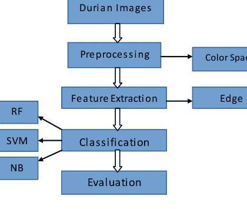
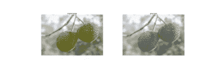
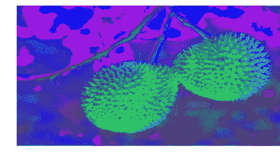
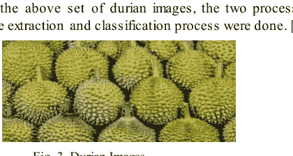
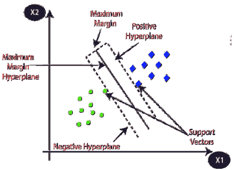
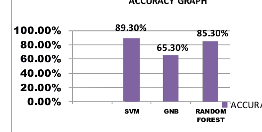
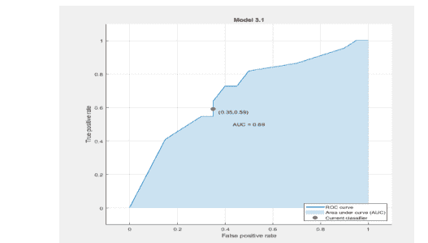
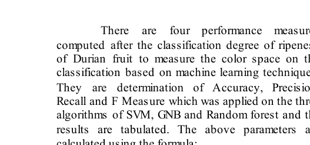
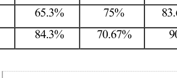

# 2020 第三届国际智能可持续系统会议 (ICISS) (印度图图杜库迪 2020.12.3-2020.12.5) 2020 第三届国际智能可持续系统会议 (ICISS) ｜｜ C


Muluthalakshmi, A
研究学者，
Hindustan Institute of Technology and Science, Chennai,
Tamil Nadu, 印度
muluthalakshmi.samy091@gmail.com

Dr. PN Renjith
副教授，
Hindustan Institute of Technology and Science, Chennai,
Tamil Nadu, 印度
nprenjith@hindustannuniv.ac.in

摘要—多吃水果对健康有益，是维生素和矿物质的极佳来源。但水果如果没有完全成熟，就是未成熟的。榴果的成熟是果实学发展中的一个重要阶段。各种机器学习技术被提出用于检测水果的分类。本文提供了一种特殊方法来识别不同种类榴果的特征。榴果被称为南亚最独特、最甜的水果，有助于提高产量并减少损失。机器学习技术对高质量的水果数据进行了分析。它以更好的准确率极大提供了最快的输出。

为了对水果进行必要的判定，该过程被分为预处理和分类两个阶段，并展示了水果数据集。在第一阶段，根据尺寸、纹理和颜色等特征对数据进行预处理。识别上述所有特征后，水果可以与植物的其他特征（如叶子、花、枝条等）区分来。第二阶段是水果的分类。如果对水果应用破坏性技术（Destructive technique），则可以进行水果分类。机器学习技术对高质量的水果数据进行了分析。它以更好的准确率极大提供了最快的输出。

关键词：水果分类、机器学习、SVM、决策树、随机森林。

## 引言

榴果被认为是南亚最独特、最甜的水果，有助于提高产量并减少损失。机器学习技术对高质量的水果数据进行了分析。它以更好的准确率极大提供了最快的输出。

为了对水果进行必要的判定，该过程被分为预处理和分类两个阶段，并展示了水果数据集。在第一阶段，根据尺寸、纹理和颜色等特征对数据进行预处理。识别上述所有特征后，水果可以与植物的其他特征（如叶子、花、枝条等）区分来。第二阶段是水果的分类。如果对水果应用破坏性技术，则可以进行水果分类。机器学习技术对高质量的水果数据进行了分析。它以更好的准确率极大提供了最快的输出。

榴果被认为是南亚最独特、最甜的水果，有助于提高产量并减少损失。机器学习技术对高质量的水果数据进行了分析。它以更好的准确率极大提供了最快的输出。

多吃水果对健康有益，是维生素和矿物质的极佳来源。但水果如果没有完全成熟，就是未成熟的。榴果的成熟是果实学发展中的一个重要阶段。各种机器学习技术被提出用于检测水果的分类。本文提供了一种特殊方法来识别不同种类榴果的特征。


对新鲜水果的成熟和品质进行非侵入式、无破坏性的监控。提出的方法包括榴莲图像的数据收集、预处理和分类。

监控被创建用于描述和解释颜色。[9]。HSV 比 RGB 更清晰地表示颜色，且 HSV 确定值的计算非常简单易用。这些值有助于数据集的稳定性，为我们的分类提供输入。对图像进行缩放，并使用 HSV 颜色分析方法划分背景和榴莲区域。

这项工作的新颖之处在于比较所有分类算法，并根据准确率（Accuracy）、精确率（Precision）和 F1 分数确定最佳分类方法。

## HSV 公式：

色调计算：

```
$H = (60 * \frac{(c'-r')}{\Delta}) \bmod 6, C_{max} = R'$
$(160 + \frac{(b'-r')}{\Delta} + 2), C_{max} = G'$
$(160 + \frac{(r'-g')}{\Delta} + 4), C_{max} = B'$
```

饱和度计算：

```
$S = \frac{C_{max}}{(\Delta)}, C_{max} \neq 0$.
```

值计算：$V = C_{max}$ (2)



图 2. 系统设计模型

### 图像采集：

为了开发和测试所提出的算法，榴莲图像是从 Kaggle 网站获取的。在这些不同水果的可用数据集中，提取了 300 张榴莲图像；其中 180 张用于训练和验证集，120 张用于测试集。使用上述榴莲图像，完成了特征提取和分类处理两个过程 [6]







图 3. 榴莲图像

### 基于颜色空间的预处理：

该过程通过通过将图像缩放为 100*100 像素来对榴莲图像进行平滑处理。图像通常由代表自身的 RGB 颜色分量组成。该 RGB 用于确定均值和中位数偏差。首先，将 RGB 转换为灰度，然后转换为 HSV。HSV 颜色空间根据色调（Hue）、饱和度（Saturation）和值（Value）来确定颜色。其中色调代表颜色，饱和度代表鲜艳度，新鲜的水果通过以下方式增强：[8]

彩色图像处理的使用取决于颜色和尺度的主要因素。其中颜色识别对象并从图像中提取对象。对象的色调与灰度级进行比较。RGB 通道在图像处理中广泛用于颜色

图 4. 榴莲图像的颜色检测

### 基于边缘检测的特征提取：

该方法的目的是显著确定榴莲与背景图像的边缘。Canny 边缘检测器是一种利用算法确定图像边缘的技术。实现的步骤为：

- (a) 通过应用高斯扩展对榴莲图像进行平滑处理，并通过以下方式减少噪声：
- (b) 使用 Canny 滤波器进行边缘检测。此过程通过计算图像每个像素的梯度来识别检测边缘。


544


(c) 最后应用双阈值确定潜在边缘，并通过滞回跟踪最终边缘。其中 $f(x)$ 的值决定了数据的分类，如果 $f(x)=0$ 则数据在超平面上；如果 $f(x)<0$ 则数据在负平面；如果值大于 0 则数据在超平面上。这些在图 (5) 中所示。梯度计算用于确定图像的强度方向。最简单的方法是在水平 (X) 和垂直 (Y) 方向应用滤波器。当梯度平滑时，$I_xI_y$ 计算如下：

```
Gradient (G) = \sqrt{I_x^2 + I_y^2}$
$\theta(x,y) = \arctan(\frac{I_y}{I_x})$
```



图 5. 榴莲图像的 Canny 检测

图 6. 支持向量模型

## D. 方法论：

预处理后，对榴莲图像进行了训练和验证。使用了 SVM、贝斯 和随机森林来比较榴莲的分类。使用训练样本的 75% 和测试的 25%，SVM 的性能显示，监督算法如贝斯、逻辑回归和简单的神经网络易于理解，从数据学习的速度快。而这些模型受到限制且工作复杂度较低。另一方面，带有 CART 的 SVM 更稳健并提供了更好的预测准确率。从文献上看，支持向量机获得了 83% 的分类。使用上述 SVM 进行数据预测是可行且高效的。

### 1) 支持向量机

SVM 通过以下公式帮助在二维空间分类：

```
$g(x) = w^Tx + b$ (3)
```

分类决策公式：

```
$f(x) = sign(w^Tx + b)$ (4)
```

```python
from sklearn.svm import SVC
from sklearn.pipeline import make_pipeline
from sklearn.preprocessing import StandardScaler

clf = make_pipeline(StandardScaler(), SVC(gamma='auto'))
clf.fit(X_train, y_train)
out = clf.predict(X_test) * 100
```

图 7. SVM 的分类准确率

### 2) 高斯贝斯

GNB算法基于贝斯定理，每个特征都是独立的。GNB 存储所有可用数据并根据相似性对新数据点进行分类，这很容易构建。它可以用于分类和回归过程。GNB 易于实现，对噪声数据具有稳健性，也适用于大量数据。朴素贝斯模型用于各种高度复杂的分类方法。[11]。将其应用于提取的榴莲特征，其确定了 63.5% 的准确率，如图 (7) 所示。

根据准确率评估了非破坏性机器学习技术的结果。榴莲分类的 SVM 提供了 89.3% 的准确率，GNB 提供了 63.5%，随机森林产生了约 84.3%。支持向量机根据颜色对未熟、半熟和完全熟的榴莲提供了更好的分类。此后解释了分类结果的图形表示。


545

## IV 分析

```
p(A/B) = \frac{p(B|A)p(A)}{p(B)} ---------- (5)
```


```python
from sklearn.naive_bayes import GaussianNB
gnb = GaussianNB()
y_pred = gnb.fit(train_x, train_y)
y_pred_ = gnb.predict(test_x)
print(accuracy_score(test_y, y_pred) * 100)
```

```python
c:\users\appdata\local\programs\python36\site-packages\sklearn\naive
y_column = col_id(id,y_name=True)
65.3333333333333
```



图 8. GNB 的分类准确率

### 3) 随机森林算法

随机森林是一种监督方法，有助于通过训练好的标签数据集分类无标签数据。它适用于数据集的分类树和回归树，然后结合所有数据集的预测。该算法防止数据过拟合，并有助于创建更准确的结果。该算法还通过从集中选择自助采样提供了帮助 [12]，


 10. 算法精度图

```python
from sklearn.ensemble import RandomForestClassifier
rf = RandomForestClassifier(max_depth=5, random_state=0)
rf.fit(train_x, y_train)
print(accuracy_score(test_y, y_pred) * 100)
```

```python
c:\users\appdata\local\programs\python36\site-packages\ipykernel_la
在从 sys.path 移除代码后
```



图 9. 随机森林算法的分类准确率

当使用该算法训练数据集时，根据水果成熟度指标分类的榴莲数据集获得了 84.3% 的准确率 (8)；

图 11. 算法的图形表示



榴莲水果的成熟度是根据机器学习技术对颜色空间进行分类的。对 SVM、GNB 和随机森林三种算法应用了准确率、精确率、召回率和 F 值测量结果结果列表。上述参数使用以下公式计算：

978-1-7288-7089-3/20/50 © 2020 IEEE

546


## 参考文献

准确率 Accuracy = 真阳性 + 真负性 * 100% --(6)

精确率 Precision = 真阳性 / (真阳性 + 假阳性) * 100% --(7)

召回率 Recall = 真阳性 / (真阳性 + 假阴性) * 100% --(8)

| 算法 | 准确率 | 精确率 | 召回率 |
| --- | --- | --- | --- |
| SVM | 89.3% | 95% | 79.33% |
| GNB | 65.3% | 75% | 83.6% |
| RF | 84.3% | 70.67% | 90% |



- [1] 张强, 乔成巧.(2016) “基于支持向量机的高光谱成像分析草莓成熟度”
- [2] Fatma M. A. Mazen, Ahmed A.Nasant (2018) “利用人工神经网络进行香蕉成熟度分类”
- [3] Luiz Fernando Santos Pereira, Sylvia Barbon (2018) “利用数字成像和随机森林预测木瓜的成熟度”
- [4] Wilson Castro, Jimmy Oblitas (2019) “利用机器学习技术和不同颜色对开普蓝莓进行成熟度分类”
- [5] Sant K Khera, Ajay Kumar Rai (2020) “基于机器学习和迁移学习方法的木瓜果成熟状态分类”
- [6] 水果 (Fruits)，来自 https://www.kaggle.com/datasets 的图像数据集
- [7] https://datascience.canvas.com/edge-detection-step-by-step-in-python-computer-vision-b8ca93b208123
- [8] Bhani Priya, Naveen Ahmed(2014) “基于 ANN 的高效水果识别技术开发”
- [9] https://github.com/image-processing-color-spaces-hsv-and-cmy
- [10] 彭宏军, 邵远谦,(2018), “基于机器视觉和 SVM 的多类水果识别研究”
- [11] Dayakar L.Naik, Rao Kitan,(2018), “分类的朴素贝叶斯分类器、多元线性回归和实验检验”
- [12] Shinji Fukuda, Eri Yasunaga (2014), “使用随机森林对果皮颜色与芒果质量之间的关系进行建模”
- [13] 李军, 磊丹 (2019), “自然环境下基于颜色和纹理特征的香蕉检测”
- [14] Nidhi Goel, Prit Segha(2015), “用于成熟度估计的采前番茄模糊分类 —— 基于自动规则学习决策树的方法”

## 结论

通过使用先进机器学习技术获得的结果可以得出，可以根据大小、形状、颜色和纹理对水果进行高效分类。在这项工作中，SVM 被用于评估榴莲果的成熟度。光谱分析数据的 SVM 模型显示了可以接受的结果。利用颜色特征和边缘检测来确定最佳波下的灰度图像。使用 300 个成熟水果组合数据集的 SVM 模型显示了最佳分类结果，分类准确率为 89.3%。与成熟水果和随机水果相比，每种方法都很少发生误分类。

未来，需要超过 500 个具有更广泛变异和不同成熟阶段内部质量的榴莲样本，以更好地识别成熟度粗糙度。这项工作的进一步增强将是基于 ANN 的分类。ANN 也是用于大量样本图像数据集分类的高度成功工具。数据集是训练、学习和测试的结合，从而产生更高的准确率。

