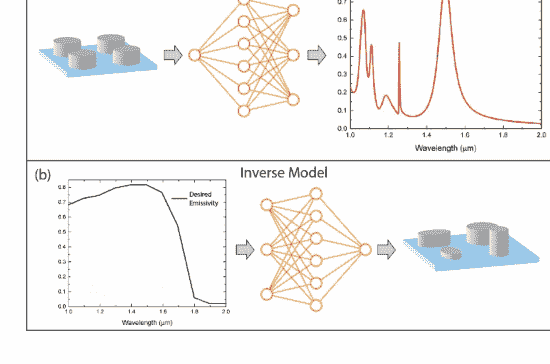
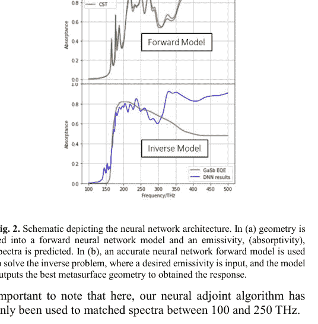

# 2020 第45届红外、毫米波和太赫兹国际会议 (IRMMW-THz) (美国纽约州布法罗 2020.11.8-2020.11.13)

摘要—我们引入了一种深层神经网络和一种逆向神经网络方法来解决多维度超表面的逆向设计问题。我们发现，即使解决方案位于几何空间之外，神经方法仍然能够找到低误差的超表面设计。

机器学习（ML）和深度学习（DL）对工业产生了巨大影响。[1] 公司使用机器学习来优化运营、营销和广告，并改进客户服务。ML/DL 在改进社交媒体、零售、制造业、能源和金融的方面还有许多其他示例。深度学习也被应用于解决材料科学、城市规划方面的问题，并取得了实质性进展。

我们使用 DL 模型来有效解决材料科学中的棘手问题，为给定目标获取最优解决方案——图 1 (a)。此外，我们设计了一种名为“神经”的逆向方法——输入所需的频率散射，由神经网络给出特定的超表面几何形状以产生此类响应，如图 1 (b) 所示。

我们的正向模型由一个神经网络（NN）组成，其中超表面单元格的几何形状（1 1 a）作为输入，并通过宽度为 1000 个神经元的全连接层。神经网络的输出包含吸收光谱——预测光谱。

将预测光谱与从仿真中获得的真值光谱进行比较，结果通过梯度下降在神经网络中反向传播。逆向方法使用具有高精度的已训练正向模型，结合边界损失和梯度下降 [3]。

需要注意的是的是，我们的神经算法仅被用于匹配 100 到 250 Hz 之间的光谱。

## II. 结果

在图 2 中，我们展示了正向模型（上）和逆向模型（下）的结果。神经网络的结果以蓝色显示，它几乎位于仿真结果的真实曲线（金色）下方。我们使用我们的逆向模型来预测设计，并重新采样以验证匹配（绿色曲线）。

我们嵌套了一个不同的所需光谱，例如图 2 底部的红色曲线，以测试我们的逆向模型。逆向神经方法返回我们的估计和生成的光谱（蓝色曲线），这在我们的参数空间内是最好的。它也是

## III. 总结

我们展示了深度学习在精确正向模型和逆向模型方面的结果。我们使用我们的方法获取实现设计所需的最优几何

## 参考文献

[1] Goodfellow, Y. Bengio, and A. Courville. Deep Learning, MIT Press, 2016.

[2] C. Nathaniel, Bohua Huang, Jordan M. Malof, and Willie J. Padilla, 'Deep learning for all-dielectric metasurface design,' Optics Express 27(29), 35553, 2019.

[3] Simao Ren, Willie J. Padilla, and Jordan Malof, 'Benchmarking Deep Inverse Models over time, and the Neural-Adjustment method,' 2019.

图 I. 神经网络架构示意图。在 (a) 中，几何形状被输入神经网络模型并输出，（吸收率），光谱。在 (b) 中，使用精确的神经网络正向模型来解决问题，其中输入所需的光谱，模型输出最佳超表面几何以获得结果。
