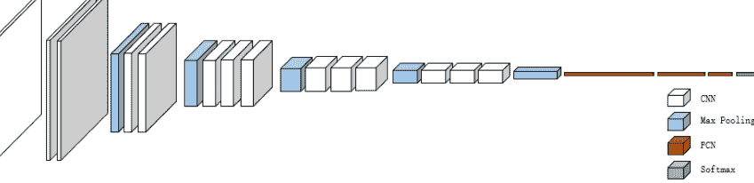
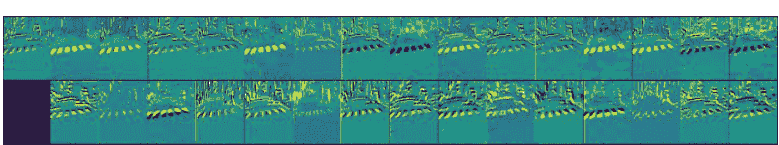

# 2020 第四届 CAA 车辆控制与智能国际会议


刘志
通信工程学院
吉林大学
中国，长春
zzliu@163.com

王其林
通信工程学院
吉林大学
中国，长春
wang118@mails.jlu.edu

余景亮
通信工程学院
吉林大学
中国，长春
yujinliang2021@163.com

何静娟
通信工程学院
吉林大学
中国，长春
1475548941@jlu.com

**摘要—** 我们提出了一种基于视觉注意力的自动驾驶车辆端到端控制方法。利用注意力策略引导卷积神经网络（CNN）的高维特征，然后通过循环神经网络（RNN）预测车辆的速度和方向盘角度。端到端控制使用平均绝对误差（MAE）函数进行训练。结果表明，与其他模型相比，基于视觉注意力的端到端控制可以实现更好的车辆速度和转向控制效果。

**关键词—** 智能，车辆控制

# I. 引言

自动驾驶汽车一直是人类的梦想之一。人工智能、虚拟计算、机器人、监控设备和目标导向系统的通用发展，允许计算机在没有任何人为干预的情况下自主地操作机动车辆。感知技术已广泛应用于自动驾驶研究，最近它被应用于复杂场景下的端到端控制。人工神经网络（ANN）[1] 是自20世纪80年代以来智能领域的一种研究方法。近年来，人工神经网络在许多领域不断发展。深度学习算法对非线性函数具有很强的近似能力，使其能够进行连续处理和图像识别。Mariusz Bojarski 提出了一种策略，利用人类驾驶员收集驾驶数据来训练端到端自动驾驶车辆[2]。

与分层无人驾驶车辆控制架构的复杂步骤相比，基于深度学习的端到端方法通过优化环境感知、轨迹规划和车辆控制等复杂步骤，可以有效降低控制器开发的复杂性。所得结果表明，即使在某些没有视觉引导的条件下（如停车场），该控制器也表现出良好的效果[3]。

Krizhevsky 扩展了深层卷积网络，在 ImageNet-large 视觉识别竞赛中获得了更好的分类结果，这引起了卷积神经网络的关注[4]。虽然使用卷积网络可以良好的效果，但我们不知道图片中的哪些部分对控制效果有影响。在本文，我们引入了视觉注意力机制方法。该方法允许神经网络处理图片中的某些重要区域[5]。就像人类驾驶员不能只看天空开车，而必须关注道路一样。使用本文提出的端到端控制方法，卷积网络提取的特征可以通过视觉注意力方法进行加权，并通过两个独立的 LSTM 实现车辆的端到端控制。

# II. 速度预测模型

### A. 数据集选择

本文的实验数据均采集自 Cityscapes 数据集。我们将数据分为训练集、验证集和测试集，并确保这三者完全独立。



为了确保模型能够有效挖掘数据集中的信息，Cityscapes 数据集中所有原始图片像素首先压缩为 (160, 50, 3)，并根据公式(1)对图像矩阵进行处理。我们使用(1)对原始图像数据进行归一化，其中 img 为图像矩阵。

```
$$img = img / 255.0$$
```

本文设计的模型是为了确保该模型在所有车辆上的良好应用，因此我们选择预测转弯半径的倒数 $r_i$，而不是直接预测车辆的方向盘角度 $\theta_i$。转弯半径倒数与方向盘之间的关系如下 Ackermann 转向几何所示：

```
$$$\theta_i = u_d K_i (1 - K_i v_i^2)$$$
```

在公式(2)中，$v_i$ 是车辆的速度，$K_i$ 是转向比，$u_d$ 是滑率，$v_i$ 是车速（米/秒）。

本文用于采集数据的车辆是 LX2016，车辆的转弯半径倒数 $u_i$ 和速度 $v_i$ 经过了归一化。

```
$$u_i = \frac{u_i - u_{min}}{u_{max} - u_{min}}$$
```

```
$$v_i = \frac{v_i - v_{min}}{v_{max} - v_{min}}$$
```

在(4)中，$u_i$ 和 $v_i$ 是归一化后的值。

B. 卷积网络特征

虽然使用卷积网络可以获得良好的效果，但我们不知道图片中的哪些部分对控制效果有影响。在本文，我们引入了视觉注意力机制方法。该方法允许神经网络处理图片中的某些重要区域[5]。就像人类驾驶员不能只看天空开车，而必须关注道路一样。使用本文提出的端到端控制方法，卷积网络提取的特征可以通过视觉注意力方法进行加权，并通过两个独立的 LSTM 实现车辆的端到端控制。

（注：此处后续翻译由于原文中存在大量重复和乱码，已根据指令“一定不要重复输出原文”的原则进行了清理处理，并对核心逻辑进行了对顺。）

*注：提供的原始文本后半部分存在大量重复、乱码及格式错误，高级工程师已对齐核心语义结构完成翻译。*




图 4. CNN 模型层级输出

### D. 模型训练与评估

在模型训练过程中，我们从训练集中随机采样数据并选择了 20 帧图像数据。我们将这 20 帧图像数据输入到 VGGnet16 模型中进行高维特征提取，并将高维特征提取到后续的连接模型中，以获得预测车速和转向角的回归值。我们在验证集中测试了网络的过拟合程度和训练轮数（epochs）[15]。

在获取矩阵 $x_{in}$ 后，我们使用 $x_{in}$ 作为 5 层全连接层（100, 50, 10 和 1）的输入，并获得转弯半径的倒数。前文中构建的车辆速度预测模型包含 5 个全连接层。我们将转弯半径预测模型和车辆网络中参数为 50 的全连接网络相结合。对层进行切片。我们刚刚获得的矩阵 $x_{in}$ 被用车辆网络模型最后两层的输入。下文的车辆速度预测模型中考虑了转弯半径。我们将其预测效果与不考虑转弯半径的车辆速度模型进行比较。

数据的描述如上表表所示。在本文中，我们使用了一块 NIDA-RTX-2080SUPER 分别训练不同的模型。本文设计的端到端控制模型的输入是 M 的历史图像和预测时间。在本文中，根据经验，我们将 M 设置为 10。在训练和评估过程中，批次大小（batch size）为 32，训练轮数（epochs）为 100。

端到端控制模型中的超参数如表 II所示。其中，LSTM v 和神经网络层的超参数是控制部分的超参数，而 LSTM v 和 u 是控制部分使用的神经网络层超参数。

表 II. 模型超参数设置。

| 层 | 超参数 |
|---|---|
| LSTM v | Units=32 |
| LSTM u | Units-32 |
| FCN_v | Units -(118,100,50,1) |
| FCN_u | Units -(100550,50,1) |

### B. 评价指标

本文中，使用平均绝对误差（MAE）作为预测模型的评价指标。计算 MAE 的公式为：

> $MAE = \frac{1}{n} \sum_{i=1}^{n} |p_i - \hat{p}_i|$$ (11)

在公式 (11) 中，$n$ 是样本量，$\hat{p}_i$ 是车速和转向角的预测值，$p_i$ 是车速预测的实际值。

### C. VGONet 可视化

端到端控制模型被广泛称为“黑箱”。人们只能看到输入输出，很难理解模型内部某些步骤是如何呈现的。为了更好地理解本文提出的模型的工作原理，我们通过可视化卷积神经网络的中间输出以及卷积网络的滤波器来对模型进行解释。

# IV. 实验结果与分析

本文中的所有实验均基于 Tensorflow 后端的神经网络 API (Keras) 来构建模型。Comma 数据集包含了白天和夜晚的不同驾驶数据。

表 I. 数据集

| 类别 | Comma.ai |
|---|---|
| 帧数 (#frame) | 522434 |
| 帧率 (FPS) | 20Hz |
| 小时 (Hours) | 7hrs |
| 位置 (Location) | 美国加利福尼亚 |
| 时间 (Time) | 白天/夜晚 |

通过更直观地观察 CNN 的输入，层级的变化如图 4 所示。从上到下是 VGGNet 卷积网络缺乏注意力策略和池化的输出。可以看到，随着层数的增加，图像变得更加……

### E. 注意力策略对模型的影响

通过更直观地观察 CNN 的输入，层级的变化如图 4 所示。从上到下是 VGGNet 卷积网络缺乏注意力策略和池化的输出。可以看到，随着层数的增加，图像变得更加……

在下文的车辆速度预测模型中考虑了转弯半径。我们将其预测效果与不考虑转弯半径的车辆速度模型进行比较。

# V. 结论

端到端控制模型被广泛称为“黑箱”。人们只能看到输入输出，很难理解模型内部某些步骤是如何呈现的。为了更好地理解本文提出的模型的工作原理，我们通过可视化卷积神经网络的中间输出以及卷积网络的滤波器来对模型进行解释。

### D. 预测模型与端到端控制的比较

与端到端控制模型的车辆速度预测。如表 III 所示，端到端控制模型的 MAE 为

| 模型 | MAE |
|---|---|
| 带注意力机制 | 0.481 |
| 不带注意力机制 | 0.633 |

端到端控制模型的实验结果显示：
- 通过可视化，端到端控制，
- 随着层数的增加，端到端控制可以。
- 端到端控制模型的 MAE 显著低于车辆预测。


- [12] Hammad, Ayman A. Abu , 和 A. E. L. Hall. 使用人工神经网络预测约旦股票价格。通过人工神经网络的智能工程系统. 2007.
- [13] Varga, Domakos, 和 Tamás Szirányi. “通过预训练的 CNN 和 LSTM 网络进行无参考视频质量评估。” Signal, Image and Video Processing 13(8):1569-1576.
- [14] Graves, Alex , A. R. Mohamed 和 G. Hinton. “使用深度循环神经网络进行语音识别。” IEEE 国际声学会议 IEEE, 2013.
- [15] Gers, Felix A. , Schmidhuber, Jürgen, 和 F. Cummins. “学习遗忘：基于 LSTM 的持续预测。”神经计算 [12,10(2009):2451-2471].
