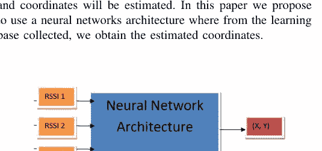
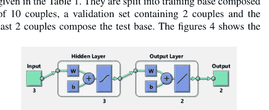
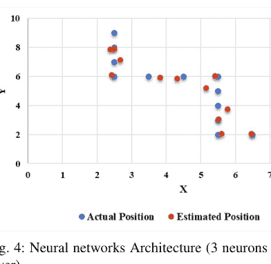

# 2020 第四届先进系统与新兴技术国际会议 (IC_ASET) (突尼斯哈马梅特 2020.12.15-2020.12.18)

## 摘要

多年来，人员和工程师一直在各种场景下寻找精确的室内定位系统（IPS）。为了实现这一目标，人们使用了多种方法。基于接收信号强度（RSS）的确定性 IPS 使用 RSS 值进行距离估计，然后通过三角测量法进行校准以获得坐标值。由于室内环境变化巨大，RSS 通常是不稳定的。

在本文中，我们提出了一种新的 IPS 方法。我们将我们的方法与使用三个锚点融合的方法进行了比较。结果优于经典方法。

**关键词—** 室内定位系统（IPS）、RSS、神经网络、学习近似和机器学习。

## I. 引言

由于对高质量研究结果的迫切需求，目前仍然缺乏可靠的室内定位产品和工具。然而，在智能城市中，基于室内定位的服务需求不断增加 [1]。近年来，室内研究的精度以及定位系统的配置设置得到了极大改进。尽管如此，这些广泛使用的室内定位方案已实现与户外环境中类似于 GPS 的满意性能 [2]。

目前已经提出了多种方法，例如 [3]、超宽带（UWB）、射频识别（RFID）[5]、微机电系统（MEMS）[6]、无线局域网（WLAN）[7]、计算机视觉 [8]、磁场 [9]、红外信号 [11] 和 [12]。

RSS 技术是移动目标定位最流行的算法之一，上述传感器允许您执行数据采集。RSS 是传感器接收到的平均功率，该功率源于发射源。假设接收功率遵循指数衰减，接收功率是发射功率、路径损耗常数以及源与传感器之间距离的函数 [13]。通过收集传感器的 `rsi` 数据并去噪，可以更准确地估计距离。这是通过使用一些分析数学方法实现的。在 [15] 中，作者讨论了这两种近似技术的缺点，尽管结果证明这些近似方法更适合此问题。在这项工作中，我们提出了使用神经网络进行位置估计，并将其与 [14] 中的结果进行了比较。位置估计通过两种神经网络（NN）架构执行，第一个基于 RSS 测量值输入；而第二个也基于 RSS 测量值输入。此外，我们对所提方法与 [14] 作者提出的方法进行了比较。重点关注的参数是每个估计位置的距离误差以及该方法在准确性方面的性能。

我们首次在相同条件下，执行了三个输入、一个隐藏神经网络的性能，以达到 [14] 中的精度。接下来，我们将比较三个输入与四个神经网络的比较，并发现增加信标的数量可以获得更高的精度。

## II. 定位

室内定位系统必须包含一组传感器，以确保以不同形式（声学、电学等）收集定位所需的必要信息 [15]。这些传感器与其他元件对于定位基础设施的安装至关重要。配置由各种参数和我们用于获取移动物体位置的技术组成。定位系统的情况确保了固定位置存在一个或多个基站，利用移动设备的接收信号来测量定位参数 [16]。所采集数据的质量取决于用于定位的元件类型和质量（传感器的类型和质量），另一方面，实验环境会有效影响数据的采集。这是由于信号传播受到一些影响因素的干扰，这些可以分为不同的维度：辐射率、气候条件、障碍物（静态或动态）（综述请参见 [3]）。

### A. 基于 RSS 的定位

由于我们的工作致力于使用 `rsi` 参数进行定位，我们将使用基于 2020 年第 44 届先进系统与新兴技术国际会议（IC_ASET）的 `rssi` 参数的三角测量技术。接收信号指示（`rssi`）方法是本地网络或移动无线电网络中常用的分类技术之一 [13]。其原理是通过计算接收信号的能量来测量发射系统和接收系统之间的距离。通常，需要三个基站来执行定位 [17]。假设参数已知，每个基站与移动设备之间的距离 $d$ 可以为：

Friis 传输方程由公式 3 给出。

```
$d_c = \sqrt{\frac{P_tg_t\lambda^2}{(4\pi)^2P_r}}$ (3)
```

$d_c$ 是发射器和接收器之间的距离，$P_t$ 和 $P_r$ 分别是发射和接收功率，$G_t$ 和 $G_r$ 是发射器和接收器的增益，$\lambda$ 是波长。

在之前的工作 [15] 中，作者研究了使用多项式近似和神经网络的距离估计。这些方法对实验结果具有非常有趣的适应性。


### C. 位置估计

在本节中，我们将看到上一节中提到的距离估计 [17]。位置估计通过两种神经网络（NN）架构执行，第一个基于 RSS 测量值输入；而第二个也基于 RSS 测量值输入。此外，我们对所提方法与 [14] 作者提出的方法进行了比较。重点关注的参数是每个估计位置的距离误差以及该方法在准确性方面的性能。

我们首次在相同条件下，执行了三个输入、一个隐藏神经网络的性能，以达到 [14] 中的精度。接下来，我们将比较三个输入与四个神经网络的比较，并发现增加信标的数量可以获得更高的精度。

然而，基站的数量可以大于 3。在这种情况下，将是位置的多次估计。

在此关系中，我们使用了来自 [14] 的 `riis` 数据来执行我们的工作。在提到的论文中，作者使用了基于权重的数学方法，并使用其他测量值进行估计。对于我们的工作，我们使用神经网络计算坐标。

## III. 相关工作

有不同的方法来估计测量的 `ri` 距离。取 Friis 传输关系 [1] 对于自由空间，通过计算接收信号，我们可以估计基站和移动设备之间的距离 [18]。公式 2.1 和 2.2 显示了毫瓦和分贝。

许多关于使用 `ri` 参数进行定位的工作已发表。在 [17] 中，采用了 Friis 方法进行定位，但估计的精度较低。在之前的论文中，我们使用来自 [14] 的 `rssi` 数据，在本文中我们决定，该方法的最大估计误差约为 0.7 米。这些值与室内维度相对准确。为了最小化误差，我们建议使用相同的 `riis` 数据和神经网络估计距离。

```
$P(mW) = 10$ (1)
```

```
$P(dBm) = 10\log\frac{P(mW)}{mW}$ (2)
```

接收信号指示（`rssi`）方法是本地网络或移动无线电网络中常用的分类技术之一。其原理是通过计算接收信号的能量来测量发射系统和接收系统之间的距离。通常，需要三个基站来执行定位 [17]。假设参数已知，每个基站与移动设备之间的距离 $d$ 可以：

该应用在 [14] 中通过无线传感器执行，基于用于无线通信的 IEEE 传感器，带有 UFL (MMCX) 接口的三探头外部天线用于实验。

在 [14] 中收集的 `rsi` 数据集如表所示：

所有基站采集的 `rsi` 被用于估计。

对于每个部分（3 和 4 个输入），对 [14] 中提出的结果进行了对比。

| y | N1 | N2 | N3 | N4 |
|---|---|---|---|---|
| 2.50 | 99.00 | 45.00 | 38.00 | 37.00 |
| 2.50 | 80.00 | 45.33 | 36.66 | 37.00 |
| 2.50 | 76.00 | 41.66 | 36.33 | 37.33 |
| 3.00 | 86.00 | 38.00 | 36.00 | 37.00 |
| 3.50 | 65.00 | 39.00 | 36.00 | 36.33 |
| 4.00 | 67.00 | 39.00 | 36.00 | 36.33 |
| 5.00 | 58.00 | 42.66 | 36.66 | 37.33 |
| 5.50 | 59.00 | 39.00 | 36.00 | 37.00 |
| 6.50 | 44.00 | 43.33 | 36.66 | 37.00 |
| 7.50 | 65.00 | 45.00 | 38.00 | 43.00 |
| 8.00 | 26.00 | 42.33 | 38.00 | 43.66 |

### A. 位置估计

此前，一种基于基站坐标估计的定位技术。通过使用来自 3 个基站的数据，将估计坐标。在本文中，我们使用了一种神经网络架构，从学习基中获得了估计的坐标。

在每个位置，都会从每个基站获取一个 `rsi` 测量值。对于每次测量，计算该位置与进行估计的基站之间的距离。在每个位置有 4 个估计值的情况下，估计出边际值。之后，应用公式来预测坐标。

## IV. 使用神经网络进行位置估计

机器学习是利用经验来增强性能或获取预测的计算方法的集合。它是一种解决问题的数据驱动方法。人工神经网络（ANNs）是受生物神经网络松弱启发的计算机系统，这些网络连接人类大脑或被称为人工神经元的节点。ANN 基于一组神经元，人工神经元之间的每个连接都可以从一个神经元传输信号到另一个，并根据数据库直接估计参数（坐标）。数据过滤被视为一个学习过程，对于所有新系统，根据基准的学习得出估计结果。



对于这种架构，我们使用来自基站 N1、N2 和 N3 的 `rsi` 测量值来训练网络（输入），并且有每个测量值的目标值。在表 II 中，我们使用不同数量隐藏层（3 和 4 个神经元）进行了训练。表 III 显示了每个位置的误差以及 [14] 中使用的检测方法的误差。

如所述，我们使用 [14] 中的 `rsi` 数据集来估计发射器和接收端 ANN 之间的坐标。对于这种方法，我们使用 `metlab` 神经网络从收集的 `rsi` 数据集中估计位置（坐标），该基准由收集的 `rsi` 数据集和真实位置的对组成。首先，从前 3 个基站采集的 `rsi` 用作网络的输入，并在



根据真实位置估计的位置（表 II 和 III）展示了基于神经网络的估计与基于决策树技术的估计之间的对比。我们的网络显示了表 III 所示每个位置的距离误差，我们看到许多值没有超过 0.1m，也有一些自由值超过了 0.5m 的距离误差。另一方面，根据 [14] 中关于距离误差的结果，

### 表 II：3 输入 ANN

| 输入 | | | | 3 架构 | | | | 4 架构 | | | | |
|---|---|---|---|---|---|---|---|---|---|---|---|---|
| n | 35.66 | RSSI1 | RSSI2 | 48 | 25 | 9 | 8.8519 | 0.0000 | 0.1483 | 2.3888 | 7.6909 | 1.1369 |
| 35.66 | 35.33 | 46 | 25 | 7 | 8.5584 | -0.0113 | 0.0769 | 2.0547 | 7.8103 | -2.7e1 |
| 41.66 | 41.36 | 36 | 25 | 6 | 7.2547 | -0.1156 | -0.1548 | 6.2610 | 7.1739 | -1.5e1 |
| 37.66 | 37.66 | 36 | 25 | 5 | 4.2029 | 0.0699 | -0.2960 | 6.0160 | 7.0082 | -8.8e2 |
| 37.66 | 37.39 | 36 | 25 | 4 | 5.7035 | 0.1638 | 0.2963 | 4.9308 | 5.8514 | 1.9101 |
| 37.66 | 37.19 | 36 | 25 | 3 | 4.386 | 0.5070 | 0.1938 | 3.3835 | 5.3888 | -1.0e1 |
| 42.36 | 42.56 | 36 | 25 | 2 | 6.1829 | -0.1167 | -0.5145 | 6.3199 | 0.6642 | -1.06e2 |
| 42.33 | 36.33 | 36 | 25 | 1 | 6.2808 | 0.7416 | 0.1761 | 5.1997 | 5.7742 | -3.76e2 |
| 44.66 | 44.66 | 36 | 25 | | 5.5110 | 2.9321 | -0.0110 | 5.3819 | 3.0431 | -4.03e2 |
| 48.33 | 48.33 | 36 | 25 | | 5.2607 | -0.0160 | 0.0067 | 5.5839 | 5.0005 | -1.8e1 |
| 45.66 | 45.36 | 36 | 25 | 3 | 6.5802 | 1.9523 | 0.0082 | 6.4732 | 2.6688 | 0.0694 |
| 45.66 | 42.33 | 38 | 25 | 2 | 7.4215 | 1.9727 | 0.0784 | 0.2072 | 2.3380 | -3.0e1 |

### 表 III：距离误差

| 距离误差 | ANN 距离误差 | 3 架构 | 4 架构 |
|---|---|---|---|
| 0.19 | 0.1480 | | 1.1144 |
| 0.38 | 0.1856 | | 0.7103 |
| 1.18 | 0.2220 | | 0.2220 |
| 0.66 | 0.3031 | | 0.3248 |
| 0.74 | 0.3844 | | 0.2426 |
| 0.71 | 0.3385 | | |
| 0.89 | 0.1747 | | 0.0872 |
| 0.30 | 0.1760 | | 0.3808 |
| 0.68 | 0.0687 | | 0.0471 |
| 0.66 | 0.0654 | | 0.0103 |
| 0.14 | 0.0933 | | 0.1062 |
| 1.74 | 0.0830 | | 0.0785 |
| 0.45 | 0.0756 | | 0.1201 |

### B. 使用 RSSI 输入进行位置估计

在本节中，我们使用基于 4 个结果输入的神经网络进行坐标估计。该表显示了代表网络位置估计的输出。我们在隐藏层中通过网络参数（4 和 7）建立了估计，数据优于使用 3 个输入获得的数据，隐藏层具有 4 个神经元的平均距离误差为 0.24，具有 7 个神经元的为 0.077。表显示了




## 实验结果分析

图 5 显示了相对于真实位置的估计位置，大部分位置与真实位置一致，除非是第一个位置（2.5, 9）和第 13 个位置（7.5, 12）。最后一个值也是最大距离 1.74 米。表显示了具有隐藏层 5 个神经元的 ANN 具有最佳距离平均值。图 6 显示了位置结果与 [14] 中的测量结果相同。同样，使用 3 个节点时，我们假设通过增加神经元的数量可以最小化误差并提高精度。对于这种架构，大部分误差超过了 0.5m，该值为 1.74，对于具有隐藏层 4 个神经元的架构非常有价值。这些平均值显示于 2020 第 44 届国际先进系统与新兴技术会议 (ICSET)。

### 表 IV：5 神经元 ANN

| RSSI1 | RSSI2 | RSSI3 | RSSI4 | X | Y | 估计 | 误差 |
|---|---|---|---|---|---|---|---|
| 36 | 45 | 27 | 9 | 37 | 2.519 | 8.18 | -0.017 |
| 36 | 45 | 37 | 6 | 25 | 2.288 | 7.99 | -0.009 |
| 36 | 41 | 36 | 6 | 37 | 7.333 | 7 | -1.107 |
| 36 | 37 | 36 | 6 | 39 | 2.499 | 5 | 5.238 |
| 37 | 37 | 36 | 5 | 36 | 4.999 | 5 | 1.127 |
| 37 | 39 | 36 | 4 | 63 | 4.999 | 5 | 4.078 |
| 38 | 42 | 36 | 5 | 36 | 3.666 | 5 | 5.482 |
| 42 | 43 | 36 | 6 | 37 | 7.333 | 5 | 5.904 |
| 44 | 36 | 36 | 5 | 39 | 3.565 | 5 | 2.92 |
| 45 | 36 | 37 | 5 | 43 | 5.5 | 3 | 5.128 |
| 45 | 36 | 37 | 6 | 32 | 2.499 | 9 | 1.982 |
| 45 | 39 | 38 | 7 | 5 | 44 | 7.2785 | 0.2214 |

### 表 V：距离误差

| 距离误差 | 距离误差 (4 神经元) | 距离误差 (5 神经元) |
|---|---|---|
| DT | 0.19 | 0.144 | 0.8201554 |
| 0.88 | 0.113 | 4.7291E-08 |
| 1.18 | 0.3220 | 1.4972E-07 |
| 0.66 | 0.1321 | 5.8475E-07 |
| 0.74 | 0.3248 | 1.3305E-07 |
| 0.71 | 0.3269 | 1.1436E-07 |
| 0.89 | 0.0872 | 6.8253E-07 |
| 0.8 | 0.3904 | 1.33617E-07 |
| 0.68 | 0.3808 | 5.6931E-03 |
| 0.08 | 0.0471 | 2.4121E-09 |
| 0.66 | 0.1043 | 3.6916E-04 |
| 0.14 | 0.0692 | 1.0064E-07 |
| 1.74 | 0.0795 | 3.25685E-05 |
| 0.45 | 0.1201 | 4.82005E-07 |

## 参考文献

[1] Wu, S.; Chen, T.; Wu, Y.; Mathis, M. 台湾智慧城市：大数据应用视角。Statistics 2018, 10.

[2] R-S, S., and S-H. 用于 RSSI-指纹索引定位的 CNN 应用比较。IEEE Electronics, 2019, 8, 韩国东国大学电气与计算机工程系，首尔，韩国。

[3] Davision, P.; Pich, R. 选定定位方法综述。IEEE Commun.Surv. Top., 2017, 19, 1431-143730.

[4] Qin, A.; Zhou, F.; Rahman, W.; Wang, Z.; Zhang, Y.; Wang, S. 使用 UWB 基础配置室内定位的研究。2017年 IEEE 第二届先进信息技术、电子与自动化控制会议 (AEAC) 论文集，中国成都，2017 pp. 195--43.

[5] Saab, S. S.; Nakas, Z. A. 使用被动标签的 RFID 定位系统。IEEE Trans. Ind. Elect., 2011, 58, 1961-10.

[6] Wu, J.; Zhang, Y.; Wang, Z.; Li, L. 使用惯性 MEMS 方法的室内定位：设计与识别。2016年 IEEE 国际电信、网络、控制与系统会议 (ICCS) 论文集，中国成都，2016 pp. 3037-35.

[7] Tian, Y.; Zhang, J.; Li, J.; Dong, W.; Wang, X. 使用接收信号强度测量的 WLAN 室内定位的加权最小二乘法。2017年国际无线个人与移动通信会议 (WPMC) 论文集，印度尼西亚巴厘岛，2017年12月. 3103-34.

[8] Kim, J.; Jun, H. 基于增强室内导航的视觉定位。IEEE Trans. Commun., 2008, 54, 9549-962.

[9] Pavska, A.; Angelopoulos, A.D.; Psotis, M.; Angel, G.; Moscha, A. 使用低频磁场的室内定位。IEEE Trans. Ind. Elect., 2016, 63, 2457-268.

[10] Qi, J.; Liu, G.P. 基于无线传感器网络的高精度室内定位。Sensors, 2017, 17, 2754.

[11] Raharajuana, T.; Mawson, P.; Nguyen, T.; Colomnicier, F.; Boyron, M.; Dipert, J.; Viot, L. 利用闪烁室内设施进行定位。IEEE, 2017, 17, 2548.

[12] Li, G.; G, Z.; Xu, Y.; Li, J. 和 Yang, P. 基于改进 RSSI 信号模型的室内定位算法。Sensors, 2018, 18, 2820 (主要).

[13] Zakhart, R.; & Bueller, H. 定位手手册：位置理论与应用。由 John Wiley & Sons, Inc. 纽约出版，2011年9月。

[14] Cheriet, A.; Olin, M.; & Azzi, K. 使用 RSSI 和决策树在无线传感器网络中的定位。electrotechnical journal, 2013, 0003-7, 9:8.

[15] A Gadhabhabhi, Y Yachdadi 和 H Zairi. 基于 RSSI 技术的粒子滤波和神经网络位置估计。STA 会议，PP24-29, 突尼斯，2019。

[16] H Liu, H Darling, P Banerjee 和 J Liu. 室内定位技术与系统综述。IEEE Systems. Man. and Cybernetics 卷: 37, pp. 1067–1080, 2007年11月.

[17] S-B Kota, S Verma 和 R-K Abbed. 能量消耗与通信分析的 RSSI WSN 定位。国际计算机应用杂志 (2017) 8887, 第 50 卷 - 第 11 期，2017年7月.

[18] J Xu, W Liu, F Lang, Y Zhang 和 C Wang. WSN 中基于 RSSI 的距离测量模型。无线传感器网络，第 2 卷，606- 613，2001.

[19] Langendoek, K., & Reijers, N. 无线传感器网络中的分布式定位：定量比较。Sensors, 3, pp. 95–98, 2003.

[20] Hamid, A. H. F. B. A., Rashid, R. A., Faisal, N., Yusuf, S. S., & Latiff, S. A. L. 用于图像的 IEEE 802.15.4 传感器网络平台开发。国际工程与技术杂志 IETpp. 112-118, 2019
