# 2020 第四届信息学及其应用国际研讨会 (ISIA) (阿尔及利亚米西拉 2020.12.15-2020.12.16) 2020 第四届信息学及其应用国际研讨会 (ISIA) ｜｜ 对象

Merouane Labene
计算机科学系
Mohamed Ben Yahia 大学
吉杰尔，阿尔及利亚
labmene@gmail.com

Chaouki Bouferna
计算机科学系
阿尔及尔1大学
阿尔及尔，阿尔及利亚
bouferna@gmail.com

Mokhtar Taffar
计算机科学系
Mohamed Sebaih Yahia 大学
吉杰尔，阿尔及利亚
bentaffar@yahoo.com

**摘要—** 视图中的对象计数是一项重要的研究领域，它能为视频流中的对象及其群体提供关于对象和位置的适当信息。实现这一目标的合适技术是使用数字视频处理方法，结合一种名为 CenterNet 的深度学习检测方法。本文提出了一种基于检测方法和视频帧之间光流的合适技术。

图 1 显示了所提技术的架构，该架构由一组概念组合组成：对象检测、对象计数、光流和切片。第二节描述了背景信息，第三节相关工作，第四节为所提方法，第 D 节描述了技术的实现与分析。

**关键词—** CenterNet 计数，光流，视频/图像处理，深度学习。

图像处理是处理和分析图像的领域。图像中存在许多我们未能成功处理的隐藏信息。图像处理的目标是利用图像/帧的不同属性，如颜色、像素之间的相关性、对象数量及其放置位置。

OpenCV 是一个 C++ 库，其模块涵盖了计算机视觉的许多领域（图像和视频处理）。除了 C++（和 C）之外，Python 作为一种简单的脚本语言，通过 C++ 代码之上的 Python 也有很大的用途 [5]。这为我们提供了两个优势：高性能和易于使用（实际的 C++ 代码在后台运行，而在 Python 中编码非常容易）。这就是 OpenCV-Python 的工作原理，它是对原始 C++ 实现的 Python 封装。

深度学习学习多个层级的表示和抽象，帮助我们理解数据。卷积神经网络（也称为 CNNs）是深度学习架构之一，它在特征识别方面表现出色，广泛用于模式识别任务。

光流（光流代码）是场景中对象的运动或两个连续帧之间的相机运动。它是帧内平移的 2D 向量场。它是一个经典且经过研究的领域，用于视频压缩、运动估计、对象跟踪和图像分割的许多成功应用 [5]。

CenterNet 检测器 [1] 用于本文中，通过借助 Hourglass [2] 作为其骨干网络通过关键点估计进行对象检测，后者的原始任务是帮助后验估计 [3]。本文中使用的 Hourglass CenterNet [2] 在 MSCO 数据集 [4] 上经过了训练。

光流遵循某些方程：

- 连续帧之间对象的强度不改变。
- 相邻像素具有相似的运动。

考虑第一帧中的像素 $(x,y)$（检查一个新维度，增加了时间）。它在时间 $dt$ 之后的帧中通过 $(dx,dy)$ 移动。由于像素是相同的且不变，我们可以使用：

$I(x,y,t) = I(x+dx, y+dy, t+dt)$

OpenCV 包含多种光流实现，我们使用了基于 [7] 的 `calc/OpticalFlowFarback` 方法。这是获取稠密流场的最佳方法之一 [5]。

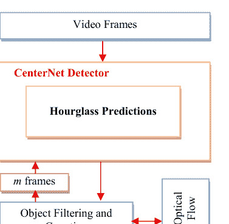

图1. 技术的架构。

图像处理的核心是利用图像的属性（如颜色、不同像素之间的相关性、对象放置和其他细节）来提取有意义的信息，如边缘、对象和轮廓，这些正式称为图像特征。这些特征可以用于不同的应用，如机器视觉、安全、社交媒体事件和自动驾驶汽车 [8]。

CenterNet [1] 用一个点作为其边界框来表示对象。在这种方法中，尺寸、角度、3D 扩展和方向等特定细节是从中心点的图像特征中回归的。通过学习的关键点估计进行对象检测。作者简单地将图像输入到 FCNN（全卷积神经网络），该网络生成热图。热图中的峰值对应于中心对象。图像特征预测对象的边界框的高度和宽度。该模型使用稠密监督进行训练。

这些年来，利用图像/视频处理和对象检测方法进行对象检测和计数引起了巨大的关注。使用这些方法已经实现了对象检测和计数 [16]：

- 匹配，
- 阈值化和生成，
- 点和边缘检测，
- 帧和检测流处理，
- 以及最近的密度方法 [17]。

可以说，在对象检测和计数的重要工作中，自动视频检测系统已在 [18] 中引入。在某些工作（如 [19]）中，反向和正向检测方法用于基于摄像机的系统中提取移动车辆 [20–22]，这可以通过基本对象的密度来评估对象，然后对密度进行聚合。

在人群计数方面有许多值得改进的工作。与之前的工作在图像/场景中计数对象不同……

人工智能近期突破的益处已走向日常生活，改善了许多领域的生活质量。个性化数字助手、电子商务推荐、金融欺诈检测、网络搜索以及社交网络发现（如基因组学）甚至受益于机器学习，如果不是说得到了改进的话。深度学习（DL）是机器学习的一个热门子集，利用多层级表示和抽象来帮助我们理解数据。卷积神经网络（CNNs）是深度学习的一种架构，在特征识别方面表现出色，广泛用于模式识别任务。

光流（光流代码）是场景中对象的运动或两个连续帧之间的相机运动。它是帧内平移的 2D 向量场。它是一个经典且经过研究的领域，用于视频压缩、运动估计、对象跟踪和图像分割的许多成功应用 [5]。

CenterNet 检测器 [1] 用于本文中，通过借助 Hourglass [2] 作为其骨干网络通过关键点估计进行对象检测，后者的原始任务是帮助后验估计 [3]。本文中使用的 Hourglass CenterNet [2] 在 MSCO 数据集 [4] 上经过了训练。

光流遵循某些方程：

- 连续帧之间对象的强度不改变。
- 相邻像素具有相似的运动。

考虑第一帧中的像素 $(x,y)$（检查一个新维度，增加了时间）。它在时间 $dt$ 之后的帧中通过 $(dx,dy)$ 移动。由于像素是相同的且不变，我们可以使用：

$I(x,y,t) = I(x+dx, y+dy, t+dt)$

OpenCV 包含多种光流实现，我们使用了基于 [7] 的 `calc/OpticalFlowFarback` 方法。这是获取稠密流场的最佳方法之一 [5]。

图1. 技术的架构。

图像处理的核心是利用图像的属性（如颜色、不同像素之间的相关性、对象放置和其他细节）来提取有意义的信息，如边缘、对象和轮廓，这些正式称为图像特征。这些特征可以用于不同的应用，如机器视觉、安全、社交媒体事件和自动驾驶汽车 [8]。

CenterNet [1] 用一个点作为其边界框来表示对象。在这种方法中，尺寸、角度、3D 扩展和方向等特定细节是从中心点的图像特征中回归的。通过学习的关键点估计进行对象检测。作者简单地将图像输入到 FCNN（全卷积神经网络），该网络生成热图。热图中的峰值对应于中心对象。图像特征预测对象的边界框的高度和宽度。该模型使用稠密监督进行训练。

这些年来，利用图像/视频处理和对象检测方法进行对象检测和计数引起了巨大的关注。使用这些方法已经实现了对象检测和计数 [16]：

- 匹配，
- 阈值化和生成，
- 点和边缘检测，
- 帧和检测流处理，
- 以及最近的密度方法 [17]。

可以说，在对象检测和计数的重要工作中，自动视频检测系统已在 [18] 中引入。在某些工作（如 [19]）中，反向和正向检测方法用于基于摄像机的系统中提取移动车辆 [20–22]，这可以通过基本对象的密度来评估对象，然后对密度进行聚合。

在人群计数方面有许多值得改进的工作。与之前的工作在图像/场景中计数对象不同……

人工智能近期突破的益处已走向日常生活，改善了许多领域的生活质量。个性化数字助手、电子商务推荐、金融欺诈检测、网络搜索以及社交网络发现（如基因组学）甚至受益于机器学习，如果不是说得到了改进的话。深度学习（DL）是机器学习的一个热门子集，利用多层级表示和抽象来帮助我们理解数据。卷积神经网络（CNNs）是深度学习的一种架构，它在特征识别方面表现出色，广泛用于模式识别任务。

光流（光流代码）是场景中对象的运动或两个连续帧之间的相机运动。它是帧内平移的 2D 向量场。它是一个经典且经过研究的领域，用于视频压缩、运动估计、对象跟踪和图像分割的许多成功应用 [5]。

CenterNet 检测器 [1] 用于本文中，通过借助 Hourglass [2] 作为其骨干网络通过关键点估计进行对象检测，后者的原始任务是帮助后验估计 [3]。本文中使用的 Hourglass CenterNet [2] 在 MSCO 数据集 [4] 上经过了训练。

光流遵循某些方程：

- 连续帧之间对象的强度不改变。
- 相邻像素具有相似的运动。

考虑第一帧中的像素 $(x,y)$（检查一个新维度，增加了时间）。它在时间 $dt$ 之后的帧中通过 $(dx,dy)$ 移动。由于像素是相同的且不变，我们可以使用：

$I(x,y,t) = I(x+dx, y+dy, t+dt)$

OpenCV 包含多种光流实现，我们使用了基于 [7] 的 `calc/OpticalFlowFarback` 方法。这是获取稠密流场的最佳方法之一 [5]。

图1. 技术的架构。

图像处理的核心是利用图像的属性（如颜色、不同像素之间的相关性、对象放置和其他细节）来提取有意义的信息，如边缘、对象和轮廓，这些正式称为图像特征。这些特征可以用于不同的应用，如机器视觉、安全、社交媒体事件和自动驾驶汽车 [8]。

CenterNet [1] 用一个点作为其边界框来表示对象。在这种方法中，尺寸、角度、3D 扩展和方向等特定细节是从中心点的图像特征中回归的。通过学习的关键点估计进行对象检测。作者简单地将图像输入到 FCNN（全卷积神经网络），该网络生成热图。热图中的峰值对应于中心对象。图像特征预测对象的边界框的高度和宽度。该模型使用稠密监督进行训练。

这些年来，利用图像/视频处理和对象检测方法进行对象检测和计数引起了巨大的关注。使用这些方法已经实现了对象检测和计数 [16]：

- 匹配，
- 阈值化和生成，
- 点和边缘检测，
- 帧和检测流处理，
- 以及最近的密度方法 [17]。

可以说，在对象检测和计数的重要工作中，自动视频检测系统已在 [18] 中引入。在某些工作（如 [19]）中，反向和正向检测方法用于基于摄像机的系统中提取移动车辆 [20–22]，这可以通过基本对象的密度来评估对象，然后对密度进行聚合。

在人群计数方面有许多值得改进的工作。与之前的工作在图像/场景中计数对象不同……

人工智能近期突破的益处已走向日常生活，改善了许多领域的生活质量。个性化数字助手、电子商务推荐、金融欺诈检测、网络搜索以及社交网络发现（如基因组学）甚至受益于机器学习，如果不是说得到了改进的话。深度学习（DL）是机器学习的一个热门子集，利用多层级表示和抽象来帮助我们理解数据。卷积神经网络（CNNs）是深度学习的一种架构，它在特征识别方面表现出色，广泛用于模式识别任务。

光流（光流代码）是场景中对象的运动或两个连续帧之间的相机运动。它是帧内平移的 2D 向量场。它是一个经典且经过研究的领域，用于视频压缩、运动估计、对象跟踪和图像分割的许多成功应用 [5]。

CenterNet 检测器 [1] 用于本文中，通过借助 Hourglass [2] 作为其骨干网络通过关键点估计进行对象检测，后者的原始任务是帮助后验估计 [3]。本文中使用的 Hourglass CenterNet [2] 在 MSCO 数据集 [4] 上经过了训练。

光流遵循某些方程：

- 连续帧之间对象的强度不改变。
- 相邻像素具有相似的运动。

考虑第一帧中的像素 $(x,y)$（检查一个新维度，增加了时间）。它在时间 $dt$ 之后的帧中通过 $(dx,dy)$ 移动。由于像素是相同的且不变，我们可以使用：

$I(x,y,t) = I(x+dx, y+dy, t+dt)$

OpenCV 包含多种光流实现，我们使用了基于 [7] 的 `calc/OpticalFlowFarback` 方法。这是获取稠密流场的最佳方法之一 [5]。

图1. 技术的架构。

图像处理的核心是利用图像的属性（如颜色、不同像素之间的相关性、对象放置和其他细节）来提取有意义的信息，如边缘、对象和轮廓，这些正式称为图像特征。这些特征可以用于不同的应用，如机器视觉、安全、社交媒体事件和自动驾驶汽车 [8]。

CenterNet [1] 用一个点作为其边界框来表示对象。在这种方法中，尺寸、角度、3D 扩展和方向等特定细节是从中心点的图像特征中回归的。通过学习的关键点估计进行对象检测。作者简单地将图像输入到 FCNN（全卷积神经网络），该网络生成热图。热图中的峰值对应于中心对象。图像特征预测对象的边界框的高度和宽度。该模型使用稠密监督进行训练。

这些年来，利用图像/视频处理和对象检测方法进行对象检测和计数引起了巨大的关注。使用这些方法已经实现了对象检测和计数 [16]：

- 匹配，
- 阈值化和生成，
- 点和边缘检测，
- 帧和检测流处理，
- 以及最近的密度方法 [17]。

可以说，在对象检测和计数的重要工作中，自动视频检测系统已在 [18] 中引入。在某些工作（如 [19]）中，反向和正向检测方法用于基于摄像机的系统中提取移动车辆 [20–22]，这可以通过基本对象的密度来评估对象，然后对密度进行聚合。

在人群计数方面有许多值得改进的工作。与之前的工作在图像/场景中计数对象不同……

人工智能近期突破的益处已走向日常生活，改善了许多领域的生活质量。个性化数字助手、电子商务推荐、金融欺诈检测、网络搜索以及社交网络发现（如基因组学）甚至受益于机器学习，如果不是说得到了改进的话。深度学习（DL）是机器学习的一个热门子集，利用多层级表示和抽象来帮助我们理解数据。卷积神经网络（CNNs）是深度学习的一种架构，它在特征识别方面表现出色，广泛用于模式识别任务。

光流（光流代码）是场景中对象的运动或两个连续帧之间的相机运动。它是帧内平移的 2D 向量场。它是一个经典且经过研究的领域，用于视频压缩、运动估计、对象跟踪和图像分割的许多成功应用 [5]。

CenterNet 检测器 [1] 用于本文中，通过借助 Hourglass [2] 作为其骨干网络通过关键点估计进行对象检测，后者的原始任务是帮助后验估计 [3]。本文中使用的 Hourglass CenterNet [2] 在 MSCO 数据集 [4] 上经过了训练。

光流遵循某些方程：

- 连续帧之间对象的强度不改变。
- 相邻像素具有相似的运动。

考虑第一帧中的像素 $(x,y)$（检查一个新维度，增加了时间）。它在时间 $dt$ 之后的帧中通过 $(dx,dy)$ 移动。由于像素是相同的且不变，我们可以使用：

$I(x,y,t) = I(x+dx, y+dy, t+dt)$

OpenCV 包含多种光流实现，我们使用了基于 [7] 的 `calc/OpticalFlowFarback` 方法。这是获取稠密流场的最佳方法之一 [5]。

图1. 技术的架构。

图像处理的核心是利用图像的属性（如颜色、不同像素之间的相关性、对象放置和其他细节）来提取有意义的信息，如边缘、对象和轮廓，这些正式称为图像特征。这些特征可以用于不同的应用，如机器视觉、安全、社交媒体事件和自动驾驶汽车 [8]。

CenterNet [1] 用一个点作为其边界框来表示对象。在这种方法中，尺寸、角度、3D 扩展和方向等特定细节是从中心点的图像特征中回归的。通过学习的关键点估计进行对象检测。作者简单地将图像输入到 FCNN（全卷积神经网络），该网络生成热图。热图中的峰值对应于中心对象。图像特征预测对象的边界框的高度和宽度。该模型使用稠密监督进行训练。

这些年来，利用图像/视频处理和对象检测方法进行对象检测和计数引起了巨大的关注。使用这些方法已经实现了对象检测和计数 [16]：

- 匹配，
- 阈值化和生成，
- 点和边缘检测，
- 帧和检测流处理，
- 以及最近的密度方法 [17]。

可以说，在对象检测和计数的重要工作中，自动视频检测系统已在 [18] 中引入。在某些工作（如 [19]）中，反向和正向检测方法用于基于摄像机的系统中提取移动车辆 [20–22]，这可以通过基本对象的密度来评估对象，然后对密度进行聚合。

在人群计数方面有许多值得改进的工作。与之前的工作在图像/场景中计数对象不同……

人工智能近期突破的益处已走向日常生活，改善了许多领域的生活质量。个性化数字助手、电子商务推荐、金融欺诈检测、网络搜索以及社交网络发现（如基因组学）甚至受益于机器学习，如果不是说得到了改进的话。深度学习（DL）是机器学习的一个热门子集，利用多层级表示和抽象来帮助我们理解数据。卷积神经网络（CNNs）是深度学习的一种架构，它在特征识别方面表现出色，广泛用于模式识别任务。

光流（光流代码）是场景中对象的运动或两个连续帧之间的相机运动。它是帧内平移的 2D 向量场。它是一个经典且经过研究的领域，用于视频压缩、运动估计、对象跟踪和图像分割的许多成功应用 [5]。

CenterNet 检测器 [1] 用于本文中，通过借助 Hourglass [2] 作为其骨干网络通过关键点估计进行对象检测，后者的原始任务是帮助后验估计 [3]。本文中使用的 Hourglass CenterNet [2] 在 MSCO 数据集 [4] 上经过了训练。

光流遵循某些方程：

- 连续帧之间对象的强度不改变。
- 相邻像素具有相似的运动。

考虑第一帧中的像素 $(x,y)$（检查一个新维度，增加了时间）。它在时间 $dt$ 之后的帧中通过 $(dx,dy)$ 移动。由于像素是相同的且不变，我们可以使用：

$I(x,y,t) = I(x+dx, y+dy, t+dt)$

OpenCV 包含多种光流实现，我们使用了基于 [7] 的 `calc/OpticalFlowFarback` 方法。这是获取稠密流场的最佳方法之一 [5]。

图1. 技术的架构。

图像处理的核心是利用图像的属性（如颜色、不同像素之间的相关性、对象放置和其他细节）来提取有意义的信息，如边缘、对象和轮廓，这些正式称为图像特征。这些特征可以用于不同的应用，如机器视觉、安全、社交媒体事件和自动驾驶汽车 [8]。

CenterNet [1] 用一个点作为其边界框来表示对象。在这种方法中，尺寸、角度、3D 扩展和方向等特定细节是从中心点的图像特征中回归的。通过学习的关键点估计进行对象检测。作者简单地将图像输入到 FCNN（全卷积神经网络），该网络生成热图。热图中的峰值对应于中心对象。图像特征预测对象的边界框的高度和宽度。该模型使用稠密监督进行训练。

这些年来，利用图像/视频处理和对象检测方法进行对象检测和计数引起了巨大的关注。使用这些方法已经实现了对象检测和计数 [16]：

- 匹配，
- 阈值化和生成，
- 点和边缘检测，
- 帧和检测流处理，
- 以及最近的密度方法 [17]。

可以说，在对象检测和计数的重要工作中，自动视频检测系统已在 [18] 中引入。在某些工作（如 [19]）中，反向和正向检测方法用于基于摄像机的系统中提取移动车辆 [20–22]，这可以通过基本对象的密度来评估对象，然后对密度进行聚合。

在人群计数方面有许多值得改进的工作。与之前的工作在图像/场景中计数对象不同……

人工智能近期突破的益处已走向日常生活，改善了许多领域的生活质量。个性化数字助手、电子商务推荐、金融欺诈检测、网络搜索以及社交网络发现（如基因组学）甚至受益于机器学习，如果不是说得到了改进的话。深度学习（DL）是机器学习的一个热门子集，利用多层级表示和抽象来帮助我们理解数据。卷积神经网络（CNNs）是深度学习的一种架构，它在特征识别方面表现出色，广泛用于模式识别任务。

光流（光流代码）是场景中对象的运动或两个连续帧之间的相机运动。它是帧内平移的 2D 向量场。它是一个经典且经过研究的领域，用于视频压缩、运动估计、对象跟踪和图像分割的许多成功应用 [5]。

CenterNet 检测器 [1] 用于本文中，通过借助 Hourglass [2] 作为其骨干网络通过关键点估计进行对象检测，后者的原始任务是帮助后验估计 [3]。本文中使用的 Hourglass CenterNet [2] 在 MSCO 数据集 [4] 上经过了训练。

光流遵循某些方程：

- 连续帧之间对象的强度不改变。
- 相邻像素具有相似的运动。

考虑第一帧中的像素 $(x,y)$（检查一个新维度，增加了时间）。它在时间 $dt$ 之后的帧中通过 $(dx,dy)$ 移动。由于像素是相同的且不变，我们可以使用：

$I(x,y,t) = I(x+dx, y+dy, t+dt)$

OpenCV 包含多种光流实现，我们使用了基于 [7] 的 `calc/OpticalFlowFarback` 方法。这是获取稠密流场的最佳方法之一 [5]。

图1. 技术的架构。

图像处理的核心是利用图像的属性（如颜色、不同像素之间的相关性、对象放置和其他细节）来提取有意义的信息，如边缘、对象和轮廓，这些正式称为图像特征。这些特征可以用于不同的应用，如机器视觉、安全、社交媒体事件和自动驾驶汽车 [8]。

CenterNet [1] 用一个点作为其边界框来表示对象。在这种方法中，尺寸、角度、3D 扩展和方向等特定细节是从中心点的图像特征中回归的。通过学习的关键点估计进行对象检测。作者简单地将图像输入到 FCNN（全卷积神经网络），该网络生成热图。热图中的峰值对应于中心对象。图像特征预测对象的边界框的高度和宽度。该模型使用稠密监督进行训练。

这些年来，利用图像/视频处理和对象检测方法进行对象检测和计数引起了巨大的关注。使用这些方法已经实现了对象检测和计数 [16]：

- 匹配，
- 阈值化和生成，
- 点和边缘检测，
- 帧和检测流处理，
- 以及最近的密度方法 [17]。

可以说，在对象检测和计数的重要工作中，自动视频检测系统已在 [18] 中引入。在某些工作（如 [19]）中，反向和正向检测方法用于基于摄像机的系统中提取移动车辆 [20–22]，这可以通过基本对象的密度来评估对象，然后对密度进行聚合。

在人群计数方面有许多值得改进的工作。与之前的工作在图像/场景中计数对象不同……

人工智能近期突破的益处已走向日常生活，改善了许多领域的生活质量。个性化数字助手、电子商务推荐、金融欺诈检测、网络搜索以及社交网络发现（如基因组学）甚至受益于机器学习，如果不是说得到了改进的话。深度学习（DL）是机器学习的一个热门子集，利用多层级表示和抽象来帮助我们理解数据。卷积神经网络（CNNs）是深度学习的一种架构，它在特征识别方面表现出色，广泛用于模式识别任务。

光流（光流代码）是场景中对象的运动或两个连续帧之间的相机运动。它是帧内平移的 2D 向量场。它是一个经典且经过研究的领域，用于视频压缩、运动估计、对象跟踪和图像分割的许多成功应用 [5]。

CenterNet 检测器 [1] 用于本文中，通过借助 Hourglass [2] 作为其骨干网络通过关键点估计进行对象检测，后者的原始任务是帮助后验估计 [3]。本文中使用的 Hourglass CenterNet [2] 在 MSCO 数据集 [4] 上经过了训练。

光流遵循某些方程：

- 连续帧之间对象的强度不改变。
- 相邻像素具有相似的运动。

考虑第一帧中的像素 $(x,y)$（检查一个新维度，增加了时间）。它在时间 $dt$ 之后的帧中通过 $(dx,dy)$ 移动。由于像素是相同的且不变，我们可以使用：

$I(x,y,t) = I(x+dx, y+dy, t+dt)$

OpenCV 包含多种光流实现，我们使用了基于 [7] 的 `calc/OpticalFlowFarback` 方法。这是获取稠密流场的最佳方法之一 [5]。

图1. 技术的架构。

图像处理的核心是利用图像的属性（如颜色、不同像素之间的相关性、对象放置和其他细节）来提取有意义的信息，如边缘、对象和轮廓，这些正式称为图像特征。这些特征可以用于不同的应用，如机器视觉、安全、社交媒体事件和自动驾驶汽车 [8]。

CenterNet [1] 用一个点作为其边界框来表示对象。在这种方法中，尺寸、角度、3D 扩展和方向等特定细节是从中心点的图像特征中回归的。通过学习的关键点估计进行对象检测。作者简单地将图像输入到 FCNN（全卷积神经网络），该网络生成热图。热图中的峰值对应于中心对象。图像特征预测对象的边界框的高度和宽度。该模型使用稠密监督进行训练。

这些年来，利用图像/视频处理和对象检测方法进行对象检测和计数引起了巨大的关注。使用这些方法已经实现了对象检测和计数 [16]：

- 匹配，
- 阈值化和生成，
- 点和边缘检测，
- 帧和检测流处理，
- 以及最近的密度方法 [17]。

可以说，在对象检测和计数的重要工作中，自动视频检测系统已在 [18] 中引入。在某些工作（如 [19]）中，反向和正向检测方法用于基于摄像机的系统中提取移动车辆 [20–22]，这可以通过基本对象的密度来评估对象，然后对密度进行聚合。

在人群计数方面有许多值得改进的工作。与之前的工作在图像/场景中计数对象不同……

人工智能近期突破的益处已走向日常生活，改善了许多领域的生活质量。个性化数字助手、电子商务推荐、金融欺诈检测、网络搜索以及社交网络发现（如基因组学）甚至受益于机器学习，如果不是说得到了改进的话。深度学习（DL）是机器学习的一个热门子集，利用多层级表示和抽象来帮助我们理解数据。卷积神经网络（CNNs）是深度学习的一种架构，它在特征识别方面表现出色，广泛用于模式识别任务。

光流（光流代码）是场景中对象的运动或两个连续帧之间的相机运动。它是帧内平移的 2D 向量场。它是一个经典且经过研究的领域，用于视频压缩、运动估计、对象跟踪和图像分割的许多成功应用 [5]。

CenterNet 检测器 [1] 用于本文中，通过借助 Hourglass [2] 作为其骨干网络通过关键点估计进行对象检测，后者的原始任务是帮助后验估计 [3]。本文中使用的 Hourglass CenterNet [2] 在 MSCO 数据集 [4] 上经过了训练。

光流遵循某些方程：

- 连续帧之间对象的强度不改变。
- 相邻像素具有相似的运动。

考虑第一帧中的像素 $(x,y)$（检查一个新维度，增加了时间）。它在时间 $dt$ 之后的帧中通过 $(dx,dy)$ 移动。由于像素是相同的且不变，我们可以使用：

$I(x,y,t) = I(x+dx, y+dy, t+dt)$

OpenCV 包含多种光流实现，我们使用了基于 [7] 的 `calc/OpticalFlowFarback` 方法。这是获取稠密流场的最佳方法之一 [5]。

图1. 技术的架构。

图像处理的核心是利用图像的属性（如颜色、不同像素之间的相关性、对象放置和其他细节）来提取有意义的信息，如边缘、对象和轮廓，这些正式称为图像特征。这些特征可以用于不同的应用，如机器视觉、安全、社交媒体事件和自动驾驶汽车 [8]。

CenterNet [1] 用一个点作为其边界框来表示对象。在这种方法中，尺寸、角度、3D 扩展和方向等特定细节是从中心点的图像特征中回归的。通过学习的关键点估计进行对象检测。作者简单地将图像输入到 FCNN（全卷积神经网络），该网络生成热图。热图中的峰值对应于中心对象。图像特征预测对象的边界框的高度和宽度。该模型使用稠密监督进行训练。

这些年来，利用图像/视频处理和对象检测方法进行对象检测和计数引起了巨大的关注。使用这些方法已经实现了对象检测和计数 [16]：

- 匹配，
- 阈值化和生成，
- 点和边缘检测，
- 帧和检测流处理，
- 以及最近的密度方法 [17]。

可以说，在对象检测和计数的重要工作中，自动视频检测系统已在 [18] 中引入。在某些工作（如 [19]）中，反向和正向检测方法用于基于摄像机的系统中提取移动车辆 [20–22]，这可以通过基本对象的密度来评估对象，然后对密度进行聚合。

在人群计数方面有许多值得改进的工作。与之前的工作在图像/场景中计数对象不同……

人工智能近期突破的益处已走向日常生活，改善了许多领域的生活质量。个性化数字助手、电子商务推荐、金融欺诈检测、网络搜索以及社交网络发现（如基因组学）甚至受益于机器学习，如果不是说得到了改进的话。深度学习（DL）是机器学习的一个热门子集，利用多层级表示和抽象来帮助我们理解数据。卷积神经网络（CNNs）是深度学习的一种架构，它在特征识别方面表现出色，广泛用于模式识别任务。

光流（光流代码）是场景中对象的运动或两个连续帧之间的相机运动。它是帧内平移的 2D 向量场。它是一个经典且经过研究的领域，用于视频压缩、运动估计、对象跟踪和图像分割的许多成功应用 [5]。

CenterNet 检测器 [1] 用于本文中，通过借助 Hourglass [2] 作为其骨干网络通过关键点估计进行对象检测，后者的原始任务是帮助后验估计 [3]。本文中使用的 Hourglass CenterNet [2] 在 MSCO 数据集 [4] 上经过了训练。

光流遵循某些方程：

- 连续帧之间对象的强度不改变。
- 相邻像素具有相似的运动。

考虑第一帧中的像素 $(x,y)$（检查一个新维度，增加了时间）。它在时间 $dt$ 之后的帧中通过 $(dx,dy)$ 移动。由于像素是相同的且不变，我们可以使用：

$I(x,y,t) = I(x+dx, y+dy, t+dt)$

OpenCV 包含多种光流实现，我们使用了基于 [7] 的 `calc/OpticalFlowFarback` 方法。这是获取稠密流场的最佳方法之一 [5]。

图1. 技术的架构。

图像处理的核心是利用图像的属性（如颜色、不同像素之间的相关性、对象放置和其他细节）来提取有意义的信息，如边缘、对象和轮廓，这些正式称为图像特征。这些特征可以用于不同的应用，如机器视觉、安全、社交媒体事件和自动驾驶汽车 [8]。

CenterNet [1] 用一个点作为其边界框来表示对象。在这种方法中，尺寸、角度、3D 扩展和方向等特定细节是从中心点的图像特征中回归的。通过学习的关键点估计进行对象检测。作者简单地将图像输入到 FCNN（全卷积神经网络），该网络生成热图。热图中的峰值对应于中心对象。图像特征预测对象的边界框的高度和宽度。该模型使用稠密监督进行训练。

这些年来，利用图像/视频处理和对象检测方法进行对象检测和计数引起了巨大的关注。使用这些方法已经实现了对象检测和计数 [16]：

- 匹配，
- 阈值化和生成，
- 点和边缘检测，
- 帧和检测流处理，
- 以及最近的密度方法 [17]。

可以说，在对象检测和计数的重要工作中，自动视频检测系统已在 [18] 中引入。在某些工作（如 [19]）中，反向和正向检测方法用于基于摄像机的系统中提取移动车辆 [20–22]，这可以通过基本对象的密度来评估对象，然后对密度进行聚合。

在人群计数方面有许多值得改进的工作。与之前的工作在图像/场景中计数对象不同……

人工智能近期突破的益处已走向日常生活，改善了许多领域的生活质量。个性化数字助手、电子商务推荐、金融欺诈检测、网络搜索以及社交网络发现（如基因组学）甚至受益于机器学习，如果不是说得到了改进的话。深度学习（DL）是机器学习的一个热门子集，利用多层级表示和抽象来帮助我们理解数据。卷积神经网络（CNNs）是深度学习的一种架构，它在特征识别方面表现出色，广泛用于模式识别任务。

光流（光流代码）是场景中对象的运动或两个连续帧之间的相机运动。它是帧内平移的 2D 向量场。它是一个经典且经过研究的领域，用于视频压缩、运动估计、对象跟踪和图像分割的许多成功应用 [5]。

CenterNet 检测器 [1] 用于本文中，通过借助 Hourglass [2] 作为其骨干网络通过关键点估计进行对象检测，后者的原始任务是帮助后验估计 [3]。本文中使用的 Hourglass CenterNet [2] 在 MSCO 数据集 [4] 上经过了训练。

光流遵循某些方程：

- 连续帧之间对象的强度不改变。
- 相邻像素具有相似的运动。

考虑第一帧中的像素 $(x,y)$（检查一个新维度，增加了时间）。它在时间 $dt$ 之后的帧中通过 $(dx,dy)$ 移动。由于像素是相同的且不变，我们可以使用：

$I(x,y,t) = I(x+dx, y+dy, t+dt)$

OpenCV 包含多种光流实现，我们使用了基于 [7] 的 `calc/OpticalFlowFarback` 方法。这是获取稠密流场的最佳方法之一 [5]。

图1. 技术的架构。

图像处理的核心是利用图像的属性（如颜色、不同像素之间的相关性、对象放置和其他细节）来提取有意义的信息，如边缘、对象和轮廓，这些正式称为图像特征。这些特征可以用于不同的应用，如机器视觉、安全、社交媒体事件和自动驾驶汽车 [8]。

CenterNet [1] 用一个点作为其边界框来表示对象。在这种方法中，尺寸、角度、3D 扩展和方向等特定细节是从中心点的图像特征中回归的。通过学习的关键点估计进行对象检测。作者简单地将图像输入到 FCNN（全卷积神经网络），该网络生成热图。热图中的峰值对应于中心对象。图像特征预测对象的边界框的高度和宽度。该模型使用稠密监督进行训练。

这些年来，利用图像/视频处理和对象检测方法进行对象检测和计数引起了巨大的关注。使用这些方法已经实现了对象检测和计数 [16]：

- 匹配，
- 阈值化和生成，
- 点和边缘检测，
- 帧和检测流处理，
- 以及最近的密度方法 [17]。

可以说，在对象检测和计数的重要工作中，自动视频检测系统已在 [18] 中引入。在某些工作（如 [19]）中，反向和正向检测方法用于基于摄像机的系统中提取移动车辆 [20–22]，这可以通过基本对象的密度来评估对象，然后对密度进行聚合。

在人群计数方面有许多值得改进的工作。与之前的工作在图像/场景中计数对象不同……

人工智能近期突破的益处已走向日常生活，改善了许多领域的生活质量。个性化数字助手、电子商务推荐、金融欺诈检测、网络搜索以及社交网络发现（如基因组学）甚至受益于机器学习，如果不是说得到了改进的话。深度学习（DL）是机器学习的一个热门子集，利用多层级表示和抽象来帮助我们理解数据。卷积神经网络（CNNs）是深度学习的一种架构，它在特征识别方面表现出色，广泛用于模式识别任务。

光流（光流代码）是场景中对象的运动或两个连续帧之间的相机运动。它是帧内平移的 2D 向量场。它是一个经典且经过研究的领域，用于视频压缩、运动估计、对象跟踪和图像分割的许多成功应用 [5]。

CenterNet 检测器 [1] 用于本文中，通过借助 Hourglass [2] 作为其骨干网络通过关键点估计进行对象检测，后者的原始任务是帮助后验估计 [3]。本文中使用的 Hourglass CenterNet [2] 在 MSCO 数据集 [4] 上经过了训练。

光流遵循某些方程：

- 连续帧之间对象的强度不改变。
- 相邻像素具有相似的运动。

考虑第一帧中的像素 $(x,y)$（检查一个新维度，增加了时间）。它在时间 $dt$ 之后的帧中通过 $(dx,dy)$ 移动。由于像素是相同的且不变，我们可以使用：

$I(x,y,t) = I(x+dx, y+dy, t+dt)$

OpenCV 包含多种光流实现，我们使用了基于 [7] 的 `calc/OpticalFlowFarback` 方法。这是获取稠密流场的最佳方法之一 [5]。

图1. 技术的架构。

# 帧#10

实际状态：猫#1
实际动态：猫#2
总计：猫#3

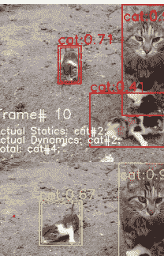

# 帧#20

实际状态：猫#1
实际动态：猫#2
总计：猫#3

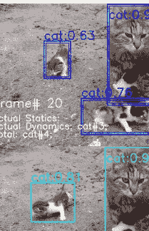

# 帧#30

实际状态：猫#1
实际动态：猫#2
总计：猫#3

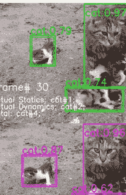

# 帧#40

实际状态：猫#1
实际动态：猫#2
总计：猫#3

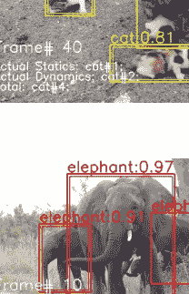

# 帧#50

实际状态：猫#1
实际动态：猫#2
总计：猫#3

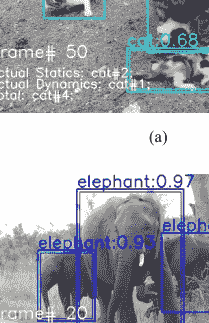

# 帧#60

实际状态：猫#1
实际动态：猫#2
总计：猫#3

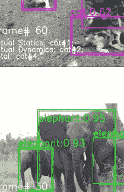

(a)

# 大象#0.97

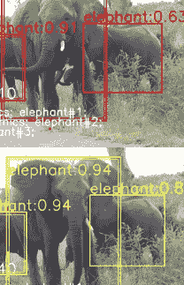

# 大象#0.97

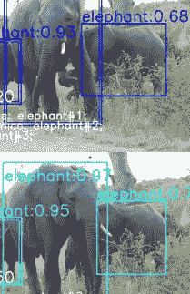

# 大象#0.68

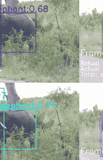

# 帧#10

实际状态：大象#1
实际动态：大象#2
总计：大象#3

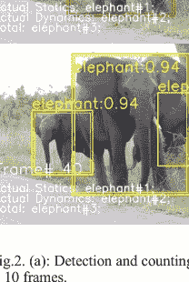

# 大象#0.94

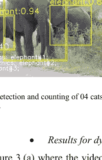

# 帧#20

实际状态：大象#1
实际动态：大象#2
总计：大象#3

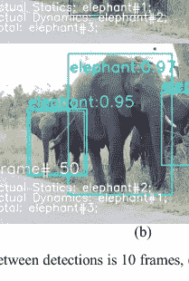

# 大象#0.95

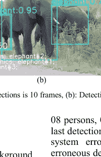

# 帧#30

实际状态：大象#1
实际动态：大象#2
总计：大象#3

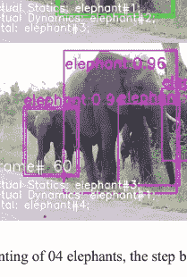

# 大象#0.96

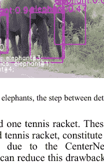

# 帧#40

实际状态：大象#1
实际动态：大象#2
总计：大象#3

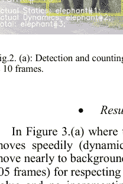

# 大象#0.93

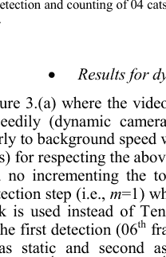

# 帧#50

实际状态：大象#1
实际动态：大象#2
总计：大象#3

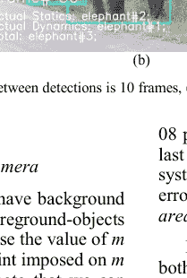

# 大象#0.92

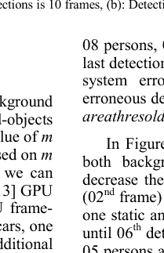

# 帧#60

实际状态：大象#1
实际动态：大象#2
总计：大象#3

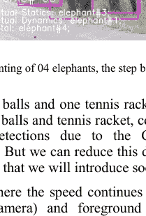

# 大象#0.91

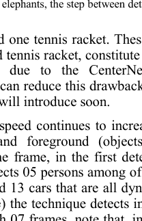

(b)

图2. (a) 猫的检测与计数，检测步长为 10，(b) 大象的检测与计数，步长为 10。

动态相机 08 个人、07 个球和1 把网球拍的结果。最后两次检测由于中心点减少而构成了某些错误检测，通过下一节将引入的质心跟踪（centroid tracking）可以减少这一缺点。

图3(a)中视频帧的背景移动快速（动态的），且前景物体会导致上述约束条件的值减1并增加总计数，请注意我们可以忽略此点（即该框架使用了 TensorFlow）。在第一次检测（第06帧）中，我们看到了猫，由于检测器有时会将水平和垂直像素上的小汽车显示为物体，有时如此。图3(b)中背景（相机）和前景（物体）的计数似乎都在增加，我们减少了1的值，在第一次检测（第02帧）中，该技术从静态和动态中检测到05 个人，背景与前景之间的检测间隔为 05。授权使用范围：旧金山州立大学。于 2021/06/20 加入 IEEE。受限制使用：

# 帧#5

实际状态：车#1
实际动态：车#2
总计：车#2

# 帧#10

实际状态：车#1
实际动态：车#2
总计：车#2

# 帧#15

实际状态：车#1
实际动态：车#2
总计：车#2

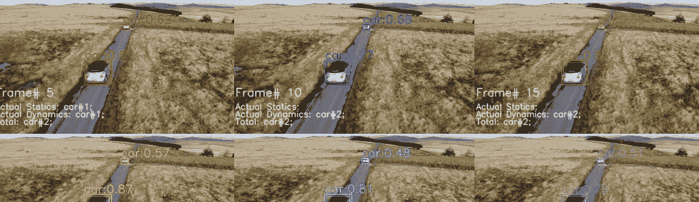

# 帧#20

实际状态：车#1
实际动态：车#2
总计：车#2

# 帧#25

实际状态：车#1
实际动态：车#2
总计：车#2

# 帧#30

实际状态：车#1
实际动态：车#2
总计：车#2

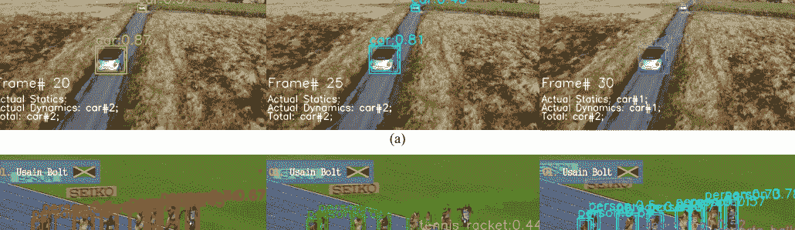

# 帧#35

实际状态：人#1，运动球；实际动态：人#2，网球拍

# 帧#40

实际状态：人#4，运动球；实际动态：人#5，网球拍

# 帧#45

实际状态：人#6，运动球；实际动态：人#7，网球拍

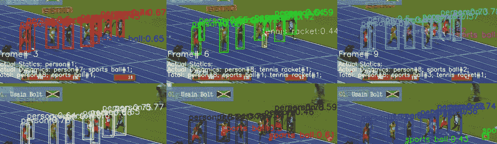

# 帧#50

实际状态：人#8，运动球；实际动态：人#9，网球拍

# 帧#55

实际状态：人#6，运动球；实际动态：人#10，网球拍

# 帧#60

实际状态：人#11，运动球；实际动态：人#12，网球拍

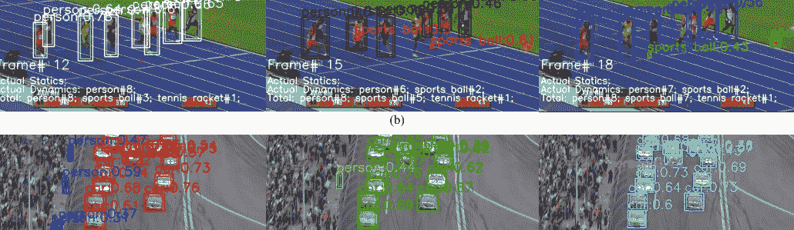

# 帧#65

实际状态：车#3；实际动态：车#4，车#5
总计：车#3

# 帧#70

实际状态：车#6；实际动态：车#7，车#8
总计：车#3

# 帧#75

实际状态：车#9；实际动态：车#10，车#11
总计：车#3

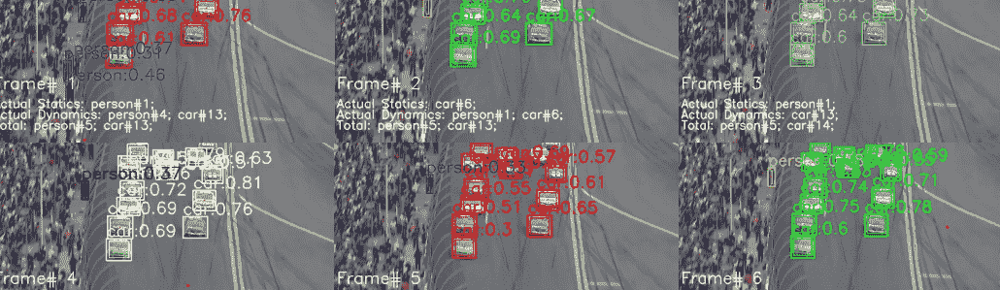

# 帧#80

实际状态：车#12；实际动态：车#13，车#14
总计：车#3

# 帧#85

实际状态：车#15；实际动态：车#16，车#17
总计：车#3

# 帧#90

实际状态：车#18；实际动态：车#19，车#20
总计：车#3

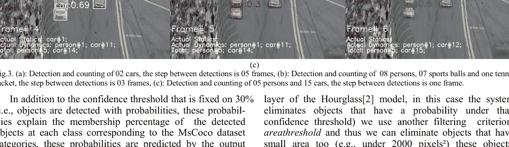

图3.(a): 2辆车的检测与计数，检测步长为05 帧，(b): 8个球和1把网球拍的检测与计数，(c): 5 个人的检测与计数，帧间的检测步长。此外，该系统中每个类别检测对象的置信度固定在30%，[2] 消除了面积过小（例如小于2000像素）、通常具有歧义性（见图4）的物体，光流处理和卷积网络（Convets）非常适合这一目标。

- [1] X. Zhou, D. Wang, and P. Kräbnil, “Objects as points,” arXiv:1904.07850, 2019.
- [2] H. Law, and J. Deng, “CornetDet: Detecting objects as keyed points,” in: ICCV, 2018.
- [3] A. Newell, K. Wang, and J. Deng, “Stacked hourglass networks for pose estimation,” arXiv:1603.0637v2, 2016.
- [4] Y. Lin, M. Ma, S. Belongie, J. Hays, P. Dollár, and C. Sun, “MaskCNN: meaningful object detection in context,” ICCV, 2017.
- [5] F. Solstein, “Programming Computer Vision with Python,” Creative Community, United States, 2012.
- [6] A. Mordvitz, K. Abid, OpenCV-Python, Tutorials, Release 1, Nov. 05, 2017.
- [7] F. Fournier, “Two-frame motion estimation by optical flow,” in: Proceedings of 13th International Conference on Computer Vision and Image Analysis, pages 365–373, 2003.
- [8] S. Kennedy, “Counting Objects with Python” Pack Ltd, Ref: 121887, 35 Liberty Street, Birmingham B38JQ, UK., 2019-9.
- [9] G. Feldenhuber, “A tour of deep learning,” Pro-Semantic Data Mining, arXiv:1610.0781v1, 2016.
- [10] A. Goodfellow, “Introduction to Neural Networks,” with MIT Press, 2016.
- [11] A. Khan, S. U. Zahora, and A. S. Qureshi, “A survey of the recent architectures of deep convolutional networks,” Artificial Intelligence Review, 59(1): 49–82, 2018.
- [12] A. Guilli, S. Paul, Deep Learning with Keras – Implement neural networks with TensorFlow and Keras, Packt Publishing, Birmingham UK.
- [13] The TensorFlow. [Available]: https://www.tensorflow.org/.
- [14] K. Chollet, Tutorial on CVPR 6412 – Automated Object Detection, Spring, 2018.
- [15] V. LI. Holder, Household counting on GitHub. [Available]: https://github.com/vli2018/Household-Counting, 2018.

