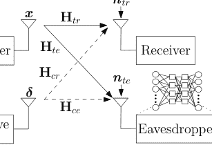
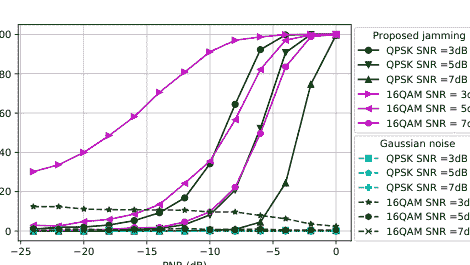
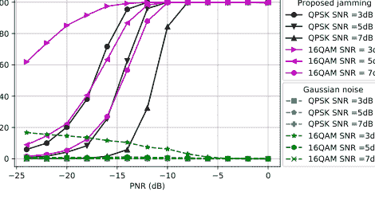
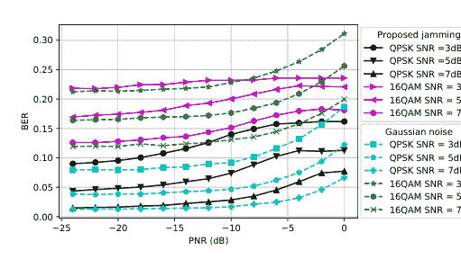
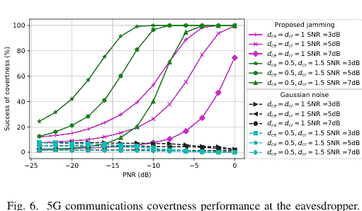
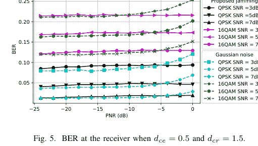
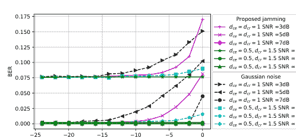

# 2020 第54届阿西洛马信号、系统与计算机会议论文｜如何实现 5G 通信


Brian Kim¹, Yalin E. Sagduyer², Kemal Davlioglu², Tugba Erpek², and Sennur Ulukus¹

*美国马里兰州大学帕克大学分校电气与计算机工程系，MD 20742
²美国马里兰州罗克维尔 Intelligent Automation 公司，MD 20855

**摘要—** 我们考虑了从深度学习（DL）分类器检测是否存在传输的窃听者隐藏通信的问题。我们证明了发射机可以欺骗窃听者的接收端，而隐蔽干扰可以将对抗扰动作为噪声引入接收到的信号中。我们展示了这种对抗扰动会导致窃听者以高概率将信号误分类为噪声，并进一步证明了如果窃听者使用 DL 分类器检测传输，任何 5G 通信都可以从其视线中有效隐藏。

本文从对抗机器学习（AML）的角度涵盖了隐蔽通信。AML 研究的是存在可能试图操纵或干扰机器学习算法训练过程的攻击者时的机器学习（ML）问题 [7–9]。在计算机视觉领域，AML 的起源是对将 AML 应用于无线通信日益增长兴趣，包括探索性（推理）、因果性（投毒）、规避和欺骗攻击 [10–16]。

## I. 引言

由于无线介质的开放和共享特性，信息隐私是无线通信中的一个基础问题。隐蔽通信由一对发射机-接收机组成，旨在隐藏从发射机到接收机的通信。接收机必须确定是否存在传输。防止未经授权解码的信息隐私已从安全信息理论角度得到了广泛研究 [1], [2]。在本文中，我们考虑一个追求第二个目标的窃听者，即检测正在进行的传输。一旦检测到传输，可以使用干扰阻塞通信。

隐蔽通信已在隐藏信息方面得到了研究，其主要目标必须是降低攻击者的信噪比（SNR）[3], [4]。在保持通信隐蔽的同时，针对给定的信道数量总发射功率已建立了一个基础界限，这通常被称为平方根律 [5]；另见相关工作。

我们考虑一个具有深度学习（DL）分类器的窃听者，该分类器在检测从噪声中接收的信号时存在不准确性。我们引入了在物理层安全中被广泛使用的协作干扰器（CJ）[17–19]。本文中，CJ 与发射机同步传输误差，目的是误分类窃听者的分类器。这被视为隐蔽干扰，旨在防止窃听者将正在进行的传输与噪声区分开来。

我们使用 CJ 作为对抗扰动的源来欺骗窃听者的分类器。CJ 添加的大扰动可以轻易欺骗分类器，但同时会将目标接收处的干扰和比特率（RATE）增加到不可接受的水平。根据 [27] 中考虑的方法（即发射机对其信号添加扰动以欺骗机器分类器同时保持其性能），我们的重点是受 CJ 辅助的隐蔽通信，CJ 重点影响窃听者将接收到的信号分类为噪声，同时降低网络性能。欺骗分类器将信号误分类为噪声（如本文考虑的）比插入此类干扰攻击（如 [27] 中考虑的）要困难得多。在评估中，我们使用了各种调制方案（QPSK 和 QAM），并证明了我们可以从使用 DL 分类器检测传输的窃听者处有效隐藏这些信号。



图 1. 系统模型。

由于来自 CJ 的扰动不仅在窃听者处产生干扰，在接收处也是如此，因此 CJ 通过使用固定功率预算确定其 $\delta$，以导致窃听者的误分类，同时该预算也限制了接收处的 BER。最后，CJ 通过求解以下优化问题首先确定 $\delta$：

$$\arg \min_{\delta} ||\delta||_2 \text{ s.t. } l(r_{te}, \delta) \neq l(r_{te}, \delta^*), ||\delta|| \leq P_{max}$$

选择 CJ 的扰动是为了在成功欺骗窃听者的条件条件下，最小化扰动强度，以及一个可以转换为接收处 BER 的扰动功率上限。我们证明了高斯噪声不足以构成对抗攻击，并开发了一种算法来优化 CJ 的扰动，以便轻松覆盖我们为不同调制类型和 5G 通信所演示的通信。

$\delta^{(4)}$ 在接收处的 BER 中求解，可以通过相应地设置 $P_{max}$ 来捕获。由于求解方程 (4)，计算领域已经提出了不同的方法来近似对抗扰动，例如快速梯度法 [7]。FGM 通过在 $x$ 处线性化 DNN 分类器的损失函数（其中 $y$ 是标签向量）来构建对抗样本，在计算上是高效的。对于优化，我们考虑了有目标攻击，即 CJ 的扰动旨在将接收信号误分类为噪声，同时降低网络性能。

## II. 系统模型

我们考虑一个由发射机、接收机和窃听者组成的无线系统，如图 1 所示。发射机发送 $x \in \mathcal{C}$，调制类型为 $g: \{0,1\} \to \mathcal{C}$，其中 $m$ 是二进制消息。窃听者接收到 $r_{te} = h_{te}x + n_{te}$，其中 $h_{te} = [h_{te1}, ..., h_{tep}] \in \mathcal{C}^p$ 是信道，$n_{te}$ 是高斯噪声。接收机接收到 $r_{tr} = h_{tr}x + n_{tr}$，其中 $h_{tr}$ 是信道，$n_{tr}$ 是高斯噪声。CJ 扰动 $\delta \in \mathcal{C}$ 以导致窃听者的误分类，产生 $r_{te}(\delta) = h_{te}(x+\delta) + n_{te}$。

## III. CJ 的对抗扰动

在本节中，我们使用 (4) 中的 FGM 描述 CJ 的白盒。对于目标攻击，我们对 $\delta$ 优化 $l(r_{te}, \delta^*)$，其中 $y$ 是 one-hot 解码类。我们将 $y$ 固定为噪声，因为 CJ 总是尝试添加扰动来欺骗窃听者认为是接收信号。我们使用 FGM 线性化损失 $l(r_{te}, \delta) = l(r_{te}, 0) + \nabla_{\delta}l(r_{te}, 0)^T\delta$，然后通过设置 $\delta = -\alpha\nabla_{\delta}l(r_{te}, 0)$ 来最小化它，其中 $\alpha$ 是一个将对抗功率限制在 $P_{max}$ 的缩放因子。之后，如果误分类满足功率约束，CJ 将保持接收处的 BER。扰动功率可以进一步调整以满足目标 BER 水平。

## IV. 仿真设置

我们分析了 CJ 实现正确性的成功以及对接收处 BER 的相应影响。我们将此扰动与对比


## 算法 1：生成 CJ 的扰动

```
Inputs: $\varepsilon_{min}$ 期望精度 $\varepsilon_{acc}$, 功率约束 $p_{max}$ 以及 $L(\theta, \cdot) \leftarrow 0$
Initialize: $\theta \leftarrow 0, p \leftarrow \sqrt{p_{max}}$
$\delta_{\theta} \leftarrow \delta_{\theta} - \eta \nabla_{\theta} L(\theta, y)$
While $\varepsilon_{avg} > \varepsilon_{min}$
	$\varepsilon_{avg} \leftarrow (\varepsilon_{max} + \varepsilon_{min})/2$
	$x_{cd} \leftarrow x_{cd} - \varepsilon \delta_{x}$
	if $(|x_{cd}| \neq \text{noise})$ then $\varepsilon_{min} \leftarrow \varepsilon_{avg}$
	$\varepsilon_{max} \leftarrow \varepsilon_{max} - \varepsilon$
end
$\theta \leftarrow \theta - \gamma \delta_{\theta}$
```



图. 2. 当 $d_{ce}=d_{cr} = 1$ 时窃听者的成功率。

CJ 传输的高斯噪声。此外，我们改变 CJ 的位置以研究拓扑和通道的影响。我们假设二进制数据在接收端均匀且独立地生成。分类器是一个卷积神经网络（CNN）。该 CNN 在两个维度 (2,16) 上处理 16 相/Q I/O 数据样本。CNN 包含一个卷积核大小为 (1,3) 的卷积层，丢弃率为 0.1。隐藏层使用激活函数，输出层使用 softmax 激活以产生信号标签。我们使用带有 Adam 优化器的反向传播算法通过交叉熵损失训练 CNN。据此实现了 CJ。我们假设窃听者已经通过 CJ 知晓信号。因此，分类器仅用两个标签：信号和噪声进行训练。对于每种信号类型，我们使用数据集训练不同的分类器，该数据集包含 20000 个符号，并分为 16 个 QPSK 块。节点之间的通道建模为：从节点 $i$ 到节点 $j$ 的通道增益为 $d_{ij}$，其中 $d_{ij}$ 是 $i$ 和 $j$ 之间的距离，衰减系数 $\gamma$ 是路 损耗。通过仿真，我们设置 $d = 1$ 且 $\gamma = 2.8$。我们参考 [25] 引入其他通道方法，包括阴影效应和小尺度衰落等衰落效应。



图. 3. 当 $d_{ce} = 0.5$ 且 $d_{cr} = 1$ 时窃听者的成功率。

我们使用 [24] 中的扰动噪声指标 (PNR) 来捕捉 CJ 相对于噪声的相对扰动。PNR 越高，窃听者分类器的准确性就越高。随着 PNR 的增加，CJ 生成的扰动更容易被窃听者检测，并增加接收端的误码率 (BER)。

显示了窃听者分类器处 CJ 生成的扰动信号。x 轴是 PNR（以 dB 为单位），y 轴是成功率（以百分比表示），表示实现无线通信隐蔽性的成功，即窃听者分类器加上扰动噪声。我们观察到，随着信号 SNR 的增加，CJ 需要更多的扰动才能窃听者处引起误分类。16QAM 信号比 QPSK 信号更容易受到扰动的影响，使其分类更困难。此外，我们观察到两种信号的扰动在达到某些 PNR 值后，成功率都会突然下降。相反，基于高斯的扰动对所有 SNR 值的分类器影响均忽略不计。我们观察到功率高斯噪声降低了信号的 SNR，当信号 SNR 为 3 dB 时，高斯噪声（实际上的高斯噪声类信号）被分类为窃听者。

# V. 不同模型信号性能评估

## A. 通信的鲁棒性

我们的目标是通过发射器隐藏固定调制方案（即 QPSK 或 16QAM）的信号。我们考虑的第一种拓扑是 $d_{ce}=d_{cr}=1$。在图 2 中，我们——

在图 3 中，$d_{ce}=0.5$ 且 $d_{cr}=1$（接近），CJ 与接收端之间的距离被接收，CJ 与窃听者之间的距离与图 2 相比。随着信号 SNR 的增加，CJ 需要更大的功率才能在窃听者处引起误分类，我们在图 2 中也观察到了这一点。由于 CJ 和窃听者之间路损效应的降低，







图 5 显示了当 $d_{ce}=0.5$ 且 $d_{cr}=1$ 时，不同类型和 SNR 值的接收端 BER 性能。我们观察到，相同 SNR 值下，高斯噪声和对抗扰动下的 BER 性能由于 CI 和 CJ 之间影响的增加而下降。因此，如果 CI 更靠近窃听者，CJ 可以在不增加功率的情况下产生导致误分类的扰动。这促使控制 CJ 位置以提高预期接收端的性能。这促使使用 AML 代替传统的干扰 ([28]) 来攻击窃听者。

## B. 通信的可靠性

图 4 显示了当 $d_{ce}=d_{cr}=1$ 时，不同调制和 SNR 值的接收端 BER 性能。16QAM 调制信号比 QPSK 调制信号更容易受到扰动的影响。其原因是 16QAM 传输的比特比 QPSK 多，点点之间的距离更小，导致在给定 SNR 下产生较大的 BER。此外，随着 SNR 的增加，BER 如预期般下降。通过观察到的对抗扰动，我们发现 BER 在达到某些 PNR 值后趋于饱和，因为可以使用小于最大功率的生成成功的扰动。例如，为了达到 QPSK 调制信号 15% 的目标 BER，PNR 选择为 3dB，收敛成功率为 65%。此外，我们观察到在低 PNR 区域，基于噪声的扰动结果优于对抗扰动，且随着 PNR 的增加 BER 会下降。

# VI. SG 通信的性能评估

我们考虑物理通信，在 CJ 干扰存在，用户设备 (UE) 向基站 (gNB) 发送上行信号。使用 MATLAB 生成共享信道信号。传输块由循环冗余校验 (CRC) 生成，低稀疏校验码 (LDPC) 用于前向纠错。输出由带有循环前缀 (CP) 的 OFDM 波形生成，其中载波在通过信道后进行 QPSK 解调、LDPC 和 CRC 解。

## A. 通信概述

图 6 显示了收敛成功。正如我们在之前的 QPSK 调制和 16QAM 调制图中所示，在高 SNR 区域，提出的干扰优于高斯噪声。我们还观察到，当 CJ 和窃听者之间的距离增加时，CJ 需要更大的功率来分类窃听者。



图 7. 接收端高斯通信 BER 性能。

## 通信的可靠性

图 7 显示了通信 BER。当 $d_{cc}=1$ dB 且 $N=5$ 时，基于噪声的扰动不仅提高了正确性，还对接收端的 BER 性能产生了影响。我们进一步观察到，当 $d_{cc}=0.5$ dB，$d_{a}=1.5$ dB 时，基于噪声的扰动优于对抗扰动。

## 结论

我们考虑了一种使用 CJ 生成噪声的通信系统。遵循 AML 方法，对于修改后的信号和伪造信号，我们显示 CJ 可以产生导致窃听者误分类的扰动，而接收端的 BER 仅受到轻微影响。另一方面，带高斯噪声无法欺骗分类器。这些结果证明了使用 CJ 进行对抗分类器攻击的可行性。

## 参考文献

[1] A. Y. Sheng and J. Sukhwani, “Wireless, privacy-based security: Lessons from information theory,” Proceedings of the IEEE, vol. 103, no. 10, pp. 1814–1825, 2015.
[2] H. Wang and P. H. Vu, “Communication security under channel uncertainty and adversarial attacks,” Proceedings of the IEEE, vol. 103, no. 10, pp. 1796–1813, 2015.
[3] M. Zhang, Y. Liu, and others, “Robust communication over noisy channels: A reliability perspective,” IEEE Transactions on Information Theory, vol. 62, no. 5, pp. 2334–2354, 2016.
[4] J. Chen, J. Wang, and L. Zheng, “Fundamental limits of communication with low reliability,” IEEE Transactions on Information Theory, vol. 62, no. 6, pp. 3493–3503, 2016.
[5] B. Xu, Y. Zhang, and T. Zhou, “Robust information hiding in noise: fundamental limits of covert communication,” IEEE Communications Magazine, vol. 12, no. 53, pp. 26–31, 2015.
[6] M. Pokharel and S. Sukhwani, “Covert bit through queries,” in IEEE ICC, 2016, pp. 626–630.
[7] A. Kurakin, T. Goodfellow, and S. Beng, “Adversarial examples in the physical world,” in International Conference on Learning Representations (ICLR), 2017.
[8] Y. Liu, M. Sagaglia, and A. Grushin, “How to steal a machine learning classifier with deep learning,” IEEE Transactions on Security and Host Environments (SSH), 2017.
[9] Y. Sagaglia, T. Liu, and., “Adversarial learning: A survey,” on Artificial Intelligence, vol. 2, no. 3.
[10] M., “Adversarial attacks for radio jamming,” in IEEE Military Conference (MILCOM), 2021.
[11] Y. Sagaglia, Y. Liu, and S. Shao, “Iot network security with deep learning,” in IEEE SECON Workshop on Machine Learning, 2019.
[12] J. Sadikh, Y. Sagaglia, and Y. Lee, “Generative adversarial attacks over-the-spectrum jamming,” IEEE Transactions on Mobile Computing, vol. 19, no. 4, pp. 719–728, 2020.
[13] M. Yh, Y,,,,,,,,,,,,,,11.
[111] M. Yh, Y. 1,,,,,,,,,,,,,,,,,,.
[14] M. Yh, Y. 1,,,,,,,,,,,,,,,,,,11.
[15] M. Yh, Y. 1,,,,,,,,,,,,,,,,,,,,11.
[16] M. Yh, Y. 1,,,,,,,,,,,,,,,,,,,,11.
[17] M. Yh, Y. 1,,,,,,,,,,,,,,,,,,,,11.
[18] M. Yh, Y. 1,,,,,,,,,,,,,,,,,,,,11.
[19] M. Yh, Y. 1,,,,,,,,,,,,,,,,,,,,11.
[20] M. Yh, Y. 1,,,,,,,,,,,,,,,,,,,,11.
[21] M. Yh, Y. 1,,,,,,,,,,,,,,,,,,,,11.
[22] M. Yh, Y. 1,,,,,,,,,,,,,,,,,,,,11.
[23] M. Yh, Y. 1,,,,,,,,,,,,,,,,,,,,11.
[24] M. Yh, Y. 1,,,,,,,,,,,,,,,,,,,,11.
[25] M. Yh, Y. 1,,,,,,,,,,,,,,,,,,,,,11.
[26]..,,,,,..1,,,,,,,,,,,,,,,,11.
[27] M. Yh, Y. 1,,,,,,,,,,,,,,,,,,,,,11.
[28] Y. Sagaglia, R. Berry, and A. Emery, “Jamming games in wireless networks with imperfect jamming,” IEEE Communications Magazine, vol. 49, no. 8, pp. 112–118, 2023.

