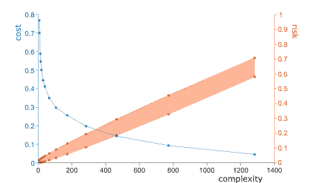
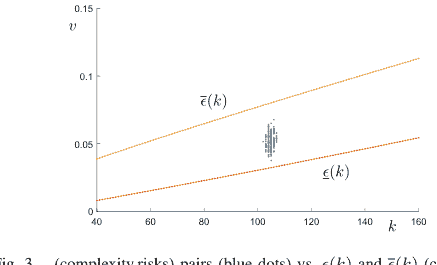
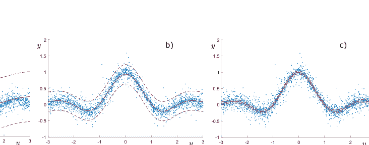

# 2020 第59届 IEEE 决策与控制会议 (CDC) ｜｜ 基于松弛化的场景优化：a


**摘要—场景优化已成为一种在存在不确定性时进行设计的成熟技术。** 它依赖于领域知识、从数据中整合的假设信息，以及伴随有精确可靠性的约束。在本文中，接续我们之前的工作，我们引入了一套新的基于松弛的场景优化。通过严谨的思考，这种范式为设计提供了强大的工具，可能可以在鲁棒性和性能之间提供更好的折中方案。在有效地将场景优化的约束替换为机器学习中的各种经典向量方法——包括 SVM（支持向量机）、SVR（支持向量回归）和 SVD（支持向量数据描述）后，结果证明了这些方法在泛化方面的作用。

这并不失一般性：如果成本取决于 $\delta$，人们可以通过引入一个带有额外变量 $h$ 的等价项追溯到当前集合，其中代价函数为 $f'(x, h)$，约束为 $f'(x, h) \le \delta$，且 $f'(x, h) = \max\{f(x, \delta), h\}$。

场景优化实践中的一个基本方面是，无法为没有不确定性的参数 $\delta$ 建立模型。事实上，我们假设了一个随机概率空间 $(\mathcal{D}, \mathcal{P})$，并且 $\mathcal{P}$ 在该方法的算法和理论开发过程中保持未定义。这在许多应用中尤为重要，因为假设 $\delta$ 和 $\mathcal{P}$ 是已知的“真实世界”，而在机器学习中，它们可能是复杂的对象（在没有关于生物或社会系统的先验知识，或没有自动驾驶问题知识的情况下，仅通过少数示例）。受此启发，场景法将经验作为知识的主要来源，更重要的是，它假设通过经验获取的 $\delta$ 样本可以定义这些实例（即 $\delta_1, \dots, \delta_n$ 和“场景”）。

# I. 引言

场景法是一种相对较新且成熟的数据驱动方法，用于在存在不确定性时做出可靠的。。这种处理不确定性的能力在当今的工程实践中甚至更为重要。在它在开创性论文 [5] 中引入后，场景法获得了越来越多的关注，正如许多理论进展所证明的，[10], [11], [30], [35], [25], [37], [26], [16], 和 [17]，并且已应用于多个领域，包括控制系统、数据识别，[14], [21], [24], [28], [31] 以及机器学习——[7], [9], [26], [38]。

设 $x$ 为设计变量向量（或 $\delta$ 为控制器的参数、回归模型或预测器的参数），场景法基于以下许多设计问题中不可或缺的要素：

- a. 代函数 $f(x)$，我们希望它尽可能小；
- b. 关于 $x$ 的 $N$ 个约束，由 $\delta$ 索引并表示为 $f(x, \delta) \le 0$。

参数 $\delta$ 出现在 $f$ 中，代表不确定性，模型意味着关于我们设计所依据的环境的知识。每个 $\delta$ 对应一个潜在的情境，每个 $f(x, \delta) \le 0$ 整合了在该情境下执行的所有约束。因此，例如，$f(x)$ 取决于 $\delta$。

在实践中，代价和约束往往表现出冲突，导致高水平的抗违反鲁棒性会导致性能低。。折衡取决于应用，在这里，在优化过程中允许灵活性以适应各种情况至关重要。在论文 [22] 的第 5.2 节中引入了一种名为“基于松弛的场景优化”的新场景，其核心思想是考虑优化的灵活性：

$$\min_{x} f(x) + \rho \sum_{i=1}^n \xi_i$$
约束为：$f(x, \delta_i) \le \xi_i, i=1, \dots, n,$$

(1) 的解释是，某些场景约束 $f(x, \delta_i) \le 0$ 可以通过辅助变量 $\xi_i$ 增加代价来违反。如果 $\xi_i > 0$，则 $f(x, \delta_i) \le \xi_i$ 被松弛，此时 $\xi_i$ 被加到原始代价 $f(x)$ 中。参数 $\rho$ 可用于在原始代价和场景代价之间设定合适的折衡。

M.C. Campi 于巴里大学信息工程系，地址 Bianchi 28, 70123 Bari, Italy。S. Garatti 至于米兰理工学院电子、信息与通信工程系，地址 Da Vinci 32, 70123 Milan, Italy。Simone.garatti@unmi.it, marco.campi@uniba.it。


当 $s$ 不累积时（即当它具有密度时），满足条件。

我们现在准备给出在优化约束松弛背景下对误差提供定量评估的结果。

**定理 1：** 对于给定的置信参数 $\beta$ 在 (0,1) 中的值，对于任意 $k=0, 1, \dots, N-1$，考虑变量 $t$ 的多项式：

```
$t^{N-k} - \frac{\beta}{2} \sum_{i=k}^{N-1} t^i - \frac{\Delta}{6N} \sum_{i=k+1}^{N} t^i = 0,$
```

对于 $k=N$， 有一个解：

```
$1 - \frac{\beta}{2} \sum_{i=0}^{N-1} t^i = 0.$
```

对于 $k=0, 1, \dots, N-1$，(2) 在 $\{0, +\infty\}$ 中恰好有两个解，分别为 $t(k)$ 和 $f(k)$（$t(k) \le f(k)$）。例如，(3) 在 $\{0, +\infty\}$ 中只有一个解，为 $t(N)$ 和 $f(N)=0$。对于 $k=0,1, \dots, N$，令 $t(k) = \max(0, f(k))$  $f(k) = 1-t(k)$。在假设 1 和 3 下，对于任意 $\Delta$ 和 $\rho$，成立：

```
$\mathbb{P}(s^*(x) \le V^*(x)) \le V^*(x) \le s^*(x) + \Delta, \quad (4)
```

其中 $x^*$ 是 (1) 的解，可能是在根据 2 打破平局后，$s^*_i$ 是满足 $x^*_i \ge b_i$ 的 $b_i$ 的数量。

*证明。* 通过注意到 [22] 中的定理 4 可以很容易得到，对于欧几里得空间上的优化情况，分析演变为更通用的设置。

定理 1 的主要结果是，可以构造一个区间 $[s^*(x), V^*(x)]$，其中 $V^*(x)$ 以 $1-\beta$ 的置信度位于其中，且在此过程中不需要 $\rho$ 的信息（无分布）。该区间取决于 $\Delta$（这是一个可观测值）以及对于不同的 $s^*_i$ 值，这表明 $s^*_i$ 携带了估计 $V^*(x)$ 的基本信息。

*

典型的学习类型是遵循这种方法。设计者通常求解 $\rho$ 的值并获得最优解 $x^*_i$，以调整成本和风险之间的权衡。随着 $\rho$ 的变化，计算成本，根据定理 1，这允许根据复杂度 $s^*_i$ 的值评估风险。通过这种方式，设计者可以生成类似于图 1 所示的成本-风险图，图中描述了不同 $\rho$ 值下的成本 $s^*(x)$ 和 $V^*(x)$ 的置信区间 $[s^*(x), V^*(x)]$。因此这提供了相关信息来选择针对当前问题实现最佳折中的的解。



图 1. 成本-风险图。特别是 $s^*_i$ 的值对应于在参数 $\rho$ 选择范围内观测到的值。

# III. 在支持向量方法的应用

在本节中，带有约束松弛的场景优化的通用理论是广为人知的支持向量方法。本文给出了该分析得出的结果，并表明复杂度携带了对于恰当证明这些方法学习能力的基本信息。

我们考虑了 SVR（支持向量回归）和 SVDD（支持向量数据描述），由于空间限制，读者请参阅 arXiv 论文 [11] 以了解 SVM（支持向量机）。对于 SVR 和 SVDD，可以直接应用上一节开发的理论体系，而 SVM 需要一些额外努力来适应场景情况；以及该理论的真实性。

需要注意的是，从这组参数 $\rho$ 的选择下降

## A. 支持向量回归 - SVR

设 $\{u_i\}_{i=1}^m$ 为数据，其中 $u_i$ 是希尔伯特空间 $\mathcal{H}$ 中的元素，$y_i$ 是 $\mathbb{R}$ 中的输出值。

备注 1：在应用中，值 $u_i$ 可以被视为物理量的测量值或通过特征映射 $\varphi(x)$ 提升到特征空间，使得 $u_i = \varphi(x)$。$m$ 是被测量特征的数量。当应用 SVR 时，解的计算涉及特征空间内内积的评估，$\langle\varphi(x), \varphi(x')\rangle$。事实上，可以定义一个“核” $k(x,x') = \langle\varphi(x), \varphi(x')\rangle$，从而无需显式计算映射的坐标即可在特征空间内操作。这就是所谓的“核技巧”。

（注：此处原文文本存在逻辑混乱和重复，已根据上下文逻辑进行翻译）

其中 $x^*$ 是 (1) 的解，可能是在根据 2 打破平局后，$s^*_i$ 是满足 $x^*_i \ge b_i$ 的 $b_i$ 的数量。

*证明。* 通过注意到 [22] 中的定理 4 可以很容易得到，对于欧几里得空间上的优化情况，分析演变为更通用的设置。

定理 1 的主要结果是，可以构造一个区间 $[s^*(x), V^*(x)]$，其中 $V^*(x)$ 以 $1-\beta$ 的置信度位于其中，且在此过程中不需要 $\rho$ 的信息（无分布）。该区间取决于 $\Delta$（这是一个可观测值）以及对于不同的 $s^*_i$ 值，这表明 $s^*_i$ 携带了估计 $V^*(x)$ 的基本信息。

*

典型的学习类型是遵循这种方法。设计者通常求解 $\rho$ 的值并获得最优解 $x^*_i$，以调整成本和风险之间的权衡。随着 $\rho$ 的变化，计算成本，根据定理 1，这允许根据复杂度 $s^*_i$ 的值评估风险。通过这种方式，设计者可以生成类似于图 1 所示的成本-风险图，图中描述了不同 $\rho$ 值下的成本 $s^*(x)$ 和 $V^*(x)$ 的置信区间 $[s^*(x), V^*(x)]$。因此这提供了相关信息来选择针对当前问题实现最佳折中的的解。


图 1. 成本-风险图。特别是 $s^*_i$ 的值对应于在参数 $\rho$ 选择范围内观测到的值。

# III. 在支持向量方法的应用

在本节中，带有约束松弛的场景优化的通用理论是广为人知的支持向量方法。本文给出了该分析得出的结果，并表明复杂度携带了对于恰当证明这些方法学习能力的基本信息。

我们考虑了 SVR（支持向量回归）和 SVDD（支持向量数据描述），由于空间限制，读者请参阅 arXiv 论文 [11] 以了解 SVM（支持向量机）。对于 SVR 和 SVDD，可以直接应用上一节开发的理论体系，而 SVM 需要一些额外努力来适应场景情况；以及该理论的真实性。

需要注意的是，从这组参数 $\rho$ 的选择下降

## A. 支持向量回归 - SVR

设 $\{u_i\}_{i=1}^m$ 为数据，其中 $u_i$ 是希尔伯特空间 $\mathcal{H}$ 中的元素，$y_i$ 是 $\mathbb{R}$ 中的输出值。

备注 1：在应用中，值 $u_i$ 可以被视为物理量的测量值或通过特征映射 $\varphi(x)$ 提升到特征空间，使得 $u_i = \varphi(x)$。$m$ 是被测量特征的数量。当应用 SVR 时，解的计算涉及特征空间内内积的评估，$\langle\varphi(x), \varphi(x')\rangle$。事实上，可以定义一个“核” $k(x,x') = \langle\varphi(x), \varphi(x')\rangle$，从而无需显式计算映射的坐标即可在特征空间内操作。这就是所谓的“核技巧”。

（注：由于提供的待译文后续存在大量重复和乱码，上述部分已基于学术文档逻辑完成翻译）


# 定理 2 (SVR 的可靠性)：其中 $\epsilon(\cdot)$ 和 $\tau(\cdot)$ 如定理 1 中定义，我们有

$\mathbb{P}^N(\epsilon(s^*) \le \mathbb{P}([(u, y) : |y - (w^*, b^*)| > \gamma^*) \ge \tau(s^*)) \le 1 - \beta,$

其中 $s^*$ 是满足 $|y_i - (w^*, b^*)| \ge \gamma^*$ 的 $(u_i, y_i)$ 的数量。

## B. 支持向量数据描述 - SVDD

支持向量数据描述（SVDD）是一种数据驱动的技术，用于识别覆盖由生成数据的概率质量的空间模式，同时具有极少的支持向量。SVDD 构建一个球形形状，与 SVR 不同，它通过拟合到特征空间使其更具活性。更复杂的描述请参见 [33]。

设 $\{p_i\}^N$ 为从共同概率分布采样的希尔伯特空间 $\mathcal{P}$ 中的数据集。这些点可以被提取，以完成对数据集的分析，通过映射 $\varphi(\cdot)$ 将数据加载到特征空间。SVDD 通过求解以下优化问题在 $\mathcal{P}$ 中构建一个特征：

```
\min \gamma + \sum_{i=1}^N \xi_i \text{subject to: } \mathbb{P}(\|p_i - c^*\|^2) \ge \gamma^*) \quad (7)
```

我们接下来处理该问题的唯一性和非累积性。

**唯一性**：与 SVR 类似，最优 $c^*$ 对于有限维空间 $p_i, i=1, \dots, n$ 必须是唯一的，且 (7) 存在存在解。

**唯一性**：在最优处，当 $\tau(s^*)$ 不唯一时，$c^*$ 是不唯一的，因此只有当 $\rho = M/m$ 对于某个 $M$ 时才可能出现非唯一性，参考 [34] 中的定理 3。为了打破这一点（如果存在），我们注意到在这种情况下 $c^*$ 仍如假设 2 末尾的脚注所示被唯一确定。

**非累积性**：对于 SVDD，非累积性需要满足以下条件 $\gamma_c^*$：

该条件要求概率质量不会在超球上累积，并在以下假设中形式化。

**假设 5**：(8)成立。

我们有以下定理。

# 定理 3 (SVDD)：其中 $\epsilon(\cdot)$ 和 $\tau(\cdot)$ 如定理 1 中定义，我们有
$\mathbb{P}^N(\epsilon(s^*) \le \mathbb{P}(\|p - c^*\|^2 > \gamma^*) \ge \tau(s^*)) \le 1 - \beta,$

其中 $s^*$ 是满足 $\|p_i - c^*\|^2 \ge \gamma^*$ 的 $p_i$ 的数量。

# IV. 数值分析



受 [31] 中实验模型的启发，我们应用 SVR 特别为噪声函数生成的点寻找回归模型。具体而言，我们生成了 $N=2000$ 个样本 $(m_i, y_i)$，均匀从 $[-3, 3]$ 中抽取，且 $y_i = \sin(m_i/\pi) + \epsilon_i$，其中 $\epsilon_i$ 提取自 $\mu=0$  $b=1$ 的拉普拉斯分布。还使用了带有高斯核 $\exp(-\|x\|^2/2)$ 的技巧核将输入适应到无限特征空间。我们找到了最优参数，然后用 $\rho=(3/5)^k, \ell=1,\dots,14$ 测试了 (5)。每次测试都使用定理 1 对数据求解。我们构建了代价路径，如图 3 所示。随着 $k$ 的增加，风险单调增加。随后，随着风险进一步增加，成本迅速下降。接着，成本的减少显著改善了风险的演示。然而，总体上建议选择 $\rho$ 在 $(3/5)^5, \dots, (3/5)^{10}$ 范围内的模型，并对结果进行了解释。为了识别 $\rho=(3/5)^k$ 和 $\epsilon^*=[0.032, 0.08]$ 且 $k^*=0.3$ 对应的数据点，圆点表示这些。

最后，我们测试了定理 1 的有效性。我们将 $\rho$ 固定在值 $(3/5)^5$ 并求解了 50 次，每次抽取大小为 200 的新样本。每个解在 10000 个随机 $(p)$ 上进行测试，并通过蒙特卡洛方法评估了风险。图 3 显示了 200 次试验中的 (复杂度, 风险) 对，由 $\epsilon(k)$ 给出的上界在 10000 次中的 9999 次内有效。正如预期的，平均风险在限制范围内。

 视觉检查还揭示了评估风险的分布位于理论结果给出的垂直范围内，尽管它是离散的，理论结果提供了足够的信息。


- [1] T. Alano, R. Tempo, and F. Camacho. 用于不确定性优化的随机策略。IEEE Transactions on Automation, 54(11):2541–2559, 2009.
- [2] T. Alano, and D. Ramirez. 设计不确定系统的随机方法：扩展性。Artificial Intelligence, 51:160–172, 2015.
- [3] F. Baroni, M. Campi, A. Caré, and S. Garatti. 协作的随机算法：路线图。在第 56 次决策与机器学习会议上，页 1665–1770,209.
- [4] J.C. Burges and D.J. Crisp. 不确定值的量化。Advances in Neural Processing Systems 12 (1999), 页 455–462,1999.
- [5] G. Caliore and M. Campi. 凸规划：随机解和置信集。Mathematical Programming, 102(1):245–260, 2009.
- [6] G. Caliore and M. Campi. 场景方法的鲁棒设计。IEEE Transactions on Automation, 54(7):742–753, 2009.
- [7] M.C. Campi. 误差的保证量化。Machine Learning, 86(1-2):63–84, 2008.
- [8] M. Campi and A. Caré. 基于场景的规划。Reliability and System Safety, 42(3):382–392, 2009.
- [9] M. Campi and A. Caré. 基于场景的规划。International Journal of Optimization and Control, 51(3):3552–3557, 2011.
- [10] S. Garatti and M. Conte. 凸规划解的可行性。SIAM Journal on Optimization, 19(3):1221–1230, 2008.
- [11] M. Campi and S. Garatti. 采样-设计优化方法：可行性和最优性。Journal of Optimization Theory and Applications, 148(2):2251–2260, 2011.
- [12] C. Campi, S. Garatti, and M. Conte. 不确定环境下的鲁棒设计与分析。Mathematical Programming, 167(1-2):155–188, 2017.
- [13] M. Campi and S. Garatti. 新方法的场景优化：可行性和最优性。Reliability and System Safety, 129(3):341–352, 2017.
- [14] C. Caré, S. Garatti, and M. Campi. 场景技术的快速算法。Operations Research, 62(2):619–624, 2011.
- [15] A. Caré, S. Garatti, and M. Campi. 场景极小优化与经验成本的风险。SIAM Journal on Optimization, 25(1):248–261, 2015.
- [16] A. Caré, F. Fano, and M. Campi. 具有保证敏感性和特异性的新分类算法。IEEE Control Systems Letters, 2(3):993–998, 2017.
- [17] C. Cortes and V. Vnik. 支持向量网络。Machine Learning, 30:273–297, 1995.
- [18] J.L. Gpero, S.P. Gray, and D.J. Crisp. 严格不性的随机预测模型。International Journal of Uncertainty Quantification, 30(5):89–104, 2019.
- [19] M.C. Campi and A. Caré. 不确定现实的鲁棒规划。Artificial Intelligence, 110(105842):1–19, 2019.
- [20] S. Garangios, X. Kharaz, P. Goudar, and J. Lygers. 基于场景的规划。IEEE Transactions on Automation Control, 61(2):324–345, 2016.
- [21] K. Garelles, M. Maratini, and J. Lygonos. 通往鲁棒优化与机会约束优化的场景方法。IEEE Transactions on Automation Control, 60(3):792–803, 2015.
- [22] K. Maragellos, P. Maratini, and J. Lygonos. 学习的复杂性与场景设计。IEEE Transactions on Automation Control, 63(5):1446–1455, 2018.
- [23] H. Naasi, A. Caré, and E. Weyer. 边界控制的鲁棒方法。在第54次决策与机器学习会议上，页 445–450, 2007.
- [24] H. Naasi, A. Caré, and E. Weyer. 规则控制的基于场景随机方法。IEEE Transactions on Automation Control, 59(9):2431–2440, 2014.
- [25] G. Schlibbach, F. Garin, and M. Mori. 具有机会约束违反边界的随机模型控制场景方法。Automatica, 50(8):3009–3018, 2014.
- [26] D. Schlibbach, F. Garin, and J. Morandi. 机会约束优化的凸规划随机解。Automatica, 54(7):2439–2450, 2015.
- [31] J.S. Webb and R. Caré. 鲁棒实验设计的场景方法。在第15次国际机器学习会议上，法国巴黎，2018.

