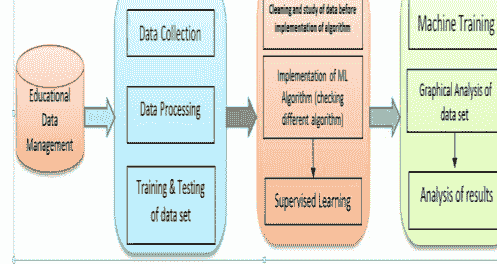
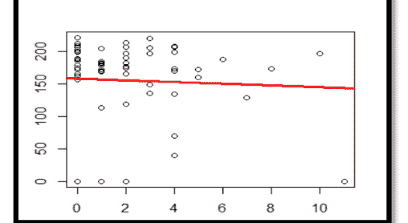
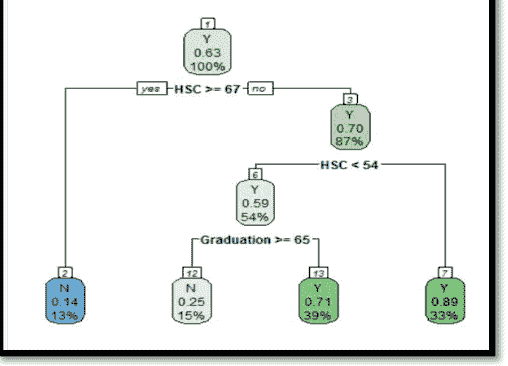
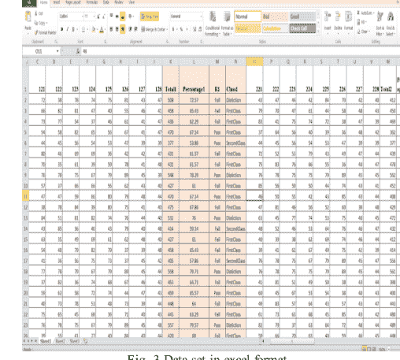

# 2020 第五届 IEEE 工程最新进展与创新国际会议 (ICRAIE) (印度斋浦, 2020.12.1-2020.12.3)

Dipti Verma  
MCA 部门，  
DYPCAM  
浦买，印度  
dipti.vasudev@gmail.com

K. Nirmala  
MCA 部门，  
DYPCAM  
浦买，印度  
skita_nirmala@rediffmail.com

## 摘要

机器学习（ML）正通过其创新积极地夺回每个领域和行业。机器学习在教学方面的能力不断扩大，并在以所有可能的方式帮助所有人方面达到了极高度。它能够产生强有力的结果，并对已在各个领域成功实施的机器学习算法进行预测。教育领域并非没有机器学习的广阔自由空间，因此本文中实现了该算法以预测学生的表现。基于机器学习算法收集的不同数据，仔细选择了恰当且合适的模型，从而可以为性能的提升制定计划。

Ciolacu, Ali Fallah Tohani, Leon Binder 和 Mujahid Svasta 关注带有智能设备、某些传感器和可穿戴设备的人工智能教育系统，用于自结构学习。应用于机器学习的教育 4.0 方法的初步结果。Amandeep Kaur、Nitin Umesh、Barinder Singh 撰写的名为《分析学生过去历史数据并预测学生学术表现》的论文，重点在于通过考虑个人、经济、社会、文化、学校环境等不同因素，通过这些方法的结果来预测学术表现。

**关键词**— 机器学习，MCA 专业，线性回归，逻辑回归，决策树

## I 引言

机器学习已成功应用于银行、保险、零售、股票交易所和美国交易所等许多领域。本文展示了机器学习算法的实现，用于预测学生的表现。结果已成功实施，并在此进行讨论。在这个学生的真实性在其职业中起着重要作用的时代，机器学习可以被证明是预测的一个方向；并利用这种方法从学生的才华中提取最大的价值。

## II 文献综述

在 Alexander J. Jameson 和 Mary L. Simpton 撰写的研究论文《使用机器学习评估计算机教育中的干预》中，重点关注了表现水平的有效性。在这篇研究论文中，通过查询标记来考虑构建预测模型。

1. 观察了机器学习算法对过程级信息的影响。
2. 建立了用于预测结果的机器学习技术类型结果。

在 Monica 撰写的研究论文《教育 4.0 - 人工智能辅助教育：利用机器学习早期识别以支持学生成功》中

## III 方法正则化

机器学习是使系统变得智能的科学。机器学习可以说，在成功实施和准确预测结果方面，它改善了人类的生活 [1]。

机器学习是根据我们从未察觉到的情况使你的事物变得智能的艺术。我们的系统可以根据数据对新问题做出响应。数据被分为训练集、测试集和结果，随后对这些结果进行比较、分析并生成新结果。机器学习几乎涵盖所有领域，教育领域也是如此。如今，教学已成为一种挑战。学生越聪明，情况越好。课堂互动性越高，因此机器学习存在巨大的差距。其中一些列举如下：

- 自适应学习
- 预测分析
- 预测结果
- 录取预测和纠正措施
- 针对学生的个性化学习
- 自动评分系统
- 预防原因
- 教师对弱势学生的支持

## IV AI 的最新趋势

人工智能和机器学习被发现在许多领域被采纳和实施，包括：

- i) 关注自学学习的强化学习。
- ii) 用于解决刑事案件和失踪人员的人脸识别，
- iii) 情感判断，
- iv) 识别手写体，
- v) 计算机视觉，
- vi) 语音识别，
- vii) 语音的识别和判断，
- viii) 解决欺诈和故障案件。
- ix) 医疗和健康领域
- x) 学术和教育领域在 AI 中没有多少探索。

## V 问题陈述与研究意义

研究目标是展示“机器学习技术是否有利于提高 MCA 学生的表现”。

通过正确和适当的方法确保学生的技能至关重要。及时分享结果将为学生提供机会。因此，实施、测试并检查了机器学习算法，以确定适用于学生表现的最佳算法。

机器学习的预测和预测将帮助机构在大学考试之前采取纠正措施，并在学习中指导引导学生。

## VI 目标与假设

- 通过早期预测结果来提高 MCA 学生的表现。
- 通过机器学习模型指导并增强学生对表现的意识。

根据收集的数据，我能够预测以下内容：

在 HSC、SSC 和数量上得分较高的学生更有可能在 MCA 中获得良好的表现。根据收集的数据得出了以下假设：

- H0: 机器学习技术得分的学生无助于提高 MCA 课程中学生的成绩。
- H1: 机器学习技术有助于提高 MCA 课程中学生的成绩。

## VII 目标与假设

此处执行研究的研究设计如下图所示。基本上，研究中使用的不同模块以逻辑方式排列，以便对研究项目进行有效的论点说明；它组织了数据收集、实验和分析的设计。

### 抽样方法-分层抽样与便利抽样

数据收集-如抽样方法所述，使用了分层抽样和便利抽样技术，研究工作的数据从大学学生中收集。它包含了第一批 MCA 学生的记录，包括他们的 SSC、HSC、毕业、CET 最终分补考数据，并通过 Excel 集合收集数据。

## VIII 不同机器学习的实现

### A. 线性回归

线性回归是使系统变得智能的科学。机器学习可以说，在成功实施和准确预测结果方面，它改善了人类的生活 [1]。

机器学习是根据我们从未察觉到的情况使你的事物变得智能的艺术。我们的系统可以根据数据对新问题做出响应。数据被分为训练集、测试集和结果，随后对这些结果进行比较、分析并生成新结果。机器学习几乎涵盖所有领域，教育领域也是如此。如今，教学已成为一种挑战。学生越聪明，情况越好。课堂互动性越高，因此机器学习存在巨大的差距。其中一些列举如下：

- 自适应学习
- 预测分析
- 预测结果
- 录取预测和纠正措施
- 针对学生的个性化学习
- 自动评分系统
- 预防原因
- 教师对弱势学生的支持

### B. 逻辑回归

逻辑回归通过概率衡量变量与一个或多个独立特征之间的关系。

$$f(x)=1/(1+e^{-x})$$

图 1：线性线的绘图

### C. 决策树算法

决策树（DT）被认为是分类中广泛使用的机器学习算法之一。决策树运行像一棵倒立的树，其中每个节点代表一个预测（特征），每个叶子节点代表一个结果（响应变量）。DT 用于根据 IF-THEN 规则树来决定特定值可以被接受还是拒绝。

图 2：决策树

### I. 数据收集与整合

收集工作完成了实时数据采集。数据包含 53 名学生。数据包括姓名、性别、电子邮件 ID、SSC 分数、HSC 分数、毕业分数、MCA 分数、补考详情、背景数量。数据已在 Excel 文件中汇总。数据快照如下所示。

图 3：Excel 格式的数据集

### II. 方法论

该研究旨在找出 MCA 最终成绩与学生之前的 SSC、HSC 和毕业成绩之间的关系。通过实施不同的算法检查模型的准确性。

在数据数据集模型上进行实现。当在数据集上构建决策树时，算法会选择其根节点和叶子节点。

- 可以得出结论：HSC（高中毕业考试）成绩超过 67% 的学生只有 13% 的挂科概率
- 毕业率超过 65% 的学生挂科概率为 15%
- HSC 成绩百分比对学生的 MC（模拟考试）表现具有很强的显著性

这些从早期预测中获得的结果可以帮助许多学生，特别是那些想要获得高分的学生。他们的表现可以预测到实际考试中，而且所有的替代方法都可以改进他们的学习方法，并帮助教师准备和教表现较慢的学生，而学生也可以提高自己的表现。教师/学院可以使用简单的模型进行预测。根据学生的结果，表现作为预测因素，模型可以根据他们对慢速学生的经验和知识变得具有独特性。

在应用其优缺点方面存在两种可能性。预测显示，如果开发了一套系统，但如果准确性不正确，可能会导致恰当或不公正的判断，这可能会影响学生及其成长。局限性可能会出现在数据收集、模型构建和准确性测试的过程中。这提供了关于教育领域使用的机器学习技术及其更广泛用途的概述。此外，它是每个人的重要部分，将教学过程维持到最高标准是每位教育工作者的责任，让学生在各个方面都能受益。本文概述了机器学习中的一些常见问题。

## X 分类

机器学习可以成功地用于教育领域的实施。机器学习技术被用于学生的利益，以及对学生表现的管理。研究还显示，毕业程度与学生分数之间的相关性可以被提前预测，这样该学生就可以受到激励并更加关注学习。本文的首要目标是理解教育中面临的问题以及以及通过机器学习提供可能的解决方案。

## XI 未来需求

有很多算法可以被应用。当收集了大量数据时，可以通过训练、测试和验证发现许多隐藏模式。

## 参考文献

- [1] Campbell, W. E., 和 K.A. Smith (2009). 新教学范式。
- [2] Nelson, 2017. 机器学习。http://badget.com/8-ways-machine-learning-will-。
- [3] wetech.com
- [4] Fatimah, S. 和 Anders Gustafson 基于机器学习的评估。
- [5] D. Khairy, M. Mahmoud 在教育中的应用。高级计算机科学与分析期刊，第 5 。
- [6] Nakadari, P., Ono, M., 和 Jackman, W. (2021). 教育中的机器学习。国际业务应用期刊，18(3), 544-551。
- [7] Burton, J. (2009). 自然语言研究的机会。国际语言与技术期刊，6(4), 627-673. doi:10.5277/1978-3642-0019-2_3_2007-4721。
- [8] Babah, N. U. (2010). 自然语言合成导论。国际技术期刊，3(1), 75-80. http://www.mongeaily.com/doi/10.22060/0227ed10-20
- [9] Lee, J., Wang, H., 和 Crowley, R. S. (2011). 生物医学教育中的机器学习。教育技术期刊，4(4), 1-15。
- [10] Mo, Y. H., Monaghan, P., Neale, S., 和 Zwickert, P. (2008). 句法与冠法的执行。会议，10(2),762-773. doi:10.1109/ICCAE.2008.472195
- [11] Deep Rajput 和 Khushal Dawahi (2018). 机器学习方法：学生学习文献综述。国际教育技术与管理会议（ICETM）论文集，国际工程师协会，IEEE, ISSN: 978-1-729-33355-0
- [12] Breesave, Vaish. Paul. 西非农村地区学生表现的分析与影响。国际技术、信息，2007. 2007届国际会议
- [13] Nguyen, Thai, James Patel, 和 Jaeher, A. 用于预测学生表现的分析技术。全球教育知识无界会议，IEEE, 2007。
- [14] Felix Sanchez (2018). 忽视业务的兴起：数据的业务案例。9(1). doi:10.978-3-811-19888-7_3_1
- [15] Koriskanen, Saart, B. 和 Panikotis, E. 大学学生表现预测。IEEE高级学习技术国际会议，ICAL 2005, pp
- [16] Brett Lantz, 使用 R 学习：Barmingham; 2016, pp
- [17] Radhika R, Rahul. 机器学习在改进教育系统中的应用。
