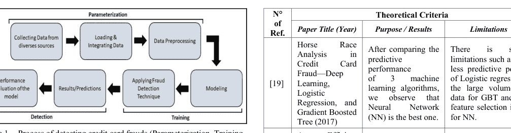

# 2020 第五届国际云计算与人工智能会议：技术与应用 (CloudTech)（摩洛哥马拉喀什 2020.11.24-2020.11.26）

Nadia Bouthera

计算机科学、系统建模与决策支持实验室

Ain Chock科学学院，哈桑二世大学

摩洛哥卡萨布兰

nadia.bauthera@gmail.com

Amina Elnorni, Noredine Abghour, Khalid Moussaid and Mohamed Rida

计算机科学、系统建模与决策支持实验室

Ain Chock科学学院，哈桑二世大学

摩洛哥卡萨布兰

**摘要** 数据技术连接了医疗、金融、制造业、运输和电子商务等领域。它们在金融领域发挥着不可或缺的作用，特别是银行服务深受服务数字化和连接因素的影响。数据的使用和不断增加的欺诈者产生了涉及银行部门的各种问题。遗憾的是，这些问题阻碍了欺诈控制系统的性能，欺诈者利用了在线支付的透明性。因此，金融机构也使用信用卡交易并允许客户使用。为了实现这一目标，他们需要更相关的欺诈检测技术，以识别更多欺诈交易并减少欺诈。本文的目的是定义银行业与欺诈检测相关的欺诈技术和挑战，以及利用机器学习技术的现有解决方案。

导致了更具相关性和效率的用于检测和识别欺诈活动的欺诈检测系统（`FDS`）。

某些大数据限制了欺诈检测系统（`FDS`）的发展和有效性 [3]。因此，许多研究人员使用了各种机器学习技术来提高低检测准确率、缩短检测时间并减少虚假警报。

本文重点关注当前的银行欺诈系统、它们面临的问题和挑战，以及用于最大化检测率和降低欺诈率的现有机器学习技术。我们还分析并比较了这些技术，以强调它们的假设和目标。

本文的其余部分提供了以下几点：首先，定义了欺诈检测系统的理论方面。其次，解释了用于处理欺诈检测问题和挑战的机器学习技术，并根据不同标准对这些技术进行了比较分析。第三，定义了……

**关键词** 机器学习技术；信用卡欺诈检测；合法交易；金融机构；数字化；电子商务。

# I. 引言

如今，各种经济机构和金融公司在电子商务中使用大数据技术，帮助客户随时随地进行在线交易。这里有不同类别的系统，例如信用卡系统、支付系统 [3]，它们被合法用户和欺诈者共同使用。遗憾的是，使用的系统越多，产生的欺诈也日益增加，特别是在银行业。因此，使用欺诈预防系统（`FPSs`）来保护客户和公司免受这些电子犯罪问题的影响。

然而，由于欺诈者的智能化以及他们对这些系统的适应能力，银行和客户面临着比过去更多的问题和挑战。事实是……

## A. 异常检测

异常检测是一种机器学习方法，用于识别偏离正常行为的 [8] 数据点和观测值。

这是一个发生在各个领域的问题，如入侵检测、系统健康监测和信用卡交易中的欺诈检测 [9]。

在数据挖掘和机器学习领域，我们将异常分类为：

- **点异常**：如果单个数据实例偏离其他数据，则将其定义为异常点。
- **上/上下文异常**：当数据实例在特定语境下是异常的（但在其他情况下不是）时，识别出这种异常，也可以称为条件异常。
- **集体异常**：如果一组相关数据相对于数据集中的每个数据点都是异常的。

# II. 理论背景

## B. 金融欺诈检测

通常情况下，当欺诈者通过一种欺骗或犯罪行为从他人处获取更多金融资产时，即可识别金融欺诈。

因此，泛而言之，违规行为会对客户的声誉和金融机构存储的机密信息产生影响，可能导致损失和声誉损害 [11]。

金融欺诈影响多个部门，特别是银行业。银行欺诈可以分类如下 [6][12]：

- **洗钱**：这是一种非法行为，用于使犯罪活动产生的资金看起来来自合法来源。
- **抵押贷款欺诈**：也用于获取抵押贷款。具体而言，它发生在购房者在申请房产抵押的过程中试图操纵重大信息时。
- **信用卡欺诈**：发生在欺诈者在信用卡交易中进行非法操作时。它可以以不同的形式出现，如丢失信用卡或持有信用卡、盗取信用卡机密信息（即无卡交易欺诈）。

## C. 信用卡欺诈检测

信用卡欺诈检测是重要的金融欺诈检测技术之一，因为它产生的损失比其他技术多。虽然使用了用于打击信用卡欺诈的预防措施，但这些措施不足以减少此类欺诈对欺诈检测系统（`FDS`）的影响。

因此，识别出另一种类型的欺诈检测系统（`FDS`）在检测信用卡交易欺诈方面更为有效。

一些问题阻碍了高效 `FDS` 的发展和进展，并导致负面影响。这些问题和挑战基于大数据的特征，如：

- **数量检测**：欺诈检测系统（`CFDS`）中的数据被大量使用，定义持有人行为的属性平均有25个。因此，减少数据对于减少交易时间和处理复杂性至关重要。为了解决这个问题，使用了多种数据减少技术，如用于选择相关属性的降维（`PCA`）和聚合交易的新颖方法 [3]。
- **速度检测**：当我们使用 `CCFDS` 检测异常时会发生这个问题。使用了不同的算法，如 `BOAT`（贝叶斯在线分析测试）算法检测时间的偏移 [15]。
- **真实性检测**：持卡者的活动会随时间和多种原因而改变。随着欺诈者攻击的演进，欺诈系统应该对这些新情况更具适应性和效率。
- **价值检测**：信用卡交易包含大量非欺诈数据，导致类别分布倾斜（不平衡数据）。监督方法受此类问题影响最大的技术，因为模型训练过度拟合多数类而非少数类（即欺诈交易）。产生了许多建模和训练错误，并影响信用卡系统的性能。
- **多样性数据**：数据涉及多种信用卡数据源。因此，银行机构可能以其独特的数据库格式存储数据。这种多样性也体现在欺诈者开发的流程多样化上。

# III. 检测技术

为了构建准确的信用卡欺诈检测系统，我们必须遵循以下步骤：

1. **参数化阶段**：这是收集信用卡交易数据、将其加载到相应的数据库系统并预处理为无问题格式的初始阶段。
2. **训练阶段**：该阶段涉及欺诈检测系统的建模和处理。根据数据的性质，可以使用不同的机器学习算法和数据挖掘技术。
3. **检测阶段**：当完成训练阶段且模型可用时，将根据标准进行评估，以获得在检测率上最高的技术。

图 1. 信用卡欺诈检测的流程（参数化、训练与检测）

## B. 比较研究

| 序号 | 论文标题 (年份) | 理论标准 | 局限性 |
|---|---|---|---|
| 13 | 用于数据分析的预测建模 (2018) | 与其他方法相比提供了最高的准确率和精确率 | 随机森林导致内存中树的过拟合。 |
| 14 | 信用卡欺诈检测算法评估 (2019) | 利用选择的技术并提供比其他孤立森林和外层更好的结果 | 该工作应采用能减少高度不平衡的重采样技术。 |
| 15 | 机器学习方法 (2018) | 随机森林高效应用 `PCA` | 如果没有与工作相关的经典（成分）匹配数据且我们没有问题，则需要其他技术。 |
| 16 | 信用卡检测学习与方法 (2019) | 卷积神经网络过采样 `SMOTE`（合成少数类过采样技术）。 | 所提方法结果最好，但未来的方法应关注于处理高度不平衡的数据。 |
| 17 | 使用卷积神经网络进行信用卡欺诈检测 (2016) | 卷积神经网络实现了最佳性能。 | |

## C. 大数据特征的比较研究

| 序号 | 数据量 | 时间 | 速度 | 数据不平衡性 |
|---|---|---|---|---|
| 14 | 20 个属性（数值型 / 13 个分类特征） | 1000 笔交易 (30% 读取 & 70% 写入) | 实时 | 时间 | 无 |
| 15 | 31 个数值特征 | 24807 笔交易 (0.173% 读取 & 99.82% 正常) | 批处理 | 高度不平衡 |
| 16 | 28 个特征 | 24807 笔交易 (0.173% 读取 & 99.82% 正常) | 批处理 | 高度不平衡 |
| 17 | NA | 2.6 亿笔交易 (4000 笔欺诈交易) | 实时 | 时间 | 无 |
| 18 | 28 个特征 | 24807 个 `PCA` 变量、金额和类别 | 实时 | 时间 | 高度不平衡 |
| 19 (2021) | 69 个属性 | 8000 万数量级 (99.86% 合法 & 0.136% 读取) | 批处理 | 高度不平衡 |
| 20 | 21 个特征 | 24831 条记录，其中包含 429 条欺诈记录 | 批处理 | 高度不平衡 |
| 21 | 28 个特征 | 24807 笔交易 (0.173% 读取 & 99.82% 正常) | 批处理 | 高度不平衡 |

## D. 基于性能指标的现有机器学习技术比较研究

现有机器学习技术对比

| 参考文献序号 | 机器学习技术 | 性能指标 | | | |
|---|---|---|---|---|---|
| | 准确率 (%) | 精确率 (%) | 误报率 (`FPR` %) | 漏报率 (`FNR` %) |
| [13] | 逻辑回归 | 72 | 76 | 64 | 12 |
| | 决策树 | 82 | 89 | 44 | 25 |
| | 随机森林 | 76 | 93 | 21 | 30 |
| | 逻辑回归 | 97.46 | 58.52 | 3 | 8 |
| [14] | 朴素贝叶斯 | 99.23 | 16.17 | 0 | 17 |
| | 多层感知器 | 99.96 | 03.8 | 0 | 18 |
| | 朴素贝叶斯 | 89 | 6 | NA | NA |
| | 随机森林 | 95 | NA | NA | NA |
| | 支持向量机 (`SVM`) | 93 | NA | NA | NA |
| | 人工神经网络 | 88 | NA | NA | NA |
| | 逻辑回归 | 94 | NA | NA | NA |
| | 孤立森林分类器 | 99 | NA | NA | NA |
| | K-均值类 | 50 | NA | NA | NA |
| [16] | 神经网络 | | | | 0.29 |
| | `SVM` | | | | 0.27 |
| | 随机森林 | | | | 0.30 |
| | `CNN` | | | | 0.32 |

*a. 带有“特征”的准确率、精确率(%)。*

*b. 不带“特征”的准确率、精确率(%)。*

## E. 综合与讨论

为了识别处理和解决信用卡欺诈检测问题最常用的机器学习技术，我们使用各种标准分析并比较了当前的研究。在当前文献中，使用的机器学习技术包括监督学习技术，如具有高准确率且适用于线性数据的**逻辑回归**、减少检测时间的 **`SVM`**，以及提高分类率 (`FPR`) 的**随机森林**和**神经网络**。比较研究有助于识别与欺诈检测领域相关的若干个问题，如下：

- 缺乏公开的数据集：本比较研究中的大多数案例都是基于 Kaggle 平台的一项特定数据。
- 大数据集：信用卡欺诈检测系统在大数据处理下运行快速且高效。
- 大多数机器学习技术未实现实时处理：信用卡欺诈检测可能无法适应任何新的攻击手段。

# IV. 结论与未来工作

| 参考文献序号 | 机器学习技术 | 性能指标 | | | |
|---|---|---|---|---|---|
| | F 分 | 增量学习 | | | |
| | `AUC` | `AP` | | | |
| [18] | 随机森林 | 0.91 | | | |
| | `SVM` | 0.85 | 0.90 | | |
| | 逻辑回归 | 0.73 | 0.84 | | |
| | 梯度提升 | | | | |
| | 神经网络 (`NN`) | | | | |
| | 逻辑回归 | 0.75 | | | |
| [21] | 决策树 | | | | |
| | 极端梯度提升 | 98.8 | | | |
| | 逻辑回归 | 94 | 95 | | |
| [22] | 决策树 | 90 | 91 | | |
| | 朴素贝叶斯 | | | | |

信用卡欺诈检测对金融领域影响巨大。为了避免欺诈损失，本文分析了用于处理不平衡数据的机器学习技术，并关注了其在实时检测方面的贡献。

## 致谢

感谢计算机科学实验室成员的建议与帮助。

## 参考文献

- [1] 使用遗传算法改进信用卡欺诈检测分类。
- [2] 信用卡欺诈检测技术综述。
- [3] 基于数据挖掘技术的欺诈检测综述。
- [4] 金融领域异常检测技术综述。
- [5] 用于预测分析技术检测加拿大信用卡欺诈。
- [6] 机器学习技术在信用卡欺诈检测中的应用。
- [7] 智能金融欺诈检测：综述。
- [8] 使用数据挖掘技术的异常检测综述。
- [9] 金融领域异常检测技术综述。
- [10] 人工神经网络用于欺诈检测。
- [11] 使用机器学习技术预防和检测欺诈。
- [12] 机器学习技术在信用卡欺诈检测中的性能。
