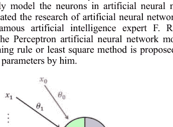
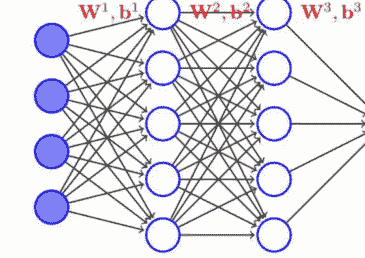
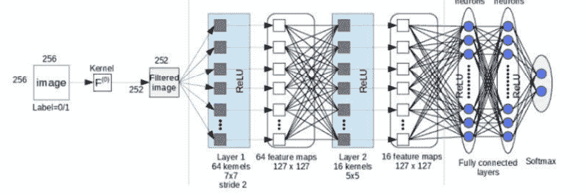
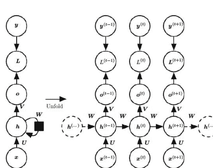
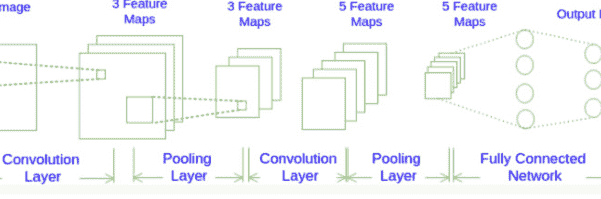
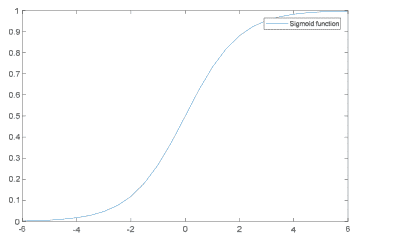
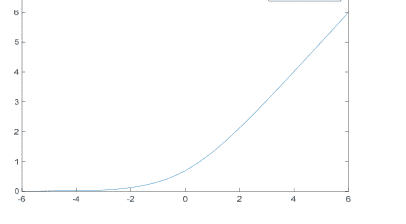
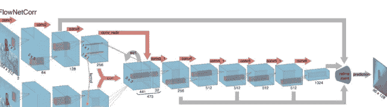

# 2020 第五届信息科学、计算机技术与交通国际会议 (ISCTT)(中国沈阳 2020.11.13-2020.11.15) 2020 第五届信息科学


刘金桥
四川大学机械工程学院
四川大学毕兹堡学院
中国，成都
通讯作者：15106980@qq.com

# II. 深度学习

摘要——近期，自动驾驶是一个研究热点，而图像识别技术是自动驾驶解决道路问题的关键之一。人工智能和深度学习的发展已广泛应用于图像识别技术，并在该领域发挥着重要作用。本文介绍了自动驾驶中图像识别的发展以及深度学习的相关内容。文中还分析了不同类型的深度学习网络，如循环神经网络（RNN）、深度神经网络（DNN）和卷积神经网络（CNN）。此外，还阐述了深度学习在图像识别中的理论基础。最后，本文探讨了自动驾驶汽车的未来以及图像识别技术的未来。结论认为，图像识别已广泛应用于自动驾驶汽车中，具有广阔的发展前景。

关键词——自动驾驶；深度学习；图像识别；深度神经网络；循环卷积神经网络

# 引言

自动驾驶的发展变得越来越流行。目前，对自动驾驶汽车的研究包括许多方面，如感知、决策和控制。自动驾驶汽车安全最基本的要求是它能够在驾驶期间识别不同的物体或环境。为了实现这一目标，自动驾驶汽车的计算机需要能够识别图像。图像识别技术的发展经历了若干挑战，例如目标检测和目标识别。研究人员将人工智能的神经网络引入图像识别技术中。神经网络方法可用于学习模式和复杂信息，在背景知识不足和分辨率不清晰的情况下，允许样本处理大量数据和失真图像 [1]。本文提出了多种如 RNN、DNN 和 CNN 等神经网络模型。这些模型极大地促进了图像识别技术。本文将对图像识别领域目前的研究进行综述，并探索自动驾驶汽车中图像识别技术的发展。

深度学习是人工智能研究领域的一个热门话题，深度学习的目的是学习数据的内部规则，在此过程中获得的信息对于解释文本、图像数据非常有帮助。深度学习的最终目标是让机器或计算机具有学习能力，能够识别文本、图像和声音数据。

深度神经网络由一个输入层、多个隐藏层和一个输出层组成。人工网络的架构最早由 McCulloch Walter Pitts 和 W. McCulloch 在 1943 年提出。当时，他们使用数学模型对人工神经网络中的模型进行了理论化，这开启了人工神经网络的研究 [2]。1955 年，著名的人工智能专家 F. Rosenblatt 提出了人工神经网络模型，并提出了 Hebb 学习规则或最小二乘法来训练参数。



1960 年，基于传统的感知器，深度学习的创始人 Jeffrey Hinton（加拿大多伦多大学）采用了多个隐藏层的深度结构，以取代感知器的单层结构 [3]。从那时起，多层神经网络结构就已成为深度学习中最经典的神经网络结构。

图 1 感知机的简单模型

### B. DNN, CNN &BNNN

深度神经网络（DNN）是深度学习的基础，可以被看作是由无限感知器组成的整体。同时，每个感知器的输入层和输出层之间存在线性关系。它可以表示为：

DNN 的内部层是相互全连接的，即一层中的任何神经元都与 i+1 层中的任何神经元连接 [4]。在线性关系和激活函数的帮助下，我们可以计算图中第 2 层的输出。

```
$z = \sum w_i x_i + b$
```

```
$a_i^1 = \sigma(w_i^1 x_i^1 + w_i^2 x_i^2 + w_i^3 x_i^3 + b^1)$
$a_i^2 = \sigma(w_i^1 x_i^1 + w_i^2 x_i^2 + w_i^3 x_i^3 + b^2)$
$a_i^3 = \sigma(w_i^1 x_i^1 + w_i^2 x_i^2 + w_i^3 x_i^3 + b^3)$
```

在该方程中，权重为 w，偏置为 b，对于每个神经元，都有一个激活函数矩阵。研究人员通常在回归逻辑中使用 Sigmoid 函数，即

```
$f(x) = \frac{1}{1+e^{-x}}$
```

根据 DNN 层的定义，神经网络 CNN 可以分为三类：输入层、隐藏层和输出层。通常，DNN 的第一层是输入层。CNN 的最后一层是输出层，DNN 的中间层是隐藏层。

在实际关系中，每层神经元的输出是由矩阵生成的，公式中的权重(w) 和偏置(b) 变为矩阵，这极大简化了公式的复杂性。

```
$d = \sigma(w^4 x^4 + b^4)$
```

CNN，卷积神经网络，是一种深度学习网络。它是一种具有深度结构并包含卷积计算的前馈神经网络。同时，CNN 广泛应用于图像识别。



### 卷积层



### 分类



# III. 识别中的深度学习

### A. 理论基础

图像识别任务不适用于传统的人工网络，因为存在大量数据。例如我们需要处理这张图像。

| 输入图像 | 3 个特征图 | 3 个特征图 | 5 个特征图 | 5 个特征图 | 输出层 |
|---|---|---|---|---|---|
| | 卷积 | 池化 | 卷积 | 池化 | 全连接 |






层负责特征提取，此时仍会有大量数据。这时，需要池化层来过滤从卷积层提取的特征数据，从而简化需要处理的计算量和数据。池化有许多方法，第一种最常用的方法是 Lp 池化。Lp 是一种受视觉皮层分层结构启发的池化模型，这种池化的公式为：

```
$A(i, j) = \left( \sum_{(m,n) \in \mathcal{N}(i,j)} X(x_i+m, x_j+n) \right)^{p}$
```

对于这个公式，p 是一个指定的参数。当 p 趋于无穷大时，Lp 被最大池化（max pooling）。图像识别过程可以通过将数据导入连接层进行处理来完成。

# IV. 自动驾驶汽车中的识别

ReLU，即修正线性单元，通常用于卷积神经网络。这种激活函数具有无梯度消失、收敛速度快和反传播计算速率快等优点。同样，激活函数也有缺点，即在训练过程中容易失败[11]。



如果汽车想在道路上正常行驶，它必须具备图像识别能力。目前这项技术仍在开发中。它分为主动图像识别和被动图像识别。主动图像识别基于传统的雷达，后者类似于摄像双目图像，但对于平面图像无效。雷达技术存在技术缺陷。同时，该系统复杂且昂贵。被动图像识别正在广泛地逐渐建立 3D 识别能力，这等于人眼的双目识别效应。更多的深度学习网络用于后者的被动识别网络[1]。

图 7 ReLU 函数的示意图

Sigmoid 函数和 ReLU 函数的公式所示：

```
$A(x) = \frac{1}{1+e^{-x}}$
```

```
$B(x) = \ln(1+e^x)$
```

A(x) 用于 Sigmoid，B(x) 用于 ReLU。当图像数据很大时，即使卷积

自动驾驶汽车中的卷积神经网络之一是。目前，FlowNet 框架可以使用 CNN 实现相对完美的自行车 3D 识别效果。FlowNet 分为两个部分，包括收缩和扩张，它还提出了两个不同的模型 FlowNetSimple 和 FlowNetCorr。这两个模型有各自的特点。前者是将两张图片重叠并放入 CNN。后者是分别识别两张图片，然后放入 CNN。


图 8 FlowNetSimple 模型的简单结构



图 9 FlowNetCorr 模型的简单结构

# V. 自动驾驶汽车图像识别技术的未来发展

汽车行业的发展如此之快，研究人员十年前无法想象电动汽车在今天能如此普及。同样，自动驾驶汽车、自动驾驶技术并不多，无法想象也许在现在十年或甚至五年后，汽车行业会发生什么。

能够高效且稳定地识别道路上的行人和车辆，并及时为汽车发出预警，增加驾驶安全性。通过这样，自动驾驶技术的未来将更加成熟、安全和灵活，

# VI 结论

未来，自动驾驶汽车将不可避免地成为社会的主流，并为人们的生活带来更多便利。计算机、视觉和图像识别技术是研究领域。目前自动驾驶技术离图像识别还很遥远。图像识别也有许多目前无法解决的技术难题，例如极大数据量和极小量的数据处理。记忆网络是图像识别最有前景的工具。具体来说，卷积神经网络和循环神经网络，研究人员应该研究这两种神经网络的状态以及如何在环境中将它们结合。这将显著提高当前的图像识别。

图像识别领域发展迅速，但还有很长的路要走。图像识别领域发展迅速，但还有很长的路要走。图像识别领域发展迅速，但还有很长的路要走。图像识别领域发展迅速，但还有很长的路要走。图像识别领域发展迅速，但还有很长的路要走。图像识别领域发展迅速，但还有很长的路要走。图像识别领域发展迅速，但还有很长的路要走。图像识别领域发展迅速，但还有很长的路要走。图像识别领域发展迅速，但还有很长的路要走。图像识别领域发展迅速，但还有很长的路要走。图像识别领域发展迅速，但还有很长的路要走。图像识别领域发展迅速，但还有很长的路要走。图像识别领域发展迅速，但还有很长的路要走。图像识别领域发展迅速，但还有很长的路要走。图像识别领域发展迅速，但还有很长的路要走。图像识别领域发展迅速，但还有很长的路要走。图像识别领域发展迅速，但还有很长的路要走。图像识别领域发展迅速，但还有很长的路要走。图像识别领域发展迅速，但还有很长的路要走。图像识别领域发展迅速，但还有很长的路要走。图像识别领域发展迅速，但还有很长的路要走。图像识别领域发展迅速，但还有很长的路要走。图像识别领域发展迅速，但还有很长的路要走。图像识别领域发展迅速，但还有很长的路要走。图像识别领域发展迅速，但还有很长的路要走。图像识别领域发展迅速，但还有很长的路要走。图像识别领域发展迅速，但还有很长的路要走。图像识别领域发展迅速，但还有很长的路要走。图像识别领域发展迅速，但还有很长的路要走。图像识别领域发展迅速，但还有很长的路要走。图像识别领域发展迅速，但还有很长的路要走。图像识别领域发展迅速，但还有很长的路要走。图像识别领域发展迅速，但还有很长的路要走。图像识别领域发展迅速，但还有很长的路要走。图像识别领域发展迅速，但还有很长的路要走。图像识别领域发展迅速，但还有很长的路要走。图像识别领域发展迅速，但还有很长的路要走。图像识别领域发展迅速，但还有很长的路要走。图像识别领域发展迅速，但还有很长的路要走。图像识别领域发展迅速，但还有很长的路要走。图像识别领域发展迅速，但还有很长的路要走。图像识别领域发展迅速，但还有很长的路要走。图像识别领域发展迅速，但还有很长的路要走。图像识别领域发展迅速，但还有很长的路要走。图像识别领域发展迅速，但还有很长的路要走。图像识别领域发展迅速，但还有很长的路要走。图像识别领域发展迅速，但还有很长的路要走。图像识别领域发展迅速，但还有很长的路要走。图像识别领域发展迅速，但还有很长的路要走。图像识别领域发展迅速，但还有很长的路要走。图像识别领域发展迅速，但还有很长的路要走。图像识别领域发展迅速，但还有很长的路要走。图像识别领域发展迅速，但还有很长的路要走。图像识别领域发展迅速，但还有很长的路要走。图像识别领域发展迅速，但还有很长的路要走。图像识别领域发展迅速，但还有很长的路要走。图像识别领域发展迅速，但还有很长的路要走。图像识别领域发展迅速，但还有很长的路要走。图像识别领域发展迅速，但还有很长的路要走。图像识别领域发展迅速，但还有很长的路要走。图像识别领域发展迅速，但还有很长的路要走。图像识别领域发展迅速，但还有很长的路要走。图像识别领域发展迅速，但还有很长的路要走。图像识别领域发展迅速，但还有很长的路要走。图像识别领域发展迅速，但还有很长的路要走。图像识别领域发展迅速，但还有很长的路要走。图像识别领域发展迅速，但还有很长的路要走。图像识别领域发展迅速，但还有很长的路要走。图像识别领域发展迅速，但还有很长的路要走。图像识别领域发展迅速，但还有很长的路要走。图像识别领域发展迅速，但还有很长的路要走。图像识别领域发展迅速，但还有很长的路要走。图像识别领域发展迅速，但还有很长的路要走。图像识别领域发展迅速，但还有很长的路要走。图像识别领域发展迅速，但还有很长的路要走。图像识别领域发展迅速，但还有很长的路要走。图像识别领域发展迅速，但还有很长的路要走。图像识别领域发展迅速，但还有很长的路要走。图像识别领域发展迅速，但还有很长的路要走。图像识别领域发展迅速，但还有很长的路要走。图像识别领域发展迅速，但还有很长的路要走。img/065e6ca5f3c06bda14dfa320bcc44def_4_1)

(a) 图像识别 (b) 语义分割 (c) 泛实例

图 10 泛实例示例

# 致谢

感谢 Lin 教授帮助我完成论文。非常感谢 Jimmy 帮助我完成这篇论文。

# 参考文献

- [1] J. W., "图像识别的发展与应用", Computer, pp.137-145
- [2] S. Sophia, Z. Zhang, "深度学习：范式的转移", Molecular & Cellular, 2020
- [3] K. Kovacs, S. Abderrazek, "自动驾驶需要", Science and Technology, pp. 0651
- [4] E. Taylor, "基于深度神经网络的癌症检测", International Journal of Computational Intelligence, 2020
- [5] W. Shin, B. Sook-Jun, C. Sung-Jun, "基于生成对抗网络和自编码器的3D卷积神经网络异常检测", Journal of Neural Systems, 2018
- [6] S. Maeda, "利用小波分解和卷积神经网络的肺癌检测方法", Journal of Biomedical Science and Engineering, pp.81-92, 2020
- [7] G. Zhou, L. Xiao, Y. Long, "拉曼光谱结合多尺度融合网络的肝炎病毒识别", Spectroscopy Letters, pp.277-288, 2020
- [8] J. Mahendra, S. Karan, "HARGRURNN: 使用门控循环单元的人体传感器活动识别", Journal of Mathematical Sciences and Cryptography, pp.1577-1587, 2019
- [9] A. Myers, S. Hanes, Z. Abderrazek, "基于VGG分析的深度卷积血管分类器", Computer Methods in Biomechanics and Biomedical Engineering: Imaging & Visualization, pp.334-342, 2020
- [10] W. Wang, S. Sophia, Z. Zhang, "基于先验知识的反传播神经网络用于早期糖尿病视网膜病变检测", Journal of Physics: Series, 012029, 2020
- [11] Hanin, Boris, "有界宽度和ReLU激活深层的通用函数近似", Mathematics, pp.992, 2019
- [12] Lin, Chin-Wei, "利用尺度关系多层特征的移动投影影检测", Journal of visual communication & image representation, pp.504-517, 2018
- [13] Lin, Yu-Hien, Chen, "通过视觉识别与双目图像重建开发的自动水下行器图像处理模块", Journal of Marine Science and Engineering, pp.107, 2019

