# 2020 第五届信息技术研究国际会议 (ICITR) (斯里兰卡 莫图瓦 2020.12.2-2020.12.4)

I.D.T.T.Weerasinghe  
计算与信息系统系  
斯里兰卡萨拉巴古拉大学  
B Lanka, Sri Lanka  
dttweerasinghe@std.appsec.sab.lk

K.P.N.Jayasena  
计算与信息系统系  
斯里兰卡萨拉巴古拉大学  
Belihoya, Sri Lanka  
pubajuda@std.appsec.sab.lk

**摘要**—洪水应急是几十年来面临的一个重大问题，因为它可能导致严重的财产损失以及水流的相对融化和干涸（溢出）。在水文学中，洪水是一个研究领域，它们是最常见且最不可预测的自然事件。洪水的发生规模从几英寸到几英尺不等，受洪水影响很大。它们也可能发生或缓慢增加。如果洪水影响水平的发生频率非常高，本研究采用深度学习方法进行洪水应急管理。我们使用了多源数据，来自社交媒体网站、卫星图像、众包和传感器网络数据。基于对洪水研究和图像处理前沿技术，当局可以使用所述方法进行识别，为人们提供预警时间，或者人们可以在当天利用此对洪水水位进行自评估，帮助他们拯救生命。深度神经网络在特征提取和数据增强以增加样本数量方面发挥着重要作用。本研究比较了`VGG16`、`VCG19`、`DenseNet16`和`MobileNet`深度模型，并使用训练和测试数据评估了其性能。数据集包含超过1500个示例，证明`MobileNet`具有86%的准确率高性能。在论文的后半部分，将描述未来的建议。

*关键词*—多媒体，大数据，众包，神经网络。

在早期阶段引导救援预警。对于这样的系统，从灾害位置检索实时散布的洪水水位信息至关重要。相反，现场数据的收集成本极高且风险很大，其范围最小不可忽略。在这里，另一种信息来源是社交媒体网站。人们还可以交换描述情况的文本和照片。这些数据具有廉价且在洪水地区可获取的优势。为了获取信息，主要的缺点是照片需要经过适当处理。一些研究已经检查了社交媒体洪水数据的使用，并已以自动方式提出。我们计划使用深度学习技术来分析图像数据并预测洪水影响水平或风险水平。这里主要通过比较每个模型来考虑现洪水学习模型。

## I. 引言

“应急”一词被定义为超出通常资源和组织处理能力的异常事件。应急情况的发生由于自然和人为事件。这些事件伴随着很少的警告和预测。洪水管理应急是每个社区面临的全球性挑战 [1]。为了提供基于预测和恢复的有效洪水管理，对以前或当前的灾害进行快速分析至关重要。本文主要关注自然灾害管理中的洪水应急管理。由于气候变化，预计洪水将变得更加严重和危险。为了尽量减少生命损失，拥有一个可以妥善的洪水应急管理系统是重要的。

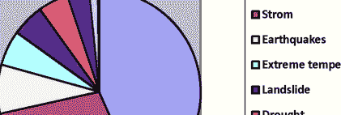

图1：1998-2017年全球发生的灾害类型

图1显示了1998年至2017年间发生的自然灾害类型。它直观地显示，以来洪水一直是影响全世界人类生活的主要灾害。

当提到斯里兰卡时，国家灾难救援服务机构（NDRCB）宣布洪水数量与去年相比逐年增加。图2显示了2014-2019年斯里兰卡受洪水影响的人数。

图2：受洪水影响的人数（2014-2019）

对于受影响的情况，为了减少受洪水影响的人，拥有一个实时的洪水水位系统是重要的。这种系统可以估计洪水水位。洪水是自然灾害。通过数据处理技术可以提高应急管理的效率。

## II. 相关工作

洪水影响水平的识别是必要的。在实施之前，进行了文献研究。

### A. 社交媒体在洪水估计中的应用

基于回归的方法。近年来，使用社交媒体数据进行洪水检测的预测 [3-6]。Wang等人利用Twitter数据和众包检测洪水区域。另一种解决方案是利用不同类型的社交数据创建洪水地图 [7]。基于社区的数据（如视频和图像）已用于洪水预测。[8]表明社交媒体是信息的来源。它还包括从社交媒体获取的非结构化数据的处理挑战。其他研究[6][7]描述了社交媒体的使用对洪水水位的影响。M. Smith等人[7]利用Twitter数据开发了洪水风险管理的实时框架。Wang等人利用英语文本估计洪水水位。

### B. 用于图像分类的深度学习模型

这项研究主要取决于深度学习和深度学习技术，我们需要了解深度学习在图像处理领域的应用。

P.Choudhary等人[10]使用`VGG`模型作为网络骨干从洪水图像中预测水位。他们通过替换末端层来调模型以减少深度，因为他们想知道水位。Lu等人[11]发现`VGG16`模型在自然灾害背景下表现良好。视觉显示`VGG`深度模型适用于大规模图像识别。

研究[13-15]使用深度学习模型进行图像分类任务。一种为移动视觉提供高效特征的深度模型。Ord. G等人[15]有效地识别了交通检测中的平衡权衡参数。在他们的论文[16]中，`Mobile`模型被用于名为`SSDnet`的相关网络框架。一种移动模型的新版本`Vmob`被用于研究[17]中的目标检测和语义分割。

高效模型 [21] 是图像分类任务中最常用的深度学习图像模型。

## III. 方法论

### B. 图像预处理

图像预处理是广泛技术的应用，包括修改图像、应用艺术滤镜、增强图像竞争力、分割等。在图像预处理中，数据增强是一种增加图像数据数量的技术。数据增强是一个过程，通常通过对原始图像进行旋转或镜像、放大和缩小、平移、放大失真、改变色调来实现 [22]。

下图 3 显示了所采用的方法论阶段，旨在进行对比研究并为洪水影响检测提出最合适的模型。

| 收集数据集 | 图像处理 | 深度学习模型 |
|---|---|---|
| 性能评估 | 分析结果 | 主动学习 |

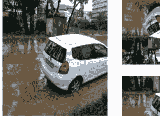

图 3: 所采用的方法论

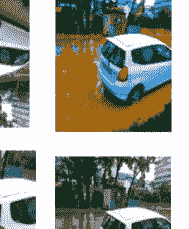

### A. 数据集

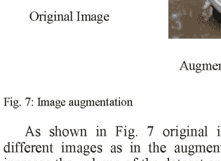

数据集由 1543 张社交媒体图像组成，并分为高风险、中风险和低风险三类。其中包含 553 张“高风险级”图像、607 张“中风险级”图像和383 张“低风险级”图像。数据集分为训练集（1245 张图像）和验证集（306 张图像）。

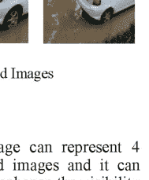

图 7: 图像增强

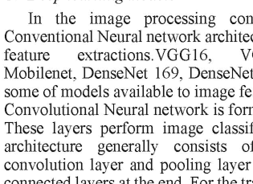

如图 7 所示，原始图像可以代表 4 种不同的增强图像，这可以增加数据集的量，并提高水位的可视性。

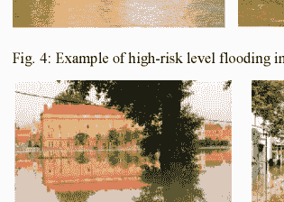

图 4: 数据集中高风险级洪水图像示例

### C. 深度层方法论

在图像处理领域，许多先进的卷积神经网络架构被用于特征提取，如 `VGG16`、`VGG19`、`InceptionV3`、`MobileNet`、`DenseNet169`、`DenseNet201`，有一些模型可以提取图像特征 [23]。卷积神经网络由若干层组成。这些层执行图像分类任务。`CNN` 架构通常由卷积层、池化层以及一个或多个连接层。对于迁移学习，使用了 `VGG16`、`VGG19`、`DenseNet169` 和 `MobileNet`。

### D. 迁移学习

迁移学习和领域适应是指将在一个环境中中学到的知识被利用以提高另一个环境中的泛化能力。迁移学习是一种优化方法，允许在建模第二个任务时取得进展或提高性能。通过大量数据和简单方法调整模型权重，然而网络将使用预训练权重来解决这些新任务。通过微调模型，我们可以调整模型以适应我们的数据并提高准确性。在这里，我们解冻最后几层

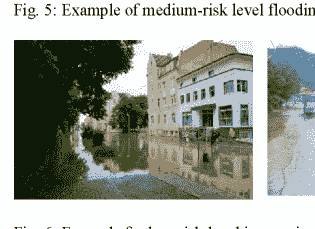

图 5: 数据集中中风险级洪水图像示例

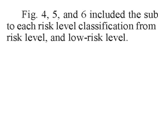

图 6: 数据集中低风险级图像示例

图 4、5 和 6 包含了与每个风险级别分类相关的数据集子集，包括高风险、中风险和低风险级。

### E. 混淆矩阵

混淆矩阵用于在输出为两个或更多类别的分类问题中，寻找模型的准确率和性能。

- 真阳性 (TP) = 真实标签且样本标签为正性。
- 真阴性 (TN) = 真实标签且样本标签为负性。
- 假阴性 (FN) = 样本真实标签为正性，但预测标签为负性。
- 假阳性 (FP) = 样本真实标签为负性，但预测标签为正性。
- 真阳性 (RP) = 真实阳性
- 真阴性 (RN) = 真实阴性
- 预测阳性 (PP) = 预测阳性
- 预测阴性 (PN) = 预测阴性

F1 分数定义真阳性的重要性是其他指标的两倍。

准确率 = $\frac{TN+TP}{TN+TP+FP+FN}$

精确率 = $\frac{TP}{TP+FP}$

召回率 = $\frac{TP}{TP+FN}$

F1Score = $\frac{2 \times TP}{2 \times TP+FP+FN}$

## IV. 结果与讨论

每个深度学习模型的最终准确和损失包含在表 1 中。

| 深度学习模型 | 准确率 | 损失 |
|---|---|---|
| VGG16 | 63% | 0.47 |
| VGG19 | 68% | 0.52 |
| MobileNet | 86% | 0.43 |
| DenseNet169 | 65% | 0.98 |

每个模型的数据分析结果在后续图中所示。这些图分别显示了每个模型的训练和验证准确率。

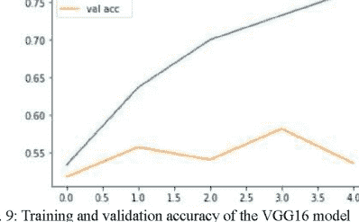

图 9: VGG16 模型的训练和验证准确率

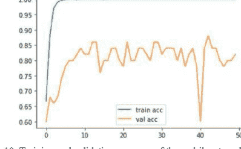

图 10: mobilenet 模型的训练和验证准确率

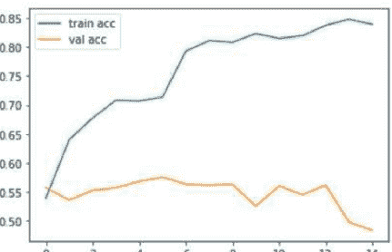

图 11: DenseNet169 模型的训练和验证准确率

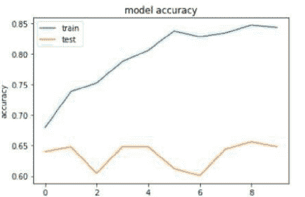

图 12: VGG19 模型的训练和验证准确率

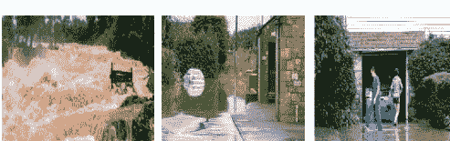

图 14: 用于评估的图像

| | 图 1 | 图 2 | 图 3 |
|---|---|---|---|
| 高风险 | 0.935892 | 0.067895 | 0.0 |
| 中风险 | 0.036322 | 0.633542 | 0.1956 |
| 低风险 | 0.027785 | 0.298563 | 0.79644 |
| 预测结果 | 高风险 | 中风险 | 低风险 |

表 2: 预测结果表

## V. 结论

获得结果后，每个深度学习模型表现良好，准确率为 86%，然后进入验证过程。在下一阶段，我们将描述 mobilenet 的评估。如第三节 E 节中的混淆矩阵所示，它对比了预测标签和真实标签。

进行了系统性综述，以了解全球洪水灾害管理的技术、算法和框架。这对于提出新的基于图像分析的方法非常重要。所提出的方法描述了预测洪水灾害的图像分析。基于 `CNN` 的模型可以自动识别图像特征并根据其影响级别进行分类。对于图像分割，使用了全卷积网络 (`FCN`) 模型。`CNN` 具有局限性，无法处理不同的输入尺寸。

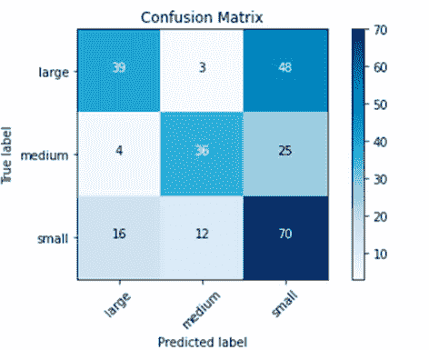

图 13: 混淆矩阵

作为工作内容，我们建议结合不同类型的多媒体数据（如图像、音频和视频）创建一个用于洪水预测的实时平台，并通过集成学习来提高模型的准确性。

## 参考文献

-   [1] L. Starkey 等人，“专业发展：纽约教育改革的体现，” *Teaching and Education*, vol. 25, no. 1, pp. 181–189, 2009. doi:10.1016/j.ied.2008.08.007.
-   [2] N. Chaudhary, S. Jang, P. J. Leito, K. Schindler, 和 J. D. Weber，“基于多级排名方法的社交媒体水位预测，” *ISPRS Journal of Photogrammetry and Remote Sensing*, vol. 167, pp. 55–262, 2020. doi:10.1016/j.isprs.2020.10.073.
-   [3] R. Q. Wang, H. Mao, Y. Cang, 和 W. Shaw，“利用社交媒体和众包数据解析城市洪涝，” *Communications and Geosciences*, vol. 111, pp. 139–147, 2018; doi:10.1016/j.cg.2017.10.118.
-   [4] J. Forberg, D. Dransch, H. Schmitz, 和 K. Schuster，“社交媒体作为洪水制图的信息源，” *Natural Hazards and Earth Science*, vol. 14, no. 2, pp. 2728–2735, 2015; doi:10.1007/s21105-015-2738-5.
-   [5] M. Krifner 和 A. Erlich，“用于洪水制的移动传感与低成本应用，” *International Archives of Photogrammetry, Remote Sensing and Spatial Information - ISPRS Archives*, vol. 42, no. 2, pp. 543–550, 2018; doi:10.5194/isprs-archives-v42-2-543.
-   [6] L. Zi, W. C. Chang, 和 D. Gu，“评估社交媒体在洪水制图中的效用：2015年卡拉奇洪水案例研究，” *Geographic and Earth Information Science*, vol. 15, no. 2, pp. 97–110, 2018; doi:10.1080/15230460.2016.1217356.
-   [7] L. Smith, Q Liang, P. James, 和 W. Lin，“利用实时框架评估社交媒体作为洪水风险管理源的效用，” *Journal of Flood Risk Management*, vol. 10, no. 3, pp. 370–380, 2017; doi:10.1111/jfrfm.12314.
-   [8] E. Starkey, G. Parikin, S. Birkinshaw, A. Page, P. Quinn, 和 G. Gibson，“证明基于社区（‘公民科学’）的观测对流域建模和表征的价值，” *Journal of Geography*, vol. 548, pp. 801–817, 2017, doi:10.1016/j.jse.2017.03.019.
-   [9] O Pavlov, A. Price, 和 M. Halon，“OpenMaps：一个用于人群可视化和灾害相关危害传感器网络观测分析的平台，” *ISRAM 2014 Conference - 11th International Conference on Information for Crisis Response and Management*, no. pp. 802–806, 2014.
-   [10] P. Chaudhary, S. D. Arroya, M. DeV, P. J. Leito, 和 J. G，“从社交图像估计水位，” *ISPRS Annals of the Photogrammetry and Spatial Information*, vol. 4, no. 2, pp. 5–12, 2019; doi:10.5194/isprs-v4-2-5.
-   [11] X. Liu, J. Van Jaeger, 和 A. D. Bagdanov，“通过学习排序的人群计数，” *Proceedings of the IEEE Conference on Computer Vision and Pattern Recognition*, 7661–7668, 2019; doi:10.1109/CVPR.2019.008198.
-   [12] A. Z. Simonovsky，“用于大规模图像识别的深度卷积，” *International Conference on Learning*, vol. 1, pp. 1–14, 2015.
-   [13] A. Howard, W. G. Chu, L. Chen, B. Chen, 和 M. Tan，“MobileNetV3，” 2019.
-   [14] C. Szogedy, V. Vanhoucke, J. Shlin, 和 J. Wiener，“重新思考残差连接的学习，”
-   [15] A. Huang 和 K. Weiner，“应用，” 2012.
-   [16] C. Szogedy, P. Reed, V. Vanhoucke, 和 A. Rabikov，“带卷积的分组跳转，” pp. 1–2.
-   [17] M. Tan 和 J. V. Le，“EfficientNet：扩展卷积神经网络，” 2019.
-   [18] F. Agostinelli, M. Hoffman, P. Sadowski, 和 P. Bail，“学习激活函数以改进深度网络，” *3rd International Conference on Learning Representations, ICLR 2015–Workshop Track*, 2013, pp. 1–9, 2015.

- [19] D. Lee 和 J. Du，“利用多光谱卫星图像集成和 CNN 架构学习检测洪水，” *IEEE CBR Workshop Proceedings*, vol. 2283, pp. 3–5, 2018.
