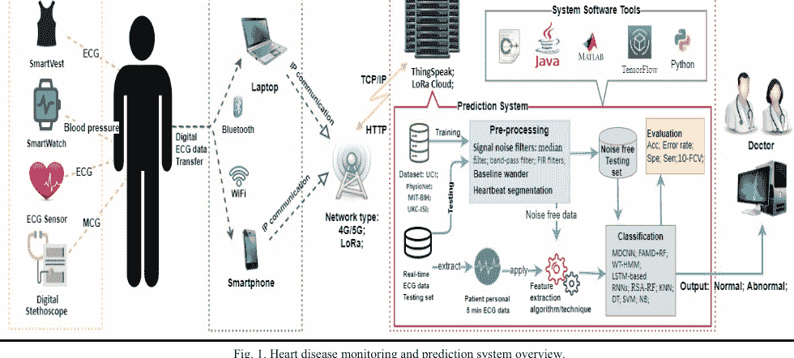
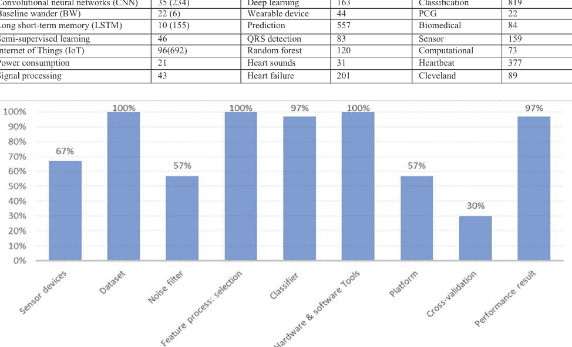

# 2020 第五届智能系统与工业应用创新技术国际会议 (CITISIA) (澳大利亚悉尼 2020.11.25-2020.11.27)

daisyhe815@gmail.com, maag@studygroup.com, elchoui@ashford.edu

**— 摘要 —** 现代人类引起的主要疾病是心脏病，这种疾病往往隐藏且无症状，导致了许多死亡。随着医疗行业物联网（`IoT`）技术的发展，为临床人员提供远程预测和监测心脏病的技术支持是目前最相关的，且需要更多论文来发现该领域的缺点并填补空白。此外，本文已通过使用不同类型的机器学习算法对心脏病进行预测和诊断，比较了所提方法与心脏病监测的最佳框架。从数据集来看，从物联网传感器收集的数据比从其他地方收集的数据更困难，因为物联网数据集中包含更多噪声，且数据值缺失在这一问题中构成了挑战。因此，为了缩小研究差距，找到监测和预测心电图（`ECG`）信号的最佳方法，同时达到可接受的准确率。

朴素贝叶斯 [9]。选择合适的算法和合适的信号预处理技术是选择最有效特征以提高准确率最重要的步骤。然而，许多研究人员指出，他们的方法在近年来可以达到高于 40% 的准确率。我们希望能够提高准确率，并对以往研究人员提出的方法使用更少的测试。

**关键词 —** 机器学习、心脏病、物联网 (`IoT`)、预测与监测。

## I. 引言

如今，机器学习技术已广泛应用于许多领域。例如，使用预训练机器模型来预测心脏领域的信号，心脏病是全球范围内的第一死因，每年有约 3500 万人死于心脏病 [1]。在物联网和可穿戴设备的发展中，为物联网与医疗行业的融合提供了基础 [2]。对于成员来说，最重要的是模型是否能够首次预测他们患有心脏病或向他们提供建议。然而，机器学习只能分析数据并预测患者是否患有心脏病。因此，我们需要物联网传感器持续监测心脏信号，主要数据是患者的心电图（`ECG`）信号 [3], [4] 以及血压频率 [6]。研究人员可以使用心电图 [7] 和 [8] 作为诊断疾病的重要信号。

本文主要关注寻找当前研究的空白并提高机器学习的预测准确率。机器学习技术有不同类型的方法。例如，随机森林、`k-近邻`、决策树、支持向量、

`MIT-BIH` 数据集包含 48 名患者的长程数据 [15]。研究人员通常将原始心电信号分解成不同的片段或每次心跳进行诊断，

## II. 文献综述

我们回顾了 15 篇关于预测心脏病研究的机器学习最相关且最新的论文，并根据这些论文使用的常用组件和特征对它们进行了深度分析。在下文中，我们根据所使用的实验将常用组件分为九方面。在输入步骤，我们分析了数据集、传感器设备以及处理后的信号特征、特征提取和分类以及许多方法。在输出结果阶段，我们分析了时间和能量成本。

### A. 主要数据集和数据

该领域的大多数研究基于在线数据分析，少数研究人员使用他们提出的方法通过测试来收集数据 [6], [11]。大多数论文可以分为两类，一类是从 [13], [14] 收集，另一类来自 `MIT-BIH` [9], [15], [16]。`UCI` 数据集包含 303 条记录，每条记录有 7 个特征。例如，血压、血糖、年龄等。然而，心脏病数据集中仅 14 名患者被用于研究。

### B. 数据传感器设备

传感器设备作为物联网上信号采集和通信的终端起着至关重要的作用 [17]。对于心脏预测，主要信号是我们需要收集血压并仅使用 2.5 分钟的患者心电图记录以达到可接受的准确率。减少时间在整个系统的运行中有了显著改进。

（注：原文此处存在大量重复段落，翻译已按要求不重复输出）

专为物联网设计。Liu [11] 设计了一种可穿戴式智能设备，用于持续监测 `ECG` 并数据传输到联想健康云平台。然而，从传感器到云端的实时传输所需的时间长于传感器与边缘之间的传输，这需要更多的功率。

为了用于机器学习方法训练的个人 `ECG` 数据，在训练之前的第一步是对数据进行预处理，消除噪声并提高其价值。无噪声的数据将使用不同的算法和技术提取特征。最后，无噪声测试数据完全从物联网传感器中采集并进行测试。因此，图表的类型，并绘制了图 1，展示了心脏病预测系统框架的概述，包括在最重要的心脏病预测系统中所使用的硬件和软件工具，即部署在云端服务器上的机器学习方法。如果经过训练，该系统可以更好地预测患者。

### H. 时间和能量成本

实时监控和心脏病预测系统对速度有约束和要求。近期，研究人员关注预测的准确性，而忽略了对功耗和消耗的检测与比较 [25]。因为系统在测试之前完成，监控是为了对每条输入数据进行预测。Liu [9]、Liu [11]、Wang [15]、Saajjad [19] 提到了提出的测试成本。然而，Omidaki 和 Hashimi [5] 考虑了执行时间和功耗。

### I. 分类和系统框架

表 I 显示了相关的 15 篇论文的分类。输入过程步骤分类以及评估和输出。我们收集了 2020 年以前发表的 6 篇论文，15 篇论文中有 9 篇与我们的主题高度相关。从表 I 可以看出，我们有 4 位来自 `UCI` 的作者，7 位来自 `MIT-B` 的作者，在其他 7 位作者中，我们使用全球数据集采集的 20 导 `ECG` 来训练输入数据。此外，带通滤波器是 15 篇论文中最常用的滤波器，用于减少和消除噪声。为了从信号数据中提取特征，`Pan-Tompkins` 是检测 `ECG` 和心心段最常用的算法。此外，大多数作者使用组合不同的特征来提高准确性。对于预测，常用的方法是卷积神经网络 (`CNN`) 和随机森林 (`RF`)，这些不需要数据特征提取。然后我们可以提取所有不同的特征作为特征树节点。此外，所有 15 篇论文都使用性能指标来评估结果。我们有 12 位作者的性能指标，包括准确率、敏感度、敏感度。然而，只有 7 位作者给出了时间结果（例如处理时间、测试时间、训练时间、预测时间）作为最终结果。

表 II 是相关 15 篇论文的汇总表。大多数作者使用在线数据集进行训练和机器学习方法，一些作者通过传感器设备为测试者收集数据。由于每个分类器使用的数据集不同，它使用选定的方法进行序列预测。训练和测试特征是系统检测的不同步骤。某些作者对分类器使用了不同的数据集，这可以导致高性能。此外，大多数人使用提取特征，因为特征数量可以减少系统处理时间和复杂函数。从分类器我们可以发现，不再需要结合两个或多个算法和技术来获得更高的准确性。最重要的步骤是分类器性能矩阵的最佳性能和结果，这些矩阵最常用的是准确率、敏感度和特异性。然而，只有少数作者展示了系统运行时间和能量消耗结果。

## III. 评估

在审查和分析相关论文后，我们提出的方法使用可穿戴设备作为智能手表、智能健康和 `ECG` 传感器来收集患者的 `ECG` 数据和血压数据。我们使用智能手机或手机来传输数据信号。进一步，我们使用已训练并部署在云端的机器学习模型，以避免对采集传感器的引导并发送到计算机。输出将类似地发送到计算机。然而，某些论文在图中展示了机器学习方法的处理步骤。在 `ECG` 机器学习的细节中，第一步是使用从数据集中采集并应用限制

表 III 是 30 篇文章中提到的术语频率。术语列是每篇论文的关键词，列出的 36 个术语与我们的主题最相关。此外，分类器的添加是 30 篇论文中提到的总时间。例如、`ECG`、`CNN` 和 `ML`，由于某些作者使用其他表达，或带有缩写的短语、表达，我们使用原始形式并计数。相应的缩写已提出。然后我们使用的结果与心脏检测有关，心电图是最重要的数据。机器学习。相应的缩写已提出。然后我们使用的结果与心脏检测有关，心电图是最重要的数据。机器学习。

## IV. 验证

图 2 展示了下面的百分比，我们可以清楚地看到可以由什么组成。

### 15 篇论文的分类

| Ref | Dataset | Input | Technique | Method | Hardware | Software | Platform | Evaluation | Output |
| :--- | :--- | :--- | :--- | :--- | :--- | :--- | :--- | :--- | :--- |
| [6] | `UCI` | Smartwatch | IBP | | | | | | |
| [7] | `UCI` | Heart monitor | BIF | | | | | | |
| [8] | `UCI` | `ECG` | FAD | | | | | | |
| [9] | `MIT-B` | | | | | | | | |
| [10] | `MIT-B` | | | | | | | | |
| [11] | `IoT` sensors | | | | | | | | |
| [12] | | | | | | | | | |
| [13] | | | | | | | | | |
| [14] | | | | | | | | | |
| [15] | | | | | | | | | |

## 传感器设备

## 患者设备

## 云端服务器

图 1. 心脏监测与预测系统架构。

用于我们的网络。显然，不同的作者会使用不同的类别来处理心脏病预测任务。图 2 列出的九个组件是根据心脏病监测范围以及通过机器学习方法对 `IoT` 设备收集的数据时遇到的最重要因素。我们列出的组件中，几乎每一项都由 30 篇文章中的超过半数提到，除了“课程（course）”外，30% 的论文使用它来获得稳定可靠的模型 [15]。选择课程的目的是获得预测准确率。然而，最重要的结果仍然是预测准确率。尽管，30 篇论文中近 100% 的都给出了性能指标。

在使用系统时。因此，这是 Yang [13] 提出的系统的局限性。此外，`UCI` 的每一类包含 76 个特征，只有 14 个是研究人员最常用于心脏病诊断的特征。根据 Khan [6]，Javed 提取了那 14 个特征并实现了与之前的学者相同的准确率。因为特征选择需要通过使用系统处理时间并降低功耗来实现。

## V. 讨论

在下一节中，我们将根据评估表比较并讨论最新 15 篇论文中使用的重要组件的优缺点。通过比较，我们可以找到目前最先进的心脏病预测和分类准确率方法。此外，基于比较，我们将尝试发现并指出这些论文中的影响和局限性。

### A. 数据比较：UCI 数据集和 MIH-B 数据集

从表 2 可以看出，15 篇论文可以分为两类不同的数据集，一个是 `UCI` 报告的数据集，另一个是 `MIH-B` 数据集。8 篇论文使用了该数据集。Khan [12] 选择使用 `UCI` 报告的实验数据，该数据集包含 30 个受试者，每个包含 76 个特征。大多数研究人员使用所有 30 个受试者进行实验。然而，Yang [13] 选择删除具有缺失值的 33 个受试，这意味着他们提出的系统无法识别和导入数据。`IoT` 设备通常较小且轻量化，数据丢失和不完整的数据收集可能会

### B. 数据划分

通常，在训练机器学习模型之前，研究人员会将数据按照一定的比例划分为训练集和测试集。训练集的数量将多于测试集。然而，Khan [6]、Gjorkesi [7]、Mehr [8]、Liu [11] 有自己通过设备收集的数据，他们选择将收集的数据作为测试集，他们可以检查他们的

| 参考文献 | `UCI` | 总受试者 | 总测试样本 | 正常受试者 | 心脏患者 | 数据集划分 训练 | 数据集划分 测试 | 比例 | 测试集 | 特征数量 | 原始特征 | 提取特征 | 最佳性能 CC | PPV | F1 | SEN | 回回率 | 时间成本 | 能量消耗 |
|---|---|---|---|---|---|---|---|---|---|---|---|---|---|---|---|---|---|---|---|
| [6] | 900 | 4000 | 304 | N/A | 139 | 5528 | N/S | 16 | 900 | 14 | 7 | N/A | 98.5 | 92.6 | 97.8 | 82.3 | N/S | N/S |
| [7] | 900 | 5187 | 764 | N/A | 303 | 3153 | N/S | 15 | 161 | 15 | 2 | N/A | 98.2 | 95.5 | 96.2 | 82.3 | N/S | |
| [12] | 900 | 4830 | 303 | N/A | 163 | 241 | N/S | 6.2 | 81 | 14 | 2 | N/A | 92.9 | 94.4 | 95.6 | 86.2 | N/S | N/S |
| [13] | 900 | 110007 | 800 | N/A | 100 | 70180 | N/S | 1.1 | 800 | 8 | 5 | N/A | 99.18 | 99.0 | 99.1 | 98.8 | N/S | N/S |
| [19] | 900 | 49632 | 201 | N/A | 55 | 80594 | N/S | 8.2 | 201 | 7 | 扩展 | N/A | 99.06 | 99.6 | 95.8 | 99.8 | N/S | 训练-测试 |
| | 900 | 2700 | 270 | N/A | 120 | 68256 | N/S | 8.1 | 270 | 13 | RAW `ECG` | N/A | 91.2 | N/A | 93.0 | N/S | N/S | 31.2 |
| | 900 | 2700 | 150 | N/A | 189 | 4428 | N/S | 7.3 | 150 | 17 | RAW `ECG` | N/A | 88.0 | 80.8 | 98.8 | 80.2 | N/S | CPU75 |
| | 900 | 1800 | 380 | N/A | 301 | D20000-min | N/S | 7.2 | 380 | 15 | RAW `ECG` | N/A | 93.3 | N/A | 99.8 | N/S | N/S | 0.872 s |
| | 900 | 1800 | 300 | N/A | 303 | D20000-one min | N/S | 7.3 | 300 | 5 | RAW `ECG` | N/A | 94.9 | N/A | 99.4 | N/S | N/S | 1.7 per beat |
| | 900 | 2500 | 250 | N/A | 150 | 480 | N/S | 7.3 | 250 | 6 | RAW `ECG` | N/A | 96.9 | N/A | N/S | N/S |
| | 900 | 1357 | 112 | N/A | 278 | 186 | N/S | 5.3 | 112 | 28 | RAW `ECG` | N/A | 91.7 | N/A | N/S | 2.3ms |
| | 900 | 300 | 317 | N/A | 94 | 450 | N/S | N/A | 317 | N/A | /A | 99.9 | 99.68 | 94.46. N/S | 6. | .
| | | 900 | 30522 | 48 | N/A | 6198 | DS200+25-my `ECG` | N/S | 1.1 | 48 | 22 | RAW `ECG` | N/A | 99.09 | N/A | N/S |
| [4] | 900 | 123 | - | N/A | - | DS200+22-my `ECG` | N/S | - | 123 | N/A | RAW `ECG` | N/A | 99.38 | 99.37 | N/S | 201s |

## 表 III 30 个所选产品的频率

| 术语 | 频率 | 术语 | 频率 | 术语 | 频率 |
|---|---|---|---|---|---|
| 支持向量机 (`SVM`) | 76 (244) | 心脏病 | 430 | `XGBoost` | 49 |
| 心血管疾病 (`CVD`) | 60 (48) | `MIT-偏置` | 75 | 实时 | 152 |
| 深度学习 | 85 | 特征选择 | 724 | 监测 | 214 |
| 心电图 (`ECG`) | 77/(140) | 医疗 | 148 | 过拟合 | 34 |
| 机器学习 (`ML`) | 293 (691) | 特征提取 | 636 | 噪声 | 186 |
| 卷积神经网络 (`CNN`) | 171/(354) | 深度学习 | 85 | 分类 | 219 |
| 基线漂移 (`BW`) | 22 (6) | 可穿戴护理 | 424 | `PCG` | 22 |
| 长短期记忆 (`LSTM`) | 10 (155) | 预测 | 557 | 生物学 | 84 |
| 半监督学习 | 46 | `QRS` 检测 | 86 | 传感器 | 159 |
| 物联网 (`IoT`) | 96/(692) | 随机森林 | 120 | 计算 | 737 |
| 功耗 | 21 | 心脏声音 | 31 | 心跳 | 377 |
| 信号处理 | 43 | 心脏衰竭 | 201 | 克利夫兰 | 89 |

所提系统处理收集的数据性能。然而，目前大多数的研究选择了划分数据集，其中 4 篇论文使用了 7:3 的比例进行划分 [8], [13], [14], [15]。[15] 在这些，Wang [1] 将数据分为三个不同的比例：8: 2、7: 3，结果显示 7: 3 达到了最佳性能。此外，研究人员也选择了 7:3 的分配，我们决定在我们的系统中使用 7:3 的比例来评估机器模型。

### C. 用于训练的个人 ECG 信号添加

对于训练集，最不同的点在于：Chen [4]、Amirishashi 和 Hashemi [5]、Saadnej [19] 也选择了一段客户隐私监测的正常 ECG 信号来实现隐私监测和系统，该系统对于识别差异和具有略微不同的 ECG 特征特别，并且可以提高准确率。Saadnej 在之前的 Chen [4]、Amirishashi 和 Hashemi [5]、Kiranyaz [23] 工作的基础上，仅向训练集添加 2.5 分钟的个人数据就获得了更高的准确率，比 Amirishashi 和 Hashemi [5] 高 1.7%，比 Chen [4] 高 0.51%，比 Kiranyaz [23] 高 1%。

基于小波的马尔可夫模型实现了最佳的心脏病预测。Saadatnij [19] 也取得了良好的性能，准确率高于 95.2%，但低于 Sangath [3]。此外，Saadatnij [19] 仅需 31 秒就实现了显著改进。Wang [85] 和 Barra [9] 的长短期循环神经网络是 Saadatnij [19] 处理 2.5 分钟个人心电图（ECG）数据时使用的方法。

误差小于 1%，达到了生命疾病预测的高度可接受范围。然而，大多数先前的研究人员侧重于提高准确率以及调节速度和功耗，而他们的模型通过物联网技术实现了可接受的准确率范围。

由于超过一半的入选患者选择使用 ECG 信号来诊断心脏受损情况，所提的系统使用可穿戴设备收集 ECG 信号。此外，大多数研究人员选择将机器学习部署在云服务器上。在对现有技术进行全面分析后，在云端部署模型是高效的。

## VI. 未来与结论

在未来，我们将基于 Saadatnij [19] 提出的长短期循环神经网络，并尝试减少本地 ECG 数据以达到可接受的准确率水平。该框架将配备和完善可穿戴的设备。对于监控，智能手表（360 Rico [94]）将作为可穿戴智能手表，即一种智能 MTM 受限电子设备 [7]。此外，参考心脏病预测领域的最先进技术，后来的研究人员可以使用 ECG 信号作为预测的数据集并降低成本。然而，我们仍然需要使用 7-3 比例对物联网设备收集的数据进行更多检查，以进行预测和分析，确保所提系统能够处理 24 小时内的大量数据。

在本文中，我们首先回顾了 30 篇最新的期刊论文，然后我们使用可穿戴物联网设备收集的 24 小时数据进行评估和分析结果，并使用移动电脑和智能手机上的蓝牙和 WiFi，然后由智能手机将数据传输到云服务器，并使用应用于部署在云端的机器学习方法来诊断疾病。通过统计分析，我们确认当前所提的研究模型和技术能够实现高达 90% 的心脏病预测准确率，许多模型甚至可以达到小于 1% 的误差率。

## 参考文献

- [3] A. Sangiah, M. Murugan and G. Bian, "一种改进 ECG 分类和心律异常分析的智能方法," Journal of Medical Systems, vol. 44, pp. 107818–107820, 2020. doi: 10.1016/j.jms.2020.107819.
- [4] J. Chen, A. Veli, and A. Rah, "心脏智能监测器：通过深度学习改进心律失常检测," IEEE Access, vol. 7, pp. 128031–128039, 2020. doi: 10.1109/ACCESS.2020.2998375.
- [6] K. Alif, et al., "基于 MDCNN 的心脏病预测深度学习," IEEE Access, vol. 8, pp. 54717–54722, 2020. doi: 10.1109/ACCESS.2020.2997467.
- [8] S. Mehrang, et al., "用于房颤检测的智能手机监测的可靠性," IEEE Journal of Biomedical and Informatics, vol. 22, pp. 992–1000, 2018. doi: 10.1109/JBHI.2018.2833553.
- [9] D. Lai, Y. Zhang, Y. Sun and M. Bin, "基于深度学习的心脏死亡智能策略," IEEE Access, vol. 7, pp. 9470–9476, 2020. doi: 10.1109/ACCESS.2020.2997467.
- [10] L. Liu, al., "可穿戴设备的智能 QRS 评估," IEEE Internet of Things, vol. 6, no. 2, pp. 1715–1722, 2019. doi: 10.1109/JIOT.2019.293217.
- [11] A. Gomez, R. Kumar, S. Ahmed and R. Rahman, "心脏疾病诊断的机器学习," IEEE Access, vol. 8, pp. 14659–14670, 2020. doi: 10.1109/ACCESS.2020.299748.
- [12] Y. Yang, et al., "健康物联网临床决策支持的支持学习," IEEE Access, vol. 8, pp. 21195–21206, 2020. doi: 10.1109/ACCESS.2020.301371.
- [13] Y. Zhao, S. Long, I. Qasim, A. Noor, "心脏病预测的基于随机搜索和遗传算法的智能系统," IEEE Access, vol. 7, pp. 188205–188239, 2019. doi: 10.1109/ACCESS.2019.293217.

## 附录

缩写词：全称

| 缩写词 | 全称 | 缩写词 | 全称 | 缩写词 | 全称 |
| :--- | :--- | :--- | :--- | :--- | :--- |
| MCFA | 基于匹配的无袖优化算法 | Pan-TA | Pan 塔算法 | HD | 心脏病 |
| ECG | 心电图 | | | CA | 心律失常 |
| MDCNN | 深度卷积神经网络 | MKDA | 基于形态的检测算法 | PWD | 个人可穿戴设备 |
| G | g 值 | QRS-DA | QRS 检测算法 | SRD | 窦性心律检测 |
| IE | 熵 | HP | 心脏点 | HDP | 高血压心脏病 |
| PPV-PP | 阳性预测值 | Acce | 可接受的心电图 | IoT-HD | 健康物联网 |
| NPV | 阴性预测值 | unac-ECG | 不可接受的心电图 | BIF | 内置滤波器 |
| SEN | 敏感性 | SEA | SEA 算法 | LPF | 低通滤波器 |
| SPE | 特异性 | Phy-A | 生理应用 | BPF | 带通滤波器 |
| DRE | 检误差率 | GAN-SSA | 基于 GAN 的无缝注意力机制 | MF | 中值滤波 |
| ORS | 过采样率 | TFL | TensorFlow 库 | HOLP | 高阶线性相位滤波器 |
| CHF | 慢性心力衰竭 | CDSS | 临床决策支持系统 | SWT | 滑动窗口技术 |
| DL | 深度学习 | k-CV | k 折交叉验证 | dbt-wb | dwt 小基线 |
| MORL | 多目标强化学习 | 5-CV | 5 折交叉验证 | dwt-wb | dwt 小波技术 |
| LOSO | 留一交叉验证 | K-CV | k 折交叉验证 | DWT | 离散小波变换 |
