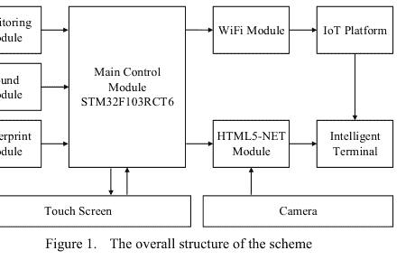
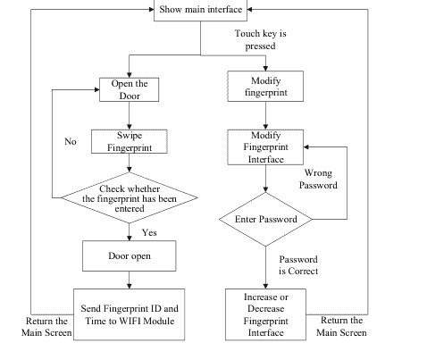
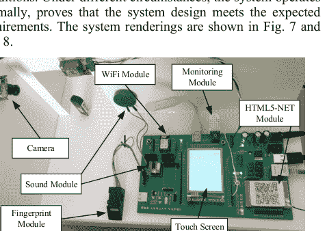

# 2020 第五届机械、控制与计算机工程国际会议 (ICMCCE) (中国哈尔滨 2020.12.25-2020.12.27)

杜文文¹，王鹏¹，卓正林¹，赵亚南¹，天磊¹

*山东科学技术大学信息与通信学院，中国山东省青岛市，266590

*通讯作者邮箱：`wengpeng045@foxmail.com`

**摘要** 智能安防是指安全服务的信息技术。随着 21 世纪信息技术的飞速发展，智能安防与计算机之间的界限正逐渐消失。我们使用 `HTML5`（超文本标记语言第 5 代）和 `UDP`（用户数据报协议）设计了一种安全系统，具有指纹识别、密码控制、远程控制、用户界面、`HTML5` 多页设备和通知等功能。我们完成了 `PCB`（印制电路板）的设计与绘制，发布了软硬件设计与制作，并完成了整个安全系统的设计。

**关键词** 智能安防；`HTML5`；`UDP`

# I. 引言

随着自动控制和通信技术的发展，与物联网密切结合的产品发展迅速。例如用户界面、智能交互、网络摄像头、远程控制等。本文设计了一种基于 `HTML5`（超文本标记语言 5）网关的安全系统，具有以下功能：

- (1) 使用 `HTML5` 实现局域网监控的实时视频采集和多平台登录。
- (2) 通过控制，系统可以远程查看访客情况及温湿度，并通过网页控制门禁开关的切换。
- (3) 绘制独立的 `PCB`（印制电路板），提高了工作的稳定性和抗干扰能力。
- (4) 使用语音提示通过用户体验与用户交互。
- (5) 使用指纹识别方法控制门禁系统，方便快捷。
- (6) 使用触摸屏，用户可以更直观地触摸操作。

该系统可分为九个模块：主控模块、`HTML5` 节点、语音模块、音频模块、指纹模块、触摸显示、摄像头模块、`WiFi` 通信模块和 `IoT` 平台 [3]。图 1 显示了程序的整体结构。

本工作结合 `HTML5` 与技术构建了语音交互智能安防系统；使用 `HTML5` 和本地网关制作网页；使用 `HTML` 节点和网关连接到网络；使用 `STM32F103RTC6` 芯片作为底层 `MCU`（微控制器）与语音、触摸屏和移动传感器进行通信；使用 `WiFi` 模块进行数据协议传输。

## A. 无线通信方法

无线通信技术可能包括 `ZigBee`、`RFID`（无线射频识别）、蓝牙等技术。`WiFi` 用于连接设备。`WiFi` 是一种稳定的无线通信技术；蓝牙；`RFID` 是无线射频识别 [4]。电子设备可以通过网络实现远距离数据交换。表 1 从六方面对这四种短距离无线技术进行了水平比较。

根据表 1，与其他类型的无线通信方法相比，该方法符合本项目的需求。首先，`WiFi` 通信技术容易与其他设备兼容。其次处理了所有设备与其他设备的互连。可以看出，选择 `WiFi` 作为无线通信方法可以轻松完成设备与互联网之间的交互，一步到位，避免二次通信。

### 表 I 四种短距离无线通信技术的水平比较

| 特性 | WiFi | ZigBee | RFID | 蓝牙 |
|---|---|---|---|---|
| 单点覆盖范围 | 50m | 50-30m | 1m | 15m |
| 传输速率 | 50Mbps | 250Kbps | - | 1Mbps |
| 频段 | 2.4GHz | 2.4GHz | 868MHz或915MHz | 2.4GHz |
| 安全性 | 中 | 中 | 低 | 高 |
| 标准 | IEEE802.11 | IEEE802.15.4 | 未使用 | 未使用 |
| 功耗 | 500mW | 15mA | 5mA | 10mA |

## B. HTML-NET 模块

`HTML-NET` 设备在 `Linux` 操作系统上，基于 `MediaTek` 提供的 `M76AN` 网关开发。它使用增强型 `STC14WK3254` C51 单片机，内部连接了 4 个 `UART`（异步通用传输收发器）端口。模块包含了丰富的接口：无线天线接口、以太网接口、`USB2.0` 接口、`UART0`、`UART` 串口。

此外，由于 `TCP/IP` 通信和串口透明传输，`HTML-NET` 还具有网页设计，可用于跨平台 `UI` 用户界面设计和配置。`HTML` 网页与 `UART1` 串口通信，以桥接 `Websocket` 协议并控制 `STC15WK3254` 微控制器。`HTML` 网页保存在模块系统的 `/html web` 目录下。

`HTML-NET` 模块内置了 `UDP`（用户数据报协议）服务器，并使用唯一机制重新封装 `UDP` 通信并共享 ID 地址。专门获取 `UDP` 客户端的 IP。对于连接 `WiFi` 网络的客户端，由于手机的情况，IP 地址会频繁变化。

`HTML-NET` 接口主要包括 `HTML-NET` 模块、以太网接口、`USB` 接口、3.3V 稳压电路、`IO` 电路和指示灯。`HTML-NET` 模块内置 `UDP` 服务器，并使用一种独特机制重新封装 `UDP` 通信并共享 ID 地址。

# III. UDP 协议

`UDP` 是一种不可靠的传输协议，具有以下特点：

- 不建立连接。
- 不保证交付。
- 不保证顺序。
- 不支持流量控制。
- 不支持拥塞控制。
- 头部开销小。

## A. 校验方法

在计算校验和时，将头部字段置为 0。如果接收到的校验和不正确，则丢弃该数据包。

| 字段 | 校验和 |
|---|---|
| 源端口 | 0000000000000000 |
| 目的端口 | 0000000000000000 |
| 长度 | 0000000000000000 |
| 校验和 | 0000000000000000 |
| 数据 | 0000000000000000... |

在计算校验和时，将头部字段置为 0。如果接收到的校验和不正确，则丢弃该数据包。

| 字段 | 校验和 |
|---|---|
| 源端口 | 0000000000000000 |
| 目的端口 | 0000000000000000 |
| 长度 | 0000000000000000 |
| 校验和 | 0000000000000000 |
| 数据 | 11111... |

在计算校验和时，将头部字段置为 0。如果接收到的校验和不正确，则丢弃该数据包。

| 字段 | 校验和 |
|---|---|
| 源端口 | 0000000000000000 |
| 目的端口 | 0000000000000000 |
| 长度 | 0000000000000000 |
| 校验和 | 0000000000000000 |
| 数据 | 10101... |

输入指纹后，系统将显示门已打开。接下来，指纹 ID 和时间将发送至 `WiFi` 模块并返回主界面。当按下指纹按钮时，将进入指纹修改界面。此时将显示数字键盘，用户可以输入设置的密码。如果密码错误，将返回到指纹修改界面。如果密码输入正确，将进入指纹增加或删除界面。指纹增加或删除后，将返回主界面。下机软件程序图如图 6 所示。

# V. 系统测试

系统上电后，对指纹模块、触摸屏、`HTML5-NET` 模块、控制和数据进行模块功能测试。测试完成后，根据预设要求进行系统的整体逻辑测试。我们设置了不同的条件。在不同情况下，系统运行正常，证明设计符合预期要求。系统需求见图 7 和图 8。

# VI. 结论

本文从 `UDP` 协议和系统设计的角度介绍了一种基于 `HTML` 网关的智能安全系统，定义了 `HTMLNET` 网关的主要功能，并根据视频流特性运行了 `UDP` 框架和验证方法。在这项工作中，我们完成了基于指纹识别、密码控制、远程控制、界面、`HTML5` 多设备、触摸按钮等的智能安全系统的绘制与设计。实现后，系统运行良好，能够满足预期需求。

## 参考文献

- [1] R. A. Naifi, N. Satar, and L. Duan, "Speech and Lightweight Communication Scheme on UDP for Low End IoT Devices," 11th IEEE International Conference on Advanced Networks and Telecommunications Systems (ANTTS), 2019, Gaya, Delhi, India
- [2] M. S. Hussain, N. Poponen, P. Oli and J. Salman, "Network Monitoring in a Small-Scale Smart-Grid Laboratory," 2014 25th IEEE International Conference on Reliability, Survivability, and Security, Finland, Switzerland, 316
- [3] M. S. Hussain, "Status monitoring for smart home healthcare," 2016 IEEE International Conference on Multimedia & Expo Workshops (ICMEW), 2016, Washington, DC, USA
- [4] Q. Wi, W. Wang, and L. Duan, "Video monitoring of security system based on Wi-Fi," 2016 Chinese Conference on Control and Decision Conference (CCDC), 2016, Beijing, China
- [5] A. K. Shaila, G. S. Gulhan, and M. Dubey, "UDP LTE: An Effective method for video transmission via UDP protocol," 2016 International Conference on Communication, Networking and Information Technologies (ICCNIT), 2016, Ramanagathapuram, India, pp. 666-672.
- [6] V. D. Vaidya and P. Vishwakarma, "A Comparative Analysis on Smart Home Monitoring System based on different technologies like GSM, IOT, Bluetooth and PI Microcontroller for Zigbee Mediation," 2018 International Conference on Smart City and Emerging Technologies (ICSET), 2018, Mumbai, India, pp. 1-4.

