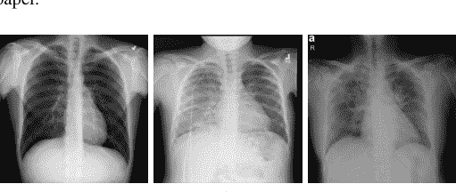
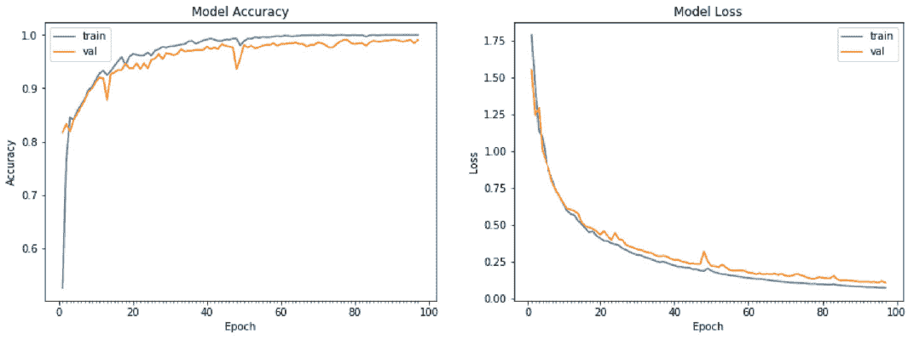
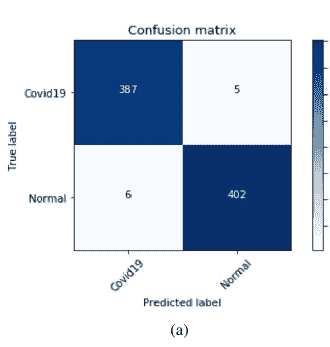
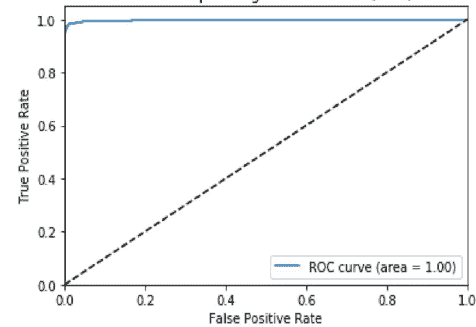
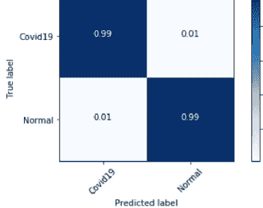
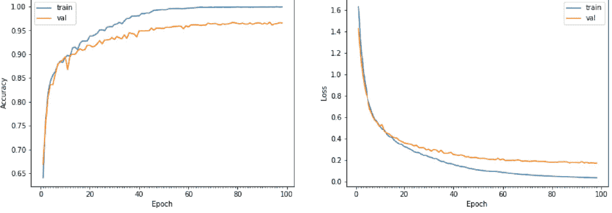
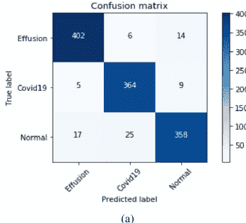
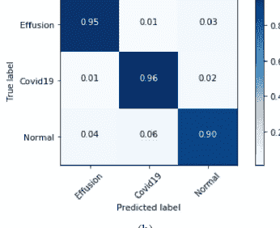

# 2020 第六届 IEEE 信息科学与技术大会 (CiSt) (摩洛哥 阿加迪尔-埃萨韦拉 2021.6.5-2021.6.12) 2020 第六届 IEEE 信息科学与技术大会 (CiSt) ｜｜ CoviNet：Au

**摘要**——冠状病毒（COVID-19）是2020年3月宣布为大流行的传染性疾病。由于其传播快速且容易，新冠病毒已导致全球数千人死亡。开发准确快速检测 COVID-19 的新方法至关重要。X光片用于诊断冠状病毒，但这需要大量时间。人工智能可以通过深度学习自动检测胸部 X 光片中的 COVID19，有助于减轻压力。所提出的架构基于深度卷积神经网络，并在公开数据集上进行了端到端训练。我们的模型在二分类中达到了 98.62% 的准确率，在多分类中达到了 97.75%。

深度学习正成为 CXR 诊断的明显选择。本文的主要目标是为 COVID19 的自动诊断提供一个高效框架。为此，我们提出了一种基于端到端卷积神经网络（CNN）[4] 架构的深度学习模型，不使用任何手动特征提取。在我们的方法中，预处理步骤是将图像输入 CNN。即使我们的目标是检测图像中是否存在 COVID19，我们也进行了多分类研究（COVID19 vs 正常）。图 1 展示了图像示例。在研究中，我们尝试通过低计算成本和较少的参数来提高准确性。本文其余部分的结构如下：第二节介绍文章章节；第三节描述方法；第四节展示结果；最后，第五节对进行总结。

*索引术*——冠状病毒，covid19，深度，卷积神经网络，胸部 X 光，自适应中值滤波-

# 引言

自2019年以来，冠状病毒（也称为 COVID19）迅速蔓，引发了全球恐慌。到6月，已有超过750 万人感染，其中 42.5 万病例导致死亡 [1]。这种感染通过喷嚏、咳嗽或呼吸道飞沫在人与之间很容易传播。病毒会导致咳嗽、发热和呼吸困难，并导致肺炎、多器官功能衰竭和死亡 [2]。考虑到新型冠状病毒缺乏疫苗或治疗药物，早期诊断至关重要。由于它们包含有用信息，快速放射学成像（包括胸部 X 光片 CXXR 和计算机断层扫描 CT）在疫情的早期检测和治疗中起着重要作用 [3]。然而，患者数量的快速增加使得医生很难在有限时间内完成诊断。在这种背景下，人工智能可以为 COVID19 诊断提供准确、快速且低成本的方案。近期，深度学习作为人工智能中机器学习的一个集，在不同的成像任务中通过卷积层（手工方法）工作。它已用于分类和检测等许多问题。在这里，深度

图 1：胸部 X 光片示例。(a) 正常。(b) 胸水肺。(c) COVID-19 阳性。

# II. 相关工作

利用机器学习进行医学领域的自动诊断已成为科学家们的一项重要工具 [5-8]。最近的工作广泛应用于胸部 X 光片以检测冠状病毒。在本节中，我们将描述该领域的一些著名工作 [9]。Khan 等人实现了 CorNetet，这是一种基于 Xception (Inception) 的卷积神经网络，包含 71 层，并在 ImageNet 数据集上进行训练。所提出的模型在 COVID19 检测中实现了 87% 的准确率。Sethy 和 Behra [10] 证明了 ResNet50  SVM 分类器在识别 COVID 方面提供了更好的性能。[11] 展示了几种常用深度学习架构之间的比较。他们在实验中使用包含 50 张图像的小型数据集，并证明了 VGG19 和 DenseNet200 更好。在 [12] 中，他们提出了一种新的 CNN 架构（COVID-Net），设计用于正常和 COVID19 的分类。该模型在包含 13800 张图像的大型数据集上得到了验证。Wang 和 Wong [12] 提出了一种用于 COVID19 识别的深度模型（COVID-Net），在检测正常、非肺炎和 COVID19 方面达到了 92.4% 的准确率。Louis 等人 [13] 使用 234 张标记的 COVID-19 图像实现了深度学习网络。他们的模型在两个类别中分别获得了 98.75% 和 93.48% 的准确率。

- 数据集图像：0 代表正常，1 代表 covid19 病毒，2 代表胸水疾病。
- 将所有图像调整为相同的一维尺寸 256x256。
- 将图像保存为一维尺度（灰度级）。
- 通过数据增强技术（镜像、翻转和随机旋转）解决类别不平衡问题。新数据集的统计数据如表 I所示。

## 表 I
数据集分布

| 数据集 | 正常 | 胸水 | COVID19 |
|---|---|---|---|
| 原始数据集 | 1000 | 107 | 308 |
| 平衡数据集 | 1000 | 1000 | 1000 |

## B. 自适应中值滤波

自适应中值滤波是一种非线性滤波技术，通常应用于图像以去除噪声并使噪声更清晰、易于区分。自适应中值滤波 (AMF) 用于检测邻域内的像素幅度。如果检测到噪声，则用中值替换它们，否则保留原始像素值。AMF 的目的是在平滑脉冲噪声时保留细节。

# III. 方法

我们提出了一种新的深度学习框架用于自动检测 2D X 光片中的 COVID19。我们的系统也设计用于区分 COVID19、胸水和正常病例。网络基于卷积神经网络，接收处理后的图像（使用自适应中值滤波和直方图均衡化）。我们评估模型性能并调整超参数以获得得分。图 2 阐述了整体工作流。

## A. 预处理

预处理步骤涉及许多操作包括：

## C. 网络架构

CovidNet 是一种 CNN 架构，包括不同的阶段：特征提取和分类部分。如图 3 所示，提出的 CNN 有四层卷积层，滤波器大小为 3x3。在每个卷积层后使用了 64 个滤波器。每个卷积 ReLU 激活函数。为了减少计算复杂性和空间尺寸，使用了最大池化，窗口大小为 2。池化输出随后被展平并输入到全连接层，该层有 128 个神经元。使用 Dropout 作为正则化技术以避免过拟合。

# IV. 实验结果

在本节中，我们描述了使用的主要数据集。我们还展示了二进制和多分类的实验设置和结果。

## A. 数据集

本研究使用了两个可用子集：
- COVID19 Radiography database：Chowdhury 等 [16] 在 Kaggle [17] 上通过收集 219 张 COVID 阳性 X 光片创建了一个数据集。所有图像均为 PNG 格式，分辨率为 1024x1024。
- XR data：该数据集由 Murai Kummitha 创建，包含两个类别，第一个是胸水，第二个是正常，总数为1000。所有图像均为 PNG 格式，分辨率不同。

## B. 实验环境

我们的模型使用 Intel Core i7 代、、 TensorFlow 以及 NVIDIA 1050 Ti GPU（分别为 8GB 和 4GB 内存）。为了训练模型，我们将 epoch 数、批量大小和学习率设置为 120、400 和 0.001。我们使用交叉熵作为损失函数（二分类、分类）并使用 Adam 作为优化器。

## C. 评估过程

通过计算准确率、特异性和 F1 分数来评估我们训练模型的性能。TP 是真阳性数量，FP 代表假阳性数量，TN 是真阴性数量，FN 是假阴性数量。

$$Accuracy = \frac{TP + TN}{TP + FN + TN}$$
$$Sensitivity = \frac{TP}{TP + FN}$$
$$Specificity = \frac{TN}{TP + FP}$$
$$Precision = \frac{TP}{TP + FN}$$
$$F1 - score = 2 \times \frac{Precision \times Recall}{Precision + Recall}$$

性和特异性分别给出分类的阳性和阴性位置。我们进行了两种场景实验来分类和检测 COVID19：首先训练 CNN 深度学习网络将 CXR 分为 covid19 和正常。在第二种情况下，模型被训练用于区分 covid19、正常和胸水三类。

## D. 模型性能

- 二分类结果：结果如表 II 所示。从表中我们可以观察到，向 CNN 模型输入图像并应用直方图均衡化（CNN）在大多数指标上获得了更好的结果。我们注意到模型达到了 98.62% 的平均准确率，特异性、精度和 F1 分数分别为 98.52%、97.72% 和 98.65%。- 多分类：评估了两个模型的三分类性能，并计算了准确率、精度、召回率指标。我们可以清楚地看到，对输入卷积神经网络的图像应用直方图均衡化的模型比其他两个模型效果更好，在仅 940 秒内达到了 95.77% 的平均准确率。为了更好地评估该模型的效率，我们在图 7 中绘制了准确率曲线。图 8 还显示了混淆矩阵，以供 COVID19 病例预测概率远高于非 COVID病例，这对于阴性病例同样有效。
- 与方法的比较：在小节中，我们将本文提出的方法性能与一组方法方法进行了比较。表 IV 展示了这种比较的结果，其中使用不同类型的图像检测 COVID：CT 和 CXR 图像。我们可以看到，我们的方法显示出更好的分类效果。我们可以解释为该问题选择超参数的重要性，以及在输入网络之前对所有图像进行预处理的重要性。

# V. 结论

在研究中，我们开发了一种深度学习模型将 CXR 分类为 COVID19、正常或胸水。我们的模型是完全自动化的，采用端到端架构，不使用任何手工方法。

## 表 II
两种方法在相同数据集下的二分类性能对比。

| 模型 | 准确率 % | AUC % | 特异性 % | 敏感度 % | 精确率 % | F-值 % | 时间 (s) |
|---|---|---|---|---|---|---|---|
| CNN | 96.0 | 0.99 | 95.53 | 98.49 | 93.77 | 96.07 | 223 |
| AMF-CNN | 95.5 | 0.99 | 95.52 | 95.47 | 95.47 | 95.48 | 149 |
| H-CNN | 98.2 | 0.99 | 98.72 | 98.52 | 98.77 | 98.65 | 705 |

## 表 III
两种方法在相同数据集（类别）下的性能对比。

| 模型 | 准确率 % | 精确率 % | 回召率 % | 时间 (s) |
|---|---|---|---|---|
| CNN | 93.05 | 89.88 | 89.66 | 537 |
| AMF-CNN | 95.47 | 93.39 | 93.16 | 117 |
| H-CNN | 95.77 | 93.69 | 93.36 | 490 |

## 参考文献

COVNet 设计用于同时执行二分类和多分类，准确率分别为 98.62% 和 95.77%。作为未来的工作，我们将使用更大的数据集来评估我们方法的有效性，并开展分割阶段的工作。

492

## 提出的 COIVINET 与基准方法的对比。

| 作者 | 使用的方法 | 图像类型 | 类别数量 | 准确率 % |
|---|---|---|---|---|
| Wang 等人 [19] | M-Inception | 胸部 CT | 2 | 82.9 |
| Song 等人 [20] | DRE-Net | 胸部 CT | 2 | 86.0 |
| Xia 等人 [21] | ResNet+5 注意机制 | 胸部 CT | 3 | 86.7 |
| Hemdan 等人 [11] | COVID-Net | 胸部 X 光 | 2 | 90.0 |
| Zheng 等人 [22] | U-Net 深度网络 | 胸部 CT | 2 | 90.8 |
| Wang 和 Wang [12] | COVID-Net | 胸部 X 光 | 3 | 92.4 |
| Ioannis 等人 [13] | VGG-19 | 胸部 X 光 | 3 | 93.8 |
| Seth 和 B [10] | ResNet50+ SVM | 胸部 X 光 | 2 | 95.8 |
| 我们的方法 | CoviNet | 胸部 X 光 | 2 | 98.6 |
| 我们的方法 | CoviNet | 胸部 X 光 | 3 | 95.7 |

图 6. 二分类的 ROC 曲线。

图 5. 二分类的混淆矩阵和归一化混淆矩阵。

[17] [在线].可用：https://www.kaggle.com/tawsifrahman/covid19-radiography-database

[18] [在线].可用：https://www.kaggle.com/im006/coviddata

[19] S. Wang, B. Kang, Y. Zheng, M. Xiao, J. Gao, M. Cao, J. Yang, Y. Zhang, and J. Wang *等*., "用于 CT 图像冠状病毒疾病 (COVID-19) 的深度学习算法", *medRxiv*, 2020.

[20] Y. Song, S. Zheng, L. Li, X. Zhang, J. Huang, J. Chen, H. Zhang, and J. Wang *等*., "深度学习通过 CT 图像实现新型冠状病毒 (COVID-19) 的准确诊断", *medRxiv*, 2020.

[21] X. Xu, X. Jiang, C. Ma, P. Xu, S. Li, L. Yu, Y. Chen, J. Su, G. Lang *等*., "用于筛查2019年冠病毒肺炎的深度学习系统 arxiv 预测。", *arxiv preprint:2002.09334*.

[22] C. Zheng, X. Deng, Q. Qu, F. Zhou, J. Feng, H. Ma, M. W. Liu, and X. Wang, "基于深度学习的胸部 CT 检测 COVID-19

## 模型准确率

## 模型损失

图 7. 三分类的准确率和损失模型曲线。

图 8. 三分类的混淆矩阵和归一化混淆矩阵。

