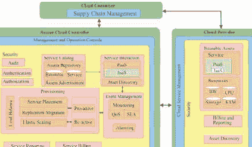

# 2020第6届信息技术国际研讨会（ITIS）（印度尼西亚泗水巴 2020.10.14-2020.10.16） 2020第6届信息技术国际研讨会 (ITIS) ｜｜ CLOUDITY：云供应链 F

Rukka Asyrofi
信息科学部门
十月十一理工学院
泗水拜，印度尼西亚
asyrofi.1905@eng.its.ac.id

Nafa Zulfa
naftzzulfa@gmail.com
信息科学部门
十月十一理工学院
泗水拜，印度尼西亚

****摘要 —** 供应链管理（SCM）是制造商和公司运营的主要需求。有许多技术可以管理供应链，例如使用 Excel。然而，这种技术不仅效率低下、不安全，而且容易受到人为错误的影响。在本文中，我们提出了 SELAT（相对市场）和区块链系统。我们修改了 JUGO 以开发出 SELAT，作为用户与云提供商安全之间的连接器。CLOUDITY 可以解决多种情况：资源配置、服务选择、身份验证和访问。此外，它通过使用 CLOUDITY 检查供应链管理系统的每一次更改，改进了数据安全性。

**关键词 —** Cloudity、云即服务（CaaS）、智能合约、供应链管理

# 1. 引言

目前使用 Excel 来管理供应链系统中的数据水平 [1]。这种传统的供应链管理系统是不安全的、低效的，且容易受到人为错误的影响。它需要一个人工干预更少的自动化系统。目前，需要一种更高级的机制来处理通过使用互联网服务器或托管的数字服务器 [1] 产生的数据链。

在本地云服务器上设置和托管位置并非最佳选择。这是因为有许多技术方面需要考虑，例如扩展性、负载均衡和灵活性。因此，云提供了解决方案。云提供商提议为用户提供更廉的服务。然而，这意味着用户可能需要为他们不需要的服务付费 [2]。问题在于资源生成。数据碎片化是提供商之间共享数据的问题 [3]。此外，供应商锁定是供应链提供商方面的一个大问题 [4]。这是一种由于切换到另一个供应商的成本极高，导致用户受困于某一个供应商的情况。

提出的供应链管理（SCM）系统在中心化数据库中接收并保存数据。中心化数据库是一种在单一位置存储数据的数据库。

在本文中，我们介绍了一种使用 CLOUDITY 和 SELAT 的云供应链管理系统，以解决上述问题。SELAT 系统作为用户与云服务提供商（CSP）之间的经纪人。它将选择价格最低、容量最高的合适的 CSP。CLOUDITY 使用区块链概念，通过在去化化系统中检查数据来提高数据安全性 [1]。它使用点对点网络来确保数据的完整性和安全性 [8]。我们设计了一个 CLOUDITY 系统，可以解决多种情况：资源配置、服务选择、身份验证和访问。

本文的其余部分结构如下：第2节解释了所提系统的详细方法。第4节描述了所提系统的设计。第6节总结了本文的工作。

# 2. 相关工作

云服务管理是云架构的主要代理。它可以扩展为作为云消费者和服务提供商（CSP）之间的服务经纪人。已开展许多研究根据用户需求为最合适的云服务创建第三方云架构 [10]。然而，这些工作没有考虑由多个具有不同服务能力的 CSP 组成的平台。因此，[11] 进行的研究

开发了一种基于用户需求推荐云服务的系统架构 JAGGO。它连接了云资源和用户之间的多个连接块。我们假设 JAGGO 开发了一套名为（SELAT 市场）的自己的架构，用于管理具有各种 CSP 的供应链参与者，以提供 SELAT 系统供应链管理的需求。

区块链系统是一种点对点网络，通过互联网连接多个块。区块链允许在数据库中进行记录的预订、接收和验证 [12]。然而，一旦发布，任何记录都无法更改。每个块都相互链接，且代码上没有任何区别。上述机制导致区块链系统对于数据修改是不可篡改的 [13]。然而，区块链链必须是中心化的 [14]。然而，供应链管理（SCM）系统与其他组件具有不同的数据库，这使得相互访问变得困难。目前，存储在数据库中的许多数据变得更容易访问。这是因为：(1) 数量：有海量数据需要处理和保存；(2) 真实性：真实性是用于决策的数据的要求。存储在财务分析中的许多数据意味着数据流得更快；等 [14]。云方法可以使数据变得可访问，使用区块链来提高云端的数据安全性 [15]。

# III. 方法论

提出的 CLOUD 系统包含主要部分：(1) 系统、(2) SELAT 系统、(3) 区块链系统以及 (4) 各种 CSP。首先，主公司建立一个与供应链中的其他零售商共同部署的系统。SELAT 系统可以选择价格最低、能力最高的合适的 CSP。

在过程中，SELAT CSP 向用户列出推荐项。用户必须从列表中选择最合适的 CSP，然后 SELAT 系统向选定的 CSP 请求，并管理初始服务器。提到的区块链也用于连接，SELAT 系统使用协议与区块链系统通信。全局 CLOUD 系统架构如图1 所示。

## A. 选择市场 (SELAT) 系统

某研究 [8] 提供了提供云即服务的架构。我们修改 JAGGO 创建了一个名为选择市场（系统）的新架构。它的功能是根据用户需求选择价格最低、能力最高的 CSP。SELAT 与 JAGGO 的区别在于系统。SELAT 配备了区块链系统来实现选择机制。SELAT 提供 CSP 推荐列表以满足用户的请求。图2 展示了 SELAT 系统的架构。

用户作为连接云提供商。首先，用户对云服务提出请求。用户发送包含规格、云服务预算的请求。SELAT 给出多个 CSP 推荐以满足用户的请求。最后，用户在推荐列表中选择一个。一旦选择，用户即选择了 CSP。

## 云端检查器

## 服务管理

## 云极速

## 资源控制器与调度器

| 标识 | Int (11) | 标识 | Int (11) |
|---|---|---|---|
| 名称 | Text | 标识 | Text |
| 价格 | In (8) | 地址 | Text |
| 源码 | Int (11) | 电话 | Int |
| 总计 | Int (12) | | |

图 3. 实验数据库表

- c) 计费与报告

计费与报告与 CSP 计费基金的概念相关。

- B. 区块链

区块链在 CLOUDITY 系统中的公平性在于通过从去中心化数据库检查 SCM 的每条变更数据来提高数据的安全性。完整的区块链机制定义如下：

- 1) 建立以太坊节点

以太坊是一个网络。创建以太坊的方法是建立以太坊节点。在许多可创建节点的应用程序中，Geth 是其中之一。

- 2) 创建智能合约

合约是浮动数据库，可以由特定地址的所有参与者使用。该地址是与实际数据库的接触点。智能合约使用 Solidity 语言编写，并通过 RemixDE 在线编译器进行编译。

- 3) 创建分布式应用

分布式应用 (DAPP) 是用于将数据上传到智能合约的应用程序。DAPP 的构建是为了在区块链网络上存储数据。
这些方法的优点是：(1) 构建一个灵活的系统，(2) 增加数据收集，(3) 增加用户透明度，(4) 数据去中心化，并从早期开始保护产品历史。

## F. 2. SELAT（服务级架构）

- b) 服务集成 (SI)

SI 集成由 CSP 提供服务。

- c) 服务供应 (SP)

资源分为两种类型。它是主动的或响应的。当用户需要时，负载均衡器将负责迁移和注册。SCM 根据需求从多个 CSP 使用资源。

- d) 事件管理 (EM)

EM 由两个模块组成：(1) 监控，一个定期验证 QoS 和 SLA 的模块；以及 (2) 告警，当资源达到限制时通知用户的模块，随后用户可以采取下一步。

- e) 安全

安全用于记录所有已登录的活动。其身份验证方法允许限制用户访问权限。它定期检查去中心化数据库中的数据。

- f) 管理操作控制台 (MO)

MO 是一个用户界面。用户可以使用 SELAT 操作功能中的特性。

- g) 身份认证服务 (AS)

AS 用于验证将访问 SELAT 中账户和服务的用户。因此，只有注册用户才能访问。

- h) 服务审计 (SA)

SA 与用户账户相关。

- i) 访问控制 (AC)

AC 控制用户访问（资源）的权限。

- j) 云服务提供商 (CSP)

- a) 资产发现

SELAT 提供者联系 CSP，通过检查来接收新资产。SELAT 允许通过检查 CSP 的资产发现来接收信息。

- b) 可复用资产

可复用资产是 CSP 的主要资产。SELAT 架构在数据库中保存可复用资产，因此 SELAT 不需要定期检查数据。

## IV. 实验设计

在这项研究中，我们进行了实验。在某天收集数据以得出结果。我们进行了 40 组数据实验，最多 10 台服务器。实验是通过本地服务器进行的。服务器可以改进连接。使用的是受限的带宽连接。我们在关系型数据库上进行了实验。关系型数据库有几个包含详细信息的表，如图 3 所示。其中一个表是 tb 表。tb 表在 id 列中有一个主键，tb source 表在 id 列中有一个主键。tb source 在某列中与 tb 进行连接（join）。

## 表 I. 不同的数据服务器

| 相同数据服务器的数量 | 不同数据服务器的数量 | 总服务器数 | 结果 |
|---|---|---|---|
| 9 | 1 | 10 | 显示最多数据 |
| 8 | 2 | 10 | 显示最多数据 |
| 7 | 3 | 10 | 显示最多数据 |
| 6 | 4 | 10 | 显示最多数据 |
| 4 | 6 | 10 | 显示最多数据 |
| 3 | 7 | 10 | 显示最多数据 |
| 2 | 8 | 10 | 错误 |
| 1 | 9 | | 错误 |

| 名称 | 价格 | 源名称 | 总计 |
|---|---|---|---|
| Ring | 76 | Queen | 10 |
| Socks | 4 | Uniform | 17 |
| Cap | 4 | Black Side | 13 |
| T-shirt | 15 | Epic | 20 |
| Shoes | 58 | White Rival | 12 |

图 4. 实验性能结果 (img/f3828bbe916f4d9adeaf9c243ad9fbec_2_0.png)

## V. 实验结果

在本节中，我们通过实验得到了结果。如图 4 所示。

### A. 不同数据服务器

表 I 显示了通过服务器进行的实验结果。由于使用了不同的服务器，数据发生了修改。

### B. 相同数据服务器

表 II 显示了相同服务器的情况。使用相同服务器的实验结果。由于数据进行检查。

## 表 II. 相同数据服务器

| 相同数据服务器的数量 | 总服务器数 | 结果 |
|---|---|---|
| 1 | 2 | 错误 |
| 2 | 4 | 错误 |
| 3 | 6 | 错误 |
| 4 | 8 | 错误 |
| 5 | 10 | 错误 |

## VI. 结论与未来工作

所提系统引入了一种基于云的机制，它利用 SELAT 架构在区块链上交换信息。SELAT 架构显示数据可以安全地存储和检索。该系统通过数据数据可以提高安全性。它可以提高性能。未来，我们认为在其他应用程序中应用区块链可以提高其安全性。

