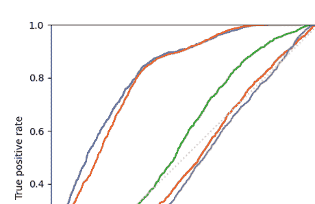

# 2020 第六届国际大数据与信息分析会议 (BigDIA)（中国深圳 2020.12.4-2020.12.6）

## 摘要

结节性硬化症儿童的癫痫治疗结果预测具有重要价值。在本文中，使用了三种常用的特征选择方法和机器学习模型，利用多模态数据预测结节性硬化症儿童的药物治疗结果。变量 `F` 回归分析的置信区间为 0.812 (±0.005)，显示了使用机器学习预测药物治疗结果的可行性。此外，这些方法在特征分析中的有效性在不同的病变数量、位置和类型下均能保持稳定。我们的分析结果显示，其中，病变类型是预测药物治疗结果最重要的因素。

## 索引术语

机器学习，多模态，结果预测，结节性硬化症

结节性硬化症 (TSC) 是一种由 `TSC1` 或 `TSC2` 基因突变引起的常染色体显性遗传病 [1]，与心脏、大脑、肾脏、肝和肺等器官瘤的形成有关 [2]。80%-90% 的 TSC 患者发生癫痫，其中几乎三分之二的人在出生后第一年发生首次大发作 [3]。TSC 症状的许多表现影响了生活质量，其中癫痫是最严重的之一。癫痫的主要治疗药物是抗癫痫药物 (AEDs) [4]。然而，大多数癫痫患者的死亡风险增加 [4]，识别发作是否具有耐药性可能需要很长时间。及早识别哪些患者对 AEDs 不敏感非常重要。

An 等人 [4] 在第一次开具抗癫痫药物时预测耐药性癫痫患者，并实现了随机森林的曲线下面积（AUC）。他们主要针对普通癫痫。然而，TSC 引起的癫痫不同，它具有更多的影像表现。在本研究中，我们主要旨在证明预测 TSC 引起的药物治疗结果的可行性。

在研究中，我们比较了 3 种特征选择方法和 6 种预测 TSC 癫痫药物治疗结果的机器学习模型。这些方法和模型都是机器学习领域中最常用的。结果显示，最佳模型实现的 AUC (95% 置信区间 [CI]) 为 0.812 (±0.005)，证明了使用机器学习预测治疗结果的可行性。根据临床经验，磁共振成像（MRI）特征对预测结果很有用。因此，我们从数量、位置和类型三个重要维度评估了这些特征的有效性。我们的结果发现，其中，病变类型在结果预测中最重要。

受控是指特征数量减少到少于至少一年观察时间的一半。未受控定义为相反。

## I. 引言

## II. 方法

### A. 数据预处理

### B. 数据选择

所有数据均来自深圳儿童医院，研究前已获得所有受试者的书面同意。方案已获得中国科学院先进研究院审查委员会 (ARB) 的批准。数据包含 103 名 TSC 患者。儿童就诊时的年龄在 50 天到 16 岁之间，中位数为 3 岁。所有患者均患有癫痫，其中一人接受过切除手术。

患者确诊为 TSC，但并非所有患者都有癫痫。癫痫患者已从数据中移除。

使用了数据、出生日期等个人信息或与任务无关的特征。删除了首次就诊时不可用的耐药史以及目标值（癫痫治疗结果）。

多模态数据包括临床数据、TSC1 和 CT 检测结果、磁共振成像 (MRI)、计算机断层扫描 (CT) 和脑电图 (EEG)。临床数据是从病史中手动提取的，包括患者姓名、年龄、性别、几种典型 TSC 类型的存在以及检查结果。MRI、CT 和 EEG 的特征也是手动提取的。对于 MRI，对病变的位置进行了定位按类型分类。对于 CT 数据，对皮下病变按大小进行了分类。对于 EEG，记录了放电特征。总之，每个患者有 155 个特征。

### C. 归一化

在归一化之前，

```
x_normalized = (x - x_min) / (x_max - x_min)
```

## III. 实验

### A. 特征选择与模型

受试者工作特征曲线 (ROC) 是一种说明二分类系统性能的图表。它通过在不同阈值设置下绘制真阳性率（敏感性）相对于假阳性率（1-特异性）来创建。曲线下面积 (AUC) 提供了分类器整体性能的衡量。AUC 1.0 表示完美分类器，而 AUC 0.5 表示性能优于随机猜测的分类器。

在研究中，我们使用了几种特征选择方法，包括：

- 随机森林
- 递归特征消除
- 信息增益

使用的机器学习模型为：

- 支持向量机 (SVM)
- 随机森林
- 神经网络
- 决策树
- 逻辑回归
- 梯度提升

实验结果使用 10 折交叉验证进行评估。每个模型的性能通过 AUC 和 95% 置信区间进行测量。

### B. MRI 有效性评估

在临床研究中，我们发现 MRI 对预测药物结果有帮助。我们随后评估了特征中 MRI 的有效性。首先，通过 AUC 评估了最佳的特征提取和模型。其次，MRI 的某些信息有限。具体而言有 5 组：

- 仅移除 MRI 信息。无变化。
- 病变计数大于或等于 1。
- 仅移除 MRI 位置。汇总了不同脑层的位置数量。
- 仅移除 MRI 病变类型信息。移除了不同类型的病变。
- 移除所有关于 MRI 的特征。

## IV. 结果与讨论

我们使用性能最好的组合来评估 MRI 预测药物结果的有效性。图 3 显示了所有 5 组的平均 ROC。第一组没有改变实验结果，但其 AUC (95% CI) 为 0.812 (±0.005)。

从分析结果来看，数量、位置和类型信息最重要的，因为在移除数量信息后，组合的 AUC 仅减少了 0.017。最重要的是类型信息，移除类型信息后，性能下降了



## V. 结论

总而言之，我们针对多模态 TSC（结核性硬化）治疗结果数据评估了常用的特征选择方法和 6 种常用的机器学习方法。使用 ANOVA F 值和 MLP 达到了最佳 AUC (95% CI) 性能，结果为 0.82 (±0.005)。这表明使用机器学习来预测药物治疗结果是可行的。随后，我们评估了 MRI 数量、位置和类型信息的有效性，得出结论：类型信息最重要，其次是位置信息和数量信息。未来将根据情况考虑更多的特征和模型。

## 致谢

部分工作得到了深圳市医学科学计划（SZZM20181005）、广东省珠江人才计划（2019Q01Y986）、深圳孔雀计划（KTD20180413183478）、中国科学院医疗技术与设备工程实验室（KFI-PTXM-012）、广东省自然科学基金（2018A030313012）以及中国国家自然科学基金（61871373, 81729003 和 81901736）的支持。

## 参考文献

- [1] K. A. Ortiz and P. B. Crino, “The tuberculous sclerosis complex,” Annals of the New York Academy of Sciences, vol. 1184, no. 1, pp. 87–105, 2010.
