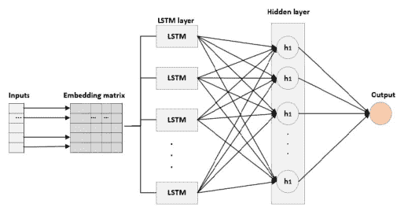
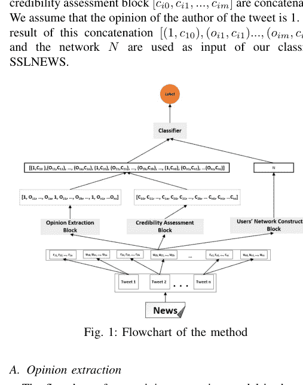
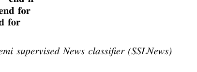
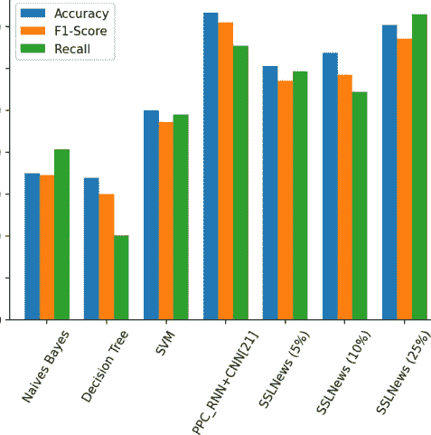
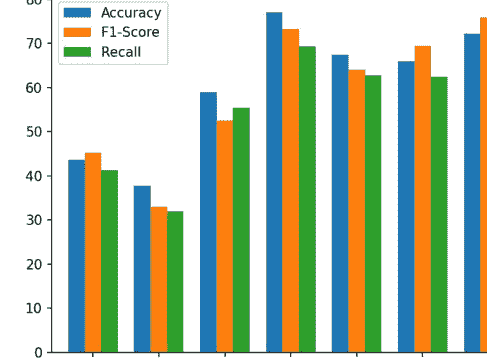

# 2020 第7届行为与社会计算国际会议 (BESC)（英国伯恩茅斯 2020.11.5-2020.11.7）

**摘要—** 虚假新闻已成为一个重要的研究课题。这是由于虚假新闻对互联网和社交媒体的影响。许多研究中提出的模型是基于监督学习的。因此，这些模型无法处理海量的未检测的虚假新闻数据。很少有研究关注早期检测。我们提出了一种在早期检测社交媒体上虚假新闻的方法。通过使用半监督学习，我们使模型能够处理大量的未标记数据。我们使用了一种方法提取内容中表达的查询，并使用 `CredRank` 评估用户的可信度并构建分类器。`SSL` 由三个网络组成：一个共享 `CNN`、一个无监督 `CNN` 和一个监督 `CNN`。我们在 25% 的标记数据上评估了 `SSL`，结果显示 `SSL` 在政治类（Politic）上的准确率达到 72.57%，在八卦类（Gossip）上的准确率为 70.35%。当使用新闻开始前 10 分钟内的数据时，`SSL` 在政治类上的准确率达到 71.10%，在八卦类上的准确率为 68.07%。

社交媒体上的故事质量远低于传统新闻机构。社交媒体用户接触到大量的误导性信息和虚假信息，从而产生了虚假新闻 [1]。虚假新闻的影响对各种个人和社会产生了负面影响 [2]。社交媒体上的虚假新闻比传统媒体上的更复杂。检测过程的任务更加复杂且具有挑战性。

检测社交媒体上的虚假新闻已成为一个具有挑战性的研究领域。研究人员通过以下方式进行研究：一些研究关注新闻的内容 [3]，这种方法包括从文本和视觉内容中提取特征以分类新闻文章。然而，这种方法具有局限性，因为新闻传播者可以设计新闻使其难以被检测为虚假。另一些研究关注用户的特征。还有一些人认为新闻 [5], [6]。基于用户特征进行分类，存在结果偏见的高风险，导致了在不考虑新闻性质的情况下独立地考虑真假新闻。一些研究人员侧重于分析新闻的传播，另一些则关注用户对新闻的反应。这些方法都有局限性。检测和新闻中的路径可能会在传播之初被作者操纵。正如我们所注意到的，所有提出的方法都有局限性，为了更好地分类新闻而进行的检测 [7], [8]。少数研究关注早期阶段的虚假检测，其中大多数研究为虚假新闻检测提出了监督学习模型。

**索引术语—** 虚假检测，半监督学习，可信度评估

## I. 引言

如今，人们在互联网上花费大量时间。最常用的应用程序一些是社交媒体网站。一些知名的包括我们每天使用的 `Twitter`、`微博`、`Facebook`、`WhatsApp` 和 `微信`。这些社交媒体被用户用来分享新闻。从社交媒体获取新闻比从传统媒体更具优势。社交媒体上的新闻质量远低于传统新闻机构。社交媒体用户接触到大量的误导性信息和虚假信息，产生了虚假新闻 [1]。虚假新闻的影响对各种个人和社会产生了负面影响 [2]。社交媒体上的虚假新闻比传统媒体上的更复杂。检测过程的任务更加复杂且具有挑战性。

检测社交媒体上的虚假新闻已成为一个具有挑战性的研究领域。研究人员通过以下方式进行研究：……（此处省略重复段落，直接进入核心问题）在该研究中，我们的目标是构建一个在早期阶段检测虚假新闻的简单模型。我们从社交媒体的回复中提取意见来判断新闻的真假。

（注：原文中存在大量重复内容，译文已整合核心引言逻辑内容。）

据我们所知，目前尚未对社交媒体上的虚假新闻进行基于用户意见和可信度评估的分类研究。这种方法基于以下研究问题：

- Q1: 如何从评论中提取用户意见？
- Q2: 如何评估社交媒体上的可信度？
- Q3: 如何结合用户意见和网络来检测虚假新闻？
- Q5: 这些元素对虚假新闻的影响如何？

本文组织结构如下：首先我们介绍相关工作。在第三节中描述我们的方法。之后，我们介绍数据和实验结果。最后在第五节中总结工作。

## II. 相关工作

以往的工作主要区别在于它们的使用方式。在此，我们将描述一些使用内容、社交上下文以及使用特征组合的研究。

### A. 基于内容

基于内容的模型从新闻中提取特征以预测欺骗。它们集中在语言线索和基于视觉的方法。引入了文本分析和基于知识的方法来检测虚假新闻，它们包含一些煽动或负面的特征。`Castillo` 等提取了标签、特殊字符、情感、正面/负面词汇来分类新闻 [9]。他们分析了趋势话题并预测是否可信。他们的模型性能为 0.754。`Guo` 等提出了一种学习内容和情感来检测 `Twitter` 上虚假新闻的模型 [10]。他们的模型从两个组件学习情感：第一个组件学习发布者的情绪，第二个组件学习其他用户的情绪。这种方法基于社交媒体互动分析。这些技术使用用户和网络作为代表消费的特征。社交上下文可以分为基于传播的和基于立场的。

### B. 基于传播

基于立场的模型使用观点对文章分类。文章的立场可以是显性的或隐性的。隐性立场从社交媒体帖子和对 `Facebook` 的直接意见表达（仇恨和关于）中提取。立场检测是自动判断文本是否支持、反对或对某个目标保持中立的任务 [12]。`Tacch` 构建了用户和 `Facebook` 的二部网络，将“赞”立场作为信息 [13]；基于此，使用监督学习模型预测 `Facebook` 帖子的可能性。

### C. 混合方法

混合模型结合基于内容和基于社交的方法，代表了以往方法的替代方案。

## III. 方法

所提出的模型由 4 个主要模块组成：意见提取模块、用户可信度评估模块、用户构建模块和分类器。给定一条新闻 $n$，我们得到 $t$ 条推文作为输出。对于每条推文 $t_i$，我们提取其回复 $r_{i1},\dots,r_{it}$ 以及用户特征 $u_{i1},\dots,u_{it}$，其中 $u_i$ 是推文 $t$ 作者的特征。$[r_{i1},\dots,r_{it}]$ 被用作意见提取模块和可信度模块的输入。回复 $t$ 的用户数量是意见模块的输出 $o_{i1},\dots,o_{it}$ 以及可信度评估模块的输出 $c_{i1},\dots,c_{it}$ 拼接在一起。我们假设 $t$ 作者的拼接结果为 1。$(L, G_0), (o_{i1},\dots,o_{it}, c_{i1},\dots,c_{it})$ 以及网络 $N$ 被用作我们分类器 `SSLNES` 的输入。



- 用户的粉丝数量；
- 这些用户使用的工具数量。

我们寻找具有相似特征的用户。我们使用层次聚类方法将用户聚分成不同的簇。相似性通过以下公式确定：

$\sin(u_i, u_j) = \sigma(C(u_i), C(u_j))$

其中 $C(u_i)$ 代表用户的特征，$\sigma(C(u_i), C(u_j))$ 代表 $u_i$ 和 $u_j$ 特征之间的相似性。在我们的模型中，我们使用 `Jaccard` 相似性来评估用户之间的相似性。我们有：

$$\sin(u_i, u_j) = \frac{C(u_i) \cap C(u_j)}{C(u_i) \cup C(u_j)}$$



图 1：方法流程图

$\sigma(C(u_i)),\sigma(C(u_j)) = 1$ 意味着两个用户的特征相似，$\sigma(C(u_i)),\sigma(C(u_j)) = 0$ 意味着它们的特征不相似。当相似性超过阈值 $tau$ 时，我们用此对用户进行聚类。该值随不同的领域变化。我们使用以下公式对用户权重进行聚类。

$\omega C_i = \frac{\sqrt{|C_i|}}{\sum \sqrt{|C_j|}}$

我们的意见提取模型流程图如图 2 所示。我们使用 `GloVe` 作为网络的嵌入层 [16]。从推文回复中提取的文本是嵌入层的输入。该层的输出输入到 `LSTM` 单元。我们使用 `tanh` 作为激活函数。网络的输出代表了内容中表达的意见：1 表示作者同意该用户，0 表示他/她不同意。我们将 `sentiment140` 数据送去测试。

其中 $\omega C_i$ 代表分配给带有成员簇的权重。该值代表了与成员相关的可信度。

### A. 意见提取

### B. 用户可信度评估

在研究中，我们使用 [18] 中描述的模型来评估用户的可信度。该模型被称为 `CredRank` 算法，它根据用户的特征使用用户：

- 用户账户是否为认证账号；
- 用户发布的状态数量；
- 用户是否开启了地理定位。

### C. 用户网络

为了构建用户网络，我们考虑了所有发布关于新闻文章推文的用户粉丝。算法 1 表示网络构建的算法。$Up$ 代表发布新闻 $n$ 的用户向量。$Ur$ 代表回复新闻 $n$ 的用户向量。算法的复杂度为 $O(x^2)$。

### 算法 1 网络构建

```
**输入:** $U_p, U_r$
**输出:** $N : a$ 矩阵
$y \leftarrow [U_p]$
$z \leftarrow [U_r]$
**for** $i = 0$ **to** $y$ **do**
$u \leftarrow U_p[i]$
**for** $j = 0$ **to** $z$ **do**
**if** $U_r[j]$ 在 $u$ 的粉丝中 **then**
$N[i,j] \leftarrow 1$
**else**
$N[i,j] \leftarrow 0$
**end for**
**end for**
```

## IV. 实验

### A. 数据集

为了实验我们的模型，我们使用了两个开源数据集：`Feminist` 和 `GossipCop` [19]。它们都从 `Twitter` 提取。这两个数据集的统计数据见表 V。由于我们的模型基于用户特征、回复和内容，我们处理这两个数据集以获取最终数据集。我们使用了 `python api` 来检索推文的回复。事实上，`Twitter API` 只能获取回复。我们的数据集是在 2018 年构建的，然后我们使用网络爬虫获取发布新闻的用户的所有粉丝。我们数据集的最终特征见表 I。为了简单起见，我们只考虑了前 1000 条推文和 400 条真实新闻。对于每个类别，我们使用了 $U_p$ 集合 $\sum_{j \in N} ||U_r|| = 2b$，其中 $N$ 是发布新闻的作者。

### D. 半监督分类器 (SSL)



图 3：SSL 流程


# 分类模型

我们的分类模型如图 3 所示。这是一个监督模型。我们通过 `Shared CNN` 构建它。该网络的输出两个网络：一个监督 `CNN` 和一个无监督 `CNN`。样本 `$x_i$` 是前两个网络的输出拼接，`$y_i$` 如果未标记为 0，否则为 1。交叉熵损失 `$l^s$` 仅针对这些样本计算，`$l^u$` 代表无监督的输出。共享 `CNN` 包含 `128 (3 × 3)` 个卷积核。其他层包含 `256 (3 × 3)` 和 `128 (3 × 3)` 个卷积核，`(2 × 2)` 池化用于所有层。`$z$` 和池化用于获取最终损失：

```
$Loss = -\frac{1}{|B|} \sum_{i \in B} \log(softmax(y_i)) + w(t) * \frac{1}{|C|} \sum_{i \in C} ||z_i - z_i'||^2$
```

## 表 I：最终数据集描述

| 特征 | 描述 |
| :--- | :--- |
| News | 新闻 ID |
| Id | 推文 ID |
| Date | 推文发布时间 |
| User id | 用户 ID |
| Author | 推文文本，如果该用户是 |
| verified | 作者账号已认证 |
| geo enable | 用户的地理定位 |
| followers | 用户的粉丝数量 |
| friends | 用户的朋友数量 |
| Description | 账号长度 |
| Followers | 粉丝列表 |

## 表 II：政治统计

| 虚假 (Fake) | 真实 (Real) |
| :--- | :--- |
| 文章总数 | 310 | 49 |
| 推文/作者数 | 8591 | 2995 |
| 回复总数 | 23908 | 10431 |
| 粉丝总数 | 1,768,838 | 2,212,385 |

## 表 III：Gossipcop 统计

| 虚假 (Fake) | 真实 (Real) |
| :--- | :--- |
| 文章总数 | 350 | 120 |
| 推文/作者数 | 10000 | 10000 |
| 回复总数 | 44097 | 52790 |
| 粉丝总数 | 3,000,000 | 3,000,000 |

# B. 实验设置

我们将 `dropout` 设置为 0.5；`epochs` 数量设置为 50；`minibatch` 大小和最大学习率分别设为 100 和 0.001。我们使用了 `Adam` 优化算法 [20]。我们使用基准算法来比较我们模型的性能：`Naive Bayes`、`决策树`、`SVM` 和 `PCC_RNN+CNN` [21]。为了评估我们模型的性能，我们使用了准确率、F1 分和召回率。我们的问题是一个分类问题。我们预测新闻是否为真：

- 真正例 (`TP`)：正确预测的新闻；
- 真阴性 (`TN`)：正确预测的虚假新闻；
- 假负例 (`FN`)：被预测为虚假的真实新闻；
- 假正例 (`FP`)：被预测为真实的虚假新闻，

然后我们可以定义指标如下：

```
$Precision = \frac{TP}{TP+FP}$
```

```
$Recall = \frac{TN}{TN+FN}$
```

```
$F1 = 2 \times \frac{Precision \times Recall}{Precision + Recall}$
```

```
$Accuracy = \frac{|TP| + |TN|}{|TP| + |TN| + |FN|}$
```

# C. 结果



**图 5：在 Gossipip 上的性能对比**



`PCC_RNN+CNN` [21] 是一种监督学习模型，其结果比我们的模型好。模型在 Politifact 上获得的结果比在 Gossipip 好，这是因为八卦数据结构化程度较低且主题更具主观性。我们评估了输入对模型准确率的影响。为此，我们构建了三个版本的模型：

- `SSLNews/Opinion-Network`：以用户及其网络作为输入；
- `SSLNews/Opinion-Credibility`：以用户及其可信度作为输入；
- `SSLNews/Credibility-Network`：以用户的可信度及其网络作为输入；

使用了 25% 的标记数据来评估这些不同的模型。从模型 6 可以看出，当我们使用所有特征时，`SSLNews` 的表现更好。可信度和意见的结合似乎比其他组合更好。在这种情况下，虚假新闻被误分类最多。这可能是因为网络仅通过考虑发布新闻的用户粉丝来构建。通过考虑所有用户的网络，我们得到了更好的结果。该结果归于时间因素。为此，我们考虑每条新闻的第一条回复 `$t_2$` 为新闻时间。我们考虑 `$T_0$` 为 `$t_0$` 时刻的时间。我们设置了三个窗口：`$W_1 = t_0 + 5` 分钟，`$W_2 = t_0 + 10` 分钟和 `$W_3 = t_0 + 60` 分钟。对于每条新闻，属于每个窗口的线程和回复。我们使用了 25% 的标记数据来评估模型。模型在窗口 2 的数据上的准确率倾向于 72%。这表明我们的模型能够在第一条推文发布后 10 分钟对新闻进行分类，准确率达到

## 参考文献

1. H. Alcott 和 M. Genzkov, "2016年选举中的社交媒体与虚假新闻," Perspect. 31, no. 2, pp. 211–236, 2017.
2. J. Wang, K. Rubin 和 Y. Chen, "自动欺骗检测：寻找虚假新闻的方法," Acc. Proc. Inf. Technol. 2018, no. 1, pp. 1–14, 2018.
3. M. Wang, S. HIZARD, 等, "对超信息和虚假新闻的对称研究," [J. arXiv], 2017.
4. A. GUPTA, H. KUMARAGURU, P. Chen, "应对不稳定的挑战：虚假新闻：飓风沙尘暴期间," 第22届国际世界网会议论文集, 2013.
5. M. MOHAMMAD, S. SOHMANI, P. KRITCHENKO, "推文中的立场与情感," ACM Internet技术期刊 (TOIT), 2017, 10(4), 17–25.
6. TAKARASHI, T. GITA, N. "Twitter上的虚假新闻检测:" 第16届国际软计算与互联网系统会议论文集，以及第13届高级智能系统国际研讨会, 2012.
7. CASTELLO, C. MENDOZA, M. P. BELBORLE, "推文中的信息信誉," 第20届国际世界网会议论文集, 2011.
8. KOWN S, M. JUNG K, "使用变分自动编码深度学习进行随时间变化的虚假新闻检测," IEEE Access, 9:1217–1228, 2021.
9. Rubin, L. Chen 和 Y. Yin, 以及 Nadia K, "虚假新闻检测：针对三类的事实," Acc. Proc. Inf. Technol., 2020.
10. KG Kelley, 等. "虚假新闻 vs 现实：一个数据集与分析," WebIA 2018: 第10届 ACM网络科学会议, pp. 72–78, 2018. doi:10.1145/3239716.3239755
11. B. D. Horne 和 S. Sali, "事实即事实：项目列表中的虚假新闻，正文文本相似性，比虚假新闻更接近真实," arXiv:1805.09163. http://arxiv.org/abs/1805.09163
12. E. Kochlenkov, M. Liu 和 A. Zubia, "用于谣言验证的多任务学习," 34: 3420–3413, 2018. 可用：http://arxiv.org/abs/1801.01801
13. C. Paul 和 M. Williams, "俄罗斯的‘虚假’宣传：为什么它可能有效以及应对方案," 加利福尼亚州圣莫尼卡: 兰公司, (2016).
14. E. Starberger 和 T. Metz, "虚假新闻危机：它们为何传播和盛行?" 2017 第26届 ACM 网络科学会议, in New, Jun., pp. 235–239, 2017. doi:10.1145/3097149.3097152
15. J. Pennington, R. Schick 和 C. D. Manning, "处理虚假新闻的全球观点," 第24届国际经验语言处理会议集 (EMNLP), 2014, pp. 1532–1542.
16. U. Gu, Al, Bha, 和 H. Li, "社交媒体中的情感信誉检测," 2012, 24. URL: http://sentiment.sento.com/sentiment-analysis.
17. M. A. Abbas 和 H. Li, "社交媒体中的情感信誉检测," 社交计算、行为与社交媒体会议,2015.
18. Kingma, D. Perez 和 J. Jimmy Ba, "一种随机优化方法," arXiv:1412.06910 (2014).
19. S. Zhou 和 J. Wang, "社交媒体虚假新闻的深度学习," Web Data 8, no. 3, pp. 171–188, 2018.
20. J. Li 和 J. Wang, "通过传播树和卷积网络检测社交媒体上的虚假新闻," 第22届 AAAI智能会议, 2018.


# V. 讨论与未来工作

在本研究中，我们构建了一个用于检测社交媒体虚假新闻的监督学习模型。该模型使用了表达特征、用户信誉和用户网络。我们使用 `LSTM` 和 `GRU` 提取用户情感。信誉通过随机算法进行评估。我们使用了真实世界的数据来测试模型：新闻精确率和准确率。当使用从新闻开始的数据时，我们的模型在 Politfact 上的准确率达到了 71.10%，在 Gosossip 上达到了 68.07%。与基准方法相比，该模型监督学习模型取得了具有竞争力的得分。未来的工作将包括构建更大的网络，并利用用户在社交媒体上的活动来评估信誉。
