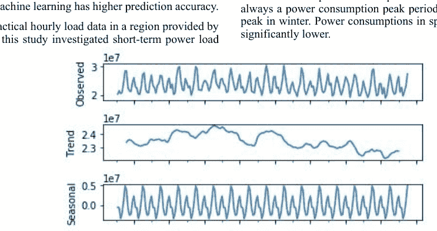
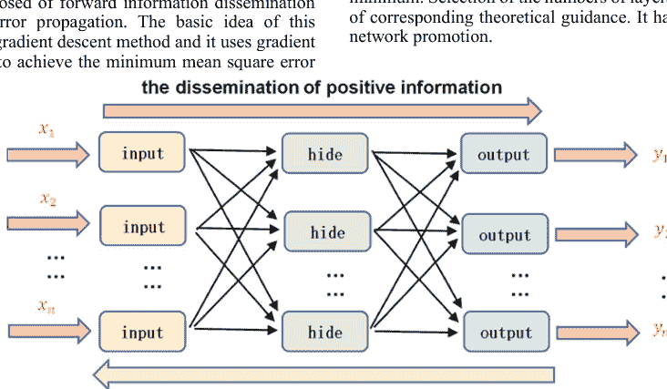

# 2020 第七届国际电气工程与自动化论坛 (IFEEA) (中国合肥 2020.9.25-2020.9.27) 论文集

Jinghua Va

*天津大学器石荣誉学院，中国天津市 300072

电子邮箱: 1552201239@ieee.com

## 摘要

准确的负荷预测有助于实现电力系统的安全和经济管理。这对于提高发电组的利用率和经济调度具有重要意义。具有较高拟合能力的机器学习方法有利于对负荷进行有效分析和预测。本文针对 PJM 公司的某区域提出了一种新框架，例如分别自回归模型和机密模型。其次，构建了 `BP` 神经网络模型和 `XGBoost` 算法模型。

机器学习是以数学模型为核心的工具，计算机系统最终模拟人类的感知、推理、学习和决策功能。结合不同学科的研究成果，竞争性技术可以处理海量的客户需求、数据和计算，本文提出了一种基于大数据技术架构的客户负荷预测解决方案 [3]。讨论了解决电力安全系统的预测和评估新框架 [4]。此外，人工智能和新技术（大数据）的产生对全球电力和能源行业产生了深远影响。它正推动电力、能源和信息技术的深度融合，形成能源效率组合标准（EEPS）以及电力管理与信息技术集成的新时代。智能电力管理系统使得所有不同系统的集成成为可能，确保无人电力系统的安全控制自动化。未来，它还可以帮助保持电力系统处于良好的工作状态并揭示其他效益 [5]。

**关键词**：负荷预测；时间序列；`BP` 神经网络；`XGBoost` 算法

## I. 引言

随着中国的快速发展，电力系统正向市场化发展。为了适应现代生活质量，电力系统接入了大规模可再生能源，理想情况下应成为与电力、信息流和流行为高度集成的智能电网。智能电网的研究基于现有的电力系统负荷管理技术。负荷管理系统是促进需求侧管理（DSM）和实现负荷优化控制的重要工具 [1]。准确的负荷预测不仅是电网安全运行和高效管理的基础，也是提高发电组利用率和经济调度的重要保障。对于优化潮流潮流调度和单元电力市场交易具有重要意义。许多教授在过去的 40 年里讨论了关于电力需求预测的相关研究，并识别了不同的方法及其特征 [2]。然而，通过各种方法的数据分析发现，大多数电力负荷表现出明显的周期性变化。机器学习有利于电力负荷随时间的有效分析和预测。

目前，已有许多技术被用于负荷预测，并通过各种方法实施。结合电力系统负荷预测的国际标准，预测方法和预测精度各异。经典方法、传统方法和智能方法是负荷预测的主要类型。经典预测通过考虑某些变量的实验或相关性，对未来做出一般方向的分类。为了解决常用负荷方法依赖主观经验的问题，提出了一种基于经典方法经验分解（EEBD）的电力负荷预测方法 [6]。Lim 等人利用电力消耗模型构建了 EPS 的电力估算方法 [7]。传统方法包括增长曲线、回归分析和高频自回归移动平均（ARIMA），被用于估计需求与各种变量之间的关系 [8]。Van 等人对来自汉市的电负荷数据的两个模型进行了比较研究。基于方法有三类模型：自适应网络模糊推理系统（ANFIS）和季节性自回归移动平均（SARIMA）[9]。Dima 等人提出了两种非季节性和两种基于窗口的 ARIMA 算法，将非季节性和季节性 ARIMA 模型与在线网络（OLIN）方法相结合 [10]。智能预测方法需要关于过程模型结构和参数的先验知识。智能预测方法主要包括专家系统方法、人工神经网络方法、理论和综合预测模型等。第 2 节主要是原始数据的预处理。第 3 节描述了两种预测框架，即 `BP` 神经网络模型和 `XGBoost` 模型。第 4 节利用真实数据实现了预测模型。第 5 节总结了模型的进一步改进。

## II. 数据

智能预测方法主要包括专家系统方法、人工神经网络方法、理论和综合预测模型等。例如，Zhao 等开发了多级小波网络来预测次日负荷。为了预测前后的负荷，使用了相关系数方案 [11]。Song 等人提出了基于回声状态网络（ESS）的短期流量电力负荷预测算法 [12]。混合神经网络方法旨在提高预测精度。本研究使用的数据来自开源平台（`https://www.kaggle.com`）。在本研究中，PJIME 指通过求和获取每小时负荷数据。为了后续数据分析，通过求和方法计算了每月负荷。关于人工神经网络（ANN）用于短期负荷预测（STLF）的问题，Alons 等人提出温度和湿度与电力负荷相关 [14]。根据比较，发现机器学习具有更高的预测精度。

通过观测数据，消除了数据，基本趋势如图 1 所示。显然，每月电力消耗在波动。总体趋势首先增加后减少。电力峰值出现在 2008 年。经过季节性分解后，基本趋势如图 1 所示。夏季始终是电力消耗峰值，而春季和秋季的电力消耗显著较低。根据 PJM 公司提供的每小时负荷数据，本研究调查了短期负荷预测。



**图 1** 负荷的周期性变化和趋势。提取了数据特征。应用特定的日期、周、月、年数据作为输入。此外，基于 `python` 构建了具有物理意义的数据。细节如下：

$$
E = \sum_{i=1}^{n} X_i^2
$$

用于返回时间序列数据的能量，即平方；

$$
ASC = \sum_{i=1}^{n} |X_i|
$$

用于返回时间序列数据的绝对值；

$$
R(l) = -\sum_{i=1}^{n} (X_i - \mu)(X_{i+1} - \mu)
$$

用于返回时间序列的自相关性；

$$
E_l = \sum_{i=1}^{n} (X_i - \mu)^2
$$

用于返回时间序列的方差；

$$
X_i = \Psi_{i} + \sum_{j=1}^{k} \Psi_{ij}X_j + \varepsilon_{i}
$$

此公式用于线性回归；

$$
E_{l} = \Phi^{l}(r) - \Phi^{l+1}(r)
$$

用于返回阶差；

$$
X_{i} = \sum_{j=1}^{k} \Psi_{ij}X_{j}
$$

用于返回统计特征；

最后，确定 2016 年 8 月 3 日作为训练集和测试集之间的分割点。进行了实验回归和观测。

## III. BP 神经网络与 XGBoost 算法

### BP 神经网络

`BP` 神经网络是反向传播算法的学习过程，由前向信息传播和误差组成。该方法的基本思想是通过梯度下降法实现网络实际值与期望值之间均误差最小。

神经网络主要由三层组成（图 2）。第一层是输入层，神经元从中间层接收信息并将信息传输到中间层神经元；第二层是隐藏层，是信息交换的内部处理层。从输入层神经元传输的信息通过一次前向传播进行处理。第三层是输出层，负责输出处理。如果实际输出符合预期，则进入误差的反向传播阶段。误差通过梯度下降法通过输出层传播并输入隐藏层和输入层。信息的周期性传播和误差是神经网络学习训练过程中调整各层权重的过程。这一过程持续到网络下降到可以接受的水平或达到预测的学习次数。

`BP` 网络在网络拓扑和性能方面相对成熟。它具有极强的映射能力和灵活网络结构的显著优势。网络的中间层数和不同层的神经元数量可以根据特定条件随机设置。`BP` 网络的性能存在差异。然而，`BP` 神经网络也有一些主要缺点，包括学习速度慢。通常需要成百上千次的迭代才能达到收敛，且容易陷入局部最小值。层数和神经元数量的选择缺乏足够的理论指导。它在网络运动中的能力有限。

#### 正向信息的传播与误差反向传播



**图 2** `BP` 神经网络的拓扑结构。

### XGBoost 算法

`XGBoost` 是一种优化的分布式梯度提升库，旨在实现高效率和可移植的性能。`GBDT`（梯度提升树）是一种以回归作为基础学习器、以提升作为框架的算法。通过在每次迭代中贪婪地构造损失函数来构建弱分类器，并将它们的结果加权组合以形成更强的分类器用于预测结果。最后输出最终预测结果。`XGBoost` 是 `GBDT` 的优化，该模型实现了并行计算系统以提高运行速度。通过快速实现泰勒公式的二阶计算来控制目标函数，提高了预测准确性。引入正则项以约束损失函数和整个模型的复杂度。`XGBoost` 的目标函数为：

```
$Obj = \sum_{i=1}^{n} (y_i, \hat{y}_i) + \sum_{k=1}^{K} \Omega(f_k)$
```

目标函数由两部分组成：衡量预测分与真实分之间差异的误差函数，$y_i$ 和 $\hat{y}_i$ 是模型的预测值。另一部分是用于定义复杂度的正则项 $\Omega$。$K$ 是回归树的数量，$f_k$ 是第 $k$ 个模型。

正则项也包含两个部分。$T$ 是叶节点数量，$\gamma$ 表示叶节点计数。$\gamma$ 可以控制叶节点数量，$\lambda$ 可以控制叶节点函数不过度并防止过拟合。目标函数简化为：

```
$T = \sum_{i=1}^{n} l(y_i, f_t(x_i)) + \frac{1}{2}\lambda f_t^2(x_i) + \Omega(f_t)$
```

$g_i$ 指 $l(y_i, f_t(x_i))$ 的一阶导数，$h_i$ 指 $l(y_i, f_t(x_i))$ 的二阶导数。

`XGBoost` 模型有很多优点。具体来说，现有的目标函数利用损失函数关于目标函数的二阶导数。当存在大量值样本时，`XGBoost` 可以实现稀疏性的自动学习。`XGBoost` 训练支持并行，并在迭代前实现预排序，在每次迭代中以块结构的形式启动。这种块结构允许目标函数的并行计算。块结构还为并行训练提供了可能。在节点分裂期间，计算每个特征的增益，并通过不同特征的线程选择增益最大的特征进行分裂。块结构还支持设置权重，通过调整权重反映模型的一阶导数和二阶导数。每次迭代后，`XGBoost` 提升叶节点的学习率，降低每棵树的权重，并减轻每棵树的影响，为后续学习提供更好的空间。

| 基础分类器 | 模型训练 | 模型权重 |
| :--- | :--- | :--- |
| 1 | 1 | 1 |
| 2 | 2 | 2 |
| 模型形成 | | |


首先，基本上选取了 `BP` 神经网络和 `XGBoost` 的参数。对于 `BP` 网络，人们普遍认为增加隐藏层的数量可以降低网络误差和复杂度，增加网络训练时间并导致“过拟合”趋势。隐藏层节点数量的最基本原理是在满足准确率的情况下尽可能选择合适的结构。

## IV. 结果

在本次实验中，选择了 367 个输入和 1 个输出层。隐藏层节点数为 100。`XGBoost` 算法有三类参数：负责投票的一般参数、用于每个选择器的提升器参数，以及用于任务估计引导的学习任务。超参数控制参数调整的优化；学习率设置为 0.3（它可以随每一步减小以使模型更深）。如果我们设置为 5，它可以控制复杂度，且这些参数的值限制了过拟合。学习的最大迭代次数（1000）是非常合适的。如果次数太高，则容易避免过拟合。

根据 `BP` 神经网络模型和 `XGBoost` 算法模型的比较，后者在短期电力负荷预测方面具有更高的准确性。

（注：原文后续存在大量重复段落，已根据要求不再重复输出）

## 参考文献

[13] Ahmad A, Javaid N, Mateen A, et al. Smart电网中的短期负荷预测：一种智能模块化方法, Energies, 2019, 12(1).

[14] Alonso R and Chávez A, "基于人工免疫系统的人工神经网络的短期负荷预测方法," 2017 IEEE URICON, Montevideo, 2017, pp. 1-4.
