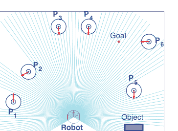
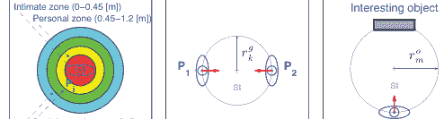
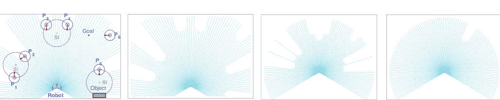
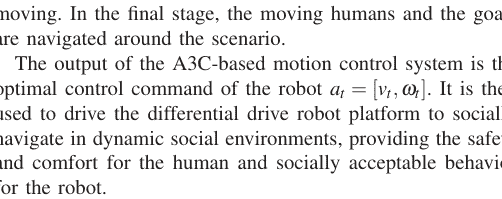

# 2020 第7届 NAFOSTED 信息与计算机科学会议 (NICS)


Nam Thang Do¹, Trung Dung Pham¹, Nguyen Huu So¹, Trung Dung Ngo² 和 Xuan Truong Truong¹

在这项研究中，我们提出了一种社交感知的导航框架，该框架使移动机器人能够利用强化学习算法在动态环境中避开人类和社交交互。所提出的框架由两个阶段组成。在第一阶段，提取涉及的人类和社交交互的时空特征，并将其投影到 2D 层。在第二阶段，将这些动态特征输入到深度神经网络中，该网络使用优势演员-评论家（AAC）技术、安全规则和约束进行训练。训练好的深度神经网络被用于机器人的运动控制。为了评估所提框架框架，我们将其集成到传统的机器人导航系统中并验证了其有效性。仿真结果表明，社交感知机器人可以导航以避开人类和社交交互，并为机器人生成符合社交规范的行为。



图 1. 动态社交环境的示例，其中有一个机器人和六个人 $p_1$ 到 $p_6$。$p_1$ 和 $p_2$ 形成一个社交群体，而两人小组 $p_3$ 和 $p_4$ 正在向机器人移动，$p_5$ 正在与一个物体交互。机器人需要导航以避开人员 $p_6$，同时避开人员 $p_1$-$p_5$ 以及社交交互。

## I. 引言

为了在动态环境中部署移动机器人，机器人应该避开周围的人类和社交交互，同时高效地向目标导航。为了实现这一目标，近年来提出了几种社交感知机器人导航系统 [1], [2]，以通用地生成移动机器人可接受的行为，并确保人类的安全和舒适。

传统的社交感知机器人导航框架可以根据用于开发运动规划的技术分为两类：(i) 基于模型和 (ii) 基于学习的方法。在第一种情况下，导航系统利用势场法 [3] 和社交代价地图 [4] 来开发运动规划。在第二类中，使用了机器学习技术，包括强化学习 [6] 和强化学习 [7]，使机器人能够在社交环境中进行安全且符合社交的导航。

尽管基于模型的方法 [8], [9] 和 [10] 已经证明导航系统能够安全地向目标导航，但仍然存在严重阻碍机器人在拥挤和动态环境中导航能力的缺点。例如，在这些论文中，作者必须人工设计周围环境人类的所有特征，然后由模型将其整合到机器人导航系统中。此外，许多参数针对特定环境。然而，这些参数集并不是个性的，并且在不同环境之间存在显著差异。

为了克服这些缺点，提出了许多基于机器学习的导航系统，在动态环境中进行安全且符合社交的导航 [11], [12], 和 [13] [14]。基于学习的方法可以根据用于导航系统输入的信息分为两类：(i) 基于传感器的和 (ii) 基于代理（agent）的技术。在前者中，代理信息被用于开发机器人的导航系统。

基于传感器的机器人导航系统 [11] 直接从原始传感器（例如 2D 激光雷达、RGB 图像）选择动作并进行端到端训练。原始传感器方法的优点是导航系统可以处理静态和动态障碍（包括墙）。此外，来自传感器的数据可以通过单一框架馈送神经网络。在现实环境中，特别是在人类环境中，从多个传感器中提取世界的代理级表示至关重要 [15], [16]。模型的输入是由于多个传感器提取的代理级表示。由于多个传感器提取的代理级表示，由于多个传感器提取的代理级表示，表示表示表示表示表示表示表示表示表示表示表示表示表示表示表示表示表示表示表示表示表示表示表示表示表示表示表示表示表示表示表示表示。



图 2. 社交交互的区域 (a) (b) (c)。

## II. 所提框架

### A. 问题描述

我们考虑一个机器人在社交环境中向目标 ($x_g^t$) 导航，环境中存在人类和物体，如图 1 所示。尽管，这种状态表示，社交感知的导航系统在导航目标时避开周围的人类和社交交互。为了生成符合社交接受的行为，机器人应该是社交的。

> *Nam Thang Do¹, Trung Dung Pham¹, Nguyen Huu So¹ 和 Xuan Truong Truong¹ 来自越南河内敦科技大学工程学院。Trung Dung Ngo 来自加拿大爱德华岛大学更多机器人实验室。truong@gmail.com, dung@ieee.org*




图4. 移动机器人的状态；(a) 涉及人类、目标和社交交互的场景；(b) 避障状态；(c) 机器人的社交状态；(d) 机器人的目标状态。

激光和 Kinect 传感器。随后，它识别机器人视野中的社交交互。人类和社交交互信息被投影到 2D 层面上。最后，将激光数据、投影的人类和社交交互以及机器人状态用于基于 ABC 的运动控制，为机器人生成运动指令。该运动控制指令用于控制机器人视野中的其他人、社交交互和障碍物。

### E. 网络架构

| 722 | [32,7,2] | [32,5,2] | [32,3,2] | 32 | 512 | 512 | 14 |
|---|---|---|---|---|---|---|---|
| $s^o$ | | | | | | | | |
| $s^s$ | Conv1D | Conv1D | Conv1D | LSTM | FC | FC | |
| $s^g$ | | | | | | | | |

图5. 策略网络和价值网络的架构。深度卷积神经网络（Conv1D 层）[32,7] 表示，在这种情况下，卷积层的内核大小为 7。最后一层 (D) 的输出与状态拼接，然后输入到长期记忆网络 (LSTM)。LSTM 具有 32 个隐藏状态。策略网络和价值网络有两个全连接 (FC) 输出层。策略网络的输出 ($\pi$) 是机器人的动作空间。价值网络的输出 ($v$) 是一个具有线性函数的标量。

### C. 状态空间

在本研究中，我们使用 2D 层作为机器人的状态空间。然而，为了将人类的动态特性（状态、社交交互）纳入所提出的社交避障框架中，我们将这些信息投影到 2D 层，如图 4 所示。为了实现这一点，我们看到图 4(a) 中，机器人在每个方向上都有 240 只眼睛向 240 个方向观察，机器人在视野中观察 3 个变量：(1) 到人类的距离，(2) 到周围障碍物的距离，(3) 到目标的距离。在图 4(b) 中，我们还包含了避障信息并命名为 $s^o$。如图 4(c) 所示。感测对象的类型包括 (2) 人类和社交交互，命名为 $s^s$，以及 (3) 目标，命名为 $s^g$，如图 4(d) 所示。此外，机器人的状态为 $s=\{s^o, s^s, s^g\}$。因此，机器人的总状态是 $(240 \times 3)$ 维状态空间 $N_s=720$ 的结果。该状态随后作为深度神经网络的输入。

### D. 动作空间

动作空间是可能的速度集合。在本研究中，我们使用差速机器人平台，因此动作空间包含线速度角速度，$a=\{v,\omega\}$。因此，考虑到机器人运动学和现实世界应用，我们使用线速度 $v \in [0,1,2]$ 和角速度 $\omega \in [-\pi,\pi]$ 的结果。我们将其称为机器人的动作空间 A。然后，在每一步，机器人将在动作空间 $N_a$ 中选择最优动作。在本文中，我们选择动作空间的大小 $N_a=14$。这意味着使用激光测距仪不允许机器人后退（$v < 0$）。

### F. 奖励函数

在本研究中，实现了一种基于神经网络的方法，用于从机器人的状态空间进行映射。然而，神经网络具有许多优势，例如泛化能力、存储知识的有限内存需求以及连续状态映射系统。为了处理机器人深度时空状态空间，我们使用了如图 5 所示的网络架构。

使用该网络，我们通过三层卷积神经网络提取状态空间的特征。然后将它们输入到具有 32 个隐藏状态的 LSTM 中，以学习状态空间的时间依赖性。LSTM 之后是两个全连接层，它们学习特征的线性组合。价值网络的输出 ($V$) 用于学习过程。策略网络的输出 ($\pi$) 用于在训练和测试阶段选择机器人的最优动作。

为了引导机器人帮助避开周围环境中的障碍物、人类和社交交互，并最小化到达目标的时间，我们使用如下奖励函数：

$r_t' = r_t^o + r_t^s + r_t^g$


输入：状态空间 $s_t$，动作空间 $A$，最大全局共享回合 $t_{max}$，每个 epoch 最大步频率 $t_{update}$ 以及折扣因子 $\gamma$。

| 参数 | 值 | 参数 | 值 | 参数 | 值 |
|---|---|---|---|---|---|
| $\alpha$ | 0.001 | $\gamma$ | 0.99 | $\epsilon$ | 20 |
| $t_{max}$ | 500 | $t_{update}$ | 14 | $\rho$ | 0.9 [m] |
| $t_{collision}$ | 0.02 | $t_{collision}$ | -0.2 | | 10 |

输出：计算梯度 $\theta$ 和 $\theta'$

```
begin
  初始化内存 M 以捕获 $t_{update}$
  for i=1 to tmax
    使用全局共享网络 $\theta$ 和 $\theta'$ 更新本地网络
    获取当前状态 $s_t$
    while ((t < t_{max}) and (not terminal))
      根据策略 $\pi(s_t|\theta')$ 选择动作
      执行动作，接收状态 $s_{t+1}$ 和奖励 $r_t$
      将 $(s_t, a, r_t, s_{t+1})$ 存储在内存 M 中
      if (t mod t_{update} == 0) or (terminal)
        // 更新梯度 $\theta$，$\theta'$
        for i=1 to length(M)
          $R = R + r_t$
          $A = R - V(s_t)$
          $\theta \leftarrow \theta + d\nabla\pi(s_t|\theta')A$
          $\theta' \leftarrow \theta' + d\nabla(R - V(s_t))^2 / 2'$
      end
  异步更新：$\theta$，使用 $d\theta$，
  清除内存 M
  if
    $s_{t+1} \leftarrow t; t \leftarrow t+1
  end
end
```

(i) 静态阶段，(ii)-动态阶段和 (iii)动态阶段。
在静态阶段，场景中的所有人类和目标都是静态的。在动态阶段，人类和目标的移动在场景中进行导航。



基于 A3C 的运动控制系统的输出是机器的最佳命令 $a_t = v_t$。它用于驱动差分机器人在动态环境中安全地进行导航，为机器人提供安全、舒适度以及可接受的行为。

## III. 结果

为了验证所提的社交导航框架，采用了 Truang 等人 [2022] 提出的社交个体指数 (SII)。SII 用于估计移动机器人的人类安全性、舒适度以及可接受的行为。

机器人要求在场景中进行导航，避开周围的人类和交互。仿真结果如图 7 所示（蓝线所示）。SII 值小于 0.14（机器人通常与人类保持距离）。

总结，仿真结果表明，所提的社交运动模型能够在以社交接受的方式避开人类和群体，同时确保动态环境中人类的安全性和舒适度。

## IV. 结论

我们提出了一种社交感知的导航框架，使机器人能够利用深度强化学习在人类和社交动态环境中移动。所提框架由两个阶段组成。在第一阶段，提取包括人类状态和交互在内的人类时空特征，并将其投影到 2D 层。在第二阶段，将动态特征输入深度神经网络，该网络使用异步 actor-critic (A3C) 安全规则和社交约束进行训练。训练后的深度神经网络随后被用于生成运动控制命令。我们在传统的机器人系统中评估了所提的运动模型，并在仿真环境中对其进行了验证。实验结果表明，所提的社交感知

## H. 训练

- 1) 训练环境：为了引导机器人避开人类、社交交互、障碍和目标，我们根据机器人模拟器 [1] 创建了一个类似走廊的场景，带有墙壁、交叉的人类、社交交互和目标，如图 6 所示。移动人类、目标和障碍使用 Hefling 等人 [4] 提出的社交力模型和 ave 软件平台控制。

- 2) 训练设置：设置基于机器人操作系统 (ROS)。所提框架使用 Python 和 TensorFlow 库实现。我们使用 Adam 优化 [12] 进行训练。我们在 Intel i7-4.2 GHz CPU 桌面电脑上提出了社交感知导航框架。运行时间为 16 小时，大约 1000 个回合。训练和测试过程的性能结果见表 1。

- 3) 训练过程：为了帮助机器人学习，我们将训练过程分为三个阶段

> ^https://pedsim.simulator.org
> https://www.tensorflow.org


图 6. 带有墙壁、物体、人类和目标的走廊。场景中分布了八个机器人（品红色）、社交情境、十个人（青色）、六个移动的人（深蓝色）、两个物体（棕色三角形和方形）以及八个目标（绿色）。机器人被分配了一项，是在避开人类和社交情境的情况下穿过人群：(1) 两人；(2) 三个人组立；(3) 四个人组立；(4) 人机交互；(5) 两人穿过场景；(6) 两人前进；(7) 人机交互前进；(8) 人人穿过场景。


框架使移动机器人避开人类和社交交互，为机器人提供可接受的行为。未来，我们几种社交情境（特别是真实环境）评估该方法。此外，我们将方法扩展到三维空间。

## 致谢

本研究由越南科学技术基金 (NAFOST) 资助，拨款号为 102-2018-ST-01。


[1] T. Kruse, Pankaj, P. Randy, and A. Kamath, “Human-robot navigation in crowded environments”, Robotics and Autonomous Systems, vol. 61, no. 7, pp. 94–104, 2015.
[2] J. Rosito, A. Spian, and C. Quaglia, “Theory to social-aware navigation: A survey”, International Journal of Social Robotics.
[3] D. Casas and J. Liu, “Social-aware navigators and mobile robots”, in Proceedings of the IEEE Conference on Robotics and Automation, vol. 2, pp. 500–505, 2005.
[4] D. Baker, “Path planning in dynamic velocity obstacles,” Review, vol. 52, pp. 4282–4292, 1985.
[5] P. Finster and J. Shiller, W. G. Bart, “Reinforcement Learning: An Introduction”, Cambridge, MA: MIT Press, 1st ed., 1998.
[6] R. S. Sutton and A. Barto, Reinforcement Learning: An Introduction.
[7] K. Henrik, S. Markus, and B. Wolfram, “Collaborative mobile robot navigation via reinforcement learning”, the International Journal of Robotics Research, vol. 35, no. 11, pp. 1289–1307, 2016.
[8] M. Shomi, F. Paolo, Z. Hayashi, and T. Kanda, “Towards a socially collision avoidance for a mobile robot navigating pedestrians using pedestrian model”, International Journal of Social Robotics, vol. 6, pp. 445–555, 2017.
[9] X. T. Truong and D. T. Deng, “Dynamic space based mobile robot navigation for human comfort in social environments”, International Conference on Intelligent Robots and Systems, 2016.
[10] F. Chen and K. Tayls, “Virtual-to-real reinforcement learning for social navigation”, Autonomous Robotics, vol. 42, pp. 1749–1770, December 2018.
[11] T. Liu, C. Palo, and M. Liu, “Multi robot collision avoidance through reinforcement learning”, IEEE/IEEE International Conference on Intelligent Robots and Systems, pp. 3762–3767, 2017.
[12] T. Fan, P. Long, and J. Pan, “Fully distributed multi-robot collision avoidance via deep reinforcement learning for safe and efficient”, in 2019 IEEE International Conference on Robotics and Automation, pp. 6041–4046.
[13] M. Everett, Y. P. Chen, and J. P. Ho, “Motion planning for decision-making agents with reinforcement learning”, IEEE/IEEE International Conference on Intelligent Robots and Systems, pp. 2003–2510, 2018.
[14] C. Chen, Y. Liu, S. Kerkis, and A. Alahi, “Crowd-robot interaction: Crowd-aware navigation with attention-based deep reinforcement”, in 2019 IEEE International Conference on Computer Vision and Pattern Recognition, pp. 1511–1520.
[15] V. Minh, A. P. Mirza, A. G. Harley, T. P. L. Lipchik, D. Silver, and K. Kavcioglu, “Methods for navigating human-crowded environments”, in Proceedings of the 2016 AAA International Conference on Machine Learning, vol. 48, pp. 1616–1624, 2017.
[16] A. Kennedy, “Human behavior: Use of space in public and private space”, Cambridge University Press, 1969.
[17] R. I. Siegwart, I. R. Darbaugh, and D. Scarciello, “Social navigation for robots”, The MIT Press, 2013.
[18] B. P. Berger, K. Tully, and A. House, “The projectlayer: Tools for multi-robot and distributed sensor systems”, in Proceedings of the International Conference on Advanced Robotics, pp. 321–323, 2003.
[19] Q. Moutley, B. Berger, K. Konsey, J. Foote, T. Lee, E. Burger, and R. Watkins, “Multi-robot navigation in open-world environments”, in IEEE Workshop on Service Robotics, 2017.
[20] D. P. Kingma and J. B. Adam, “Adam: A method for stochastic optimization”, in Proceedings of the 13th International Conference on Learning Representations, pp. 1–15, 2011.
[21] X. Truong and T. Ngo, “To Approach Humans: a unified framework for intention prediction and socially aware robot navigation”, IEEE Transactions on Cognitive and Developmental Systems, vol. 10, no. 3, pp. 557–572, 2017.

