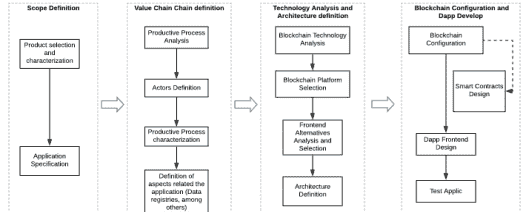
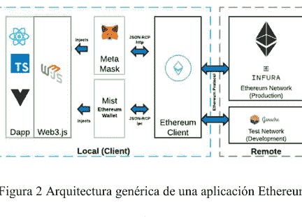
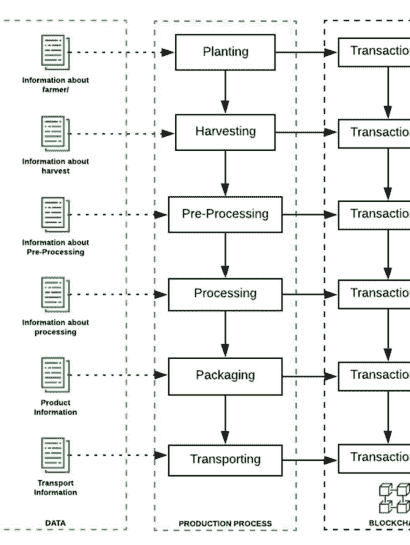
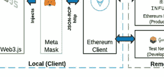
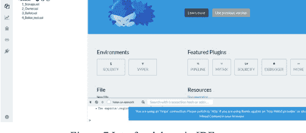

# 2020 第9届国际软件过程改进会议 (CIMPS)


Juan Mosquera
jmosquera@utlp.edu

Nelson Piedra
Grupo de Investigación de Sistemas Basados en Conocimiento
nopiedra@utlp.edu

**Resumen -** En los últimos años, la tecnología blockchain ha logrado una aplicación móvil en múltiples industrias debido a sus características únicas como la transparencia, trazabilidad, interoperabilidad e integridad, entre otras. Este trabajo presenta un marco metodológico para la integración de la tecnología blockchain en la industria del café. Para ello, se propone una metodología para la implementación de esta tecnología en esta industria, el análisis detallado de los aspectos de producción, la definición de una arquitectura para el desarrollo y soluciones de tecnología blockchain. Esta investigación plantea que las características de la tecnología blockchain sugieren que se puede establecer una solución que permita la transparencia y trazabilidad en el proceso productivo realizado por la industria del café.

Para gestionar diversos desafíos relacionados con garantizar la producción de calidad, y lograr que este sector sea atractivo y rentable para los pequeños agricultores [1].

En este contexto, el mercado del café es una industria global. Según el Departamento de Agricultura de los Estados Unidos (USDA), existen alrededor de 60.000 millones de gramos de café generados en el mercado hasta el 21 de junio de 2020 [6]. Un un aumento en el precio del café de [8]. La Organización Internacional del Café (ICA) reporta que en los años 2017 y 2018 hubo un aumento en la producción mundial de café [7].

El café cultivado en Ecuador ha ocupado, durante las últimas décadas, un lugar importante en el desarrollo de la agricultura. En Ecuador existen alrededor de 60.000 agricultores de café a lo largo del país. Esto tiene una capacidad de exportación de aproximadamente 80.000 sacos de café por año [8]. Las variedades de café con mayor demanda de exportar son Washed Arabica, Natural y Robusta. Las variedades de café que más se consumen en el mundo son el café suave, considerado en el resultado del mercado como un café de gran calidad.

**Abstract -** In recent years, blockchain technology has showed remarkable application in multiple industries due to its inherent characteristics such as transparency, traceability, interoperability, integrity, and among others. This work presents a methodological framework for the integration of blockchain technology in the coffee industry. For this, several necessary steps are proposed to implement this technology in this industry, the detailed analysis of production aspects, definition of an architecture for the development and solutions of blockchain technology. This suggests that the characteristics of blockchain technology can be used to establish a solution that allows transparency and traceability in the production process carried out the coffee industry.

**Palabras clave -** Blockchain, trazabilidad, Aplicación descentralizada, Industria del Café, Agricultura

**Keywords -** Blockchain, Trazabilidad, Aplicaciones descentralizadas, Café, Agricultura

Durante los últimos años, la implementación de las tecnologías emergentes Blockchain (BC) y de Ledger Distribuido ha liderado un impacto en una variedad de dominios, desde los financieros hasta los de Internet, la educación, las cadenas de producción y suministro. La tecnología blockchain se constituye en un libro en el cual se registran. Estos sistemas permiten garantizar la integridad de las transacciones [2], [3] en un entorno distribuido. Existen números funcionando en varios países; por ejemplo: aplicaciones relacionadas con el gobierno, la identificación digital, el registro de tierras, entre otras [4], [5].

# I. INTRODUCCIÓN

En la actualidad, muchos países del mundo han impulsado la innovación en el sector agrícola con el objetivo de lograr

Como resultado, se ha desarrollado cada vez más aplicaciones descentralizadas basadas en BC para numerosos servicios, entre otros. Estas aplicaciones implementan programas informáticos descentralizados especializados llamados Smart Contracts (SC) que se implementan en el mercado de BC. Estos SC están abiertos a una amplia gama de desafíos y son utilizados para cualquier tipo de

II. TRABAJOS RELACIONADOS

(Nota: El texto original proporcionado contiene fragmentos cortados o repetitivos en la sección final, pero se han traducido siguiendo la estructura de las líneas presentes).

... [13] ... realizan una revisión de aplicaciones de la tecnología blockchain.

En [14], realizan una revisión de la literatura académica de aplicaciones y servicios basados en la tecnología blockchain, los autores analizan varias ventajas de esta tecnología, entre algunos de los sectores que mencionan el sector financiero, cadena de suministro, gobierno.

En lugar Bueno-Almeida et al [15] realizan una investigación con el objetivo de obtener los beneficios que consiga la aplicación de la tecnología blockchain en la cadena de suministro. Analizan un caso de uso real, por ejemplo, herramientas y métodos para mejorar la autenticidad de los productos alimenticios. Además, realizan varios casos de uso y la propuesta de blockchain para la producción de alimentos.


用于此类目的的代币进行产品认证的认证机构。

该阶段具有至关重要的意义，根据本阶段定义的定义，确立了解决方案架构的比例关系。此外，还包含了多项被认为重要的产品特性，以便定义、注册并允许所工作的行业取得进展。然而，下文将介绍该阶段以便于生产流程、参与者及其他方面。

在 [21] 中，作者在他们的建议中提出了一种基于区块链的方案论系统，用于对流程过程中某一阶段所生成的信息进行分析，随后通过一种节点数据记录方法对作为解决方案部分的数据进行分析。

本工作提出的建议建立了一种综合方法论，涵盖了行业分析、技术分析，并通过技术的有效集成执行解决方案，该方法适应了行业的需求和特征。

## B. 价值链

在此阶段，根据第一阶段所确立的内容，进行流程分析，目标是定义价值链。价值链是产生产品或服务的系列阶段的集合。

下一节将描述一种将区块链集成到行业的方法论。

此外，还定义了构成生产过程的参与者，其中包括农业生产者、生产者、运输商等许多人员。

## III. 方法论

区块链在行业和供应链中的集成必须与生产流程保持一致。为此，本工作提出了一个方法论框架，分为 4 个阶段，包括范围定义、价值链定义、区块链架构中的功能定义，以及最终的去中心化应用开发。

在此阶段，重要的是定义在定义的生产流程的每个阶段中想要记录的信息，以及可能需要的信息：

- 与产品种植有关的信息，其中可能包括播种日期、地点和品种。
- 与生产或市场相关的信息，其中可能包括后续流程的参考、温度、产品生产地。
- 与运输相关的信息，其中可能包括产品发送和接收的参考，例如日期、车辆识别码等数据。
- 价值链中定义阶段的其他信息，例如交换、销售等。

接下来，图 1 展示了作者提出的将区块链集成到行业的方法论，该方法可以在农业和食品领域使用通用模型。



图 1 建议在农业领域集成区块链的方法论。

## C. 通过技术分析定义解决方案架构。

建议认为必须进行行业分析，即对生产流程进行分析，因为这些方面有助于系统。此外，它有助于在执行技术集成过程时理解并解决重要问题。

在定义解决方案架构之前，必须对开发解决方案的可用技术进行分析。在必须分析的技术类型中，区块链平台、解决方案接口的前端框架是用户与去中心化应用交互的媒介。

### A. 范围定义

在此阶段对将进行集成过程的产品进行定义，并确定解决方案的范围。

根据需要考虑的特性来决定某些区块链平台，其中一些特性如下 [23]：

- 要求的区块链类型
- 对语言或 SDK 的支持
- 共识协议
- 对智能合约的支持
- 平台的扩展性

根据 Fluence Labs 进行的一项研究 [25]，用于开发去中心化应用的区块链平台包括：

- Ethereum
- EOS
- Tron
- Hyperledger

而与去中心化应用相关的框架包括：

- React
- Vuejs
- Angular

一旦定义了技术，就可以根据下一阶段的结果建立系统架构。

图 2 中展示了一个适用于 Ethereum 的通用架构，其主要分为本地部分和远程部分。本地部分是访问去中心化应用的团队，而远程部分与网络相关。



## IV. 开发

在本节中根据方法论中提出的阶段的设计。

### A. 范围定义

如前所述，本工作通过以下特性将技术集成到行业中：

- 来源
- 质量
- 价格，等等 [27]。

### B. 价值链定义

为了该阶段的发展，作者们进行了与供应链相关的价值链验证工作。Diaz 等人 [29] 在其工作中分析了咖啡供应链，表征了构成该链的主要参与者：农民、生产者、国内和外国消费者，并详细说明了每个人的功能。表 1 可以观察参与者和活动。

表 I. 参与者的活动与功能

| 主要参与者 | 活动 |
| :--- | :--- |
| 小生产者 | 播种、收获、脱皮、清洗（湿法）、干燥（干法）、包装 |
| 运输商 | 运输 |
| 绿豆处理器 | 压皮、选择、包装 |
| 咖啡处理器 | 烘焙、磨粉、包装 |
| 外国消费者 | 消费 |
| 国内消费者 | 消费 |

### D. 去中心化架构

一旦建立了架构和与信息相关的方面，就在编码、部署、执行和维护之后开发。为了配置支持智能合约的平台，在此阶段设计了根据指令可以执行的一系列计算机程序。值得注意的是，解决方案的维护取决于所使用的技术。

另一方面，Viere、Enden 和 Schaltegge [30] 在其工作中分析了咖啡供应链，其他作者描绘了以下 7 个对应阶段：

- 种植
- 干处理
- 湿处理
- 精炼
- 烘焙
- 销售
- 消费

- 收获阶段：在此阶段，一旦农民收获了果实，即进行收获。在此阶段可能被记录的信息是收获，例如细节、其他方面。
- 前处理阶段：在此阶段，收获完成后，农民结束该流程。存在两种方法：干法（干燥）和湿法（脱皮、发酵、清洗）。完成任何工艺后，下一个活动是处理。在前处理阶段，可能记录的信息与批次有关，例如它是经过干法还是湿法（水合）处理的，以及进行该工艺的日期和时间。

同样，[31] 中对秘鲁的咖啡供应链进行了分析，作者展示了以下一些阶段：

- 清洗
- 干燥
- 检查
- 分类
- 脱皮
- 包装
- 装载

- 处理阶段：在此阶段，进行对果实的转化。该阶段的参与者有农民、脱皮工、磨坊等可能被考虑的参与者。这从果实的脱皮开始，经过选择和包装，随后是果实的烘焙。在某些演示中，咖啡豆被选择并等待；而在另一些情况下则进行封装后销售。可能生成的信息将涉及每个阶段执行的日期和地点，以及每个阶段的特性，例如进行的烘焙类型。

因此，根据处理的工作和专家意见，为价值链立了以下阶段：收获、前处理、包装；运输（发送和接收），如图 3 所示。

| 生产 | 收获 | 前处理 |
| :--- | :--- | :--- |
| 生产 | 收获 | 前处理 |
| 运输 | 包装 | 处理 |

图 3 农业领域集成区块链的方法论。

下文描述了上述阶段：

- 种植阶段：构成了咖啡供应链的开始。在此阶段，农民种植咖啡植物以供日后的生长和收获。在此阶段，生成的信息对应于种植细节，如执行日期、农场名称、农民名称、咖啡品种。此外，还可能记录细节以允许农场的地理定位和有关种植的其他信息。
- 收获阶段：在此阶段，一旦农民收获了果实，即进行收获。在此阶段可能被记录的信息是收获，例如细节、其他方面。
- 前处理阶段：在此阶段，收获完成后，农民结束该流程。存在两种方法：干法（干燥）和湿法（脱皮、发酵、清洗）。完成任何工艺后，下一个活动是处理。在前处理阶段，可能记录的信息与批次有关，例如它是经过干法还是湿法（水合）处理的，以及进行该工艺的日期和时间。


## 平台

| 特性 | Ethereum | Hyperledger Fabric | Hyperledger Sawtooth |
| --- | --- | --- | --- |
| 加密货币令牌 | Ether (ETH) |否 | 否 |
| 行业类型 | 所有 | 所有 | 金融行业 |
| 区块链类型 | 公有 | 联盟 | 联盟 |
| 可扩展性 | 允许 | 允许 | 允许 |
| 流行程度和开发状态 | 非常流行，状态活跃 | 活跃 | 活跃 |

表 III. 平台对比

| 特性 | Corda | Quorum |
| --- | --- | --- |
| 创始人 | David E. Ritter | Lori Beer |
| 智能合约 | 是 (Kotlin, Java) | 是 (Solidity) |
| 共识算法 | 可插件式, Trusted Solo, BFT | 可插件式 Raft Consensus Istanbul PoS PoET |
| 加密货币令牌 | Ether (ETH) | 否 |
| 行业类型 | 金融行业 | 所有 |
| 公有性 | 私有 | |
| 可扩展性 | 允许 | 不允许 |
| 流行程度和开发状态 | 活跃 | 活跃 |



图 4 进程之间的信息流

为了使这些流程实现更好的理解并建立区块链层面的交易，认为这些流程之间的信息流是必要的。

## C. 解决方案架构定义阶段开发

在定义应用案例的区块链平台和框架之前，已对最流行的平台进行了分析。

目前存在多种区块链平台，其中最流行的有 Ethereum、Hyperledger Fabric、Ric 3 和 Quorum。这些平台广泛使用了针对特定工业的解决方案 [32]–35]。

| 特性 | Ethereum | Hyperledger Fabric | Hyperledger Sawtooth |
| --- | --- | --- | --- |
| 创始人 | Vitalik Buterin | Linux Linux Foundation | |
| 智能合约 | 是 (Solidity) | 是 (Java, Golang) | 是 (C++, Golang) |
| 共识算法 | PoW, PoS | 可插件式, Trusted Solo, Crash Fault Tolerant | PoET, BFT |

表 II. 平台对比 (1)

## 平台

表 IV. 前端框架对比

## 特性

| 平台 | 描述 | 开发者 | 学习难度 |
| --- | --- | --- | --- |
| React | 一种用于构建用户界面的高效、声明式且灵活的 JavaScript | Facebook | 中等 |
| Vuejs | 一个渐进式的、增量适应的构建 Web 图界面的框架 | 2013 | 高 |

关于最流行的解决方案的前端框架，涉及 React、Angular 和 Vue.js。表 IV 对这些框架进行了比较。

## 特性

| 平台 | 描述 | 开发者 | 学习难度 |
|---|---|---|---|
| Angular | 一个移动端和桌面端的框架 | Evan You* | 中等 (Typescript) |

https://www.trufflesuite.com/ganache。图中显示了它提供的图表。


在所开发的框架中，选择了 React，因为其与连接区块链技术所需的库兼容性，以及该框架的学习曲线。

通过图 5 展示了本案例研究去中心化开发的架构。

```
0x81B2C3D4E5F6G7H8I9J0A1B2C3D4E5F6G7H8I9J0 98.95 ETH
0xA1B2C3D4E5F6G7H8I9J0A1B2C3D4E5F6G7H8I9J0 100.00 ETH
0xB2C3D4E5F6G7H8I9J0K1A2B3C4D5E6F7G8H9I0J0 85.00 ETH
0xC3D4E5F6G7H8I9J0K1L2M3N4O5P6Q7R8S9T0U1V2 100.00 ETH
0xD4E5F6G7H8I9J0K1L2M3N4O5P6Q7R8S9T0U1V2 100.00 ETH
0xE5F6G7H8I9J0K1L2M3N4O5P6Q7R8S9T0U1V2 100.00 ETH
0xF6G7H8I9J0K1L2M3N4O5P6Q7R8S9T0U1V2W3X4Y5ZZ 95.00 ETH
```

图 6 Ganache 环境



图 5 去中心化开发架构

## D. 去中心化架构开发

- Remix IDE：是一个开发接口编译器，允许对多种功能进行合约的测试。要访问它，必须输入以下地址：remix.org。示例强调该工具对于 Ethereum 至关重要。图 7 展示了通过 remix 进行的开发，即合约部署。

在定义了用例中架构涵盖的方面后（如带有解决方案架构的工作流定义），此阶段即为去中心化开发。在应用案例中选择了 Ethereum 架构，因此重要的是说明该平台支持智能合约。在此阶段，必须进行合约的分析和开发。合约语言方面使用的是 Solidity。

为了部署合约，需要一个允许执行此过程的工具，可用工具之一是 Truffle。Truffle 是一个智能合约开发环境，允许在以太坊虚拟机 (EVM) 上执行。

在开发智能合约时，在生产阶段之前进行测试非常重要。可用工具之一是 Truffle（此处由于原文截断重复）。




[5] J. Bashir, 《区块链精通》，第二版. Birmingham: Pact Publishing Ltd., 2018. [22]

[6] USDA, 《咖啡：世界市场与贸易》， 2020. [23]

[7] ICO, 《各国作物产量》， 2020.

[8] E. Espinosa, 《咖啡/厄瓜多尔年度报告》，基多, 2020.

[9] IBM, 《截至2020年的IBM足迹增长》，[2019]。 访问于：https://www.ibm.com/en-us/blockchain/solutions

[10] J. Astilli, 《供应链中的透明度：增强解决方案技术的综述》，Sec. Food Tech. Sci, 第91卷, 2018年12月, 第240–247页。

[11] M. A. Rubio, G. M. Tarrazona, 和 L. Contreras, 《大数据与区块链开启咖啡供应的新架构》，第6卷, 2018年6月, 第659–699页。

[12] Y. Liu, Q. X. Lu, Z. Hu, 和 Y. Yao, 《供应链中的模式设计：基于区块链的可溯性应用研究》，Lett. Comput. Sci (包括科学通讯快报、人工智能信息、生物信息学), 2019, 第10974卷, 第92–99页。

[13] F. Antoncei, S. Figorigilli, C. Cusa, F. Pallotino, L. Raso, 和 P. Meseni, 《区块链在咖啡行业中应用的综述》，J. Food Agri. Sci, 第91卷, 2019年6月, 第6128–6139页。

[14] I. Konstantou, G. Simountinos, C. Tompelas, P. Veras, Y. Petersen, 和 D. Schwarz, 《用于业务应用的区块链：系统性综述》，《业务系统》，第2卷, Springer International, 2018, 第384–399页。

[15] O. Bermero-Almida, M. Contreras, E. Ferroz-Gález, R. Cabezezas-Zambrano, 和 Y. Bazán-Vera, 《农业中的区块链：系统性文献综述》，Comput. Inf. Inf. Vol., 883, 第45–56页。

[16] L. Liotin 和 D. Gunesco, 《区块链：将技术整合至供应链运营中》、《供应链管理与物流》，2020, 第57–89页。

[17] B. Tan, J. Yan, S. X, 和 Y. Lu, 《区块链对供应链的影响：核桃案例》，国际出版部, 2018, 第167–177页。

[18] Z. Wang 和 J. P. Liu, 《区块链在农产品追源系统中的应用》，11634 LNCS. 国际出版, 2019。

[19] S. K. Roy, R. Ganguly, 和 S. Gulmani, 《基于区块链的供应链转型：简评》，Springer Singapore, 2020, 第583–593页。

[20] R. dos Santos, T. Nieto, E. Yamada, 和 J. Ribeiro, 《使用智能合约对配方产品进行GTR-Track原材料评估》，Informatics, 第6卷, 第1期, 第11, 2019年3月。

[21] J. Hua, X. Wang, M. Kang, H. Wang, 和 F. Y. Wang, 《基于区块链的农产品溯源：一种分布式技术》，IEEE国际会议, 2018.

R. Windey 和 J. Hodson, 《发展中国家的开放源供应链：案例研究》，Austain, 第10卷。

A. Takyar, 《2020年顶级区块链平台》，访问于：https://www.leeway.com/blockchain-platforms-for-chains; [2020年7月]。

E. Ponnamare, 《2019年开发者调查》，Medium。访问于：https://medium.com/network-dev/developer-survey-2019; [2020年7月]。

E. Ponnamare, 《2020年开发者报告》，Medium, 2020。访问于：https://medium.com/network-dev/developer-web-report-2020-5a413879;

R. Gardiner, 《免费智能合约》，7月,2018。

E. Carbival, J. Rivera, E. Ramos, 和 Y. Yamaguchi, 《可持续咖啡供应链的战略路由》，Human Systems Engineering and Design, 第11卷,2020, 第99。

V. R. George, H. O. Hahn, P. Y, 和 A. K. Babu, 《餐厅与食品供应链的质量溯源》，Clean Prod., 第240卷, 11821,2019。

J. T. Dias, D. Gutierrez, 和 H. Y. Bolivar, 《绿色咖啡供应链决策的应用》，Proc. Oper. Manage. SMELO, 2016, 第578–588页。

T. Vire, J. Even, 和 U. Schlä, 《环境管理会计中的生命周期与管理：咖啡案例研究》，第23–31，2021。

J. Gomez, G. Albuquerque, E. Ramos, 和 C. Yamaguchi, 《基于供应链的全生命周期模型构建：秘鲁库斯科咖啡案例研究》，2020, 第922–928页。

R. Moladi, 《Solidity编程元素》。Birmingham: Pact Publishing. 2018。

A. Lee, 《区块链技术：超越比特币》，第2卷。

T. Laurence, 《傻瓜区块链》，第2卷. John Wiley & Sons, 2019。

Web3, 《Web3》，[2020]。访问于：https://github.com/web3/

Metamask, 《Metamask 扩展程序》，2020。访问于：https://github.com/Metamask/metamask-extension。

Piedra, N., Tovar, E., Contreras-Palacios, R., Lopez-Vargas, J., and Chiezaza, J. A. (2014). 消费和产生链接开放数据：开源案例：Program。

