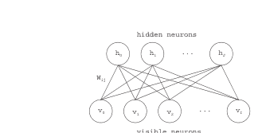
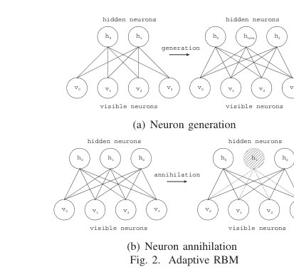
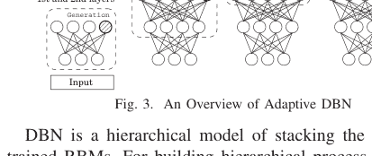
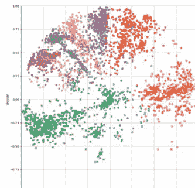
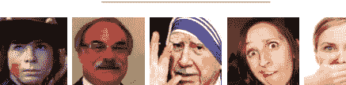
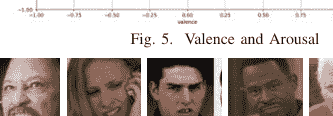
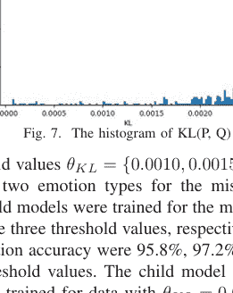

# 2020 第九届国际高级应用信息大会 (IIAI-AAI)（日本九州，2020.9.1-2020.9.15） 2020 第九届国际高级应用信息大会 (IIAI-AAI) ｜｜ 分布式


**索引术—** 深度学习、受限玻尔兹曼机、KL蒸馏、学习、AffectNet

另一种深度学习模型是深度信念网络（DBN），它通过训练和堆叠受限玻尔兹曼机（RBM，一种生成式神经网络）来实现高分类性能。尽管 DBN 模型的分类性能不如 CNN 模型，但根据输入数据空间学习，针对 RBM 隐藏神经元和 DBN 隐藏层的自动确定方法 [9] 已经被开发出来。该方法是 DBN 的自适应结构学习方法（Adaptive DBN），它利用遗传优化算法寻找最优网络结构 [11]。自适应 DBN 的显著特征是对于某些图像数据集 [12] 和真实世界，它可以显示出多个类别更高的分类准确率 [13]。

最近，深度学习 [1], [2] 研究不仅对人工智能理论研究产生了意想不到的影响，也影响了生活中的实际应用。AlexNet [3]、GoogleNet [4]、VGG [5] 和 ResNet [6] 等深度模型产生的图像识别能力远超人类能力。这些模型是卷积神经网络的一种。输入数据中的特征在多个层上进行处理，通过分层堆叠，可以高容量地表示输入图像的复杂特征。



图 1. RBM 的网络结构

DBN 可以进行大量的迭代训练。此外，对误标记数据的判断需要额外的信息。

在本文中，我们利用训练数据重构了训练过的 DBN。首先，针对冲突的测试数据训练一个新的子 DBN。其次，使用库尔巴克-莱布勒（KL）散度观察父模型和子模型之间的差异 [16]。当 KL 散度较大时，会在父 DBN 中生成一个新的神经元，并使用 [14] 中描述的方法对其权重进行微调。我们提出了这种方法来验证测试数据中哪些类别被误分类。分类准确率从 78.4% 提高到了 91%。

本文的其余部分组织如下：第 II 节解释了 DBN 的结构学习。第 III 节介绍了事实数据库 Affect。在第 IV 节中，通过实验验证了我们所提方法的有效性。在第 V 节中，我们给出了一些讨论以总结本文。

## II. DBN 的结构学习方法

本节描述了我们提出的自适应 DBN 的基本思想，以理解自组织结构的行为。RBM 的网络结构由两种二值层组成，如图1 所示。DBN 通过分层构建多个 RBM 进行堆叠的随机无监督学习。

### A. 神经元生成/消除算法

我们在 RBM 和 DBN 中开发了自适应结构学习方法，称为自适应 RBM 和自适应 DBN [13]，以便在训练过程中为给定空间生成数量数量隐藏神经元。在该方法中提出了行走距离（WD）思想用于参数的方差学习。如果方差很大，显然如果网络没有足够的神经元，WD 将倾向于沿轨迹波动。这种情况表明，由于缺少隐藏神经元，某些隐藏神经元可能无法异常模式。为了将异常模式表示为神经元，会生成一个新的神经元来继承父元的属性，如图 2 所示。

然而，我们可能会由于神经元生成过程产生一些冗余神经元。在神经元生成过程后应用神经元消除算法来杀死冗余神经元。图 2(b) 显示了相应的神经元被消除了。



(a) 神经元生成

(b) 神经元消除

图 2. 自适应 DBN

自动生成合适的隐藏层和神经元数量。

- 第 4 层和第 5 层之间的预训练
- 第 2 层和第 3 层之间的预训练
- 第 1 层和第 2 层之间的预训练



图 3. 一种自适应的 DBN

DBN 是堆叠多个已训练的 RBM 的分层模型。为了构建分层过程，i-1 的输出可以视为 i+1。通常，DBN 的能力强于输入。自适应 DBN 可以动态调整网络以添加新神经元。如果方差很大，网络将不会收敛，等待。

## III. 针对 AFFECT 的自适应学习方法

Affect 是一个包含人类情感的数据集 [15]。如表 I 所示，除了“非脸”之外还有其他类别。效价（Valence）是快乐和不悦的程度。

### 表 I Affect 中的情感类别

| 类别 | 训练数据 | 测试数据 |
| :--- | :--- | :--- |
| 中性 (Neutral) | 5478 | 500 |
| 快乐 (Happy) | 13415 | 500 |
| 悲伤 (Sad) | 2595 | 500 |
| 惊讶 (Surprise) | 14090 | 500 |
| 恐惧 (Fear) | 5738 | 500 |
| 厌恶 (Disgust) | 5803 | 500 |
| 愤怒 (Anger) | 4892 | 500 |
| 无 (None) | 7750 | 500 |
| 不确定 (Uncertain) | 11645 | 500 |
| 非脸 (Non-Face) | 5267 | 500 |
| 总计 (Total) | 44198 | 500 |



(a) 中性 (b) 快乐 (c) 悲伤 (d) 惊讶 (e) 恐惧 



(f) 厌恶 (g) 愤怒 (h) 愤怒 (j) 愤怒



(f) 厌恶 (g) 满意 (h) 无 (j) 不确定

图 5. 效价与情感

图 6. 误分类类别的示例

图 4. Affect 中的样本

唤醒度（Arousal）分别为 [-1, 1]，如图 5 所示。

## IV. KL散度蒸馏模型

本节详细说明了使用 KL 散度的学习方法。研究了每个类别的测试准确率。结果在第 III 节报告。计算了训练与误分类情感之间的 KL 散度。如果 KL 散度大于某个阈值，将在适当位置重建某些神经元以分类误分类案例。神经元生成方法涉及与目标神经元的匹配。

### A. DBN 对 AffectNet 的分类

表 III 显示了 DBN 对 AffectNet 的分类结果。情况下，AlexNet 的分类约占测试数据的 60%。DBN 在训练集上实现了 100% 的分类准确率。对于测试数据，情感类型的平均分类准确率达到 87%。最好的情况是“快乐”，最差的是“愤怒”。分类准确率低于 90% 的类别是“中性”、“悲伤”、“惊讶”和“厌恶”。


# 情感分类模型中两个标注者之间一致性的分类 [15]

| 中性 | 快乐 | 悲伤 | 惊讶 | 恐惧 | 厌恶 | 愤怒 | 满意 | 不确定 | 非脸 |
|---|---|---|---|---|---|---|---|---|------|
| 中性 | 58.8 | 9.5 | 8.8 | 0.8 | 1.1 | 1.9 | 1.8 | 8.0 | - | - |
| 快乐 | 11.3 | 79.6 | 1.7 | 0.3 | 0.4 | 0.5 | 3 | 4.6 | - | 2.2 |
| 悲伤 | 9.5 | 1.7 | 85.2 | 0.0 | 0.3 | 0.5 | 0 | 4.2 | - | 2.7 |
| 惊讶 | 2 | 3.8 | 6.6 | 66.5 | 14.0 | 0.8 | 1.9 | 2.7 | - | - |
| 恐惧 | 0.8 | 0.4 | 0.0 | 0.1 | 91.5 | 0.0 | 0.0 | 0.5 | 1.5 | - |
| 厌恶 | 1.5 | 0.8 | 1.2 | 3.5 | 0.7 | 67.1 | 1.3 | 1.7 | 2.3 | 2.1 |
| 愤怒 | 2.0 | 7.5 | 2.1 | 0.5 | 0.4 | 3.5 | 66.9 | 3.7 | 1.5 | 0.6 |
| 满意 | 10.2 | 7.5 | 5.2 | 2.1 | 0.5 | 4.4 | 3.7 | 72.5 | 1.5 | 8.9 |
| 不确定 | 13.5 | 12.1 | 7.8 | 4.3 | 4.5 | 6.2 | 2.6 | 12.3 | 20.6 | 8.9 |
| 非脸 | 3.7 | 3.8 | 1.7 | 1.1 | 0.0 | 1.4 | 0.7 | 0.4 | 1.4 | 83.9 |

表 II

## 表 103
对象的分类准确率

| CNN [15] | 自适应 DNN | 自适应 DNN |
|---|---|---||
| 类别 | 测试数据 | 测试数据 |
| 中性 | 63.0% | 87.8% |
| 快乐 | 88.0% | 92.4% |
| 悲伤 | 99.9% | 95.8% |
| 惊讶 | 91.4% | 85.8% |
| 恐惧 | 92.0% | 93.3% |
| 厌恶 | 92.3% | 92.4% |
| 愤怒 | 98.2% | 78.4% |



显示两个标注者对于相似的图像达成了一致。从表 II 来看，该比例不是随机的，最高的是“快乐”，达到 79.6%，“满意”水平和“愤怒”的水平分别为 50.8%、66.9% 和 62.3%。此外，一致性程度通过 Cohen 系数 [17] 进行衡量，该系数是根据表 II 以及多个标注者的数据集主观性计算出的。

对于两个或多个 DNN 的集成，我们构建了一个针对数据集训练的父级 DNN，以及两个针对测试用例训练的子 DNN。原始模型 P 和子模型 Q 之间的 KL 散度通过以下方程计算：

```
$D_{KL}(P||P_x) = \sum P_x(x) \log \frac{P_x(x)}{P(x)}, \quad (1)$
```

```
$D_{KL}(P_x||P) = \sum P_x(x) \log \frac{P_x(x)}{P(x)}, \quad (2)$
```

在 [16] 中，我们为错误分类的数据构建了一个模型，并对“中性”和“厌恶”标记了数据。所示，我们将所有图像的目标设为“值”，Set1 是正确分类的数据，Set2 是错误分类的数据。父模型 P 以及子模型 Q1、Q2 分别针对数据 Set0、Set1 和 Set2 进行了训练。表 VI 显示了父模型 P 与子级模型 Q1、Q2 之间的 KL 散度。P 和 Q2 的 KL 散度大于 P。结果显示模型之间存在某些差异。测量了 P 和 Q 的每个样本的 KL 散度，其结果从 0.0000 到 0.0025 不等。因此，我们假设数据中的 KL 散度水平以及三个值 $D_{KL} = (0.0010, 0.0015, 0.0020)$ 是错误分类数据中情感类型的边界。结果显示，三个阈值值下，分类准确率分别为 95.8%、97.2% 和 95.2%。准确率最高的模型针对 $D_{KL} = 0.0015$ 进行训练。

我们考虑了一种通过使用 KL 散度值来连接网络并在父级 DNN 中引入新神经元的方法。子模型 Q 对 P 错误分类的“愤怒”和“厌恶”案例进行训练。从重分类所示，对于输入 x，比例模型 Q 和 P 的分类准确率得到了提高。在父级模型的网络结构中插入两个模型将减少深度学习集成的复杂性。

### B. 基于 KL 散度的学习

在本文，我们定义了带有 KL 的子模型 Q，其初始化网络结构以连接来自父级 P 的值。子模型 Q 对 P 错误分类的“愤怒”和“厌恶”案例进行训练。从重分类所示，对于输入 x，比例模型 Q 和 P 的分类准确率通过公式 (3) 计算。

```
$D_{KL}(P||Q) = \sum P(x) \log \frac{P(x)}{Q(x)}, \quad (3)$
```

P 和 Q 之间的 KL 散度对于“愤怒”和“厌恶”两种案例显示为 0.060。从表 II ，错误分类数据的 KL 散度在 0.0000 到 0.0025 范围内。除了 KL 散度外，还调查了给定数据的网络信号。探索了从输入层到输出层的路径。如果计算了错误的输出

**自适应 DBN 分类的混淆矩阵**

| 中性 | 快乐 | 悲伤 | 惊讶 | 恐惧 | 厌恶 | 愤怒 | 蔑视 |
|---|---|---|---|---|---|---|---|
| 中性 | 439 | 7 | 46 | 2 | 0 | 4 | 12 | 19 |
| 快乐 | 5 | 442 | 0 | 4 | 12 | 11 | 1 | 12 |
| 悲伤 | 7 | 15 | 410 | 10 | 29 | 22 | 0 | 9 |
| 惊讶 | 6 | 8 | 2 | 421 | 5 | 8 | 5 | 10 |
| 厌恶 | 8 | 2 | 3 | 5 | 18 | 462 | 7 | 5 |
| 愤怒 | 6 | 1 | 0 | 0 | 5 | 416 | 17 | |
| 蔑视 | 1 | 0 | 0 | 3 | 2 | 5 | 21 | 438 |

表 V训练数据 (1)

| 集合 | 描述 | 数量 |
|---|---|---|
| Set 0 | 所有愤怒和厌恶图像 | 1008 |
| Set 1 | 聚类在 Set 0 的图像 | 862 |
| Set 2 | 聚类在 Set 1 的图像 | 146 |

表 VI KL 散度 (16)

| 模型 | KL |
|---|---|
| $D_{KL}(P||Q1)$ | 0.188 |
| $D_{KL}(P||Q2)$ | 0.660 |

案例中，神经元路径被激活。该方法利用 RBM 的隐藏节点表示为二值模式 [0, 1]。将所有可能的二值模式给定经过训练的 DBN，并分析从底层到输出层的网络信号以寻找激活路径。调整方法可以部分修复网络路径以提高分类准确率。算法 1-3 显示了调整方法。

结果显示，输入层没有显著差异，但在图 8(a) 和图 8(b) 所示的父级模型和子级模型的输出路径附近存在特征差异。在图 8 中，节点

算法 2 第 l 层修改路径的方法

1. 让 $(x_1, \dots, x_N)$ 为模式，$N$ 为模式数量。让 $Y(y_1, \dots, y_N)$ 为教师信号。经过训练的 DBN 具有 $L$ 层。让 $l$ 为调整的目标层。
2. 将 $X$ 输入网络进行前向计算。在计算中，保存从底层到输出层被激活的神经元。让 $X^l$ 和 $X^T$ 为 $Y^T$ 的正确输入模式。
3. 在第 l 层，如果神经元满足公式 (4)，则将连接到神经元 $j$ 的权重修改为 $w^{correct}$。公式 (5) 是如果 $X^T$ 在层 $j$ 固定，$w^{correct}$ 为常数值（例如 $w^{correct}=0$）。

```
$|Activation^l(X^l) - X^T|_j^2 = (w^{correct})^2$. (4)$
```

```
$|Activation^l(X^l) - X^T|_j^2 = 0$. (5)$
```

其中，$\theta^l$ 是阈值。在这种情况下，根据经验方法 $\theta^l$ 为 0.3。

算法 3 通过 C45 知识

1. 让 $(x_1, \dots, x_N)$ 为模式，$N$ 为一维向量。经过训练的 DBN 具有 $L$ 层。让 $f(n)$ 为为给定 $X$ 生成输出模式 $Y(y_1, \dots, y_N)$ 的函数，$y_i$ 有分类类别值。
2. 将 $X$ 输入网络并计算 $Y$。
3. 通过 C45 提取规则。


(a) 父级模型 (b) 子级模型

图 8. DBN 中的触发路径

算法 1 微调方法

1. 构建通过训练自适应 DBN 训练的 L 层结构。
2. 按照算法 2 描述的第 l 层 ($l \le L$) 微调方法从第一层到第 L 层实施。

表 VII 蒸馏模型的分类率

| 类别 | 调整前 | 调整后 |
|---|---|---|
| 厌恶 | 92.4% | 94.7% |
| 愤怒 | 78.4% | 91.3% |

包含“愤怒”和“厌恶”等模糊人类情感的错误分类案例（例如“蔑视”）。将在未来的工作中对此进行研究。

致谢
这项工作得到了 JASP KAKHI 号 192142, 1924365 的支持，并由日本信息通信技术研究 (NICT, 2015) 委托获得。

在父级模型中未被激活。由于子模型中相反的“厌恶”输出。我们模型之间的结果差异源于父级模型和子级模型表示能力上的差异。如果图 7 所示子级模型中的神经元也是通过生成过程生成的，父级模型可以表示与子级模型不同的模式。根据我们发现这种 KL 散度很大的观察，这表明我们通过在神经元之间复制相同权重的对应神经元来构建父级模型。

