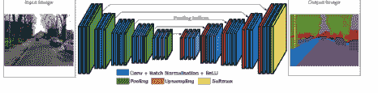
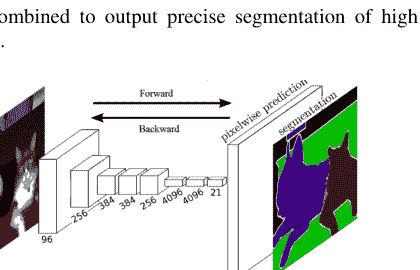
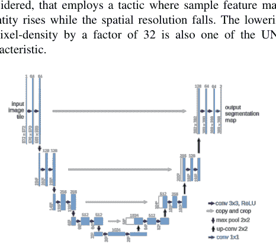
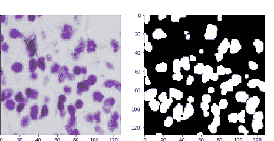
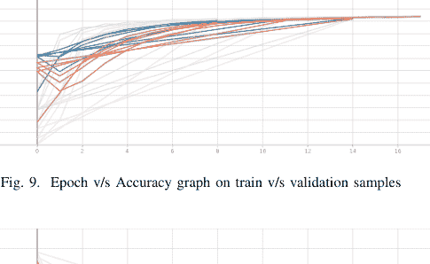
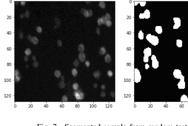
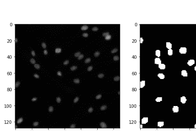

# 2020 高级通信技术与信号处理 (ACTS) (印度西尔恰 2020.12.4-2020.12.6)

Rahul Pandey*

信息技术系

米佐拉姆大学

印度，米佐拉姆

ra.pan.91294@gmail.com

R. Lachchhima

信息技术系

米佐拉姆大学

印度，米佐拉姆

mzut145@mzu.edu.in

Ksh. Robert Singh

电气工程系

米佐拉姆大学

印度，米佐拉姆

mzut158@mzu.edu.in

**摘要**— 语义分割受益于深度学习技术的进步。图像分割对于医学领域的应用和研究领域识别来说是一项巨大的福音，可以提取出器官受感染部位的病变。通过对来自 MRI、CT 等医疗设备拍摄的受感染器官医学图像中的细胞图像进行研究，不仅可以提供治疗，还能让研究人员开发此类疾病的疫苗。本研究旨在通过使用不同的超参数来训练模型，使网络学会自动分割来自数据库的医学图像。分割是在遇到任何其他问题（如细胞核检测和分类）之前的关键问题。本研究还通过评估矩阵查看了网络的性能。

图 1. 常染色体多性囊性肾疾病的语义分割 [4]。

**索引术**— 深度学习；神经网络；语义分割；细胞单元；医学图像分割；应用 U-Net。

## I. 引言

分割涉及将图像（或视频帧）划分为不同的段，并将它们分配给具有相似的像素级对比度 [1]–3。特别是，语义分割是为给定样本中的每个像素分配颜色的任务，通常代表两个区域，即背景和物体。语义分割将不同感兴趣的“区域”相似性聚类视为一个单一单元。分割是图像计算和视觉的一个关键领域，应用于感知、粘接、检查、图像/视频压缩等许多领域。例如，医学中的语义分割 [4]。

随着现代技术（如以神经网络为基础的深度学习）的发展，已经开发出各种架构来实现分割（在我们的案例中是语义分割）。深度学习在执行语义分割方面有了显著提高，并促进了卓越水平的输出。一些广为人知的深度学习架构有 `CNN`、`FCN`、`U-Net`、`VNet`、`GoogleNet`、`ResNet-18` 等。

### B. 深度网络

从根本上说，深度学习是机器学习的一个子集，而机器学习又是人工智能的一个子集，如图1所示。深度神经网络基本上代表具有深层的人工神经网络，灵感来自人类大脑中从过去样本数据学习的神经元。深度学习算法反复更新任务，每次都调优以增强输出。

| 人工智能 |
| :--- |
| 机器学习 |
| 深度学习 |

图 2. 深度学习的关系。机器学习与人工智能。

在过去的几年里，深度卷积网络在视觉识别任务中的表现优于“先进水平”，例如 [6] [7]。虽然卷积网络已经存在很长时间，但它们的成功受限于可用训练集的大小和网络。由于在具有 100 万张训练图像的 `ImageNet` 数据集上对具有 8 层和数百万个参数的大型网络进行监督学习，实现了突破。自此，已经训练了更大、更深的网络。

## II. 现有技术

基于深度学习的语义分割方法的“未来感”模型是编码器-解码器和 `FCN` 架构的适应，它们之间有一些共同点，例如使用编码器和跳跃连接。跳跃连接已被证明在精炼目标对象的细粒度特征方面令人印象深刻，能够在复杂的样本上生成微小细节的语义标签 [8]–10]。

### A. FCN 语义分割模型

2015 年，提出了使用 `FCN` 进行语义分割的深度网络方法 [8]。广泛使用的卷积如 `VGG16` 和 `GoogleNet` 架构通过使用全卷积上采样来代替全连接层进行了修改。通过从像素逐点传播实现了甚至彻理解的像素分辨率输出。从最终层开始，使用跳跃连接对图进行上采样，并与之前的层图拼接。来自深层和粗糙层的语义空间细节与来自浅层和细微层的高分辨率特征细节相结合，以获得高精度的精确分割 [9]。

图 4. SegNet: 编码器-解码器模型 [5]。

### B. 用于语义分割的编码器-解码器

基于深度学习的语义分割方法的“未来感”模型是编码器-解码器和 `FCN` 架构的适应，它们之间有一些共同点，例如使用编码器和跳跃连接。跳跃连接已被证明在精炼目标对象的细粒度特征方面令人印象深刻，能够在复杂的样本上生成微小细节的语义标签 [8]–10]。

### C. 用于语义分割的 U-Net

2015 年，提出了 `U-Net` 模型以为了研究目的积极分割生物显微样本。为了高效地理解图像样本，其架构和训练策略取决于数据增强问题。`FCN` 中的网络由任务、检测和与准确定位表达相关的捕获任务组成。在网络深度上，考虑以 `VGG16` 模型为基础，其特征图质量随空间分辨率的增加而提高。像素密度降低 32 倍也是 `U-Net` 的特征之一。

图 3. FCN 模型语义分割。

图 5. U-Net 架构。

## IV. 实验结果与分析

我们实验使用的数据集取自互联网上的一个公开数据库。该数据集作为医学图像问题挑战的一部分，在 2018 年数据科学挑战赛中上传到 `Kaggle`。我们一直在自动识别数据集图像中的细胞核，以促进医学分割 [45]。为此，我们使用了这些图像对给定样本中的细胞核进行分割。

### 表 IV

### UNET 模型中的实验残差。

| 网络名称 | 年份 | 格式 | 感兴趣区域 |
| --- | --- | --- | --- |
| CE-Net [38] | 2019 | CT, 内窥镜 | 肺、视网膜、视神经盘 |
| MultiResUNet [39] | 2019 | MRI, 内窥镜 | 肿瘤（大脑） |
| DRUNet [28] | 2019 | MRI | 肿瘤（大脑）骨肉肉瘤（大脑） |
| ResUNet [40] | 2019 | MRI | |
| FC-ResNet [41] | 2017 | CT | 前列腺、肝脏、神经结构 |

#### A. 原始数据预处理

数据集的预处理分为以下两个部分进行：

- 首先，所有训练和测试图像均被缩调整为 `128x128`，因为数据集包含不同尺寸的图像。
- 其次，每个图像的所有掩码（`mask`）被合并/压缩为包含所有细胞核的单个掩码图像。每个测试图像具有相同的大小。

在表 VI 中，列出了网络中的训练样本总数、验证样本、网络的可训练参数和不可训练参数。

#### E. 密集与空洞技术

2017 年，[35] 提出了 `DenseNet`，其具有获取信息和梯度流的技术。目前，通过重复检查去混乱梯度并使用 `DenseNet` 减少特征计数不仅是巨大的。[40] 针对肿瘤和肝脏样本分割建议了高密度连接。`H-DenseNet` 继承了密集连接路径和 U 型网络 [15] 的特征边缘。2015 年，[42] 空洞卷积最初被引入分割开始。传统的 `CNN` 在给定样本上采用池化和卷积，这可能会收缩其维度并在卷积操作期间扩大感受野。在样本维度剪枝和扩展期间，使用空洞收缩和扩张对细节侵蚀的信息得以通过。它扩大了视野大小，使得每次卷积都能预测更大范围的特征。使用空洞卷积的分割模型通过样本和精细架构 [44] 使用空洞卷积作为网络的输入卷积，其性能在几乎所有使用的实验中都优于原始架构。

### 表 VI

### 样本可用参数数量

| 训练样本 | 验证样本 | 参数 | 训练参数 | 训练参数（重复项） |
| --- | --- | --- | --- | --- |
| 603 | 67 | 1,415 | 1,415 | 0 |

### 表 V

### UNET 模型中的密集与空洞技术。

| 网络名称 | 年份 | 格式 | 感兴趣区域 |
| --- | --- | --- | --- |
| Dense-Net [48] | 2018 | MRI | 肿瘤（大脑） |
| MR-CNN [49] | 2019 | MRI | 胰腺缺血 |
| DenseNet [42] | 2019 | MRI | 肿瘤（大脑） |
| DRINet [43] | 2019 | MRICT | 肿瘤（大脑），脑脊液 (CSF) |
| CSAU [44] | 2019 | 眼底 | 视网膜（眼） |
| RA-UNet [15] | 2019 | CT | 肿瘤（肝脏） |

#### B. 每个 epoch 训练的结果

以下是调优的 `UNet` 模型分割期间每个 epoch 的对应值。对于每个 epoch，均计算了损失（`Loss`）、准确率（`Accuracy`）、验证损失（`Validation Loss`）。从表 VII 可以看出：随着 epoch 总数的增加，验证损失在减少，同时准确率值在不断增加。一旦可训练模型停止在验证损失值上显示改进，将终止训练。

通过整合残差块和 U 形状来实现医学分割集成。[37] 将残差块嵌入 U 型网络中以提取特征。不同种类的残差块可以从部门中捕更大的映射。

### 表 VII

### 每个 epoch 的损失、准确率、验证损失和验证准确率

| Epoch | 准确率 | 验证损失 | 验证准确率 |
| --- | --- | --- | --- |
| 1 | 0.5218 | 0.7705 | 0.2986 | 0.8162 |
| 2 | 0.3276 | 0.8254 | 0.1953 | 0.8237 |
| 3 | 0.2077 | 0.9024 | 0.1131 | 0.9458 |
| 4 | 0.1457 | 0.9476 | 0.1131 | 0.9553 |
| 5 | 0.1750 | 0.9548 | 0.1127 | 0.9548 |
| 6 | 0.1255 | 0.9523 | 0.1101 | 0.9568 |
| 7 | 0.1098 | 0.9590 | 0.1073 | 0.9610 |
| 8 | 0.1077 | 0.9589 | 0.1058 | 0.9638 |
| 9 | 0.0999 | 0.9625 | 0.1026 | 0.9610 |
| 10 | 0.1006 | 0.9624 | 0.1023 | 0.9660 |
| 11 | 0.0965 | 0.9639 | 0.0956 | 0.9667 |
| 12 | 0.0924 | 0.9651 | 0.0883 | 0.9658 |
| 13 | 0.0895 | 0.9660 | 0.0858 | 0.9664 |
| 14 | 0.0887 | 0.9663 | 0.0845 | 0.9667 |
| 15 | 0.0867 | 0.9668 | 0.0884 | 0.9667 |
| 16 | 0.0862 | 0.9672 | 0.0793 | 0.9678 |
| 17 | 0.0883 | 0.9670 | 0.0815 | 0.9676 |
| 18 | 0.0823 | 0.9683 | 0.0883 | 0.9680 |

#### C. 分割结果

从测试集和验证集中随机选择了图像，并通过训练模型进行语义分割。图 7 & 8 显示了从输入样本处理的分割图像。

图：9 & 10，红色和蓝色曲线代表了从训练和验证过程的数据。

## V. 结论

语义分割是计算机视觉应用中备受关注的主题，部署在目标检测、自动驾驶、医学成像和物体识别等各种应用中。有效的分割技术取决于用户输入的参数，如优化器、激活函数以及 UNet 模型对输入图像的预处理和调优。本文提出的方法在准确率方面成功实现了更精细的分割。

## 参考文献

- [1] S. Slansky, "图像分割与特征提取," IEEE Transactions on Systems, Man, and Cybernetics, vol. 8, no. 4, p. 237-247, 1980.
- [2] D. P. Panda and A. Rosenfeld, "通过像素分类图像分割," IEEE Transactions on computers, no. 9, p. 175-180, 1979.
- [3] W. Petick, "使用边缘分割分割," IEEE Transactions on Pattern Analysis and Machine Learning, no. 1, p. 8-13, 1999.
- [4] V. Vrilakova, A. Buransetti, G. Cascarano, F. Sace, M. Moschella, and L. Urban, "基于立体摄像头的自动驾驶任务两种深度学习架构比较," BMC Med. Inf., vol. 19, no. 9, p. 244. [在线]. https://doi.org/10.1186/s12913-019-0988
- [5] L. Liu and J. Zhao, "新一代深度学习综述," IEEE Access, vol. 7, p. 172-200, 2019.
- [6] R. Risch, J. Donahue, T. Darrell, and J. Malik, "用于检测和语义分割的丰富层次结构," IEEE计算机视觉与模式识别会议论文，pp. 650–657.
- [7] Y. Leun, C. Boser, S. Denker, E. Wahba, and L. Kan, "反向传播应用于手写数字," Neural computation, vol. 4, pp. 541–551, 1989.
- [8] J. Long, E. Shelhamer, and T. Darrell, "用于语义分割的全卷积网络," IEEE计算机视觉与模式识别会议论文，pp. 3431–3440, 2015.
- [9] A. Ben-Cohen, I. Daniel, K. Matiagi, and H. Greenfield, "自由形式检测," 深度学习和医学应用数据标记。Spring, pp. 67–78.
- [10] O. Ronneberger and A. Brox, "U-Net：用于生物医学图像分割的卷积网络," 医学成像与计算机辅助干国际会议，Springer，2015.
- [11] D. Ortiz and R. Merlin, "集成方法：一项实证研究," 人工智能研究期刊，vol. 12, pp. 169–198, 2009.
- [12] Y. Han and C. Chen, "使用深度卷积网络的语义分割：空间到vct的应用," IEEE医学成像汇刊，vol. 36, no. 6, 2019.
- [13] I. Sutevernik and O. Vsky, "带有神经网络和注意力机制的序列序列学习," 神经处理系统进展，2014.
- [14] J. Zhang, A. Shao, Z. Zhu, and A. Mazuraka, "用于 MRI 肿瘤自然分割的层次卷积网络," 医学图像分析，vol. 38, pp. 2663–2674, 2018.
- [15] F. Hu, J. Zhou, X. Du, K. Wang, and X. Cao, "用于医学图像分割和极化的联合深度学习," IEEE医学成像汇刊，vol. 37, no. 7, pp. 1597–1608, 2018.
- [16] H. Chen, S. Sun, S. Patel, and C. Meyer, "使用 3D U-nets 进行脑分割以及所提结果的总体验证," 计算神经科学，vol. 4, pp. 25–32, 2017.
- [17] S. Kumar, C. Joshi, A. Roy, and N. Navaugh, "用于分割的全自动深度学习," 2018第15届国际医学研讨会(ISB)，pp. 148–153.
