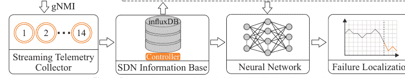
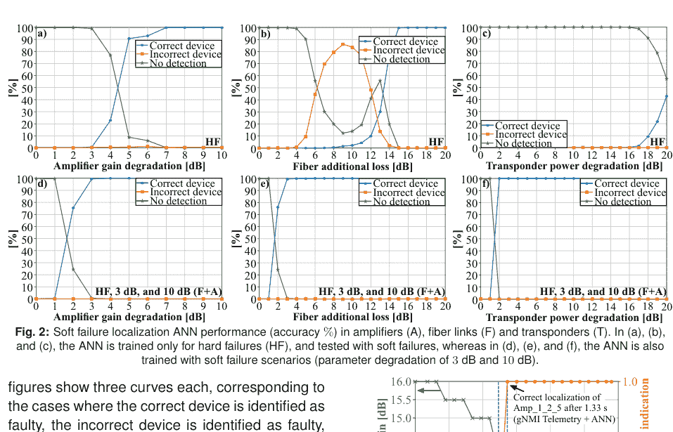
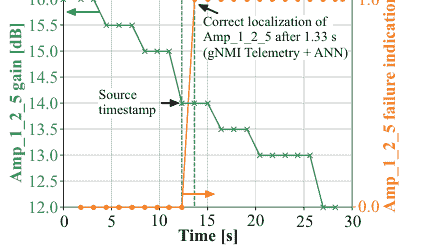

# 2020欧洲光通信会议 (ECOC)(布鲁塞尔，比利时 2020.12.6-2020.12.10) 2020欧洲光通信会议 (ECOC) ｜｜ 基于机器学习的软故障定位

Kayol S. Mayer(1*), Jonathan Soares(1), Rossano P. Pinto(2), Christian E. Rotenberg(2), Dalton S. Arantes(1), 和 Darli A. Mello(1)

(1) DECOM, DCA, 卡皮纳大学, 404 Albert Einstein Ave., Campinas, 13083-52, SP, Brazil.
(*) kayol@decom.unicamp.br

针对软故障（soft failure）定位，我们提出了一种利用 SDN 全网参数流式遥测的机器学习方法。该人工神经网络只需要少数场景即可达到良好的插值性能。在仿真的 FSNet 拓扑中通过 gNMI 遥测对该实现进行了验证。

## 引言

机器学习（ML）技术日益越来越多地用于解决运营型网络中的若干问题 [1][2]。其中，故障管理是最紧迫的问题之一。近期，应对软故障 [3][4] 已成为一个活跃的研究方向。软故障是指那些导致网络参数发生识别的退化，但不会触发告警并中断服务。在某些情况下，软故障可能会演变为硬故障。因此，软故障定位持续有助于避免服务中断和潜在的设备维修。

目前已提出了多种方法来解决软故障管理。Barzeg 等人 [5] 通过监控现有光路的性能来检测异常并定位故障。Vela 等人 [6] 通过监控光纤分析仪和测试通道，在调试和光路运行期间识别软故障。我们等人 [7] 提出了一种基于卷积网络和接收机 DSP 的软故障识别方案。Shahkarani 等人 [8] 通过监控误码率（BER）识别实验链路中的软故障。Varughese 等人 [9] 通过应用软开关识别软故障类型。我们解决的是定位问题 [3]。软故障（例如增益衰减的放大器）最终可能会触发网络串级终端的异常，并在全网范围内 [14] 定位该故障。近期基于数据的驱动 SDN 光网络 [12][15] 能够收集由大量潜在网络元素（如收发器和放大器）生成的监控参数，并利用指标 [16][17] 处理海量监控数据。

在本文中，我们提出了一种通过人工神经网络（ANN）定位软故障的方法，该网络应用于基于 SDN 的 gNMI [16] 流式遥测架构收集的全网参数。我们在大规模仿真网络场景中实验性地验证了所提出的框架。

## 全网软故障定位

图 1 展示了所提出的框架。故障工作流从创建当前 SDN 状态快开始，包括网络状态、拓扑、路由路径和遥测数据（TD）。信息被发送到故障仿真机，产生考虑网络中任何可能故障场景的 TD，以训练用于定位的 ANN。每当网络拓扑发生变化时，必须执行此训练过程。元素向 SDN 控制器流式遥测（使用 gNMI 协议，一种 gRPC 服务）。ST 处理并将收集的数据存储在 InfluxDB 时序数据中。ANN 持续从 InfluxDB 获取 TD，以有效且及时地定位潜在故障。标准的 OpenConfig/YANG 模型用于交换消息和维护 SDN 信息。

### NSFNet

### 训练流水线

### 系统参数

| 参数 | 数值 |
| --- | --- |
| 启动功率 | -1 dBm |
| 线路内前放大 | 10 [dB] |
| 后级放大 | 5 [dB] |
| 放大器本底 | 6 dB |
| NSC 衰减 | - |
| 分路器衰减 | 2 dB/1 |

图 1：所提出的网络软故障定位框架。

## 评估设置

**拓扑与流量生成。** 所提出的软故障定位机制在 14 节点 NSFNet [19] 上运行，假设为静态场景。在我们的案例中，生成 4.8 THz 光链路的 0.2 dB/km 衰减，除最后一段外的源模式和带宽。我们使用 Dijkstra 算法 [20] 执行路由，并使用波长首次拟合算法 [21]。我们接受 1000 个业务需求，总计 380 km 的跨段，对于 0.2 dB 的容量是短的。最终拓扑具有 581 个跨段，包含 536 个线路放大器、44 个前放大器和 44 个功率器。我们使用用于光通道监控器（OCM）和波长选择开关（WSS）的可配置直插复用器。控制环确保 -1 dB 的功率。772 个收发器支持双向连接。系统参数总结在图 1 中，其中 $N$ 是节点度，$L$ 是纤长。

**监控数据。** 仿真流量生成具有 3064 个监控参数。在放大器中，我们监控 2248 输入和输出的光噪比（OSNR），假设可以从前向纠错（FEC）估计比特率（BER）。我们使用 972 个收发器、624 个放大器和 580 个单向跨段。

**遥测设置。** 我们假设下游网络节点从放大器收集 TD。发射器和放大器的监控数据通过遥测服务器流传输。作为 gNMI，14 个节点流嵌入 InfluxDB 的 SDN 信息。ANN 模块处理 TD 以更新故障设备。

## 故障定位结果

**ANN 设计与训练。** 故障定位由由 3 层组成的 ANN 执行 [25]。第一层有 564 个输入（对应所有收集的 TD），隐藏层有 1000 个神经元，输出层有 978 个带有 激活函数的非线性神经元，控制所有可能故障的网络元素。输入端应用归一化 [23] 以提高数值稳定性。输出之和代表故障元素故障的概率。我们使用分类损失函数处理 ANN 输出。Adam 的自适应方法 [24] 应用反向传播过程。如果输出超过 0.5，则识别该网络元素。训练在 x86 服务器（Intel Xeon Silver 411 CPU @2.2 GHz，46GB RAM 和10 核）上进行。

**硬故障。** 我们首先训练硬故障，即传输功率等于 0 W、光链路衰减变为无穷大或放大器增益等于 0 dB。经过 12 次训练周期（30 min ANN），ANN 算法达到了 99.75% 的分类准确率。训练阶段后，我们测试 ANN 以分析软故障。结果所示如图 2a、2b 和 2c。

显示了三条曲线，分别对应正确识别为故障、错误识别为故障以及未识别出故障的情况。图 2 显示，如果放大器增益衰减超过 5 dB，ANN 能够以超过50%的比例正确识别故障放大器。错误检测的概率为零。图 2b 表示，在光纤软链路（a）6 dB 损失下，高概率识别为错误设备。图 2c 显示了减少放大器输出功率的软故障结果。显然，ANN 只能定位对应高损失的软故障。图 2b 和 2c 显示，训练硬故障不足以定位软故障。

**软故障定位。** 为了克服观察到的局限性，我们训练 ANN 定位某些软故障：(i) 放大器增益衰减 3 dB 和 10 dB，(ii) 收发器功率衰减 3 dB，以及 (iii) 光纤衰减 3 dB。同样，在 120 次迭代（min 数据集）后，ANN 实现了 99.5% 的正确准确率。图 2d、2e 和 2f 显示了针对这些软故障场景训练的 ANN 的性能。图 2d 显示 ANN 正确识别了放大器衰减大于 3 dB 的所有软故障。图 2e 也显示它定位了光纤链路引起大于 3 dB 的所有软故障。同样，图 2f 显示，当收发器功率大于 2 dB 时，所有收发器都被正确定位。

**仿真结果。** 图 3 展示了在仿真环境中实现的软故障定位框架的结果。我们在连接 SDN 节点 1 和 2 的链路第 5 个节点中仿真了增益衰减，标值为 16 dB，并忽略了传播延迟。带有叉号的绿线显示链路中的时间。橙色线显示了遥测和数据库处理后 ANN 的输出。当放大器增益为 14 dB 时，实现了软故障定位。整个遥测流、数据库处理和 ANN 处理过程耗时小于 1.4 秒。

结论。获得的结果表明，在硬故障和软故障场景下训练 ANN 进行软故障定位具有良好的性能。实现环境的性能洞察表明性能是合适的。

## 参考文献

- [1] F. Khan, Q. Fan, C. Lu, and A. P. T. Lu, "基于机器学习的光纤通信服务及其应用," Journal of Lightweight Technology, vol. 37, no. 2, pp. 493–516, 2021.
- [2] F. Musmann, C. Roberts, A. Nag, I. Macaluso, D. Zibar, R. Muffini, and M. Tornatore, "光网络中机器学习技术综述," IEEE Communications Surveys & Tutorials, vol. 23, no. 2, pp. 1180–1203, 2021.
- [3] F. Musmann, C. Roberts, G. Gorani, S. Shakahari, F. Cini, and M. Tornatore, "光网络管理中的机器学习教程," Journal of Lightweight Technology, vol. 37, no. 16, pp. 4125–4139, 2019.
- [4] N. Gu, L. Li, X. Liang, S. Bose, and G. Shen, "如果 AI 失败：光网络中对抗攻击的防御," 2020 IEEE Optical Fiber Communications and Exhibition (OFC), 2020.
- [5] S. Bargazer, V. Merilli, U. Ferrai, A. Napoli, V. Curri, and L. Lasso, "解构网络中的软定位与设备工作参数," in 2021 IEEE Optical Fiber Communications and Exhibition (OFC), 2021, pp. 1–6.
- [6] A. P. Bela, V. Shakahari, R. Muffini, F. Cini, A. Castelli, L. R. Roetti, P. Casalella, S. J. Basto, and Y. Luo, "光网络识别与拓扑的软定位," IEEE/OSA Journal of Optical Communications and Networking, vol. 37, no. 1, AZE26–AZE236, 2020.
- [7] H. Liu, F. Xu, Y. Liu, W. Yi, and C. Zhuge, "基于稠密卷积神经网络的光通信系统软故障识别," Journal of Lightweight Technology, vol. 38, no. 4, pp. 2995–3006, 2020.
- [8] S. Shakahari, F. Musmann, F. Cini, and M. Tornatore, "光网络中基于机器学习的软故障检测与识别," in 2018 IEEE Optical Fiber Communications and Exhibition (OFC), 2018, pp. 1–6.
- [9] S. Varausegge, D. Liptak, R. Ticher, S. Sibelius, and E. Raj, "使用复杂度异常检测识别光纤链路中的软故障," Optical Fiber Communications and Exhibition (OFC), 2019, pp. 1–6.
- [10] L. Shu, Z. Yu, J. Zhang, J. Shu, and K. Ku, "利用光谱信息的线性光网络双点软故障检测与识别," Journal of Lightweight Technology, vol. 38, no. 5, pp. 1988–1999, 2020.
- [11] Z. Liu, M. Zhang, D. Wang, G. Song, M. Liu, J. Li, L. Lou, and Z. Liu, "光网络中使用机器学习和时间序列进行故障预测," Opt. Express. vol. 25, no. 16, pp. 18553–18566, 2017.
- [12] D. Rafiefer, S. Tychonowicz, H. Grieber, A. Autterhoff, and J. Chen, "光网络故障管理的认知保障架构," Journal of Lightweight Technology, vol. 36, no. 7, pp. 1443–1450, 2018.
- [13] T. Panayotou, S. P. Chataris, and G. Elias, "利用机器学习解决光网络故障定位问题," IEEE/OSA Journal of Optical Communications and Networking, vol. 10, no. 3, pp. 162–173, 2018.
- [14] T. Pan, E. Song, J. Jia, W. Cao, and T. Huang, "无探头的轻量级网络遥测," in 2020 INFOCOM, pp. 2–3.
- [15] A. Shyagar, A. Mercian, M. McGary, M. Reinstein, and W. Keller, "软件定义光网络 (SDNs)," IEEE Communications Surveys & Tutorials, vol. 18, no. 4, pp. 2738–2788, 2016.
- [16] Y. Zhou, L. Xu, X. Zhang, G. Zheng, and Y. Sun, "基于机器学习的软件定义网络应用综述," IEEE Access, vol. 7, pp. 95417–95419, 2019.
- [17] 未来网络机器学习框架 ITU-2020, ITU-International Communications Union, Tech Rep.
- [18] A. Sadadasivaro, S. Sayed, D. Panda, P. Gomes, R. Raj, L. Prashasti, and K. Raj, "用于 DWDM 分析与验证的时域光纤监控," in 2020 IEEE Optical Fiber Communications and Exhibition (OFC), pp. 1–6.
- [19] H. Chen, Y. Zhou, J. Zhang, W. Wang, and R. Zhu, "弹性光网络中碎片化流量的静态路由与频谱分配," IEEE Networks, vol. 35, no. 5, pp. 1045–1052, 2021.
- [20] I. Kath and D. Medis, "MPLS/ON-over-DWDM 多层网络容量优化：启发式算法与理论," IEEE Transactions on Network and Service Management, vol. 14, no. 3, pp. 340–365, 2007.
- [21] Y. Xiao, J. Zhang, Z. Gao, and Y. Li, "5G/融合无线网络中基于强化学习的服务型 DU 放置," IEEE Optical Fiber Communications and Exhibition (OFC), Mar. 2020, pp. 1–6.
- [22] M. Solintakiani, A. Jamavard, and J. Lee, "被动光神经网络部署优化的理论洞解," IEEE Transactions on Information Theory, vol. 65, no. 2, pp. 742–769, 2019.
- [23] A. Jain, K. Kandakumar, and A. Ross, "多模态生物识别系统中的评分归一化模式," Pattern Recognition, vol. 38, no. 12, pp. 22770–2285, 2005.
- [24] D. P. King and L. Ba, "一种随机优化方法," in International Conference on Learning Representations (ICLR) 2015, pp. 1–15.

