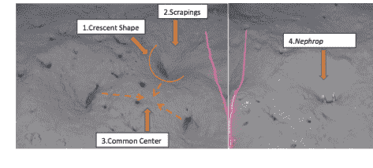
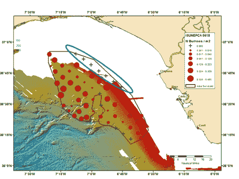
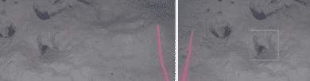
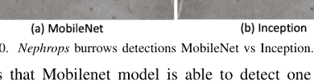
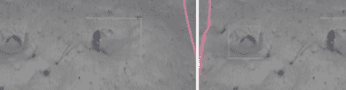

# 2020全球无线与光学技术会议 (GCWOT)（西班牙马拉加 2020.10.6-2020.10.8） 2020全球无线与光学技术会议 (GCWOT) ｜｜ N 的自动检测

**作者：**
Atif Naseer, Enrique Navo Barro, Sultan Daud Khan, Yolanda Vila Gordillo

**单位：**
ETSI Telecomunicaciones, 马拉加大学, 西班牙，马拉加
ETSI Telecomunicaciones, 马德里大学, 西班牙，马德里
计算机科学系, 国家技术大学, 巴基斯坦，伊斯兰堡
Español de Oceanografía, 加迪斯海洋中心, 西班牙，加迪斯

**邮箱：**
atif@uma.es, en@um.es, sultandaud@nutech.edu, yolanda.vila@leo.es

**摘要—** 科学家使用高清摄像头的水下作业器高效、准确地捕捉水下视频。加迪斯湾挪波虾（Nephrops）穴的丰富程度基于对它们水下栖息穴的计数。海洋研究所（IEO）每年进行一次水下调查，以估计深海挪波虾密度，标准误差小于20%。目前，挪波虾穴的识别和计数是人工完成的，这非常枯燥且耗时。计算机视觉和深度学习可以帮助在目标的检测和分类上节省数日。

浑浊度或物种的运动使其成为一项挑战 [2]。两个主要因素增加了难度：不受限制的自然环境以及内容的变化，这些变化可能源于照明、比例和非刚性变形 [3]。

挪波虾（*Nephrops norvegicus*）是欧洲主要的海洋甲壳类动物之一 [4]。加迪斯湾挪波虾的年产量虽小于大西洋挪波虾种群（2008年约为100吨），但对船队具有很高的价值 [5]。图1显示了一个挪波虾个体。该物种占据了深度200米到700米的沙质底部 [6]，那里的沉积物适合它们构筑洞穴。

所提出的系统引入了一种基于深度学习的方法来分类挪波虾穴。该工作使用`Faster RCNN`模型、`Inception2`和`MobileNet v2`进行目标检测和分类。通过测试使用不同数量的训练图像来评估所提性能。RCNN的平均平均精度超过75%，而MobileNet为64%。结果显示了Faster和MobileNet的检测情况，以及对未检测到穴的真阳性和假阳性检测分类。

**关键词—** `Faster RCNN`，计算机视觉，*Nephrops norvegicus* 种群评估，水下视频分类。

# I. 引言

水下分析的研究非常广泛，其在不同领域具有巨大的应用价值，例如水下生物多样性和底部地貌、管道和电缆网络、矿产开采，以及动植物识别，其中珊瑚检测和礁石分类问题是水下图像分析中最热门的任务。然而，环境特征如底物颜色变化和浑浊度或物种的运动使其成为一项挑战 [2]。两个主要因素增加了难度：不受限制的自然环境以及内容的变化，这些变化可能源于照明、比例和非刚性变形 [3]。

挪波虾穴通常有多个通往不同隧道的开口，这些隧道相互相通，被称为挪波虾穴系统。一个经过评估的个体占据一个洞穴系统 [7]。洞穴显示出与图2所示的挪波虾相似的各种特征，并可以总结为：

1) 至少有一个洞穴呈特殊的半月形。
2) 有其他排出的沉积物证据，通常在隧道开口处呈宽的“扇形”，且足迹通常清晰。
3) 所有开口洞穴的中心都有一个凸起结构。
4) 可能存在挪波虾（在洞穴内或外）。

人工智能（AI）和计算机视觉（CV）的进步有助于海洋物种的分类和检测。在检测和分类挪波虾穴方面，CV和AI起着至关重要的作用，因为它改进了分类和检测。我们利用最先进的`RCNN`深度学习算法来识别加迪斯湾海底视频中的挪波虾。这项工作的目标是使用深度学习模型来检测、计数和分类挪波虾穴，并使用先进的`Faster RCNN`模型进行目标检测和分类。



论文的其余部分如下：数据描述在第2节讨论。研究方法在第3节进行说明。实验细节和结果在第4节讨论。最后，结论在第6节。

图2. 挪波虾穴特征

# II. 数据描述

用于监测挪波虾种群丰富性的水下遥测（UTW）系统于90年代初在苏格兰领先。利用UTW系统开发挪波虾可以识别并量化挪波虾区域的穴密度，这可以作为种群指数 [5]。自2016年以来，使用挪UTW系统的种群数量增加，预计将对18处挪波虾进行调查。

### A. 水下环境

与其他数据相比，水下数据面临许多挑战。由于光线穿过水层时表现不利，它无法吸收或反射海面，导致图像产生模糊效果。由于采集的数据量巨大，图像设备设计为低分辨率。此外，散射和不均匀的光线使得环境数据采集更具挑战性，因为目标是尽可能接近洞穴。可见度是水下环境中的关注点。当前的洋流是另一个导致浑浊的因素。

西班牙地理研究所自2014年以来一直进行UTW调查。这些专注于加迪斯湾挪波虾的合适栖息地。配备高品质摄像头的拖曳在船上移动并录制10分钟的视频。目前，挪波虾穴通过水下视频进行计数。每段视频都由专家人工审核，这使得这项工作耗时且耗费大量人力资源。目前没有系统可以帮助解决挪波虾人工检测和计数的问题。

### B. 研究区域和数据收集

研究区域位于西班牙南部的加迪斯湾。这项工作是在于2018年6月2日至14期间进行的`ISUNPECA_0618` UTW调查期间获得的。调查设计遵循随机等距网格，设有4个采样点。位点深度在0到650米之间，覆盖了300平方公里的区域。图3显示了加迪斯湾地图，以及2018年位于`ISUNPECA_0618`的站点，使用计数法测量挪波虾穴密度。

Durden等人 [2008] 证明，即使对于高底栖生物也无法获得100%的准确率。挪波虾穴的数量会变化，因为它取决于疲劳、压力和其他因素。这些变化导致了错误的分类和检测，这是海洋生态采样中的一个瓶颈 [9]。目标检测对于研究领域来说非常新，挑战使得该任务与其他目标检测和分类不同。水下图像分析有许多名称，例如水下目标识别 [10]、海底识别 [11] 以及水下图像处理或视觉内容识别 [12]。

视频使用4k高清（UHD）相机（索尼 HandyCam HDR-XR33AX）录制，配有蔡司/Var-Smart2.8mm及10倍光学变焦。相机安装在侧面顶部，与海底成45度角。使用了具有光质良好的四个独立强度控制光点的视频。设备还带有两个间距7厘米的激光固定在视野内，使用3V & 2400 mAh（480瓦）电池为整个设备供电。使用`HiPAM`传输器跟踪每条轨迹的拖曳位置。



### C. 数据特征

每幅图像的分辨率为 `3840 x 2160` 像素。某些帧质量很低且可见度差，这些帧被舍弃。数据为 `jpeg` 格式。

# III. 研究方法论

### A. 数据准备

1) **数据采集**：视频在良好的光照条件下以每秒 25 帧的速度录制。站点录制了每段 10-12 分钟的视频素材。其中，仅选择了七个光照条件最佳、噪声较少、对比度高且挪波虾穴密度大的站点。这七个站点的数据被考虑用于标注。每段视频均为每秒 25 帧，长度为 10-12 分钟。来自 2018 年数据调查的不同站位总共记录了 105,000 帧。

2) **预处理**：从加迪斯收集的数据被转换为旋转后的帧。光照差且质量差的帧被舍弃，而信息相同的帧不包含在数据集中。在标注阶段，大多数图像不包含任何挪波虾信息。

3) **图像标注**：在此阶段对数据进行标注以记录真值（`ground truth`）标注。最初，来自 IEO 挪波虾穴研究的专家手动记录了虾穴。然后，使用 `Microsoft VOTT` 图像标注工具 [19] 对图像进行手动标记。保存的 `XML` 文件名包含类名（`Nephrops`）和每幅图像的边界框。图 4 显示了来自 `ISUNEPCA_0618` UWWT 调查的一个示例，该示例是使用 `Microsoft VOTT` 手动标注的。经过标注的图像由 IEO 的专家使用，用于记录 `ISUNEPCA_0618` UWWT 调查中每个站点的真值标注图像，这些图像被用于模型训练和测试。总共标注了 7 个站点，记录了 266 张标注图像。表 I 显示了加迪斯每个站点的真值图像，这些图像将用于模型训练和测试。从加迪斯数据集中使用了 7 个站点和 266 张标注图像，其中包含从视频文件中提取的一个或多个虾穴，并用于本项工作。

#### 表 I: ISUNEPCA_0618 选取站点的标注

| 站点 | 加迪斯数据集 |
|---|---|
| RF01 | 42 |
| RF03 | 75 |
| RF04 | 34 |
| RF05 | 31 |
| RF07 | 13 |
| RF09 | 36 |
| **总计** | **266** |

4) **训练数据集的准备**：为了使用深度模型，应将数据分为三个子集：训练集（`train`）、验证集（`validate`）和测试集（`test`）。表 II 显示了加迪斯数据集的分布。原始图像尺寸缩小到 `717x403` 像素，以降低模型训练的计算成本。

#### 表 II: 加迪斯数据集分布

| 加迪斯数据集 | 训练图像 | 验证图像 | 测试图像 |
|---|---|---|---|
| 数量 | 200 | 50 | 16 |
| 占比 | (75%) | (19%) | (6%) |
| **总图像数** | **266** | | |

### B. 模型训练

为了训练模型，我们使用了卷积神经网络（CNN）。我们没有训练自己的网络，而是使用迁移学习 [13] 来保留 TensorFlow 中的 `Faster R-CNN Inception V2` 模型 [14] 和 `MobileNet V2` 模型 [15]。我们在配备有 `NVIDIA TitanX GPU` 的 Linux 机器上进行了模型训练和验证。来自加迪斯数据集被用于训练。图像标注以 `XML` 格式转换为 TensorFlow (`TF`) 记录，记录在模型中用于训练。配置使用的参数为：`Inception-model`：类别数 2（用于挪波虾和背景），`MobileNet`：类别数 = 2（将挪波虾作为背景）以及 `L.2` 正则化：模型训练了 80k 步。

### C. 模型验证

一种方法的实用性取决于检测挪波虾的准确性。为此目的，精确率（Precision，P，称为正预测值）和召回率（Recall，R，也称为敏感性或真阳性率）是接收者工作特征曲线（ROC）方法中的指标，它们使用公式 1 和 2 计算：

```
P = TP / (TP + FP)
R = TP / (TP + FN)
```

其中 `TP`、`FP` 和 `FN` 分别表示真阳性、假阳性和假阴性的数量。真阳性是指模型正确检测到了挪波虾，而假阳性意味着检测到的挪波虾未被海洋生物学家标注，假阴性则意味着被标注的挪波虾未被模型检测到。此处不考虑真阴性（`TN`）情况，因为这会产生不一定重叠的边界框。

精确率的严谨程度取决于模型识别挪波虾存在的严谨程度，而召回率是模型检测到的总正性中真阳性的比例 [17]。为了量化挪波虾检测性能，我们使用公式 3 定义了精确率-召回率（PR）曲线。

### D. 模型性能



图 9. 鼠龙虾穴检测 MobileNet 对比 Inception。示例 1

与 Inception 模型（其以 99% 的置信度检测到所有三个正样本）相比，该模型无法检测到任何穴道系统。在最终考试中，我们需要更多来自加迪斯的数据，并使用来自其他国家的数据，这些数据在图像质量、视频采集程序和背景纹理方面存在差异。此外，我们将使用更多的目标检测方法来提高检测准确性。

# 致谢

感谢西班牙加的斯海洋研究所（Instituto Español de Oceanografía）为本研究提供数据。

# 参考文献

[1] K. Srividhya and M. Ramanya, "Accurate object recognition in the underwater environment using learning algorithms and texture features," Multimedia Tools and Applications, vol. 76, no. 24, pp. 25679-25695, 2019.

[2] T. Rimavicius and A. Gelinis, "A Comparison of the Deep Learning Methods for Solving Seabed Image Classification Tasks," Computer and Information Sciences, 12(3), 283, 2017.


[3] H. Qin, X. L. Zhixiang and M. Shang, "When analysis detects burrow: a vision at the beg of Cadiz," *OCEANS - 2021*.

[4] C. Bell, F. Richards and I. Tuck, "Lobsters: Biology, Management, Aquaculture and Fisheries," pp. 412-462, 2006.

[5] ICES, Report of the Working Group for the Bay of Cadiz and the Iberian Western Ocean (WGBIE), *ICES Oceanogr.*, 3-10 May 2018.

[6] J. Jordan, F. Bonello, and R. Roberts, "Objective methods for detecting multi-species fish in trawls waters of the Gulf of Cadiz," *Fisheries Research*, vol. 67, pp. 195-208, 2019.

[7] T. Wang and Y. Wei, "Introduction to deep learning course on Nephrous burrow identification (WGBIE), 2021.

[8] J. Durarden, B. Bett, T. Schonberg, K. Muller, N. Natkemmerich and H. Ruh, "Comparing image annotation data generated by multiple investigators for benthic ecology," *Marine Ecology Progress Series*, vol. 935, pp. 601-617, 2020.

[9] J. Durdens, I. Perez, A. Albu, B. Purser, B. De Smit, C. Dominguez-Carriello, C. Yeson, D. de Jorge and L. Lindsay, "Report on the Marine Imaging Journal, 2017.

[10] M. Montimniaz, S. Islam, M. Benammous and P. Lacey, "Deep Learning on Object Detection Method: A Survey," *Advanced Computer Vision and Image Systems*, 2020.

[11] A. Ahmoud, M. Benammous, A. Senij, S. Febel, S. Fhouhou, K. Renaev, G. Kennedy and R. Fisher, "Automatic annotation of coral reef using deep learning," *OCEANS 2016*.



**图 10. 鼠龙虾穴 MobileNet 对比 Inception。示例 2**

表明 `MobileNet` 模型能够以 98% 的置信度检测到任何鼠龙虾穴（总共三个中的一个），而相比之下，`Inception` 模型以 99% 的置信度检测到所有三个正样本：



**图 11. 鼠龙虾穴 MobileNet 对比 Inception。示例 3**

可视化结果清楚地显示 `Inception v2` 在精和准确性方面要好得多。由 `Inception` 训练的模型检测到的真正例（`True Positives`）比 `MobileNet` 多。结果的可视化有助于理解错误的性质并在未来的工作中进行改进。

## V. 结论与未来工作

海洋研究所（`Instituto de Oceanografía`）在鼠龙虾（`Nephrous lobster`）的识别和计数方面有极大的研究工作。在这项工作中，我们训练、验证并测试了目前先进的 `Faster RCNN v2` 和 `MobileNet v2` 用于鼠龙虾穴的检测与分类。我们展示了方法的定性结果。我们得出结论，`Inception` 模型在检测鼠龙虾穴方面远优于 `MobileNet`。在未来，我们计划使用

经授权用户许可使用：Carlos L. Carleton 于 2023/03/01 05:34:43 登录 `IEEE Xplore`。
